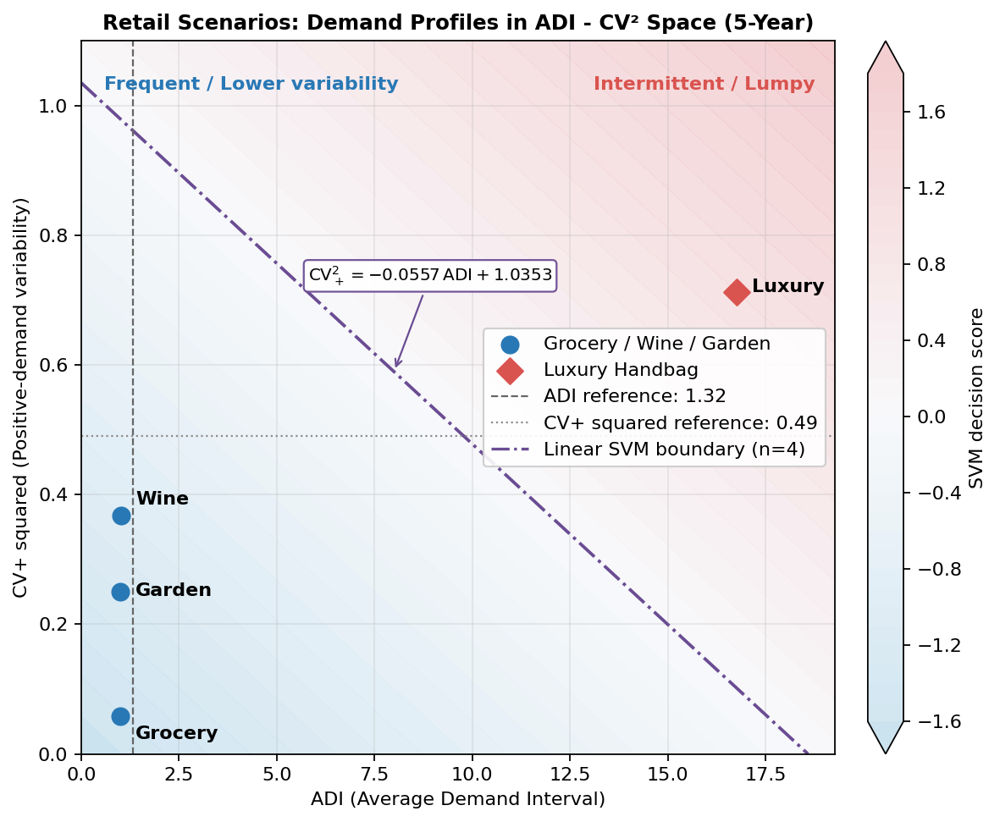
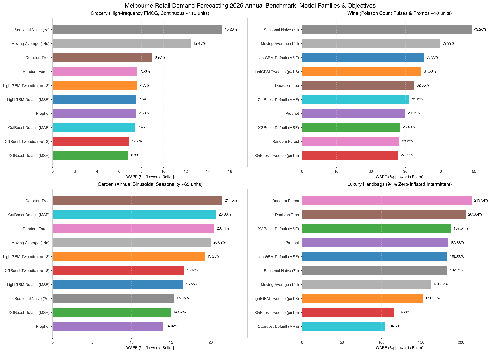

# Retail Demand Forecasting (零售需求预测教学与基准评测)

基于澳大利亚维多利亚州（VIC / 墨尔本）合成零售数据的可复现需求预测教程与多模型基准评测仓库。所有数据均为固定随机种子生成的教学合成数据，覆盖完整 5 年（2022-07-04 至 2027-06-27，共 260 完整周 / 1,820 天），用于受控检验不同预测模型在典型零售业务场景下的优势与局限，不代表任何真实企业经营数据。

## 📘 系列技术博客与报告 (Featured Blog Posts & Reports)

本仓库配套的技术博客与量化实证报告深度拆解了零售需求预测的建模机制、调参诊断、缺货去偏、Tweedie 损失函数与 52 周前向滑动窗口基准评测：

- **[零售需求预测 2026 零售周基准：52 周滑动窗口评测与 Tweedie 分布实践](docs/articles/2026-retail-demand-forecast-benchmark.md)**
  记录 V3 固定 24 周历史快照在 52 个完整零售周上的结果。该历史报告不等同于 V4 扩展历史主榜。
- **[2026 零售周 52 周前向滑动窗口技术验证报告](docs/reports/2026-annual-retail-forecast-benchmark.md)**
  保存 15 种模型及配置的 V3 历史证据；其不可变快照位于 `data/benchmarks/published/2026-retail-week-24w-v3/`。
- **[2026 零售周 V4 分阶段基准报告（第一阶段 + ARIMA）](docs/reports/2026-retail-week-v4-first-stage-report.md)**
  使用审核后的扩展历史主榜和生产式 104 周滚动实验，分开呈现工具包广度、配置深度与训练历史影响。
- **[Retail Demand Forecast V4 实验设计](docs/reports/experiment-design.md)**
  固化当前日粒度、13 × 4 周滚动回测、双训练历史、指标、发布契约与新模型接入边界。
- **[GBDT Tweedie 目标函数数学原理推导与实验报告](docs/reports/2026-11-03-gbdt-tweedie-validation-report.md)**  
  深入探讨指数离散族（Exponential Dispersion Family）、Compound Poisson-Gamma 分布的极大似然估计、一阶梯度与二阶 Hessian 推导及其在 LightGBM / XGBoost C++ 源码中的工程映射。
- **[零售需求预测实战：基于 Prophet 的建模、调参、诊断与局限性分析](https://cuicaihao.github.io/zh/posts/2026-10-01-prophet-retail-demand-forecast/)**  
  结合本仓库生成的四套合成零售数据，系统剖析 Prophet 的可加/可乘分解、VIC 州公共假日与促销回归项、缺货删失（Stockout Censoring）去偏、参数敏感性诊断，以及在脉冲促销与稀疏间歇需求下的结构性边界。

---

## 🛒 四大合成零售场景：本仓库的核心资产 (Synthetic Retail Scenarios)

本仓库最核心的学术与工程贡献，在于**抽象并严密实现了四个具有行业典型挑战的合成零售需求场景**（位于 `data/teaching/`，由 [scripts/generate_teaching_data.py](scripts/generate_teaching_data.py) 或 [notebooks/00-generate-teaching-data.ipynb](notebooks/00-generate-teaching-data.ipynb) 确定性生成）。每个场景代表现实供应链中不可回避的特定预测难题：

| 场景 | 数据文件 (`data/teaching/`) | 核心需求形态与业务机制 | 已知业务协变量 (Known Future Covariates) | 核心评测挑战与不可自愈陷阱 |
| :--- | :--- | :--- | :--- | :--- |
| **1. 商超日用杂货 (Grocery)** | `grocery_scenario_data.csv` | 高频连续消费 + 强周/年周期 | `is_open`, `is_closed_holiday`, `discount`, VIC 公共假日 | 随机缺货截断与闭店，检验**缺货删失（Censoring）去偏**能力 |
| **2. 红酒促销 (Wine)** | `wine_scenario_data.csv` | 泊松计数脉冲 | `promo_case_buy`, `is_party_event`, `is_december_peak` | 短时促销脉冲与年末峰值，检验非线性特征吸收能力 |
| **3. 庭院耗材 (Garden)** | `garden_scenario_data.csv` | 强年度正弦周期 + 周末效应 | `is_long_weekend_diy`, `is_end_of_autumn_clearance` | 冬夏跨季振幅与长周末叠加，检验跨年长周期先验 |
| **4. 奢侈品手袋 (Luxury)** | `luxury_scenario_data.csv` | 极端稀疏间歇性需求 | `is_saturday`, `is_sunday`, `is_december_peak`, `is_vip_event`, `discount` | 零膨胀序列，检验全零陷阱、需求事件识别与分位数校准 |

精确均值、零值率、ADI、CV² 和缺货天数由 `scenario_diagnostics.csv` 生成，并由 `generation_metadata.json` 记录哈希；README 不再复制一份可能漂移的统计值。



---

## 🏆 2026 零售周 52 周基准库 (2026 Retail-Week Benchmark Store)

当前使用声明式 **V4 周对齐前向滚动协议**。主榜与生产模拟实验使用相同测试 fold，但禁止交叉聚合：

- **主榜 `2026-retail-week-expanding-v4`**：每个预测起点使用此前全部可用历史；
- **生产模拟 `2026-retail-week-104w-rolling-v4`**：每个月使用此前最近 104 个完整周训练，预测随后 4 个完整周；
- **严格兼容性**：协议、数据哈希、场景、fold、forecast origin、有效标签集合和冻结参数必须全部一致；
- **发布分层**：本地结果写入 `runs/`；审核后的不可变快照写入 `data/benchmarks/published/<benchmark-id>/releases/<release-id>/`，允许后续 release 增加昂贵模型而不改写旧证据。
- **实验层比较**：跨历史策略结果单独发布到 `data/benchmarks/published/comparisons/<comparison-id>/releases/<release-id>/`，并通过哈希固定两套源 release。

> 下方数值表属于 `2026-retail-week-24w-v3` 历史快照，不代表 V4 扩展历史结论。当前 V4 结果及其发布 provenance 请以[V4 分阶段报告](docs/reports/2026-retail-week-v4-first-stage-report.md)为准。

### 四大零售场景独立排行榜 (Scenario-Specific Annual Leaderboards - 52 Weeks)

在零售时序预测中，将均值 110 件的连续快消品与 93.6% 零销量的奢侈品进行简单算术平均是缺乏业务意义的。**“需求形态决定模型优势（Demand Profile Dictates Model Dominance）”**，必须根据每个场景特定的数据分布与业务痛点分场景独立评测：

#### 场景 1：商超日用快消品 (Grocery - 高频连续需求，均值 ~109.5 件)
> 业务重点：高信噪比日常连续走量、每两周 7 天的 8 折常规促销、以及对 24 个历史缺货截断日的去偏能力。

| 排名 | 模型与配置 | 模型家族 | 2026 全年 WAPE | MAE | RMSE | Bias | 跨期波动 Std |
| :---: | :--- | :--- | :---: | :---: | :---: | :---: | :---: |
| 🥇 | **XGBoost Tweedie (p=1.2)** | 梯度提升树 | **6.59%** | **8.064** | **10.442** | -0.51% | 0.013 |
| 🥈 | **XGBoost Tweedie (p=1.5)** | 梯度提升树 | **6.61%** | 8.080 | 10.466 | -0.50% | 0.012 |
| 🥉 | **XGBoost Tweedie (p=1.1)** | 梯度提升树 | **6.72%** | 8.218 | 10.577 | -0.33% | 0.013 |
| 4 | XGBoost Default (MSE) | 梯度提升树 | 6.83% | 8.357 | 10.727 | -0.06% | **0.011** |
| 5 | XGBoost Tweedie (p=1.8) | 梯度提升树 | 6.87% | 8.407 | 10.756 | -0.13% | 0.013 |
| 6 | CatBoost Default (MAE) | 梯度提升树 | 7.45% | 9.110 | 11.839 | -0.60% | 0.018 |
| 7 | LightGBM Tweedie (p=1.1) | 梯度提升树 | 7.51% | 9.189 | 11.928 | -0.85% | 0.018 |
| 8 | Prophet | 广义可加模型 | 7.53% | 9.205 | 11.796 | +0.74% | 0.024 |
| 9 | LightGBM Default (MSE) | 梯度提升树 | 7.54% | 9.229 | 11.825 | -0.31% | 0.015 |
| 10 | LightGBM Tweedie (p=1.8) | 梯度提升树 | 7.59% | 9.281 | 12.046 | -0.56% | 0.017 |
| 11 | Random Forest | Bagging 集成树 | 7.63% | 9.338 | 11.846 | -0.33% | 0.020 |
| 12 | Decision Tree | 基础树模型 | 8.97% | 10.971 | 13.864 | +0.02% | 0.025 |
| 13 | Moving Average (14d) | 平滑基线 | 12.45% | 15.231 | 18.458 | -0.38% | 0.014 |
| 14 | Seasonal Naive (7d) | 周期基线 | 15.28% | 18.696 | 22.953 | -8.89% | 0.019 |
| 15 | CatBoost Tweedie (p=1.8) | 梯度提升树 | 40.52% | 49.570 | 52.797 | -40.52% | 0.087 |

> 📌 **洞察**：在连续需求场景中，微调 Tweedie 幂指数至 $p=1.2$（6.59%）超越了纯 MSE（6.83%），证明轻度泊松收缩能够有效平滑右偏噪声，对常规连续品类具有显著正则化效果。

---

#### 场景 2：单 SKU 红酒促销 (Wine - 泊松脉冲大促，均值 ~10.4 件)
> 业务重点：低均值泊松计数分布、每 28 天前 3 天非线性成箱折扣（Case Buy）、派对突发事件与 12 月年末消费高峰。

| 排名 | 模型与配置 | 模型家族 | 2026 全年 WAPE | MAE | RMSE | Bias | 跨期波动 Std |
| :---: | :--- | :--- | :---: | :---: | :---: | :---: | :---: |
| 🥇 | **XGBoost Tweedie (p=1.8)** | 梯度提升树 | **27.90%** | **3.263** | **4.203** | -2.24% | **0.073** |
| 🥈 | **Random Forest** | Bagging 集成树 | **28.25%** | 3.305 | 4.281 | +1.73% | 0.103 |
| 🥉 | **XGBoost Tweedie (p=1.2)** | 梯度提升树 | **28.29%** | 3.310 | 4.220 | +1.69% | 0.089 |
| 4 | XGBoost Tweedie (p=1.1) | 梯度提升树 | 28.46% | 3.330 | 4.248 | +1.07% | 0.088 |
| 5 | XGBoost Tweedie (p=1.5) | 梯度提升树 | 28.48% | 3.332 | 4.243 | -0.03% | 0.089 |
| 6 | XGBoost Default (MSE) | 梯度提升树 | 28.49% | 3.333 | 4.242 | +4.53% | 0.090 |
| 7 | Prophet | 广义可加模型 | 29.91% | 3.499 | 4.540 | +13.03% | 0.107 |
| 8 | CatBoost Default (MAE) | 梯度提升树 | 31.20% | 3.650 | 4.675 | -1.64% | 0.085 |
| 9 | Decision Tree | 基础树模型 | 32.56% | 3.809 | 4.887 | +5.07% | 0.106 |
| 10 | LightGBM Tweedie (p=1.1) | 梯度提升树 | 33.77% | 3.951 | 4.985 | -0.48% | 0.093 |
| 11 | LightGBM Tweedie (p=1.8) | 梯度提升树 | 34.63% | 4.051 | 5.188 | -3.14% | 0.081 |
| 12 | LightGBM Default (MSE) | 梯度提升树 | 35.33% | 4.133 | 5.255 | -0.11% | 0.095 |
| 13 | Moving Average (14d) | 平滑基线 | 39.99% | 4.678 | 6.170 | -4.28% | 0.119 |
| 14 | CatBoost Tweedie (p=1.8) | 梯度提升树 | 43.94% | 5.140 | 6.869 | -37.60% | 0.044 |
| 15 | Seasonal Naive (7d) | 周期基线 | 49.26% | 5.762 | 8.043 | +4.39% | 0.127 |

> 📌 **洞察**：**XGBoost Tweedie (p=1.8)**（27.90%）精准拟合了成箱大促的阶跃突刺，并保持了全场最低跨期波动（Std: 0.073），显著超越了传统季节朴素法（49.26%）与 Prophet（29.91%）。

---

#### 场景 3：庭院用品 (Garden - 强年度正弦天气季节性，均值 ~64.9 件)
> 业务重点：极大的冬夏跨年正弦波温度振幅（冬谷约 20 件、夏峰约 120 件）、春季长周末 DIY 脉冲与 5 月秋末清仓。

| 排名 | 模型与配置 | 模型家族 | 2026 全年 WAPE | MAE | RMSE | Bias | 跨期波动 Std |
| :---: | :--- | :--- | :---: | :---: | :---: | :---: | :---: |
| 🥇 | **Prophet** | 广义可加模型 | **14.02%** | **10.069** | **13.254** | +8.29% | **0.054** |
| 🥈 | **XGBoost Default (MSE)** | 梯度提升树 | **14.94%** | 10.729 | 14.088 | -0.06% | 0.065 |
| 🥉 | **Seasonal Naive (7d)** | 周期基线 | **15.36%** | 11.030 | 15.556 | -2.92% | 0.068 |
| 4 | XGBoost Tweedie (p=1.5) | 梯度提升树 | 15.88% | 11.407 | 15.082 | -2.99% | 0.070 |
| 5 | XGBoost Tweedie (p=1.1) | 梯度提升树 | 15.99% | 11.487 | 15.121 | -3.05% | 0.072 |
| 6 | XGBoost Tweedie (p=1.2) | 梯度提升树 | 16.10% | 11.566 | 15.177 | -2.88% | 0.071 |
| 7 | LightGBM Default (MSE) | 梯度提升树 | 16.55% | 11.886 | 15.488 | +0.01% | 0.090 |
| 8 | XGBoost Tweedie (p=1.8) | 梯度提升树 | 16.68% | 11.980 | 15.482 | -3.84% | 0.077 |
| 9 | LightGBM Tweedie (p=1.1) | 梯度提升树 | 17.54% | 12.598 | 16.422 | -2.27% | 0.078 |
| 10 | LightGBM Tweedie (p=1.8) | 梯度提升树 | 19.25% | 13.825 | 18.037 | -3.70% | 0.086 |
| 11 | Moving Average (14d) | 平滑基线 | 20.02% | 14.382 | 18.676 | -0.62% | 0.087 |
| 12 | Random Forest | Bagging 集成树 | 20.44% | 14.682 | 18.276 | -0.50% | 0.107 |
| 13 | CatBoost Default (MAE) | 梯度提升树 | 20.68% | 14.853 | 18.388 | -0.85% | 0.102 |
| 14 | Decision Tree | 基础树模型 | 21.45% | 15.409 | 20.676 | +1.71% | 0.135 |
| 15 | CatBoost Tweedie (p=1.8) | 梯度提升树 | 37.09% | 26.642 | 33.145 | -35.93% | 0.137 |

> 📌 **洞察**：**Prophet** 以 14.02% 斩获庭院场景冠军！广义可加模型的显式傅里叶分解对长达一年的平滑气候正弦波动具有天然的先验优势，相比仅依赖 24 周（约半年）历史滑窗的树模型展现出更强的跨年外推稳定性。

---

#### 场景 4：奢侈品高价手袋 (Luxury - 极端零膨胀，营业日零值率 93.58%)
> 业务重点：极低频间歇性消费、年均仅十余次偶发购买、季度 VIP 预览与极端零膨胀分布。核心检验模型是否会掉入“全输出 0”或“输出虚假浮点数”的陷阱。

| 排名 | 模型与配置 | 模型家族 | 2026 全年 WAPE | MAE | RMSE | 零值预测准确率 | 跨期波动 Std |
| :---: | :--- | :--- | :---: | :---: | :---: | :---: | :---: |
| 🥇 | **CatBoost Default (MAE)** | 梯度提升树 | **104.63%** | **0.084** | 0.397 | **97.9%** | **0.062** |
| 🥈 | **XGBoost Tweedie (p=1.8)** | 梯度提升树 | **116.22%** | **0.093** | 0.398 | **88.0%** | **0.225** |
| 🥉 | **XGBoost Tweedie (p=1.5)** | 梯度提升树 | 140.92% | 0.113 | 0.398 | 70.4% | 0.605 |
| 4 | LightGBM Tweedie (p=1.8) | 梯度提升树 | 151.93% | 0.122 | **0.392** | 56.3% | 0.737 |
| 5 | Moving Average (14d) | 平滑基线 | 161.82% | 0.130 | **0.392** | 47.8% | 0.779 |
| 6 | XGBoost Tweedie (p=1.2) | 梯度提升树 | 166.30% | 0.133 | 0.396 | 66.0% | 0.739 |
| 7 | CatBoost Tweedie (p=1.8) | 梯度提升树 | 170.06% | 0.136 | 0.395 | 59.8% | 0.770 |
| 8 | LightGBM Tweedie (p=1.1) | 梯度提升树 | 170.28% | 0.136 | 0.394 | 44.9% | 0.784 |
| 9 | XGBoost Tweedie (p=1.1) | 梯度提升树 | 175.13% | 0.140 | 0.399 | 51.6% | 0.765 |
| 10 | Seasonal Naive (7d) | 周期基线 | 182.76% | 0.146 | 0.490 | 93.5% | 1.166 |
| 11 | LightGBM Default (MSE) | 梯度提升树 | 182.88% | 0.147 | 0.396 | 46.3% | 0.855 |
| 12 | Prophet | 广义可加模型 | 183.06% | 0.147 | 0.422 | 65.4% | 0.796 |
| 13 | XGBoost Default (MSE) | 梯度提升树 | 187.54% | 0.150 | 0.397 | 46.3% | 0.803 |
| 14 | Decision Tree | 基础树模型 | 205.84% | 0.165 | 0.418 | 68.3% | 1.202 |
| 15 | Random Forest | Bagging 集成树 | 213.34% | 0.171 | 0.394 | 25.8% | 1.118 |

> 📌 **洞察**：**高斯 MSE 目标函数在零膨胀长尾需求中彻底失效**（XGBoost MSE 误差高达 187.54%，每天给出 0.05~0.15 件虚假库存浮点数，零值准确率仅 46.3%）。**XGBoost Tweedie (p=1.8)** 将 WAPE 削减至 **116.22%**（**骤降 71.3 个百分点**），零值识别率提升至 **88.0%**，跨期波动标准差从 0.803 收敛至 **0.225**。CatBoost MAE 则依靠极度保守的接近全零预测取得了 104.63% 的名义最低值。

---



> 💡 **历史单一切片基准存档**：旧版基于 2025 年 12 月单一 28 天切片的基准测试结果（含 AutoGluon、TFT、TimesFM、ARIMA 等），已完整归档保存在 [`data/benchmarks/archive_single_cutoff_28d/`](data/benchmarks/archive_single_cutoff_28d/)，其历史代码状态已永久标记为 Git Tag `v0.2.0-single-cutoff-benchmark`。

---

## 🧩 如何独立重跑与接入新模型 (How to Run Benchmarks & Onboard Models)

### 1. 独立运行与按需实验 CLI

使用统一的基准调度器 `scripts/run_benchmark.py`，支持缓存幂等与独立重算：

```bash
# 查看所有已注册的模型与当前已持久化的模型库
uv run python scripts/run_benchmark.py --list

# 独立运行指定模型（支持单个或逗号分隔列表）
uv run python scripts/run_benchmark.py --benchmark 2026-retail-week-expanding-v4 --models xgboost_tweedie_p18

# 按模型家族批量运行（如仅重跑 GBDT 系列）
uv run python scripts/run_benchmark.py --benchmark 2026-retail-week-expanding-v4 --family tree_gbdt

# 仅聚合一个明确的结果根目录；禁止隐式扫描与跨协议混合
uv run python scripts/run_benchmark.py --benchmark 2026-retail-week-expanding-v4 --compare-only --source-root runs/20261105-all-models-benchmark

# 两套协议都完成后，生成训练历史策略比较表
uv run python scripts/compare_training_histories.py \
  --source-root runs/20261105-all-models-benchmark \
  --main-benchmark 2026-retail-week-expanding-v4 \
  --fixed-window-benchmark 2026-retail-week-104w-rolling-v4

# 审核两套模型 release 后，发布可复算的训练历史比较
uv run python scripts/publish_training_history_comparison.py \
  --main-release data/benchmarks/published/2026-retail-week-expanding-v4/releases/20261106-arima-v1 \
  --fixed-window-release data/benchmarks/published/2026-retail-week-104w-rolling-v4/releases/20261106-104w-v1 \
  --release 20261106-104w-v1
```

### 2. 零重训图表与报告生成工具

无需重新拟合模型，直接从标准持久化存储中聚合指标并生成出版级配图与技术报告：

```bash
# 渲染 4 组出版级基准全景图表 (生成至 images/benchmarks/)
uv run python scripts/plot_benchmark_summary.py \
  --benchmark 2026-retail-week-expanding-v4 \
  --release 20261106-arima-v1

# 从已发布快照生成受控 Markdown 数据块，不覆盖人工叙事
uv run python scripts/generate_benchmark_report.py \
  --benchmark 2026-retail-week-expanding-v4 \
  --release 20261106-arima-v1

# 重新渲染 4 个场景的时序全貌图与 ADI-CV 分布图 (生成至 images/)
uv run python scripts/plot_teaching_scenarios.py
```

### 3. 接入新模型 (XXX) 的标准化流程

未来若要接入新的预测模型（如 **Chronos、MOIRAI、TiDE、PatchTST、DLinear** 等）：
1. **查阅开发规程**：阅读 [`docs/reports/model-onboarding-protocol.md`](docs/reports/model-onboarding-protocol.md)；
2. **实现接口契约**：在 `src/retail_forecast/` 中继承 `BaseRetailForecaster`；
3. **注册运行器**：在 `scripts/run_benchmark.py` 的 `MODEL_REGISTRY` 注册配置与参数；
4. **一键执行并网**：运行 `uv run python scripts/run_benchmark.py --benchmark 2026-retail-week-expanding-v4 --models <model_key>`。

> 🤖 **面向 AI Coding Agents**：参与本项目的 AI 助手请严格遵循根目录顶级指引文档 **[`AGENTS.md`](AGENTS.md)** 中的架构红线与开发规程。

---

## 🗂️ 仓库目录结构 (Repository Structure)

```text
retail-demand-forecast/
├── data/                       # 📊 数据与模型资产 (严格维持 8 个顶级目录之一)
│   ├── teaching/               # 5 年合成场景 CSV (260 周 / 1,820 天) 与哈希清单
│   ├── artifacts/              # 经审核的参考快照 (published/) 与中间产物
│   ├── benchmarks/             # 🏆 核心基准结果持久化库
│   │   ├── protocols/          # 可哈希的 V4 评估协议声明
│   │   ├── published/          # 经审核的不可变轻量发布快照
│   │   └── archive_single_cutoff_28d/ # V2 单一切片历史基准归档
│   └── models/                 # 教学参考模型权重快照 (data/models/reference/)
├── docs/                       # 📚 统一文档中心 (系列博客、技术报告与学术文献)
│   ├── articles/               # 对外发布的系列长文 (*-retail-demand-forecast.md)
│   ├── reports/                # 内部量化实证报告与系统设计 (YYYY-MM-DD-*.md)
│   └── references/             # 学术文献与经典论文 PDF 存档
├── images/                     # 🖼️ 教学数据概览与出版级实验对比图表 (.png / .webp)
│   ├── benchmarks/             # 2026 全年基准系列图表 (Fig 1~4)
│   └── tweedie/                # Tweedie 目标函数消融图表
├── notebooks/                  # 交互式教学与基准评测 Notebook (00 ~ 36)
├── runs/                       # 本地实验独立输出目录 (命名规范: runs/YYYYMMDD-[model]-[type]/)
├── scripts/                    # 自动化与运维脚本 (基准评测、数据绘图、报告生成与发布)
├── src/
│   └── retail_forecast/        # 核心 Python 库与生产 SQL 资产
│       ├── common.py           # 数据加载、SHA256 校验与统一评价指标
│       ├── baselines.py        # Seasonal Naive 与 Moving Average 基准实现
│       ├── benchmark_protocol.py # V4 声明式协议与 fold 生成
│       ├── benchmark_registry.py # 严格结果契约、指标与汇聚引擎
│       ├── benchmark_adapters.py # 模型适配器与正式评估前参数冻结
│       ├── trees.py            # Decision Tree, Random Forest, LightGBM, XGBoost, CatBoost
│       ├── prophet_benchmark.py# Prophet 建模与评测模块
│       ├── arima.py            # SARIMAX / 动态回归实现
│       ├── neural.py           # MLP 与 LSTM 时序神经网络实现
│       ├── tft.py              # Temporal Fusion Transformer (TFT) 实现
│       ├── autogluon_benchmark.py # AutoGluon-TimeSeries 自动集成评测
│       ├── timesfm_benchmark.py# Google TimesFM 时序大模型评测
│       └── sql/                # 生产级 BigQuery SQL (含 TimesFM AI.FORECAST 原生实验)
└── tests/                      # 单元测试 (仓库布局规范、数据哈希一致性、模型基准测试)
```

---

## 🧭 教程 Notebook 路线图 (Tutorial Roadmap)

请先运行 `00` 生成本地合成数据集，随后可按模型专题或全模型对比顺序阅读与执行：

| 阶段 | Notebook 文件 | 主题与涵盖模型 |
| :--- | :--- | :--- |
| **00 数据生成** | [00-generate-teaching-data.ipynb](notebooks/00-generate-teaching-data.ipynb) | 生成 5 年四套墨尔本零售教学合成数据、VIC 公共假日表与数据概览图 |
| **10–11 Prophet 专项** | [10-prophet-retail-tutorial.ipynb](notebooks/10-prophet-retail-tutorial.ipynb)<br>[11-prophet-luxury-tutorial.ipynb](notebooks/11-prophet-luxury-tutorial.ipynb) | Prophet 可加分解、假日与促销回归项、缺货去偏、参数消融及在稀疏奢侈品场景下的局限性诊断 |
| **20 五模型初探** | [20-five-model-comparison.ipynb](notebooks/20-five-model-comparison.ipynb) | Seasonal Naive、Prophet、SARIMAX、LightGBM 与 TFT 五类代表性模型的初步横向对照 |
| **31 经典统计模型** | [31-arima-tutorial.ipynb](notebooks/31-arima-tutorial.ipynb) | ARIMA / SARIMAX 动态回归、傅里叶季节项与信息准则选参 |
| **32 树模型与 GBDT** | [32a-decision-tree-tutorial.ipynb](notebooks/32a-decision-tree-tutorial.ipynb)<br>[32b-random-forest-tutorial.ipynb](notebooks/32b-random-forest-tutorial.ipynb)<br>[32c-lightgbm-tutorial.ipynb](notebooks/32c-lightgbm-tutorial.ipynb)<br>[32d-xgboost-tutorial.ipynb](notebooks/32d-xgboost-tutorial.ipynb)<br>[32e-catboost-tutorial.ipynb](notebooks/32e-catboost-tutorial.ipynb)<br>[32f-tree-model-comparison.ipynb](notebooks/32f-tree-model-comparison.ipynb) | 时序转表格化特征工程（Lags、Rolling Stats、日历与促销特征），从单棵决策树到主流 GBDT 家族的系统对比 |
| **33 深度学习模型** | [33a-mlp-tutorial.ipynb](notebooks/33a-mlp-tutorial.ipynb)<br>[33b-lstm-tutorial.ipynb](notebooks/33b-lstm-tutorial.ipynb)<br>[33c-tft-tutorial.ipynb](notebooks/33c-tft-tutorial.ipynb)<br>[33d-neural-model-comparison.ipynb](notebooks/33d-neural-model-comparison.ipynb) | MLP、序列编码 LSTM 与 Temporal Fusion Transformer (TFT) 的训练、早停与样本复杂度边界 |
| **34–35 全模型与 AutoML** | [34-all-model-comparison.ipynb](notebooks/34-all-model-comparison.ipynb)<br>[35-autogluon-timeseries-tutorial.ipynb](notebooks/35-autogluon-timeseries-tutorial.ipynb) | 10 种核心模型在统一滚动验证与测试口径下的全量对比，以及 AutoGluon-TimeSeries 多层集成实验 |
| **36 时序基础模型 (TSFM)** | [36-timesfm-bigquery-tutorial.ipynb](notebooks/36-timesfm-bigquery-tutorial.ipynb) | Google TimesFM 3.0 与 BigQuery 原生托管时序大模型零样本预测、缺货去偏与冷启动极限评测 |

---

## 🚀 快速开始 (Quick Start)

### 1. 环境准备

本项目基于 **Python 3.12** 并使用 [uv](https://docs.astral.sh/uv/) 进行依赖与虚拟环境管理。在仓库根目录下执行：

```bash
uv sync --group dev
```

### 2. 生成 5 年教学数据并启动交互式环境

```bash
# 生成 5 年完整教学数据与配图
uv run python scripts/generate_teaching_data.py
uv run python scripts/plot_teaching_scenarios.py

# 启动交互式 Notebook 环境
uv run jupyter lab
```

### 3. 执行测试与基准校验

```bash
# 运行仓库布局规范、数据哈希契约与模型协议单元测试
uv run python -m unittest discover -s tests -v
```
