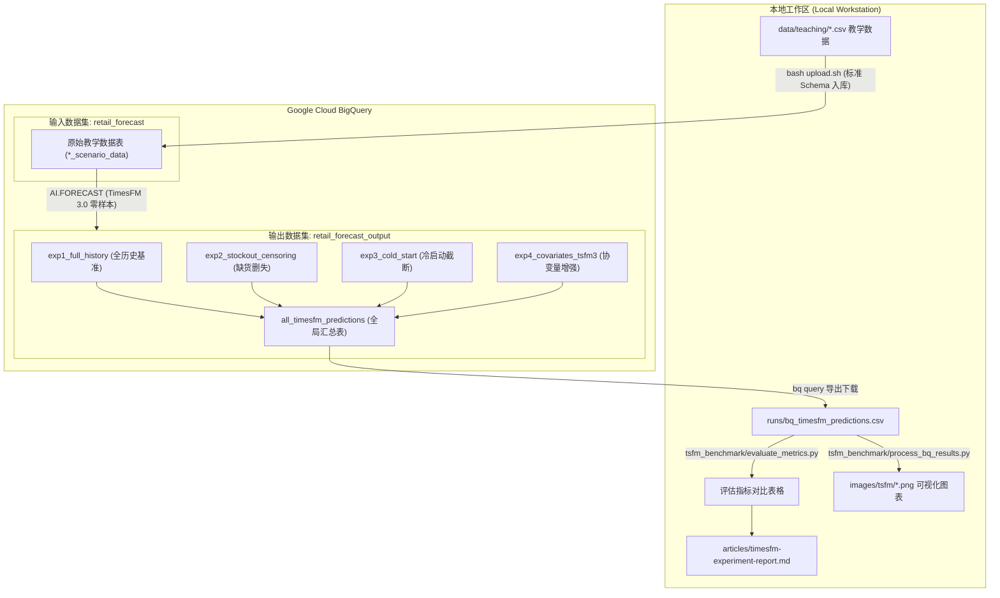

# TimesFM 在四个合成零售场景上的 BigQuery 企业级受控实验计划（Experiment Plan & Spec）

> **用途说明**：本文档面向 `retail-demand-forecast` 仓库的开发者与 AI Agent。
> 本实验全面拥抱 Google Cloud 官方最新发布的 [BigQuery TimesFM 3.0 with Multivariate Forecasting](https://cloud.google.com/blog/products/data-analytics/bigquery-timesfm-3-0-with-multivariate-time-series-forecasting) 与 [TimesFM Univariate Tutorial](https://cloud.google.com/bigquery/docs/timesfm-univariate-tutorial)。
> 实验将 **Google Research TimesFM**（3.3 亿参数时序基础大模型）的零样本推理与分位数生成委托给 **Google Cloud BigQuery** 原生时序引擎（内置函数 `AI.FORECAST`，免去模型拟合与存储开销）。
> 预测结果通过标准化 CSV 契约（`runs/bq_timesfm_predictions.csv`）回传本地，由仓库自带的指标评估与可视化脚本生成数据分析报告 `articles/timesfm-experiment-report.md` 及配套图片 `images/tsfm/*.png`，供主博客《拆解 Google TimesFM》第五章直接引用。

---

## 一、 实验背景与总体目标

在本仓库现有的教程中，我们已经使用 **4 套固定随机种子生成的墨尔本超市教学合成数据集**（位于 `data/teaching/`，由 `notebooks/00-generate-teaching-data.ipynb` 生成）系统检验了 `Seasonal Naive`、`Prophet` 与 `LightGBM` 的表现。

在现代企业级零售预测架构中，时序基础模型（Time-series Foundation Models, TSFM）正逐步取代单 SKU 独立拟合的传统机器学习管线。Google 在 BigQuery 中深度集成了 **TimesFM 2.5 / 3.0**，以 `AI.FORECAST` 函数提供真正的 **Zero-Shot（零样本）** 预测与原生协变量建模能力。

本实验模块的目标是：**在完全相同的时间切分、信息可用边界与评价指标口径下，借助 BigQuery 原生 TimesFM 托管算力，系统完成四组受控实验**：

1. **全历史基准对决（Full-History Benchmark）**：在拥有完整 3 年历史（1,068 天训练/上下文，预测最后 28 天）的条件下，BigQuery TimesFM（TimesFM 2.5 与 TimesFM 3.0 零样本模式）分别在高频杂货、脉冲红酒、强季节庭院耗材、高零值奢侈品手袋四个场景上表现如何？与调优后的 `Prophet` 和 `LightGBM` 差距在哪里？
2. **冷启动与极短历史截断测试（Cold-Start Context Truncation）**：当输入历史从 `1,068` 天依次缩短为紧邻测试集前的 `90` 天、`28` 天、`14` 天、`7` 天时，`Prophet`、`LightGBM` 与 `TimesFM` 的预测误差如何变化？基础模型在极小样本下是否显著优于传统统计与树模型？
3. **缺货删失与业务状态清洗对决（Data Cleaning & Censoring Impact）**：在包含 24 个缺货日（上限被截断为 20 件）及公休闭店日（Good Friday / Christmas Day）的杂货场景中，对比：
   - 方案 A（标准清洗）：剔除闭店日与缺货日后输入模型；
   - 方案 B（原始暴露）：直接暴露含缺货截断与闭店 0 值的原始观测序列。
   检验 TimesFM 基础模型对真实零售数据噪声与污染的鲁棒性。
4. **TimesFM 3.0 动态未来协变量（Future Covariates）增益测试**：全面启用 TimesFM 3.0 的多变量/外生特征注入能力，在杂货（促销折扣 `discount`）、红酒（成箱促销 `promo_case_buy`、派对事件 `is_party_event`、12月旺季 `is_december_peak`）与庭院（秋季清仓 `is_end_of_autumn_clearance`、DIY长周末 `is_long_weekend_diy`）场景中，测试在未来 28 天注入已知外部计划特征相较纯单变量预测的绝对增益。

---

## 二、 混合架构工作流与数据契约



### 2.1 BigQuery 输出数据集分层设计：`retail_forecast_output`

为符合企业级数仓治理规范，保证源数据只读不受污染，我们将所有实验的模型预测输出统一隔离至专用的 **`retail_forecast_output`** 数据集：

| 输出表名 | 所属实验 | 说明 | 包含场景/切片数 | 预测行数 |
| :--- | :--- | :--- | :--- | :--- |
| **`exp1_full_history`** | 实验 1 | 四场景全历史基准零样本预测 | 4 个场景，各 28 天 | 112 行 |
| **`exp2_stockout_censoring`** | 实验 2 | Grocery 缺货删失污染 vs 无偏去偏对比 | 2 组输入条件 (Raw Censored vs Clean) | 56 行 |
| **`exp3_cold_start`** | 实验 3 | 历史可见长度截断敏感度测试 (365/90/56/28/14天) | 3 场景 × 5 窗口 | 420 行 |
| **`exp4_covariates_tsfm3`** | 实验 4 | TimesFM 3.0 注入已知外部特征预测 | 3 场景协变量预测 | 84 行 |
| **`all_timesfm_predictions`** | 汇总表 | 上述 4 个实验所有预测切片的 UNION ALL 总集 | 全量汇总，供一键拉取本地评测 | 644 行 |

### 2.2 命名规律与字段元数据对照表（与 SQL 严格对齐）

| Scenario | Experiment ID | Model 标识 | 输出表名 | 输入切分与特征说明 | 预测行 |
| :--- | :--- | :--- | :--- | :--- | :--- |
| `grocery` | `exp1_full_history` | `TimesFM (BigQuery)` | `exp1_full_history` | 全历史 (1068d), 剔除闭店与缺货 (标准去偏基准) | 28 行 |
| `wine` | `exp1_full_history` | `TimesFM (BigQuery)` | `exp1_full_history` | 全历史 (1068d), 营业日 (`is_open=TRUE`) | 28 行 |
| `garden` | `exp1_full_history` | `TimesFM (BigQuery)` | `exp1_full_history` | 全历史 (1068d), 营业日 (`is_open=TRUE`) | 28 行 |
| `luxury` | `exp1_full_history` | `TimesFM (BigQuery)` | `exp1_full_history` | 全历史 (1068d), 营业日 (`is_open=TRUE`) | 28 行 |
| `grocery` | `exp2_raw_censored` | `TimesFM (BQ-RawCensored)` | `exp2_stockout_censoring` | 未清洗全量暴露 (含 24 个缺货截断日 + 公休闭店 0) | 28 行 |
| `grocery` | `exp2_unbiased_clean` | `TimesFM (BigQuery)` | `exp2_stockout_censoring` | 去偏基准对照 (引用 `exp1_full_history` 无偏行) | 28 行 |
| `grocery` | `exp3_L{L}` | `TimesFM (BQ-L{L})` | `exp3_cold_start` | $L \in \{365, 90, 56, 28, 14\}$ 天短历史窗口 | 140 行 |
| `wine` | `exp3_L{L}` | `TimesFM (BQ-L{L})` | `exp3_cold_start` | $L \in \{365, 90, 56, 28, 14\}$ 天短历史窗口 | 140 行 |
| `garden` | `exp3_L{L}` | `TimesFM (BQ-L{L})` | `exp3_cold_start` | $L \in \{365, 90, 56, 28, 14\}$ 天短历史窗口 | 140 行 |
| `grocery` | `exp4_covariates_tsfm3` | `TimesFM 3.0 (+Discount)` | `exp4_covariates_tsfm3` | 注入未来 28 天已知折扣特征 (`discount`) | 28 行 |
| `wine` | `exp4_covariates_tsfm3` | `TimesFM 3.0 (+PromoEvents)` | `exp4_covariates_tsfm3` | 注入成箱促销、年底旺季与派对事件协变量 | 28 行 |
| `garden` | `exp4_covariates_tsfm3` | `TimesFM 3.0 (+ClearanceDIY)` | `exp4_covariates_tsfm3` | 注入长周末 DIY 与秋季清仓已知协变量 | 28 行 |
| *(汇总表)* | *(包含上述所有 ID)* | *(对应模型标识)* | `all_timesfm_predictions` | 全量 `UNION ALL` 汇聚表，供本地拉取评测 | 644 行 |

### 2.3 BigQuery 输出契约文件：`runs/bq_timesfm_predictions.csv`

从 BigQuery 导出并下载至本地 `runs/` 目录的预测结果表必须严格遵循以下标准列规范：

| 列名 | 类型 | 说明 | 示例值 |
| :--- | :--- | :--- | :--- |
| `scenario` | STRING | 场景标识 | `grocery`, `wine`, `garden`, `luxury` |
| `experiment_id` | STRING | 实验标识 | `exp1_full_history`, `exp2_raw_censored`, `exp3_L28`, `exp4_covariates_tsfm3` |
| `model` | STRING | 模型描述 | `TimesFM (BigQuery)`, `TimesFM 3.0 (+Discount)` |
| `ds` | DATE | 预测日期（2025-12-04 至 2025-12-31） | `2025-12-04` |
| `prediction` | FLOAT | 点预测值（P50 / 中位数） | `112.4` |
| `q10` | FLOAT | 10% 分位数下界（P10） | `98.1` |
| `q90` | FLOAT | 90% 分位数上界（P90） | `125.7` |

---

## 三、 四个场景的数据契约与切分口径

所有数据均覆盖 `2023-01-01` 至 `2025-12-31`（共 `1,096` 天）：
- **历史可见期截止日（Forecast Origin）**：`2025-12-03`（前 `1,068` 天）；
- **测试评价窗口（Evaluation Horizon）**：`2025-12-04` 至 `2025-12-31`（共 `H = 28` 天，含 1 个闭店日 `2025-12-25`，有效营业日 `n = 27`）；
- **闭店日业务规则**：预测值在闭店日强制乘以 `is_open`（即圣诞节统一归零）。

| 场景名称 | 本地源文件（`data/teaching/`） | BQ 对应数据表 | Schema 定义文件 | 核心已知业务特征（外生协变量） | 场景统计特性 |
| :--- | :--- | :--- | :--- | :--- | :--- |
| **1. 杂货 (Grocery)** | `grocery_scenario_data.csv` | `retail_forecast.grocery_scenario_data` | `grocery_scenario_data.schema.json` | `discount` (20%双周折扣), `vic_holidays` | 高频平稳（均值 ~109.5），含 24 个缺货截断日 |
| **2. 红酒 (Wine)** | `wine_scenario_data.csv` | `retail_forecast.wine_scenario_data` | `wine_scenario_data.schema.json` | `promo_case_buy` (成箱促销), `is_party_event`, `is_december_peak` | 泊松计数，短时脉冲与年底节日旺季 |
| **3. 庭院耗材 (Garden)** | `garden_scenario_data.csv` | `retail_forecast.garden_scenario_data` | `garden_scenario_data.schema.json` | `is_long_weekend_diy`, `is_end_of_autumn_clearance` (清仓) | 强年季节周期 + 长周末 DIY 脉冲 |
| **4. 奢侈品手袋 (Luxury)**| `luxury_scenario_data.csv` | `retail_forecast.luxury_scenario_data` | `luxury_scenario_data.schema.json` | `is_vip_event` (季度VIP周末), `discount` | 极端稀疏间歇需求（93.58% 零值） |

---

## 四、 BigQuery 实验执行指南（基于 `AI.FORECAST` 官方语法）

### 4.1 数据入库状态
通过 `data/teaching/upload.sh` 脚本，所有表均已成功按标准 Schema 写入 BigQuery `retail_forecast` 数据集：
- `grocery_scenario_data`、`wine_scenario_data`、`garden_scenario_data`、`luxury_scenario_data`、`vic_holidays`、`scenario_diagnostics`。

### 4.2 实验第一步：30 秒冒烟测试（Smoke Test）
在 BigQuery 控制台中运行以下纯 SQL 查询（无需 `CREATE MODEL`），验证基础连接与 TimesFM 调用：

```sql
SELECT
  'grocery' AS scenario,
  'exp1_full_history' AS experiment_id,
  'TimesFM (BigQuery)' AS model,
  DATE(forecast_timestamp) AS ds,
  forecast_value AS prediction,
  prediction_interval_lower_bound AS q10,
  prediction_interval_upper_bound AS q90
FROM AI.FORECAST(
  (
    SELECT ds, y
    FROM `gcp-cc-ai-ml-llm.retail_forecast.grocery_scenario_data`
    WHERE ds <= '2025-12-03' AND is_open = TRUE AND stockout = FALSE
  ),
  data_col => 'y',
  timestamp_col => 'ds',
  horizon => 28,
  confidence_level => 0.80
);
```

> **核心参数说明**：
> - `data_col => 'y'`: 目标销量预测列（FLOAT64）。
> - `timestamp_col => 'ds'`: 日期序列列（DATE）。
> - `horizon => 28`: 向前预测未来 28 天。
> - `confidence_level => 0.80`: 80% 双尾置信区间，下界对应 **P10**，上界对应 **P90**。

---

### 4.3 实验第四步设计：TimesFM 3.0 动态未来协变量（Future Covariates）注入

参考官方博客 [BigQuery TimesFM 3.0 with Multivariate Forecasting](https://cloud.google.com/blog/products/data-analytics/bigquery-timesfm-3-0-with-multivariate-time-series-forecasting)，TimesFM 3.0 采用极为优雅的输入数据契约来接收未来已知特征（如折扣促销、长周末）：

```sql
SELECT
  'grocery' AS scenario,
  'exp4_covariates_tsfm3' AS experiment_id,
  'TimesFM 3.0 (+Discount)' AS model,
  DATE(forecast_timestamp) AS ds,
  forecast_value AS prediction,
  prediction_interval_lower_bound AS q10,
  prediction_interval_upper_bound AS q90
FROM AI.FORECAST(
  (
    -- 1. 历史训练行：y 包含实际销量，discount 包含历史折扣
    SELECT ds, y, discount
    FROM `gcp-cc-ai-ml-llm.retail_forecast.grocery_scenario_data`
    WHERE ds <= '2025-12-03' AND is_open = TRUE AND stockout = FALSE

    UNION ALL

    -- 2. 未来预测行：y 为 NULL，但未来 28 天的 discount 排期明确已知！
    SELECT ds, CAST(NULL AS FLOAT64) AS y, discount
    FROM `gcp-cc-ai-ml-llm.retail_forecast.grocery_scenario_data`
    WHERE ds > '2025-12-03'
  ),
  data_col => 'y',
  timestamp_col => 'ds',
  model => 'TimesFM 3.0',
  confidence_level => 0.80
);
```

---

### 4.4 实验全流程执行

1. **执行自动化 SQL 套件**：
   在本地终端一键触发全套 4 组受控实验：
   ```bash
   bq query --use_legacy_sql=false < tsfm_benchmark/bigquery_experiments.sql
   ```
   该脚本将所有场景的预测结果写入 `retail_forecast_output` 对应的 4 张独立实验表中，并自动聚合成总表 `retail_forecast_output.all_timesfm_predictions`。

2. **一键拉取预测数据至本地**：
   ```bash
   mkdir -p runs
   bq query --use_legacy_sql=false --format=csv --max_rows=10000 \
     "SELECT * FROM \`gcp-cc-ai-ml-llm.retail_forecast_output.all_timesfm_predictions\`" > runs/bq_timesfm_predictions.csv
   ```

3. **本地多维指标评估与报告输出**：
   ```bash
   # 计算 MAE / RMSE / WAPE / 80%区间覆盖率，并与 Prophet / LightGBM 交叉对比
   python3 tsfm_benchmark/evaluate_metrics.py

   # 生成多场景对比图与单栏博客高清配图
   python3 tsfm_benchmark/process_bq_results.py
   ```

---

## 五、 本地图表与报告交付规格

完成上述执行后，系统将生成以下最终交付物：

1. **`runs/bq_timesfm_predictions.csv`**：BigQuery TimesFM 全实验预测标准结果集。
2. **`images/tsfm/fig-tsfm-01-four-scenarios-comparison.png`**：四场景 28 天预测曲线与分位数区间对比四宫格图。
3. **`images/tsfm/fig-tsfm-02-coldstart-degradation-curve.png`**：历史样本长度对误差（WAPE/MAE）衰减曲线图（单栏博客布局）。
4. **`images/tsfm/fig-tsfm-03-stockout-censoring-impact.png`**：缺货删失污染与清洗对比图。
5. **`articles/timesfm-experiment-report.md`**：完整数据分析报告，汇总全部量化误差对比表，为博客正文提供实证支持。
