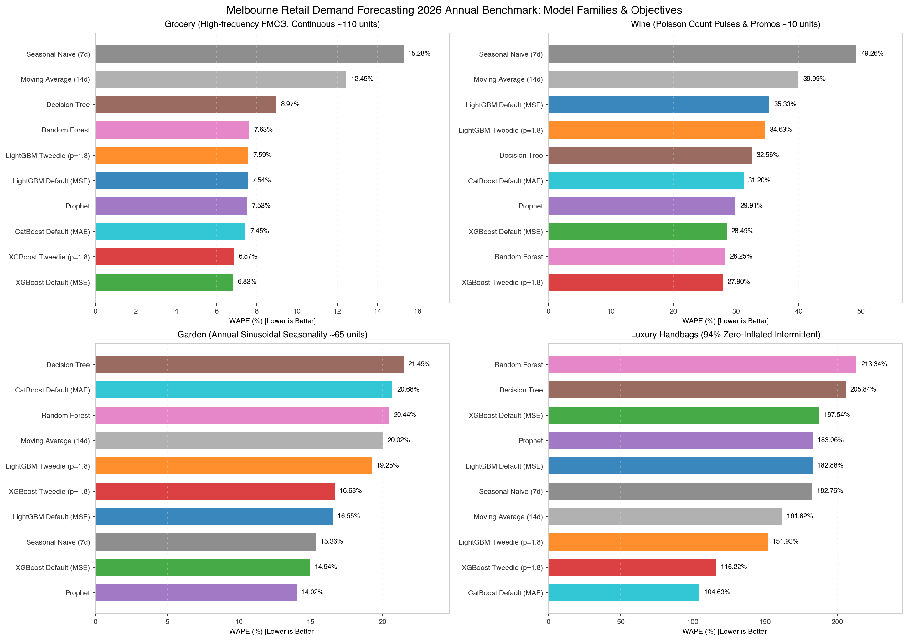
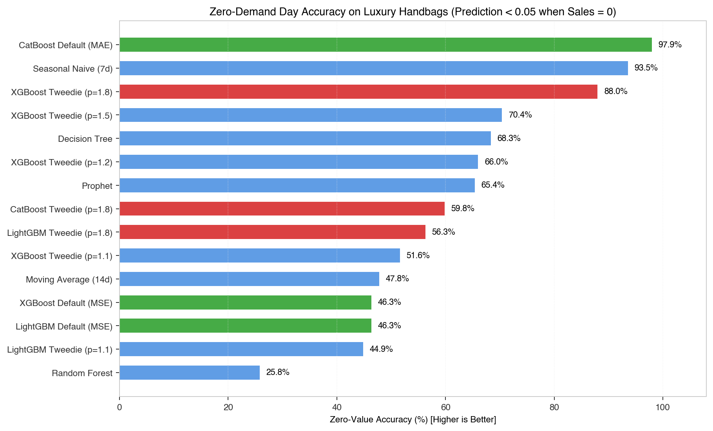
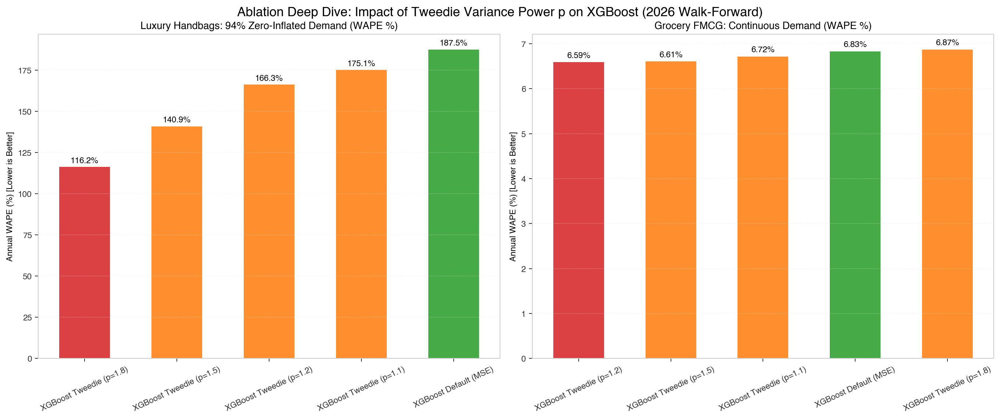
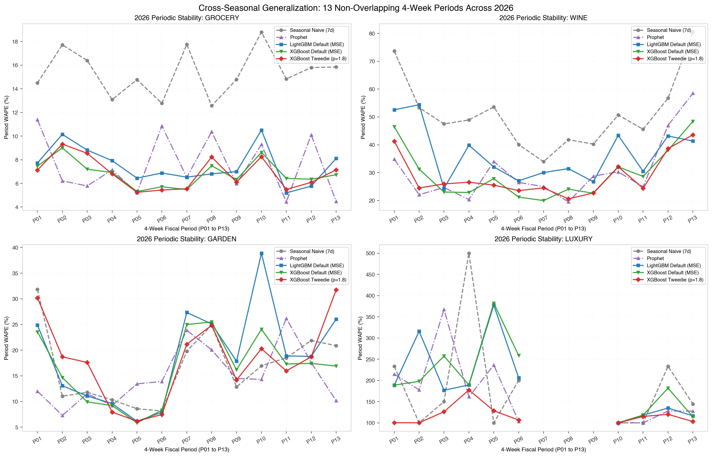

> **证据状态**：本文保留 `2026-retail-week-24w-v3` 历史快照的分析。评估范围为 2025-12-29 至 2026-12-27 的 52 个完整零售周，不等同于完整日历年，也不得与 V4 扩展历史结果混合。当前结论、事件指标和训练历史消融请以 [V4 首阶段基准报告](../reports/2026-retail-week-v4-first-stage-report.md)为准。

## 一、 为什么传统的“留出 28 天测试集”不可靠？

在零售需求预测和供应链补货的算法实践中，最常见的实验设计是：拿过去两年或三年的历史数据作为训练集，留出最后四周（28 天）作为测试集。

然而，时间序列数据存在强烈的非平稳性（Non-stationarity）与季节异质性：
- 如果最后四周恰逢**双十一或圣诞大促销**，高估模型的惩罚会被瞬间放大；
- 如果最后四周是**节后极寒淡季**，原本适应平稳需求的高斯模型会被大量零销量击穿。

为了减少单一切片带来的偶然性，我们将墨尔本（VIC）四类零售场景的教学数据集扩展至 **完整 5 年（2022-07-04 至 2027-06-27，共 260 完整周）**，并在 **2026 零售周年度（52 个完整周）** 上实施了 **13 期无重叠 28 天块步进前向滑动窗口评测（Walk-Forward 4-Week Block Evaluation）**。这是一套受控合成数据实验，不是生产效果保证。



---

## 二、 四大场景 V3 结果：模型差异随需求形态变化

在零售需求预测中，不存在一个跨越所有业务形态的“通用万能模型”。
- 商超连续快消需求（日均 ~109.5 件）的 WAPE 仅在 6%~10%；
- 红酒成箱促销（日均 ~10.4 件）的 WAPE 处于 27%~35%；
- 庭院正弦季节性（日均 ~64.9 件）的 WAPE 约为 14%~20%；
- 奢侈品长尾（93.6% 零销量）因分母极小，WAPE 普遍高达 100%~200%。

若简单做跨场景算术平均，奢侈品的大数额百分比会完全淹没其他品类的关键精度差距。因此，我们严格分场景对 15 种模型及配置进行穿透评测：

| 零售场景 | 需求分布与特征 | V3 最低 WAPE 配置 | 2026 零售周 WAPE | 可能的机制解释 |
| :--- | :--- | :--- | :---: | :--- |
| **商超快消 (Grocery)** | 高频连续 (~109.5 件/日)，周中/周末强循环，24 天缺货右截断 | **XGBoost Tweedie (p=1.2)** | **6.59%** | Tweedie 方差结构可能对该场景的右偏噪声形成正则化 |
| **单 SKU 红酒 (Wine)** | 泊松脉冲 (~10.4 件/日)，成箱大促阶跃，派对事件突刺 | **XGBoost Tweedie (p=1.8)** | **27.90%** | 较高方差幂可能更贴合该生成协议中的促销长尾 |
| **庭院用品 (Garden)** | 跨年强正弦天气季节性 (~64.9 件/日)，长周末 DIY 脉冲 | **Prophet** | **14.02%** | 显式傅里叶季节项可能更贴合该合成数据的平滑周期；24 周历史不足以公平评价年度季节能力 |
| **奢侈品手袋 (Luxury)** | 极端零膨胀间歇性 (93.58% 零销售)，VIP 偶发消费 | **CatBoost (MAE)** / **XGBoost Tweedie (p=1.8)** | **104.63%** / **116.22%** | MAE 与 Tweedie 对零值和长尾的权重不同，可能减少持续的小幅正预测 |

### 从 V3 可以观察到什么？
1. 在这套固定 24 周历史的合成实验中，不同需求形态对应不同的最低 WAPE 配置；这支持分场景报告，不足以证明某个工具包在真实业务中必然占优。
2. Garden 中 Prophet 的 WAPE 最低，但 24 周历史不包含完整年度周期，因此这项结果更适合作为短历史压力测试，不能单独概括 Prophet 或树模型的年度季节能力。
3. Luxury 中 MAE 与 Tweedie 配置降低了 WAPE，但仅凭零销量日命中率无法判断模型是否识别了正需求事件；V4 因此补充了 DemandRecall 和事件 F1。

---

## 三、 零膨胀长尾难题：损失函数与需求分布的匹配

零售中最令人头疼的是**低频高值长尾品类**（如奢侈品高价包包，93.6% 的日期销量为 0）。

### 3.1 MSE 的错配风险：小幅正预测与虚假库存
当我们使用基于均方误差（MSE）的经典回归时，模型背后隐含的假设是误差服从高斯分布：
$$
\epsilon_i \sim \mathcal{N}(0, \\sigma^2)
$$
在零值占绝大多数、正需求偶发的叶节点中，平方损失通常估计条件均值，因此可能持续给出微小正数（例如 $0.08$ 件），而不是明确区分“是否发生需求”与“发生后的数量”。
- **V3 观察**：XGBoost Default (MSE) 的零销量日命中率为 **46.3%**，WAPE 为 **187.54%**。这个旧指标只看真实零销量日是否命中阈值，不是包含正负两类的分类准确率。

### 3.2 Tweedie 复合泊松-伽马分布解法
Tweedie 分布将“是否有购买发生”（泊松过程 $N \sim \text{Pois}(\lambda)$）与“单次购买金额/数量”（伽马分布 $Z \sim \text{Gamma}(\alpha, \gamma)$）端到端融合为单分布。

在 $1 < p < 2$ 时，其负对数似然对对数打分 $s = \log \mu$ 的梯度为：
$$
g_i = -y_i \exp\left((1-p) s_i\right) + \exp\left((2-p) s_i\right)
$$

当样本真实销量 $y_i = 0$ 时，梯度仅保留正惩罚项 $\exp\left((2-p) s_i\right)$，从而对正均值预测施加向下更新；最终效果仍取决于树结构、正需求样本和正则化设置。



在奢侈品合成场景的 V3 对照中：

| 模型与配置 | 零售周 WAPE | MAE | 零销量日命中率（旧口径） | 波动性 Std |
| --- | --- | --- | --- | --- |
| CatBoost Default (MAE) | 104.63% | 0.084 | 97.9% | 0.062 |
| XGBoost Tweedie (p=1.8) | 116.22% | 0.093 | 88.0% | 0.225 |
| XGBoost Tweedie (p=1.5) | 140.92% | 0.113 | 70.4% | 0.605 |
| LightGBM Tweedie (p=1.8) | 151.93% | 0.122 | 56.3% | 0.737 |
| Moving Average (14d) | 161.82% | 0.130 | 47.8% | 0.779 |
| XGBoost Tweedie (p=1.2) | 166.30% | 0.133 | 66.0% | 0.739 |
| CatBoost Tweedie (p=1.8) | 170.06% | 0.136 | 59.8% | 0.770 |

- **XGBoost Tweedie ($p=1.8$)** 相较于默认 MSE，V3 WAPE 低 71.3 个百分点，零销量日命中率从 46.3% 提高到 **88.0%**；这仍不能回答正需求事件召回率。
- 其 13 个周期 WAPE 的描述性标准差从 0.803 降至 **0.225**，但这里没有进行显著性检验。

---

## 四、 GBDT Tweedie 参数消融：$p$ 应该怎么选？

在 XGBoost 与 LightGBM 中，Tweedie 方差幂指数 $p$ 是一个核心超参数。V3 对称配置提供了场景内的敏感性观察：



1. **高频连续型快消（Grocery）**：V3 中 $p \in [1.1, 1.2]$ 的结果略优于纯 MSE；这可作为该生成协议下的候选区间，仍需在独立数据上重新选择。
2. **大促脉冲与间歇零膨胀（Wine, Luxury）**：V3 中较高的 $p$ 在部分 WAPE 对照里占优，但 Luxury 的配置选择必须同时检查正需求召回与事件 F1，不能仅按零值命中率推荐 $p=1.8$。

---

## 五、 穿越四季：13 期滑动窗口稳定性全景



从 P01（年初夏季）到 P06（复活节及冬季淡季），再到 P12-P13（黑五与圣诞旺季），时序误差轨迹清晰表明：
- 单一切片可能给出不稳定的模型判断。传统季节朴素法（Seasonal Naive）在平稳期表现尚可，但在部分促销切换期误差超过 100%（描述性 $\sigma=0.345$）；
- Tweedie GBDT 在部分场景和时期的误差更低，但各 fold 仍有明显波动；这些轨迹用于描述稳定性，不构成“全天候鲁棒”的证明。

---

## 六、 总结与复现指引

这次历史实验支持三项后续基准设计原则：
1. **时间单位与业务周期对齐**：统一采用以周一为起点的 28 天完整周期，避免月份天数不均直接改变每个 fold 的样本量；
2. **分层评估而非固定路由**：连续、季节和零膨胀场景应使用不同指标与候选配置；具体模型仍需在冻结协议下比较；
3. **显式防泄漏与可复现性**：当前 V4 通过未来目标扰动测试、数据哈希、冻结参数和 release manifest 检查信息边界；这些检查降低泄漏风险，但不替代持续审计。

### 一键复现代码
```bash
# 当前 V4 主榜中独立重算一个模型
uv run python scripts/run_benchmark.py \
  --benchmark 2026-retail-week-expanding-v4 \
  --models xgboost_tweedie_p18

# 从显式指定的本地运行目录严格重建分场景汇总
uv run python scripts/run_benchmark.py \
  --benchmark 2026-retail-week-expanding-v4 \
  --compare-only \
  --source-root runs/20261105-all-models-benchmark

# 仅对人工审核并发布的不可变快照生成图表和报告数据块
uv run python scripts/plot_benchmark_summary.py \
  --benchmark 2026-retail-week-expanding-v4 \
  --release 20261106-first-stage-v1
uv run python scripts/generate_benchmark_report.py \
  --benchmark 2026-retail-week-expanding-v4 \
  --release 20261106-first-stage-v1

# 复算本文引用的 V3 历史快照；它不会被升级为 V4 结果
uv run python scripts/validate_benchmark_release.py \
  data/benchmarks/published/2026-retail-week-24w-v3
```
