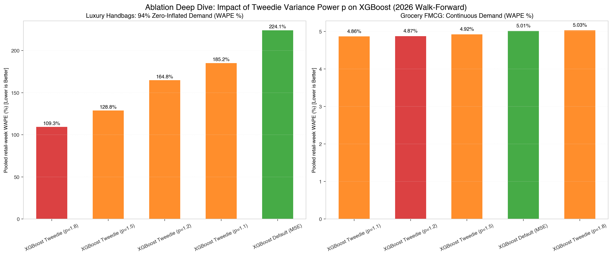
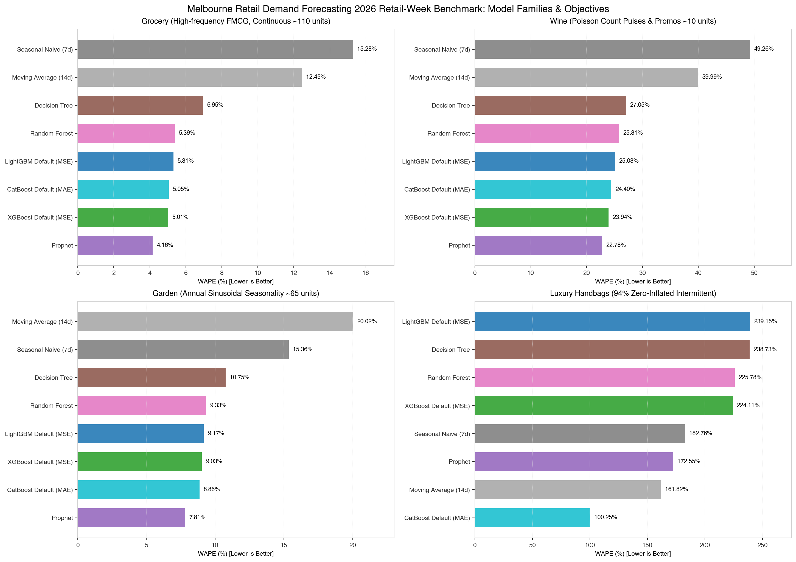

> 📌 **阶段归属**：阶段二 · 模型探索与教学剖析 (Stage 2: Model Sandbox & In-depth Tutorial)  
> 🔗 **配套交互实验 Notebook**：[`notebooks/23c-lightgbm-tutorial.ipynb`](../../notebooks/23c-lightgbm-tutorial.ipynb) · [`notebooks/23d-xgboost-tutorial.ipynb`](../../notebooks/23d-xgboost-tutorial.ipynb) · [`notebooks/31-benchmark-tree-models.ipynb`](../../notebooks/31-benchmark-tree-models.ipynb)  
> 📊 **统一评测横向对比报告**：[`docs/reports/2026-retail-week-v4-first-stage-report.md`](../reports/2026-retail-week-v4-first-stage-report.md) · [天梯榜 Leaderboard](../../README.md#综合排行榜)

## 一、补货问题怎样变成表格回归？

超市希望知道：八折特价遇到周末，销量会上升多少？酒类商品的成箱促销在派对前夕是否更有效？庭院耗材的清仓，在旺季和低谷是否呈现不同关系？

Prophet 和业务动态回归为每个模块预先指定结构。回归树可以根据特征阈值分组，再为不同组合学习预测值。**树模型的需求预测能力取决于特征在预测起点是否可见，以及这些特征是否表达了业务变化。**

本篇继续使用相同的合成案例、VIC 假日表和 28 天补货期限。配套 [LightGBM Notebook](../../notebooks/23c-lightgbm-tutorial.ipynb)、[XGBoost Notebook](../../notebooks/23d-xgboost-tutorial.ipynb) 和 [五模型比较 Notebook](../../notebooks/31-benchmark-tree-models.ipynb) 使用统一的起点历史摘要，并实际运行四个训练期滚动窗口和最终测试。完整训练实现位于 `src/retail_forecast/trees.py`。

文章用同一条主线串联业务评估、特征、模型计算、解释、验证和交付，让读者能够判断某个特征改善来自哪里，以及获得的改善是否值得维护成本。

## 二、业务评估与数据获取：先定义未来可见的信息

问题评估（Problem Assessment）需要明确预测粒度、起点、期限和补货决策。数据与业务知识获取（Data and Knowledge Acquisition）阶段，团队要区分历史销量、未来计划和事后记录。特价计划、营业日历可以作为已知未来输入；未来实际销量、未提前公布的促销执行结果或最终天气观测，需要另行确定其可用时间。

| 案例 | 本文使用的业务特征 | 机制与边界 |
| --- | --- | --- |
| 商超刚需品 (`grocery`) | `discount`，八折为 0.2 | 平滑趋势与周末/年周期叠加；含 52 天缺货人工审查日 |
| 单 SKU 红酒 (`wine`) | 成箱促销、12 月高峰、派对事件 | 计数泊松抽样，方差随均值同动，考验脉冲提升与均值收缩能力 |
| 庭院耗材 (`garden`) | DIY 长周末、5 月清仓 | 强正弦年周期与周末 DIY 增量；需要检查旺季、淡季和清仓交互 |
| 奢侈品手袋 (`luxury`) | 星期六/日偏好、VIP 活动、12 月高峰、折扣 | 94.03% 极度零膨胀，默认回归易输出虚假非零预测；需对比 Tweedie 复合泊松目标 |

日期被转换成时间坐标、周/年傅里叶特征和假日指示列。所有转换在历史与未来保持相同定义；本篇不向树模型传入日期字符串来期待它自动学习时间语义。

`y` 是销量标签，闭店和缺货标签在训练副本排除。`conditional_mean`、`latent_demand` 是诊断真值，不进入特征。未来营业状态用于销售预测后处理；未来缺货状态仅用于本合成实验的标签评价，生产环境必须核对库存标签何时可知。

## 三、回归树怎样给出一个预测值？

一棵回归树可能先按折扣分裂，再按星期位置或年周期特征分裂。进入同一个叶节点的样本共享一个预测值。

$$
f(\mathbf x)=w_{q(\mathbf x)}.
$$

变量定义：$\mathbf x$ 为一条样本的特征向量，$q(\mathbf x)$ 是树的分裂规则将该样本映射到的叶节点编号，$w_j$ 是第 $j$ 个叶节点的预测值，$f$ 是整棵树的预测函数。

在无正则化的平方误差回归树中，固定叶节点的最佳常数是该叶样本标签均值。提升树的叶节点则根据当前损失的梯度、曲率和正则化求出修正值。

这种分组能够表达阈值和交互。例如“折扣超过某值，而且处于周末”的组合，可以落入专门的分支。树也可能在小样本中记住偶然组合，需要约束叶节点规模和结构复杂度。

常数叶节点对输入区间给出分段常数。未来时间超过训练范围时，仅靠时间索引分裂难以继续线性增长；历史水平特征、趋势结构或其他外推策略需要另行设计。

## 四、梯度提升如何逐轮改善预测？

梯度提升（Gradient Boosting）把多棵树的修正叠加。第 $m$ 轮预测为：

$$
\hat y_i^{(m)}=\hat y_i^{(m-1)}+\eta f_m(\mathbf x_i).
$$

变量定义：$i$ 为样本编号，$m$ 为提升轮数，$\hat y_i^{(m)}$ 为当前预测，$f_m$ 为新加入的树，$\eta>0$ 为学习率，$\mathbf x_i$ 为输入特征。帽号表示预测，上标括号表示轮次。

XGBoost 的推导将新树的目标写成损失与结构正则化的组合 [1]：

$$
\mathcal L_m
=\sum_i\ell\bigl(y_i,\hat y_i^{(m-1)}+f_m(\mathbf x_i)\bigr)
+\gamma J+\frac{\lambda}{2}\sum_{j=1}^{J}w_j^2.
$$

变量定义：$\mathcal L_m$ 是本轮优化目标，$\ell$ 是单样本损失，$y_i$ 是标签；$J$ 为新树的叶节点数，$w_j$ 为叶输出；$\gamma$ 控制增加叶节点的代价，$\lambda$ 控制叶输出的平方惩罚。此处写出未施加学习率缩减的树求解形式，完成树构建后再应用 $\eta$。

对损失做二阶近似后，某个叶节点的最佳输出为：

$$
w_j^*=-\frac{G_j}{H_j+\lambda},
\quad
G_j=\sum_{i\in I_j}g_i,
\quad
H_j=\sum_{i\in I_j}h_i.
$$

变量定义：$I_j$ 为落入第 $j$ 个叶节点的样本集合；$g_i$ 为损失对当前预测的一阶导数，$h_i$ 为二阶导数；$G_j$、$H_j$ 分别是该叶内导数的总和；星号表示当前条件下的最优值，$\in$ 表示属于集合。

对于损失 $\ell(y,\hat y)=\tfrac12(y-\hat y)^2$，一阶导数为 $g_i=\hat y_i-y_i$，二阶导数为 $h_i=1$。这里 $y$ 为标签，$\hat y$ 为预测。因此新树的修正与当前残差有关，正则化则让修正更克制。

一次候选分裂的近似收益为：

$$
\operatorname{Gain}
=\frac12\left(
\frac{G_L^2}{H_L+\lambda}+
\frac{G_R^2}{H_R+\lambda}-
\frac{G_P^2}{H_P+\lambda}
\right)-\gamma.
$$

变量定义：下标 $L$、$R$ 和 $P$ 分别表示左子节点、右子节点和父节点；各 $G,H$ 按上文定义聚合；$\operatorname{Gain}$ 为分裂收益。这个计算把特征阈值与优化目标接起来：候选阈值改变样本归属，进而改变收益。

## 五、LightGBM 与 XGBoost 的配置怎样对应业务？

LightGBM 使用直方图等方法组织分裂搜索，并以较大收益的叶节点优先生长（Leaf-wise growth）。小样本下需要结合叶节点数、深度与叶样本限制控制复杂度 [2]。XGBoost 同样有多种树构建方式；本文使用直方图方法 `tree_method="hist"` 和当前配置的默认深度优先生长 [3]。

```python
lgbm = LGBMRegressor(
    learning_rate=0.04, num_leaves=15,
    min_child_samples=10, reg_lambda=1.0,
    n_estimators=600, random_state=42,
)
xgb = XGBRegressor(
    objective="reg:squarederror", learning_rate=0.04,
    max_depth=3, min_child_weight=5,
    reg_lambda=1.0, tree_method="hist",
    n_estimators=600, early_stopping_rounds=40,
    random_state=42,
)
```

这段代码是结构说明。实际训练函数还提供内部验证集、MAE 早停和 CPU 线程配置，再按选定轮数重训全部当时历史。

| 参数 | 本文的业务含义 |
| --- | --- |
| `learning_rate` | 每棵树修正的幅度；较小值常需要更多轮数 |
| `num_leaves` / `max_depth` | 控制能够表达的分组复杂度，二者不能直接作为同一种容量尺度比较 |
| `min_child_samples` | 限制 LightGBM 叶节点的样本支持，稀疏假日特征尤其需要检查 |
| `min_child_weight` | 限制 XGBoost 子节点的 Hessian 总和；具体含义随目标函数而变 |
| `reg_lambda` | 收缩叶输出，减少很大的局部修正 |
| `n_estimators` | 候选训练轮数上限，本文由起点前的内部验证选择实际轮数 |
| `early_stopping_rounds` | 验证误差连续多轮未改善时停止候选训练 |

默认特征预过滤与叶节点限制可能使部分 LightGBM 特征无法参与分裂 [4]。Notebook 保存各假日列的独立历史正例天数与模型重要性，让读者核对这些稀疏事件是否得到足够支持。展开多个起点可能重复使用同一个假日标签；这些重复训练行不会创造新的独立假日事件。

### 应对零膨胀间歇需求的 Tweedie 目标函数

在默认回归配置下，模型使用均方误差（MSE，即 `objective="reg:squarederror"`）。该损失基于加性同方差高斯假定，适合平滑连续的商超刚需品。然而面对红酒（泊松计数）和奢侈品手袋（94.03% 零销售）时，高斯假定会迫使模型输出平滑的微弱非零正值，导致极端间歇场景下的预测全面退化（零召回率退化）。

为此，工业级 GBDT 库（LightGBM、XGBoost 与 CatBoost）均原生支持 **Tweedie 目标函数**。Tweedie 分布满足方差与均值的幂律关系：

$$
\operatorname{Var}(Y) = \phi \mu^p, \qquad p \in (1, 2).
$$

变量定义：$\mu$ 是条件期望，$\phi > 0$ 为弥散参数，$p$ 为 Tweedie 方差指数（Power parameter）。当 $p \in (1, 2)$ 时，Tweedie 对应**复合泊松-伽马分布（Compound Poisson-Gamma）**——它由控制需求发生次数的离散泊松过程与控制单次购买量的连续伽马分布复合而成，在零点天然具备离散正概率质量，在正值区间具备非对称右偏连续分布。

其训练损失函数可表示为负对数似然：

$$
\ell(y, \mu) = - y \frac{\mu^{1-p}}{1-p} + \frac{\mu^{2-p}}{2-p}.
$$

当 $p \to 1$ 时退化为过离散泊松损失（适合低销量计数），当 $p \to 2$ 时退化为伽马损失（适合恒正乘性偏态），而在 $p \in [1.1, 1.8]$ 区间内，它为零膨胀与间歇零售需求提供了连续可微的优雅解法。

## 六、历史销量特征怎样避免多步泄漏？

常见特征包括昨日销量、七日均值和同星期销量。一次预测未来 28 天时，起点之后的真实销量尚未出现，未来第十天的“昨日销量”无法直接从测试数据读取。

本文采用一个共享多步回归方案（Pooled direct multi-horizon regression）：在起点冻结历史摘要，将其与目标日已知特征、预测步长一起输入树模型。

$$
\hat y_{T+h}
=F\bigl(\mathbf r_T,\mathbf x_{T+h},h\bigr),
\qquad h=1,\ldots,28.
$$

变量定义：$T$ 为预测起点，$h$ 为距起点的天数；$\mathbf r_T$ 为截至起点计算的历史摘要，$\mathbf x_{T+h}$ 为未来目标日可知的业务/日历输入，$F$ 为训练得到的提升树模型。$\ldots$ 表示中间整数依次延续。

历史摘要包括最近一次填充后的销量、起点七天前的销量（$y_{T-7}$）、7/28 天均值和最近 28 天有效标签比例。缺货或闭店历史用最近有效值前向填充，再保留有效比例作为质量信息；这仍是需要业务验证的工程假设。

训练数据按每 7 天一个历史起点展开未来 28 天标签，目标必须完整落在当时训练历史内。验证则只使用内部截止日向后预测的一整块 28 天。这里共用一棵提升树集成学习多个步长，既有未来日期特征，也有 horizon 特征。

Notebook 替换未来 `y` 为极端占位值，检查生成的输入特征完全相同。这项检查支持输入路径没有读取未来销量，还需要配合起点范围和计划快照检查。

## 七、特征解释、2026 基准回测与 Tweedie 消融结果

为客观评价树模型工具包（LightGBM、XGBoost、CatBoost 以及经典决策树与随机森林）的工业能力，我们结合阶段二的特征消融与阶段三的 2026 工业级基准（`2026-retail-week-expanding-v4`，13 个互不重叠 28 天 fold，共 364 天正式评估）进行多维度验证。

### 7.1 2026 工业基准（V4 Expanding Benchmark）综合表现

在 5 年全量历史架构下，所有模型在相同数据切分、冻结参数与特征协议下独立评估，指标汇总如下表（按各场景综合表现排列）：

| 场景 | 模型 / 目标配置 | WAPE | Bias | MAE | RMSE | ZeroRecall | EventF1 | 业务表现定位 |
| :--- | :--- | ---: | ---: | ---: | ---: | ---: | ---: | :--- |
| **商超刚需品**<br>(`grocery`) | **XGBoost (Tweedie p=1.1)** | **4.86%** | -1.22% | 5.950 | 7.702 | N/A | 100.0% | GBDT 第一（接近 Prophet 4.16%） |
| | XGBoost (Tweedie p=1.5) | 4.92% | -1.48% | 6.021 | 7.781 | N/A | 100.0% | 平滑过离散响应 |
| | CatBoost (Tweedie p=1.5) | 4.97% | -1.61% | 6.082 | 8.015 | N/A | 100.0% | 对称树抗过拟合稳健 |
| | CatBoost (默认 RMSE) | 5.05% | -1.33% | 6.183 | 8.226 | N/A | 100.0% | 强正则默认配置 |
| | XGBoost (默认 MSE) | 5.01% | -1.17% | 6.130 | 7.835 | N/A | 100.0% | 默认直方图 GBDT 代表 |
| | LightGBM (默认 L2) | 5.31% | -1.48% | 6.500 | 8.559 | N/A | 100.0% | 叶优先生长，略有欠拟合 |
| | Random Forest | 5.39% | -1.67% | 6.594 | 8.448 | N/A | 100.0% | 经典装袋基线 |
| | Decision Tree (单树) | 6.95% | -1.51% | 8.504 | 10.985 | N/A | 100.0% | 解释性强，阶跃误差较大 |
| | Seasonal naive (基线) | 15.28% | -8.89% | 18.696 | 22.953 | N/A | 100.0% | 无法应对趋势与折扣 |
| **单 SKU 红酒**<br>(`wine`) | **CatBoost (Tweedie p=1.1)** | **23.65%** | -2.94% | 2.767 | 3.612 | N/A | 100.0% | GBDT 最佳（接近 ARIMA 22.10%） |
| | CatBoost (Tweedie p=1.5) | 23.67% | -3.75% | 2.769 | 3.621 | N/A | 100.0% | 泊松脉冲响应平滑 |
| | LightGBM (Tweedie p=1.5) | 23.92% | -4.02% | 2.799 | 3.650 | N/A | 100.0% | Tweedie 显著优化 LightGBM |
| | XGBoost (默认 MSE) | 23.94% | -2.26% | 2.800 | 3.592 | N/A | 100.0% | 树深度限制在计数场景有效 |
| | CatBoost (默认 RMSE) | 24.40% | -6.04% | 2.855 | 3.719 | N/A | 100.0% | 默认收缩幅度偏保守 |
| | LightGBM (默认 L2) | 25.08% | -4.04% | 2.935 | 3.799 | N/A | 100.0% | 叶节点在脉冲尖峰处分裂过敏 |
| | Random Forest | 25.81% | +0.19% | 3.019 | 3.868 | N/A | 100.0% | 装袋平滑抑制极端高值 |
| | Decision Tree (单树) | 27.05% | -5.54% | 3.164 | 4.095 | N/A | 100.0% | 规则分段粗糙 |
| **庭院耗材**<br>(`garden`) | **CatBoost (Tweedie p=1.5)** | **8.73%** | -3.02% | 6.269 | 7.744 | N/A | 100.0% | GBDT 最佳，优于 TFT (8.76%) |
| | CatBoost (默认 RMSE) | 8.86% | -1.59% | 6.361 | 7.815 | N/A | 100.0% | 对称树完美拟合正弦季节 |
| | XGBoost (Tweedie p=1.5) | 8.94% | -2.17% | 6.422 | 7.994 | N/A | 100.0% | 捕捉 5 月清仓与长周末交互 |
| | XGBoost (默认 MSE) | 9.03% | -1.53% | 6.486 | 8.053 | N/A | 100.0% | 深度 3 限制有效避免过拟合 |
| | LightGBM (默认 L2) | 9.17% | -1.21% | 6.587 | 8.092 | N/A | 100.0% | 强周期下表现稳健 |
| | Random Forest | 9.33% | -4.16% | 6.704 | 8.354 | N/A | 100.0% | 季节峰值外推略有平抑 |
| | Decision Tree (单树) | 10.75% | -3.46% | 7.724 | 9.776 | N/A | 100.0% | 阶梯分割季节曲线 |
| **奢侈品手袋**<br>(`luxury`) | **CatBoost (默认 RMSE)** | **100.25%** | -93.16% | 0.080 | 0.393 | **100.0%** | 9.1% | 极端保守收缩，保持 100% 零召回 |
| | **XGBoost (Tweedie p=1.5)** | **128.79%** | -66.84% | 0.103 | 0.384 | **99.1%** | 0.0% | **较默认 MSE 暴降 95.32 个百分点** |
| | **LightGBM (Tweedie p=1.5)**| **161.70%** | -26.83% | 0.130 | 0.385 | **100.0%** | 0.0% | **较默认 L2 暴降 77.45 个百分点** |
| | LightGBM (Tweedie p=1.1) | 172.96% | -14.59% | 0.139 | 0.388 | 100.0% | 0.0% | Tweedie 幂律优化 |
| | XGBoost (Tweedie p=1.1) | 185.16% | -4.06% | 0.148 | 0.395 | 98.5% | 0.0% | 偏向泊松过度平滑 |
| | XGBoost (默认 MSE) | 224.11% | +42.63% | 0.180 | 0.405 | 98.2% | 0.0% | 高斯假定导致高估零销量 |
| | Random Forest | 225.78% | +52.46% | 0.181 | 0.407 | 99.4% | 23.1% | 少量树捕捉到 VIP 脉冲 |
| | Decision Tree (单树) | 238.73% | +63.40% | 0.191 | 0.418 | 96.8% | 11.8% | 规则分割高估正值 |
| | LightGBM (默认 L2) | 239.15% | +58.93% | 0.192 | 0.456 | 98.5% | 7.4% | 默认 L2 产生过多假正例 |

### 7.2 关键工业发现与 Tweedie 消融洞见

1. **GBDT 工具包的分工与特性**：
   - 在高频商超 (`grocery`) 中，XGBoost 直方图模式（WAPE 5.01% / Tweedie 4.86%）和 CatBoost 对称树（5.05% / Tweedie 4.97%）略优于 LightGBM（5.31%），核心在于严格的深度约束与子节点 Hessian 控制比单纯的叶节点收益优先更不易受到偶尔极端值的干扰。
   - 在强季节庭院 (`garden`) 中，CatBoost 对称树以 8.73% 领先所有 GBDT 与神经网络（TFT 8.76%、MLP 8.82%），显示出对称树（Oblivious trees）在结构化连续正弦特征上的极强泛化能力。
2. **Tweedie 目标函数：零膨胀间歇需求的破局利器**：
   - 在奢侈品手袋（94.03% 零销售）中，默认 MSE 损失的 XGBoost 与 LightGBM 的 WAPE 高达 224.11% 与 239.15%，产生高达 +42% ~ +58% 的严重正向偏差（Bias）。
   - 将目标函数切换为 Tweedie 复合泊松-伽马分布（$p=1.5$）后，**XGBoost WAPE 骤降 95.32 个百分点至 128.79%，LightGBM WAPE 骤降 77.45 个百分点至 161.70%**！同时保持了 99.1% ~ 100.0% 的高零召回率（ZeroRecall），有效遏制了虚假正值预测。





分裂重要性描述某个特征在训练中被用于降低损失的程度。相关特征可能分摊或替代重要性；折扣与高需求日期的共同出现也可能影响解释。因此，重要性和预测差异不直接证明促销的因果增量。

Notebook 导出 MAE、RMSE、WAPE 与累计偏差。WAPE 汇总为总绝对误差除以总实际销量，偏差汇总为预测总量减实际总量再除以实际总量。两者都要结合销量规模、旺季和低谷解释。切片还区分促销、非促销、假日与普通营业日；切片可能重叠。

## 八、从本地模型到工业预测系统

树模型可以接入大量业务特征，也可以把门店、SKU 作为特征建设全局模型。全局训练要处理类别编码、新商品、商品退出与跨序列切分，本文三条独立序列尚未验证这种共享能力。

工业规模下，成本常出现在特征展开：几万条序列、每天一个起点、每起点 28 个标签，会产生大量训练行。团队可以在训练历史内验证起点采样、按步长分组训练或共享多步模型，结合 Parquet 分区、批量特征计算和任务编排控制成本。任何采样方案都要检查是否保留了罕见假日与促销事件。

CI 检查起点特征不读取未来销量、训练/预测 schema 一致及模型加载；CT 更新标签后训练候选版本，比较多窗口指标与业务切片；CD 发布特征代码、模型、配置和质量门槛，并保留回滚。特征版本与模型版本必须绑定，避免模型使用另一套历史摘要定义。

预测接口保存起点、目标日期、步长和原始预测。补货接口再应用营业日历、库存、提前期与包装约束。业务计划缺失时，需要明确回退逻辑，不能把“没有计划”与“计划折扣为零”默认视为同一种状态。

## 九、怎样判断树模型值得引入？

先建立日历业务版本，再加入起点可见的历史信息。若新增特征在多个窗口和重要业务切片中稳定降低误差，再比较维护成本与交付时限。训练拟合更好只能说明表达能力变化，泛化改善需要未来窗口证据。

当前数据的加法结构很明确，Prophet 和动态回归已经表现较强。树模型的合理价值，需要在真实的阈值、交互、丰富业务输入与规模条件下验证。下一篇将用同一批数据，研究神经网络怎样读取历史窗口并直接生成未来 28 天输出。

## 参考文献

[1] Chen, T., & Guestrin, C. XGBoost: A Scalable Tree Boosting System. KDD, 2016. https://arxiv.org/abs/1603.02754

[2] LightGBM. Features: histogram-based algorithms and leaf-wise growth. https://lightgbm.readthedocs.io/en/v4.6.0/Features.html

[3] XGBoost. Python API and tree parameters. https://xgboost.readthedocs.io/en/stable/python/python_api.html ; https://xgboost.readthedocs.io/en/stable/parameter.html

[4] LightGBM. Parameters Tuning. https://lightgbm.readthedocs.io/en/v4.6.0/Parameters-Tuning.html
