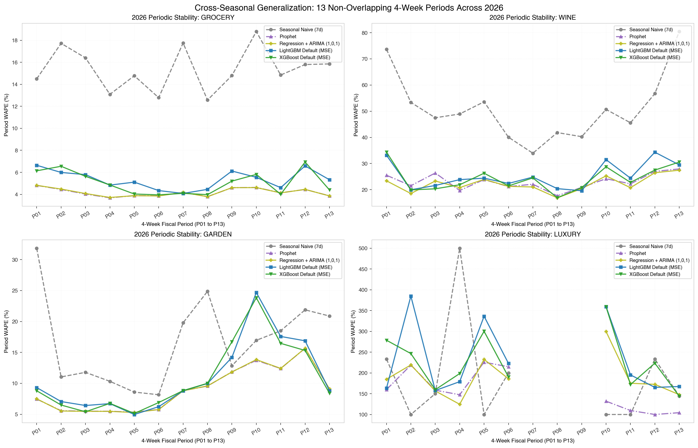
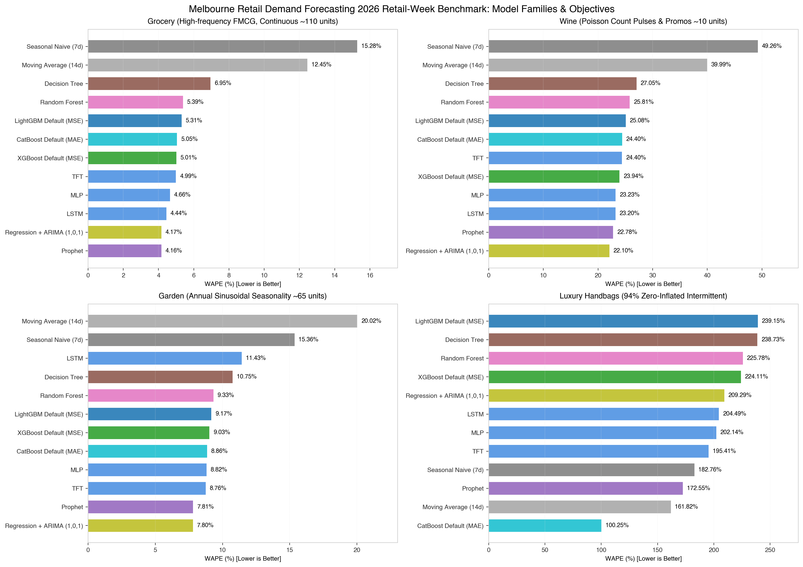

> 📌 **阶段归属**：阶段二 · 模型探索与教学剖析 (Stage 2: Model Sandbox & In-depth Tutorial)  
> 🔗 **配套交互实验 Notebook**：[`notebooks/24a-mlp-tutorial.ipynb`](../../notebooks/24a-mlp-tutorial.ipynb) · [`notebooks/24b-lstm-tutorial.ipynb`](../../notebooks/24b-lstm-tutorial.ipynb) · [`notebooks/24c-tft-tutorial.ipynb`](../../notebooks/24c-tft-tutorial.ipynb) · [`notebooks/32-benchmark-neural-models.ipynb`](../../notebooks/32-benchmark-neural-models.ipynb)  
> 📊 **统一评测横向对比报告**：[`docs/reports/2026-retail-week-v4-first-stage-report.md`](../reports/2026-retail-week-v4-first-stage-report.md) · [天梯榜 Leaderboard](../../README.md#综合排行榜)

## 一、四周预测为什么会用到神经网络？

零售团队每天需要为未来四周安排采购。历史销量包含最近的需求水平、周内模式和促销后的变化；未来又有折扣、假日与营业计划。工程师希望模型共同读取这些信息，并直接产生一组未来预测。

神经网络可以学习输入窗口到未来输出的映射。实际价值取决于样本组织、未来输入的可见性、训练数据规模与交付成本。**网络结构增加表达能力，工程验证决定这些能力是否改善补货预测。**

本文沿用 Prophet 和树模型教程的 VIC 教学案例。配套 [MLP Notebook](../../notebooks/24a-mlp-tutorial.ipynb)、[LSTM Notebook](../../notebooks/24b-lstm-tutorial.ipynb)、[TFT Notebook](../../notebooks/24c-tft-tutorial.ipynb) 和 [神经网络比较 Notebook](../../notebooks/32-benchmark-neural-models.ipynb)，分别比较训练内回看、历史滚动验证和最终 28 天测试。

LSTM 与 TFT 的完整实现分别来自 PyTorch 和 PyTorch Forecasting；后者也提供需求预测教程 [1]。本文记录的历史快照曾恢复每个起点对应的真实检查点，并验证恢复预测与此前逐日预测完全一致。当前仓库的权威 wine/garden 数据已经更新，因此 Notebook 默认从头训练全部 TFT；历史 checkpoint 只能与其 manifest 记录的输入版本配套使用。

## 二、业务任务与数据：区分三类输入

问题评估（Problem Assessment）需要确定预测用于哪类补货决策，标签是潜在需求还是观测销量，更新频率和预测期限分别是什么。数据与业务知识获取（Data and Knowledge Acquisition）阶段，还要明确字段何时可见。

| 输入类型 | 零售例子 | 本文处理 |
| --- | --- | --- |
| 静态信息（Static covariates） | 门店、商品类别、包装规格 | TFT 中保留序列标识；当前每案例独立训练，标识不能带来跨商品共享 |
| 已知未来输入（Known future inputs） | 目标日期、星期、假日、预先公布的折扣计划 | 传入未来 28 天日历与业务特征 |
| 只在历史可见的输入（Observed historical inputs） | 已实现销量、过去实际库存、历史天气 | 本例使用历史销量；未来真实销量从推理输入排除 |

四个案例分别为平滑加法商超需求（`grocery`）、泊松采样的低销量红酒需求（`wine`）、强季节庭院需求（`garden`），以及 94.03% 极度零膨胀的奢侈品手袋需求（`luxury`）。`conditional_mean` 为生成器无噪声均值，`latent_demand` 已包含随机性，二者仅用于诊断。门店品牌和消费机制均为教学背景，不能据此推断真实业务表现。

缺货和闭店日期在训练中设为无效标签。神经网络要求张量有限，因此历史销量用最近有效值前向填充，首部必要时使用当时训练均值；目标损失在无效日期权重为零。原始销售记录继续保存在 CSV。填充与屏蔽缓解输入问题，仍需验证是否扭曲真实的高需求缺货关系。

## 三、将一条序列转换成监督学习样本

从预测起点 $T$ 出发，模型读取过去 $L$ 天和未来 $H$ 天的已知特征：

$$
\hat{\mathbf y}_{T+1:T+H}
=F_{\boldsymbol\theta}
\left(
\mathbf Y_{T-L+1:T},
\mathbf X_{T-L+1:T},
\mathbf X_{T+1:T+H}
\right).
$$

变量定义：$T$ 是预测截止日，$L=84$ 是历史窗口长度，$H=28$ 是未来预测长度；$\mathbf Y$ 为历史销量，$\mathbf X$ 为日历与业务特征；$F_{\boldsymbol\theta}$ 为参数为 $\boldsymbol\theta$ 的网络，$\hat{\mathbf y}$ 为未来预测向量。粗体表示向量或矩阵，冒号表示连续索引范围，帽号表示预测。

本例同时产生未来 28 天点预测。推理时不会把未来真实销量喂入网络。某些其他模型采用自回归输出，需要递归使用自身预测或采样值；模型的输入组织应随预测策略明确。

训练样本允许共享部分历史和目标日期，但所有目标必须落在当时训练截止日前。本文 MLP/LSTM 每 7 天建立一个训练起点；TFT 沿用每日滑窗协议。内部验证保留起点之前的最后 28 天，候选训练样本的目标全部在内部截止日前结束。训练 DataLoader 可以打乱已合法构造的训练样本，训练与验证的时间边界继续保持。

销量缩放为：

$$
\tilde y_t=\frac{y_t-\mu_{\mathrm{train}}}{s_{\mathrm{train}}},
\qquad
\hat y_t=\mu_{\mathrm{train}}+s_{\mathrm{train}}\hat{\tilde y}_t.
$$

变量定义：$y_t$ 是原销量，$\tilde y_t$ 是内部缩放值，$\mu_{\mathrm{train}}$ 与 $s_{\mathrm{train}}>0$ 分别是当时有效训练标签的均值和标准差；帽号表示预测，波浪号表示缩放坐标。输入特征另用训练历史拟合的标准化器转换。

内部验证使用核心训练历史的缩放参数；最终重训重新拟合完整当时历史的缩放参数。验证损失还原到原单位时，要使用产生该验证输入的核心训练标准差。

## 四、MLP 与 LSTM 怎样读取历史？

### MLP：先形成历史上下文

本文 MLP 将 84 天历史销量输入一个 32 维隐层，形成上下文。这个上下文与每个未来日期的特征拼接，再经过共享输出头预测该日销量。

$$
\mathbf r_T=\operatorname{ReLU}(W\tilde{\mathbf Y}_{T-L+1:T}+\mathbf b),
\qquad
\hat{\tilde y}_{T+h}=G_{\boldsymbol\psi}(\mathbf r_T,\tilde{\mathbf x}_{T+h}).
$$

变量定义：$\mathbf r_T$ 是历史上下文向量；$W,\mathbf b$ 是隐层权重与偏置；$\operatorname{ReLU}(a)=\max(0,a)$，对向量逐元素应用；$G_{\boldsymbol\psi}$ 为输出头，参数为 $\boldsymbol\psi$；$\tilde{\mathbf x}_{T+h}$ 是标准化后的未来特征，$h$ 为预测步长。$\tilde{\mathbf Y}$ 为缩放历史销量。

这个版本保留各历史位置对应的独立权重，结构简单，适合检查历史窗口是否带来收益。它没有专门的递归记忆结构。

### LSTM：通过门控更新记忆

LSTM 逐日读取历史销量及历史日历/业务特征。其门控状态按以下方式计算 [2]：

$$
\begin{aligned}
\mathbf i_t&=\sigma(W_i\mathbf z_t+U_i\mathbf h_{t-1}+\mathbf b_i),\\
\mathbf f_t&=\sigma(W_f\mathbf z_t+U_f\mathbf h_{t-1}+\mathbf b_f),\\
\tilde{\mathbf c}_t&=\tanh(W_c\mathbf z_t+U_c\mathbf h_{t-1}+\mathbf b_c),\\
\mathbf c_t&=\mathbf f_t\odot\mathbf c_{t-1}+\mathbf i_t\odot\tilde{\mathbf c}_t,\\
\mathbf o_t&=\sigma(W_o\mathbf z_t+U_o\mathbf h_{t-1}+\mathbf b_o),\\
\mathbf h_t&=\mathbf o_t\odot\tanh(\mathbf c_t).
\end{aligned}
$$

变量定义：$\mathbf z_t$ 是当前历史输入；$\mathbf h_t$ 是隐藏状态，$\mathbf c_t$ 是记忆状态，$\tilde{\mathbf c}_t$ 是候选记忆；$\mathbf i_t,\mathbf f_t,\mathbf o_t$ 分别为输入门、遗忘门和输出门；$W_g,U_g,\mathbf b_g$ 是各门或候选记忆的输入权重、状态权重和偏置，$g$ 对应 $i,f,c,o$。$\sigma$ 是输出位于 0 与 1 之间的 sigmoid 函数，$\tanh$ 是双曲正切函数，$\odot$ 表示逐元素乘法；下标 $t-1$ 表示上一历史时刻。

门控决定保留多少旧记忆、写入多少新信息，以及输出哪些状态。本文取历史窗口末端的隐藏状态作为上下文，再与各未来日已知输入拼接。所有未来日共享同一个历史上下文，输出头同时生成 28 天预测。

代码核心为：

```python
_, (hidden, cell) = lstm(history_tensor)
context = hidden[-1]
context = context[:, None, :].expand(-1, 28, -1)
prediction = head(torch.cat([context, future_features], dim=-1))
```

`history_tensor` 包含历史销量与特征，`future_features` 仅包含已知未来特征；隐藏维度决定上下文容量，输出头学习上下文与未来条件的关系。门控并不保证任意长历史都能有效利用，窗口长度仍需在训练历史内验证。

## 五、TFT 增加了哪些结构？

TFT 将静态信息、历史观测和已知未来输入纳入多步预测结构，组合变量选择、局部序列处理、门控与时间注意力等模块。原论文研究了多种真实数据上的多步预测与解释方法 [3]。

它的作用可以按信息流理解：静态信息影响序列表示；变量选择模块调整不同输入的参与程度；LSTM 层处理局部时间关系；注意力层聚合与目标相关的时间信息；输出层产生各未来步长的结果。这些模块与普通“给 LSTM 加一个注意力层”的实现存在结构差异。

注意力的一般计算为：

$$
\operatorname{Attention}(Q,K,V)
=\operatorname{softmax}\left(\frac{QK^\top}{\sqrt{d_k}}\right)V.
$$

变量定义：$Q$、$K$、$V$ 分别为查询、键和值的表示矩阵；$d_k$ 为键的维度；$\top$ 表示转置，$\sqrt{\cdot}$ 为平方根；$\operatorname{softmax}$ 将每行分数转成和为 1 的非负权重。这个公式解释注意力的基本计算，具体 TFT 实现还包含自身的头共享、门控和时序遮罩设计。

Notebook 使用完整 PyTorch Forecasting 模型 [1]：

```python
model = TemporalFusionTransformer.from_dataset(
    training_dataset,
    learning_rate=0.005,
    hidden_size=16,
    attention_head_size=2,
    hidden_continuous_size=8,
    lstm_layers=1,
    dropout=0.1,
    output_size=1,
    loss=RMSE(),
)
```

| 配置 | 教学设定与含义 |
| --- | --- |
| 历史/未来长度 | 84/28 天，读取一个历史窗口并输出四周结果 |
| `hidden_size` | 共享隐藏表示的容量，本例为小型 16 维网络 |
| `attention_head_size` | 注意力头数，本例为 2 |
| `hidden_continuous_size` | 连续输入变量表示的维度，本例为 8 |
| `dropout` | 训练时的随机失活比例，本例为 0.1 |
| `output_size=1`、`RMSE()` | 每日输出一个点预测；本例没有输出分位数区间 |
| 内部选择 | 最多 25 个 epoch，起点前的验证窗口选择轮数，再重训当时全部历史 |

TFT 的变量选择权重和注意力可以辅助理解模型的输入使用方式。相关变量、训练组织和模型结构会影响这些权重，因此它们需要与业务知识、消融实验一起解读，无法直接提供促销的因果效应。

## 六、损失函数、训练与数据泄漏检查

MLP/LSTM 的掩码均方误差为：

$$
\mathcal L
=\frac{\sum_{b,h}v_{b,h}(y_{b,h}-\hat y_{b,h})^2}{\sum_{b,h}v_{b,h}}.
$$

变量定义：$b$ 为训练样本编号，$h$ 为样本内预测步长；$v_{b,h}$ 为有效目标权重，有效为 1，无效为 0；$y_{b,h}$、$\hat y_{b,h}$ 为同一缩放坐标下的标签与预测；$\mathcal L$ 为平均损失，$\sum_{b,h}$ 对样本及步长求和。实现对分母设置最小正值以处理空权重批次。

训练使用反向传播（Backpropagation）计算梯度，用 AdamW 优化器更新参数，并通过梯度裁剪限制一次更新中的梯度范数。验证窗口选择 epoch 数后，模型从固定种子初始化，在完整当时历史上按该轮数重新训练。数据、特征、窗口和轮数共同决定最终模型，网络名称本身不足以解释结果。

推理检查分成两层：训练与缩放只读取起点之前历史；未来销量被替换为极端占位值后，MLP/LSTM 输入张量保持相同，TFT 预测保持相同。TFT 的目标只属于历史未知输入，未来解码器使用已知输入。

历史快照还曾将恢复后的 TFT 逐日预测与上一轮保存的预测逐一比较：滚动验证、最终测试及训练回看的最大差异均为零。这证明这些检查点能复现对应的旧数据版本；它不代表检查点可与当前已更新的 wine/garden 数据混用。当前默认执行会重新训练，耗时口径应以新运行记录为准。

## 七、四个零售场景的实际表现与 2026 工业基准解释

为客观评估深度学习模型在零售预测中的真实收益与开销，我们采用 2026 年 52 个完整零售周的 13-fold 滚动评估基准（`2026-retail-week-expanding-v4`，发布版本 `20261106-neural-v1`）。在统一协议下，MLP、LSTM、TFT 与基准模型在四个场景上的评估指标如下：

| 场景 | 模型 | WAPE | Bias | MAE | RMSE | ZeroRecall | EventF1 | 结构特点与分析 |
| :--- | :--- | ---: | ---: | ---: | ---: | ---: | ---: | :--- |
| **商超刚需品**<br>(`grocery`) | **Prophet (统计参考)** | 4.16% | +0.19% | 5.093 | 6.442 | N/A | 100.0% | 显式周期/趋势分解基准 |
| | **LSTM (长短期记忆网络)** | **4.44%** | -0.19% | 5.435 | 6.833 | N/A | 100.0% | **神经模型最佳**，逼近 Prophet 与 ARIMA (4.17%) |
| | MLP (多层感知机) | 4.66% | +0.81% | 5.694 | 7.176 | N/A | 100.0% | 简单前馈上下文映射，优于 GBDT (5.01%) |
| | TFT (时间融合变换器) | 4.99% | -1.96% | 6.106 | 7.890 | N/A | 100.0% | 多头注意力与 VSN 在平滑加法序列上容量偏大 |
| | Seasonal naive (基线) | 15.28% | -8.89% | 18.696 | 22.953 | N/A | 100.0% | 遗漏趋势与动态折扣 |
| **单 SKU 红酒**<br>(`wine`) | **Regression + ARIMA (参考)** | 22.10% | +2.14% | 2.586 | 3.265 | N/A | 100.0% | 动态回归广度榜第一 |
| | Prophet (统计参考) | 22.78% | -1.03% | 2.665 | 3.375 | N/A | 100.0% | 负二项/泊松事件脉冲基线 |
| | **LSTM** | **23.20%** | +2.54% | 2.715 | 3.450 | N/A | 100.0% | **神经模型最佳**，优于 LightGBM (25.08%) |
| | MLP | 23.23% | +3.17% | 2.717 | 3.409 | N/A | 100.0% | 门控与非线性编码周度周期 |
| | TFT | 24.40% | +0.49% | 2.854 | 3.587 | N/A | 100.0% | 低计数方差下注意力权重略有发散 |
| | Seasonal naive (基线) | 49.26% | +4.39% | 5.762 | 8.043 | N/A | 99.4% | 无法识别成箱促销与派对 |
| **庭院耗材**<br>(`garden`) | **Regression + ARIMA (参考)** | 7.80% | -0.21% | 5.605 | 6.971 | N/A | 100.0% | 傅里叶年周期第一 |
| | Prophet (统计参考) | 7.81% | -0.23% | 5.611 | 6.975 | N/A | 100.0% | 平滑正弦加法季节 |
| | **TFT** | **8.76%** | -1.11% | 6.292 | 7.998 | N/A | 100.0% | **神经模型最佳**，与 CatBoost (8.73%) 齐平 |
| | MLP | 8.82% | -0.62% | 6.333 | 7.851 | N/A | 100.0% | 历史窗口上下文拟合清仓 |
| | LSTM | 11.43% | +3.44% | 8.212 | 11.081 | N/A | 100.0% | 长周期递归存在时序记忆衰减 |
| | Seasonal naive (基线) | 15.36% | -2.92% | 11.030 | 15.556 | N/A | 99.4% | 年季节与长周末错位 |
| **奢侈品手袋**<br>(`luxury`) | Prophet (统计参考) | 172.55% | -15.07% | 0.138 | 0.397 | 99.1% | 8.0% | 连续模型产生轻微假正例 |
| | Seasonal naive (基线) | 182.76% | -3.45% | 0.146 | 0.490 | 93.5% | 8.9% | 偶遇 VIP 周末脉冲 |
| | **TFT** | **195.41%** | +10.84% | 0.157 | 0.392 | 99.7% | 0.0% | **神经模型最佳**，保持 99.7% 零召回 |
| | MLP | 202.14% | +23.11% | 0.162 | 0.397 | 99.7% | 8.7% | 单序列 MSE 目标被零值主导 |
| | LSTM | 204.49% | +25.52% | 0.164 | 0.390 | 99.7% | 8.7% | 零膨胀梯度消失与均值塌陷 |

### 7.2 关键架构洞见与消融分析

1. **结构复杂度不等于泛化精度**：
   - 在高频商超 (`grocery`) 中，轻量级 LSTM（4.44%）与 MLP（4.66%）均超越了参数量更大的 TFT（4.99%），并显著击败了默认 GBDT 模型（5.01% ~ 5.31%）。在平滑趋势与加法周期占主导的场景下，紧凑的循环门控能够更专注地捕捉短期连续残差，而复杂的多头注意力机制反而引入了轻微的参数开销与方差。
2. **长程正弦周期与注意力机制的匹配**：
   - 在强季节庭院 (`garden`) 中，TFT（8.76%）显著优于 LSTM（11.43%），几乎与表现最优的 CatBoost 对称树（8.73%）并驾齐驱。LSTM 逐日串行推进隐藏状态 $\mathbf h_t$，在跨越 84 天历史并向后解码 28 天（跨度长达 112 天）时，门控机制会遭遇长程依赖衰减；而 TFT 的自注意力与门控残差网络（GRN）可以直接对齐历史上同一季节相位的特征，有效克服了递归遗忘。
3. **单序列局部训练在极度零膨胀下的局限性**：
   - 在奢侈品手袋场景中，三类神经网络的 WAPE 均在 195% ~ 204% 之间。因为当前评测遵循单序列局部训练协议，当 94.03% 的样本标签为 0 时，MSE 损失的梯度绝大多数时间将网络推向输出常数零；偶然到来的 VIP 购买事件被视为极端离群点惩罚，无法构建稳健的非线性映射。这为企业界提供了明确指引：**面对极度稀疏与零膨胀序列，不能仅靠单序列本地网络，而必须转向全局跨序列模型（Global models）或结合 Tweedie/零膨胀泊松分布**。





MLP/LSTM 的学习曲线来自内部验证，纵轴为缩放后的验证 RMSE；不同案例的缩放不同，不能直接跨案例比较这个纵轴。原单位误差则在统一评价表中报告。

商超结构接近平滑加法模型，历史上下文和未来计划都有明确规律。红酒含计数噪声，单个年份的少量派对日期不容易支撑稳定的复杂关系；庭院年周期强，不同需求阶段会改变相对误差和模型排序。

当前每案例单独训练，MLP/LSTM 与 TFT 的滑窗步长、损失与容量不同，调参预算也不同。结果反映这些完整方案的共同作用。四个窗口足以支持教学诊断，仍无法决定真实零售业务中的稳定排名。

## 八、工业模型选择：从局部点预测到全局概率预测

“使用神经网络”涉及不同的信息组织与输出分布。下列架构都有论文或成熟工程实现依据，但具体工业适用性需要项目验证：

| 架构 | 主要学习方式 | 对零售任务的意义 |
| --- | --- | --- |
| MLP 窗口模型 | 历史窗口到未来输出的非线性映射 | 建立简单神经基线，检验复杂结构的额外收益 |
| LSTM | 递归门控编码历史 | 研究历史上下文与时序状态；可配直接多步头或自回归输出 |
| TFT | 融合静态、历史、未来输入与注意力 | 适合验证多种协变量的多步预测方案；需要评估训练与解释成本 |
| DeepAR | 多条相关序列共享自回归概率网络 | 提供概率分布预测，强调跨序列学习和逐步采样 [4] |
| N-BEATS | 多层网络块进行预测与回看分解 | 提供另一种历史窗口建模路线；原始架构与外生变量扩展需要分别理解 [5] |

DeepAR 研究大量相关时间序列上的概率预测，不能把只训练一个 SKU 的 LSTM 实验视为对它的替代验证 [4]。N-BEATS 的原始论文讨论基于历史窗口的预测结构，也不等于 TFT 的未来协变量接口 [5]。本文只实际实现 MLP、LSTM、TFT，其他架构作为研究方向。

大量门店商品场景可以建设全局模型（Global model），共享网络参数并接入商品/门店信息。必须处理序列尺度、历史长度、类别变化与冷启动，并检查大销量商品是否主导训练目标。本文三个局部模型尚未检验这种共享收益。

红酒等计数需求还可研究 Poisson 或负二项输出；用于安全库存的任务可研究分位数与概率预测。分位数损失为：

$$
\ell_\alpha(y,q)=(\alpha-\mathbb 1\{y<q\})(y-q).
$$

变量定义：$\alpha\in(0,1)$ 为目标分位数水平，$q$ 为该分位数预测，$y$ 为观测；$\mathbb 1\{y<q\}$ 为条件成立时取 1、否则取 0 的指示函数，$\ell_\alpha$ 为损失。这个方向需要新增训练与校准实验，当前点预测 Notebook 没有检验其区间质量。

## 九、从模型实验到运行系统

模型原型需要进入完整系统建设（Complete System）、评估与验证（Evaluation and Validation）、部署与集成，以及维护运行。训练任务应保存输入快照、窗口配置、特征 schema、目标缩放、随机种子、最佳轮数和模型权重；推理必须恢复同一转换过程。

CI 检查张量 shape、时间边界、保存加载和缺货掩码；CT 更新历史后训练候选版本，使用代表性窗口与条件切片设置质量门槛；CD 发布模型、预处理和预测接口，保留上一个稳定版本。生产系统还需要 GPU/CPU 成本预算、批量推理、预测时限、异常回退与漂移监测。

先用 MLP 与 LSTM 检查窗口信息的收益，再用 TFT 检验融合结构是否带来稳定改善。若未来要研究全局模型或概率输出，应建立新的训练与独立评价设计。模型复杂度值得增加的条件，是团队获得可重复的业务改善，并能承担对应的数据与运行责任。

## 参考文献

[1] PyTorch Forecasting. Demand forecasting with the Temporal Fusion Transformer. v1.5.0. <https://pytorch-forecasting.readthedocs.io/en/v1.5.0/tutorials/stallion.html>

[2] PyTorch. LSTM implementation and gate equations. <https://github.com/pytorch/pytorch/blob/main/torch/nn/modules/rnn.py>

[3] Lim, B., Arık, S. Ö., Loeff, N., & Pfister, T. Temporal Fusion Transformers for Interpretable Multi-horizon Time Series Forecasting. <https://arxiv.org/abs/1912.09363>

[4] Salinas, D., Flunkert, V., Gasthaus, J., & Januschowski, T. DeepAR: Probabilistic Forecasting with Autoregressive Recurrent Networks. <https://arxiv.org/abs/1704.04110>

[5] Oreshkin, B. N., Carpov, D., Chapados, N., & Bengio, Y. N-BEATS: Neural Basis Expansion Analysis for Interpretable Time Series Forecasting. <https://arxiv.org/abs/1905.10437>
