> 📌 **阶段归属**：阶段二 · 模型探索与教学剖析 (Stage 2: Model Sandbox & In-depth Tutorial)  
> 🔗 **配套交互实验 Notebook**：[`notebooks/20-prophet-tutorial.ipynb`](../../notebooks/20-prophet-tutorial.ipynb) · [`notebooks/21-prophet-luxury-diagnosis.ipynb`](../../notebooks/21-prophet-luxury-diagnosis.ipynb)  
> 📊 **统一评测横向对比报告**：[`docs/reports/2026-retail-week-v4-first-stage-report.md`](../reports/2026-retail-week-v4-first-stage-report.md) · [天梯榜 Leaderboard](../../README.md#综合排行榜)

## 一、引言：从零售需求预测问题到 Prophet

零售需求预测不仅要估计每个门店—商品组合未来每天的需求，还要识别历史销量中的时间规律、业务影响和观测限制。以一家制定未来四周补货计划的墨尔本超市为例，周末形成周期规律，促销和公共假日形成事件效应，需求水平的长期变化形成趋势；闭店、缺货或商品未在售则可能使观测销量降低或为零，但不一定表示潜在需求同步下降。

Meta 开源的 [Prophet](https://facebook.github.io/prophet/) 是一种时间序列预测方法，提供 Python 实现。它使用可分解模型组合趋势、季节性和节假日效应，并可加入额外业务变量 [1]。Prophet 更适合季节规律明显且历史数据覆盖多个季节周期的序列，因此本文不预设它适合所有零售序列。

**本文构造了模拟零售场景的教学数据，以门店—SKU（库存管理单位）组合定义一条需求序列，以日为观测与预测粒度，预测未来 28 天的每日需求，并讨论如何将这一流程扩展到大规模多序列预测。** 文章结合模型公式、参数估计、预测重建、时间回测和候选模型比较，分析 Prophet 在不同数据条件下的适用条件与边界。文中的数据和业务参数均为教学设定，不代表任何企业的实际经营规律。

正文先定义预测对象并建立教学案例，再依次说明 Prophet 的模型结构、数据处理、模型配置、MAP 参数估计和每日预测重建；随后通过时间回测、误差诊断和参数实验评价模型，比较间歇性需求方法、ARIMA、树模型与跨序列建模方案；最后讨论批量训练、预测交付、监控和回退。完整 Python 代码、配套 Notebook 和运行说明见 GitHub 仓库：[retail-demand-forecast](https://github.com/cuicaihao/retail-demand-forecast)。

## 二、需求预测项目：从预测对象到案例设定

### 销量与需求：先确定预测对象

本文约定：`store_id` 唯一标识一家门店，`product_id` 标识一个产品概念，`sku_id` 标识具有具体规格、容量、包装或销售单位的库存管理单位。同一个 `product_id` 可以对应多个 `sku_id`。例如，某品牌意面的 500 g 袋装和 1 kg 袋装可以共享一个 `product_id`，但分别使用不同的 `sku_id`。

`store_id` 与 `sku_id` 共同定义一条需求序列；每个日级观测由业务日期 `business_date` 标识，因此日级记录键为 `store_id + sku_id + business_date`。不同企业的商品主数据结构可能不同，接入真实系统时应以实际定义为准。

在这一粒度下，团队还要明确预测目标：模型预测的是系统记录的实际销量，还是顾客在供给不受限时希望购买的潜在需求。实际销量可以直接观测；潜在需求更接近补货决策所需的目标，但在缺货期间通常需要另外估计。两种目标对应不同的数据处理、模型解释和业务用途。

实际销量同时受潜在需求和有效供给约束。例如，顾客希望购买 100 件，但当天只能满足 60 件需求，最终最多售出 60 件。在门店正常营业且不考虑替代购买、渠道转移和延迟购买的简化条件下：

$$
y_t^{\mathrm{obs}}=\min(D_t,V_t)
$$

记号说明：

| 记号 | 定义与读法 |
| --- | --- |
| $y_t^{\mathrm{obs}}$ | 营业日观测到的售出件数；`obs` 表示观测，闭店状态在下方另行处理 |
| $D_t$ | 第 $t$ 天的潜在需求件数，即在供给不受限时顾客希望购买的数量 |
| $V_t$ | 第 $t$ 天能够实际满足需求的有效供给件数，需要结合库存及日内供给情况确定 |
| $\min(D_t,V_t)$ | 取需求与有效供给中的较小值 |

三个数量均非负，并采用相同商品、门店和日期口径。该式还简化了日内供需到达顺序，不能仅凭当天总库存推断是否发生缺货。

真实业务还涉及替代购买、渠道转移和延迟购买，但上述关系已经说明：发生缺货时，观测销量是对潜在需求的删失观测（censored observation）。如果直接把受供给限制的销量当作完整需求训练模型，模型可能低估真实需求。

生产数据至少需要区分以下状态：

| 当天状态 | 数据含义 | 可采用的处理 |
| --- | --- | --- |
| 正常营业、商品可购买、供给充足但没有售出 | 零销量观测；在本文的简化条件下作为零需求使用 | 保留为零 |
| 缺货或全天供给不足 | 潜在需求未被完整观测，销量是受供给约束的删失观测 | 保留缺货标记；教学基准可在模型目标列中设为缺失 |
| 门店关闭 | 没有正常销售机会 | 根据预测目标建模营业状态或排除 |
| 数据接口失败 | 观测缺失 | 修复或保留缺失，不能自动补零 |
| 商品尚未上架或已经退市 | 生命周期边界 | 按在售区间处理 |

教学基准在模型目标列中屏蔽缺货日，同时保留原始销量和缺货标记，避免模型把受供给限制的销量解释为低需求。模型随后使用其余有效营业日的销量拟合需求规律，但这不等于恢复了缺货日的潜在需求；被屏蔽日期仍需通过专门的需求修复方法估计。

### 教学案例：销售数据生成与时间划分

本文为教学案例构造一条模拟澳大利亚大型超市高频食品的日销量序列。数据覆盖 2022 年 7 月 4 日至 2027 年 6 月 27 日，共 1,820 天（260 个完整周）；模型使用截至 2026 年 11 月 29 日的数据训练，并预测 2026 业务年第 13 期（P13，2026-11-30 至 2026-12-27）的 28 天。所有数据和业务规律均为教学设定，不代表任何企业的实际销售情况。

该案例用于展示趋势、周期、假日、折扣、缺货和闭店如何影响销量。它代表非零观测较多的高频需求，不覆盖大量零销量的间歇性需求；相关模型将在第七章讨论。

假设门店正常营业，当天的无噪声需求均值由趋势、周末、年周期、假日与折扣贡献相加，再加入随机噪声：

$$
\mu_t^{\mathrm{open}}=85+0.015t+16W_t+
14\sin\!\left(\frac{2\pi(t-15)}{365.25}\right)+28H_t+130q_t,
\qquad\\
D_t^{\mathrm{sim}}=\max(0,\mu_t^{\mathrm{open}}+\epsilon_t),
\quad \epsilon_t\overset{\mathrm{iid}}{\sim}\mathcal N(0,6^2)
$$

其中，$\mu_t^{\mathrm{open}}$ 表示假设门店正常营业时的无噪声需求均值；$t$ 是自 2023 年 1 月 1 日起的日数，$W_t$、$H_t$ 和 $q_t$ 分别表示周末、公共假日和折扣比例。$D_t^{\mathrm{sim}}$ 是加入随机噪声后的仿真潜在需求。

$\epsilon_t$ 是跨日期独立同分布的随机噪声，服从均值为 0、方差为 $6^2$ 的正态分布，因此标准差为 6 件。上标 `open` 和 `sim` 分别表示假设正常营业的情景与仿真量。

有了潜在需求，还要经过营业和供给约束，才能得到销售记录。营业日先取需求与供给中较小的数量，再按件取整；闭店日则直接记为零：

$$
y_t^{\mathrm{sales}}=O_t\,\operatorname{round}\!\left[\min(D_t^{\mathrm{sim}},V_t)\right]
$$

有效供给量采用以下简化规则：

$$
V_t=
\begin{cases}
20, & \text{当天被标记为缺货},\\
+\infty, & \text{否则}.
\end{cases}
$$

其中，$O_t$ 是 0/1 营业状态，$V_t$ 是有效供给量，$y_t^{\mathrm{sales}}$ 是经过供给约束并按件取整后的观测销量。代码通过 $O_t$ 将闭店销量设为零。固定的 20 件上限仅用于生成教学数据；本例没有模拟连续变化的库存轨迹。

折扣 $q_t$ 在每 14 天的前 7 天为 0.20，其余为 0；营业日以 3% 概率随机标记缺货。教学门店在 Good Friday（受难周五）与圣诞节闭店，其余日期按全天营业处理。实际使用时，需要根据商店类别与适用许可核对交易限制，并提供门店营业日历 [2]。

生成的 CSV 包含日期 `ds`、原始观测销量 `y`、营业标记 `is_open`、闭店假日标记 `is_closed_holiday`、折扣 `discount` 和缺货标记 `stockout`。这些字段在真实业务系统中通常可以记录或预先确定。文件还保留 `conditional_mean` 和 `latent_demand`，用于核对合成数据的生成机制和诊断模型误差；这两列不作为模型输入，真实业务通常也无法直接观测。

原始观测销量是构造模型目标列的基础。训练前，缺货日和闭店日对应的目标值被设为缺失，原始 CSV 仍保留销售记录。闭店日的潜在需求表示“假设营业”的反事实（counterfactual）；本例没有模拟 ANZAC Day 的营业时段缩短。

下图先展示完整五年销量，再放大包含折扣、缺货和闭店的 2026 年第四季度窗口。

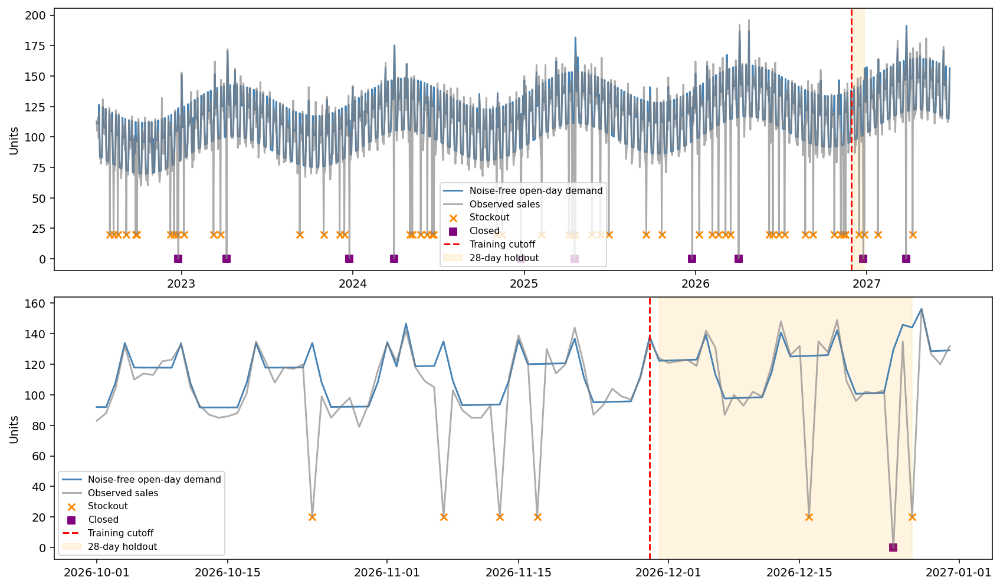

下表列出同一窗口中的日级样本，只展示上述六个现实业务字段。3 月 30 日发生缺货，观测销量受 20 件供给上限约束；4 月 7 日因 Good Friday 闭店，观测销量记为零。

| `ds` | `y` | `is_open` | `is_closed_holiday` | `discount` | `stockout` |
| --- | ---: | --- | --- | ---: | --- |
| 2023-03-18 | 138 | `True` | `False` | 0.20 | `False` |
| 2023-03-19 | 115 | `True` | `False` | 0.00 | `False` |
| 2023-03-20 | 102 | `True` | `False` | 0.00 | `False` |
| 2023-03-21 | 97 | `True` | `False` | 0.00 | `False` |
| 2023-03-22 | 102 | `True` | `False` | 0.00 | `False` |
| 2023-03-23 | 95 | `True` | `False` | 0.00 | `False` |
| 2023-03-24 | 97 | `True` | `False` | 0.00 | `False` |
| 2023-03-25 | 113 | `True` | `False` | 0.00 | `False` |
| 2023-03-26 | 134 | `True` | `False` | 0.20 | `False` |
| 2023-03-27 | 128 | `True` | `False` | 0.20 | `False` |
| 2023-03-28 | 123 | `True` | `False` | 0.20 | `False` |
| 2023-03-29 | 126 | `True` | `False` | 0.20 | `False` |
| 2023-03-30 | 20 | `True` | `False` | 0.20 | `True` |
| 2023-03-31 | 128 | `True` | `False` | 0.20 | `False` |
| 2023-04-01 | 146 | `True` | `False` | 0.20 | `False` |
| 2023-04-02 | 115 | `True` | `False` | 0.00 | `False` |
| 2023-04-03 | 97 | `True` | `False` | 0.00 | `False` |
| 2023-04-04 | 100 | `True` | `False` | 0.00 | `False` |
| 2023-04-05 | 90 | `True` | `False` | 0.00 | `False` |
| 2023-04-06 | 91 | `True` | `False` | 0.00 | `False` |
| 2023-04-07 | 0 | `False` | `True` | 0.00 | `False` |

这组平滑周期与稳定加法效应便于将生成公式和拟合组件逐项对照。改变种子、日期或公式后，需要重新运行模型，并更新正文的组件值与评估结果。完整生成过程及字段说明见数据生成 Notebook。

## 三、Prophet 的建模理论：怎样表达时间与业务规律

本章从模型结构出发，解释 Prophet 如何表示需求序列中的时间规律和业务影响。Prophet 将需求序列分解为趋势、季节性、节假日效应和额外业务变量，并为每个成分建立相应的数学形式。读者可以对照第二章的数据生成规则，理解这些规律如何进入模型。第四章和第五章将分别说明输入转换与参数估计。

为避免工程术语与统计术语混用，本文先作统一约定。数据表中的 `y` 在机器学习中称为目标变量，在统计建模中也称响应变量；用于拟合的一行数据称为训练样本，在似然推导中称为观测；模型输入列统称特征，其中参与回归计算的变量也称回归变量或协变量。工程流程可以批量训练模型，单个 Prophet 模型则通过拟合估计参数。本文中的标签仅表示数据管道中已观测的目标值或其可用状态，不应与无法直接观测的潜在需求混为一谈。

### 从加法模型（additive model）理解预测

本文用 $t$ 表示从固定起点开始计算的天数，用 $y(t)$ 表示第 $t$ 天观测到的目标变量，用 $\hat y(t)$ 表示模型给出的点预测。为便于解释，本章公式采用天数和销量件数等业务尺度。Prophet 在拟合时会对时间和目标值进行内部缩放，因此比较公式参数与模型内部参数之前，需要先统一尺度。每个符号在首次出现时定义，后文继续沿用；内部缩放后的量在符号上方加波浪号。

Prophet 的加法模型将每天的观测值表示为几部分之和：长期趋势、重复出现的季节性、节假日与业务事件效应，以及模型尚未解释的随机误差。各部分采用与目标变量相同的加法尺度：

$$
y(t)=g(t)+s(t)+h(t)+\varepsilon_t
$$

变量说明：

| 变量 | 定义 |
| --- | --- |
| $t$ | 时间坐标，本文以天为单位 |
| $y(t)$ | 时刻 $t$ 观测到的目标变量；统计建模中也称响应变量，在案例中是每日观测销量 |
| $g(t)$ | 趋势（trend），表示非周期性的长期变化 |
| $s(t)$ | 季节性（seasonality），表示重复出现的周期变化 |
| $h(t)$ | 节假日或业务事件效应 |
| $\varepsilon_t$ | 误差项，表示上述成分没有解释的变化；下标 $t$ 表示该日的误差 |

如果还提供折扣率、陈列状态等业务特征，模型会为每个特征估计相应系数，并将“特征值乘以系数”的贡献加入预测。这些输入称为额外回归变量（extra regressors），它们与系数的内积构成回归成分：

$$
y(t)=g(t)+s(t)+h(t)+\mathbf{x}_t^\top\boldsymbol\beta+\varepsilon_t
$$

新增的回归项记号如下，其余沿用上式：

| 记号 | 定义与读法 |
| --- | --- |
| $\mathbf{x}_t=[x_{t1},\ldots,x_{tR}]^\top$ | 第 $t$ 天的额外特征列向量；$x_{tr}$ 表示第 $t$ 天第 $r$ 个特征的取值，例如折扣率或陈列标记 |
| $\boldsymbol\beta=[\beta_1,\ldots,\beta_R]^\top$ | 回归系数列向量；$\beta_r$ 对应第 $r$ 个特征，$\beta$ 读作 beta |
| $R$ | 额外回归变量的数量 |
| $\top$ | 转置符号；$\mathbf{x}_t^\top$ 将特征列向量转为行向量 |
| $\mathbf{x}_t^\top\boldsymbol\beta=\sum_{r=1}^{R}x_{tr}\beta_r$ | 回归成分，即各特征取值与对应系数乘积之和，结果是一个标量 |

在加法模式下，目标变量、趋势、季节性、事件效应和回归成分使用相同单位，例如件/天。预测时，模型将拟合后的趋势、季节性、事件效应和回归成分相加，得到点预测 $\hat y(t)$；随机误差项 $\varepsilon_t$ 描述观测值围绕这些系统性成分的未解释波动。预测区间还会结合观测噪声和未来趋势变化等不确定性，第六章将进一步讨论其含义。

因此，Prophet 更接近带有时间结构的回归模型。给定未来 28 天的日期和业务输入，模型可以直接计算每天的预测；默认模型不会自动利用昨日销量或残差之间的时间依赖，这类结构需要另外建模。第五章将以 Boxing Day 约 129.62 件的预测为例，核对各组件如何相加得到最终结果。

### 趋势：怎样表达增长、转折与饱和

#### 线性趋势：每天按固定数量变化

最简单的趋势假设是：需求从一个基础水平出发，每天增加或减少相同的数量。将每天的变化量乘以经过的天数，再加上起始水平，就得到线性趋势（linear trend）：

$$
g(t)=kt+m
$$

变量说明：

| 变量 | 定义 |
| --- | --- |
| $g(t)$ | 时刻 $t$ 的趋势值 |
| $t$ | 从固定起点开始计算的天数 |
| $k$ | 线性趋势的斜率，表示时间每增加一天，趋势值改变多少 |
| $m$ | 线性趋势的截距，即 $t=0$ 时的趋势值 |

第二章的数据生成规则 $85+0.015t$ 表示：在不考虑周末、季节、节假日和折扣等短期影响时，该商品在 2023 年 1 月 1 日的趋势基准为每天 85 件，之后每天增加 0.015 件，相当于每年增加约 5.48 件。这个缓慢上升的趋势可以理解为社区人口增长、门店逐渐成熟或长期客流增加等因素的综合结果；这些因素只是教学场景中的业务解释，不代表模型能够识别具体原因。

这里的趋势值不是最终观测销量。每天的实际销量还会受到季节性、节假日、折扣、随机波动和供给限制影响。拟合得到的趋势也会吸收其他模块的平均水平，因此参数不必与生成值逐项相同。教学模型在 12 月 4 日的趋势约为 105.50 件，到月底累计增加约 0.46 件；周末增量怎样分配将在下一节说明。

#### 变点：在保持连续的同时改变斜率

线性趋势假设增长速度始终不变，但真实业务中的长期变化很少完全符合这一假设。Prophet 因此设置一组候选变点（changepoints），允许趋势在这些位置调整斜率。

对于每个候选变点，模型构造一个指示变量：日期位于变点之前时取 0，到达变点当天及之后取 1。设 $J$ 个候选变点的位置为 $c_1,\ldots,c_J$，对应的指示变量为：

$$
a_j(t)=\mathbb{I}(t\ge c_j)
$$

记号说明：

| 记号 | 定义与读法 |
| --- | --- |
| $J$ | 候选变点的数量 |
| $j$ | 变点编号，从 1 到 $J$ |
| $c_j$ | 第 $j$ 个候选变点的时间坐标，与 $t$ 使用相同单位 |
| $a_j(t)$ | 第 $j$ 个变点是否已经生效的标记，只能取 0 或 1 |
| $\mathbb{I}(\cdot)$ | 指示函数（indicator function）：括号内条件成立时取 1，否则取 0 |
| $\ge$ | “大于或等于”；因此到达变点当天及之后，$a_j(t)=1$ |

当时间到达第 $j$ 个变点后，$a_j(t)$ 从 0 变为 1，斜率随之增加 $\delta_j$。模型同时加入截距调整量 $\gamma_j$，避免趋势值在斜率改变时突然跳变。由此得到连续的分段线性趋势：

$$
g(t)=\left(k+\sum_{j=1}^{J}a_j(t)\delta_j\right)t
+\left(m+\sum_{j=1}^{J}a_j(t)\gamma_j\right),
\qquad \gamma_j=-c_j\delta_j
$$

记号说明：

| 记号 | 定义与读法 |
| --- | --- |
| $\delta_j$ | 第 $j$ 个变点带来的斜率变化量；$\delta$ 读作 delta |
| $\gamma_j$ | 为保持趋势连续而引入的截距调整量，由 $c_j$ 和 $\delta_j$ 决定；$\gamma$ 读作 gamma |
| $\sum_{j=1}^{J}$ | 求和符号，表示把编号 1 到 $J$ 的各项相加 |

$\gamma_j$ 不是独立估计的自由参数，而是由连续性约束 $\gamma_j=-c_j\delta_j$ 确定。在 $t=c_j$ 时，新增的斜率贡献 $c_j\delta_j$ 与截距调整量恰好抵消，因此趋势值保持不变，只有后续斜率发生变化。该关系适用于分段线性趋势；分段 logistic 趋势采用不同的连续性规则。

例如，假设时间坐标到达 $t=100$ 时，趋势斜率从每天 0.02 件增至每天 0.05 件，则斜率变化量为 $\delta=0.03$ 件/天，截距调整量为 $\gamma=-100\times0.03=-3$ 件。在变点处，新增的斜率贡献为 $0.03\times100=3$ 件，与 −3 件的截距调整恰好抵消，因此趋势值不会跳变。此后每经过一天，趋势比原斜率下的延伸值多增加 0.03 件。这个例子只用于说明连续性，教学案例并未设置这一趋势转折。

候选变点的位置与斜率变化量来自两个不同阶段。在本文验证的 Prophet 1.4.0 中，若用户没有手动提供变点日期，默认配置会请求 25 个候选变点。本文的训练历史足够长，因此实际候选数量为 $J=25$。模型先排除目标值 `y` 缺失的记录，再在训练历史前 80% 的有效观测中近似等距设置候选位置。对于完整的日级序列，这些位置在日历上也近似等距。候选日期随后被转换为内部时间坐标 $c_1,\ldots,c_J$；这些位置在参数优化前已经确定，并不是优化器从所有日期中搜索得到的 [3, 4]。

拟合时，Prophet 在同一个目标函数中联合估计初始斜率 $k$、截距 $m$、各候选位置的斜率变化量 $\delta_1,\ldots,\delta_J$，以及季节性、节假日和回归系数。在本文中 $J=25$，因此 `model.params["delta"]` 包含 25 个对应的变化量。稀疏性诱导先验（sparsity-inducing prior）使多数 $\delta_j$ 收缩到接近零，只在数据提供足够支持的位置保留较大的变化；`changepoint_prior_scale` 越大，趋势通常越灵活。截距调整量 $\gamma_j$ 再由 $c_j$ 和 $\delta_j$ 根据连续性约束确定。

教学案例虽然没有人为设置趋势转折，仍会使用上述候选位置和收缩机制。模型拟合后，可以通过 `model.params["delta"]` 检查各候选位置对应的斜率变化量：候选位置只表示模型允许斜率在此改变；只有估计出的 $\delta_j$ 明显偏离零，才说明拟合结果在该位置保留了较大的斜率变化。

趋势变化可能与客流、陈列或门店调整有关。模型只能估计变化的位置和幅度，具体原因仍需业务记录支持。

#### Logistic 趋势：接近饱和水平时逐渐放缓

以一家新开的社区超市为例：某款高频食品上架后，随着附近顾客逐渐了解门店并形成复购，日需求可能在前期较快增长；当商圈内的潜在客群和购买频率趋于稳定后，长期需求可能逐渐接近每天 200 件，而不是继续按固定速度增长。

如果历史数据和业务判断都支持这种逐渐趋于稳定的增长过程，恒定斜率或分段线性趋势可能不再合适。Prophet 因此也支持 logistic 增长（logistic growth，也称逻辑斯蒂增长）。当上下限固定且增长速率为正时，趋势沿 S 形曲线上升，并在接近上限时逐渐放缓。不考虑变点时，可以写成：

$$
g(t)=F(t)+\frac{C(t)-F(t)}{1+\exp[-\rho(t-t_0)]}
$$

记号说明：

| 记号 | 定义与读法 |
| --- | --- |
| $C(t)$ | 时刻 $t$ 的趋势上限，对应 `cap`；可以是固定值，也可以随时间变化 |
| $F(t)$ | 时刻 $t$ 的趋势下限，对应 `floor`；可以是固定值，也可以随时间变化，并要求 $C(t)>F(t)$ |
| $\rho$ | logistic 曲线的增长速率参数，读作 rho；若 $t$ 以天为单位，则其单位为天的倒数，正值越大表示固定边界下的上升越集中 |
| $t_0$ | 时间位置参数；上下限固定时，趋势在该时刻处于上、下限的中间位置 |
| $\exp(u)$ | 指数函数，等于 $e^u$；$e$ 是约为 2.71828 的自然常数，$u$ 表示指数函数的输入 |

当 $C(t)=C$、$F(t)=F$ 为固定值且 $\rho>0$ 时，logistic 趋势具有以下基本性质：

- 当 $t$ 远小于 $t_0$ 时，$g(t)$ 接近下限 $F$；
- 当 $t=t_0$ 时，$g(t_0)=(F+C)/2$，趋势位于上下限的中点；
- 当 $t$ 远大于 $t_0$ 时，$g(t)$ 接近上限 $C$；
- $\rho$ 控制曲线在 $t_0$ 附近上升的快慢；$\rho$ 越大，变化越集中，曲线越陡。

下图以固定下限 $F=0$、固定上限 $C=200$ 为例。趋势在 $t=t_0$ 时达到中点 100 件，并在该位置附近增长最快；此后增速逐渐放缓，趋势不断接近但不会穿过上限。

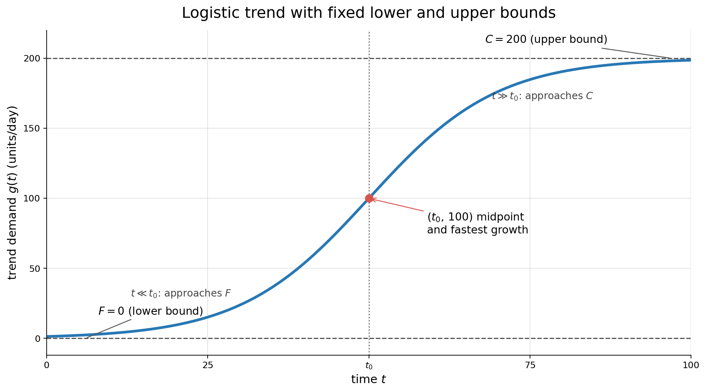

本文的教学案例使用线性趋势，扩展实验才采用图中的 logistic 设置。上限 200 仅用于说明函数性质，不代表该商品的真实需求上限；生产模型中的上下限需要业务依据，并通过历史数据和时间回测检验。

这里使用 $\rho$ 和 $t_0$，以免与线性趋势中的斜率 $k$ 和截距 $m$ 混淆。上下限固定时，$t_0$ 也是曲线的拐点；当 `cap` 或 `floor` 随时间变化时，上述对称性、渐近性质和拐点位置不再完全成立，需要结合边界函数解释。`cap` 和 `floor` 应反映有业务依据的饱和水平 [5]。

**货架库存决定当天能够满足多少需求，`cap` 描述的则是趋势成分可以接近的饱和上限。** 两者含义不同，需要分别设定。直接把当天库存作为 `cap`，会把已有的供给限制带入需求预测。还要注意，logistic 边界只约束趋势成分；叠加季节性、节假日效应和额外回归成分后，最终预测仍可能高于 `cap` 或低于 `floor`。

在实际项目中，新开门店、首次进入某一商圈的商品或处于导入期的新品，都可能经历从增长到趋稳的过程。AI/ML 工程师应结合序列长度、业务阶段和市场容量，判断是否需要将线性趋势与 logistic 趋势同时纳入候选模型，并通过时间回测比较两者，而不是仅凭观察到的曲线形状作出选择。

使用 logistic 趋势时，历史数据除 `ds` 和 `y` 外，还必须为每个日期提供 `cap`；未来预测数据也必须按照相同口径提供 `cap`。如果需要设置非零下限，历史区间和预测区间还应提供 `floor`，并保证每个日期都满足 `cap > floor`。边界可以随时间变化，但其未来取值必须在预测时已知，或者能够根据业务规则预先确定。模型初始化时还需要显式设置 `Prophet(growth="logistic")`；否则 Prophet 默认采用线性趋势 [5]。

实际项目不应仅凭历史最大销量设置 `cap`，而应综合相似门店或商品在成熟期的表现、商圈潜在客群、商品渗透率和业务规划，并在回测中检验结果对边界设定是否敏感。对于缺少自身销售历史的新店或新品，还需要借助相似序列、分层信息或冷启动规则；启用 logistic 趋势本身不能解决数据不足的问题。

### 季节性：用傅里叶级数描述重复规律

销量在一周或一年中的季节性，表现为随日期重复出现的高低变化。Prophet 使用傅里叶级数（Fourier series）表达这种周期结构。

从时域（time domain）观察，季节性是一条随时间重复变化的曲线；从频率的角度看，这条曲线可以分解为多组不同频率的正弦和余弦波。低频波形描述周期内较宽缓的变化，高频波形补充更局部的起伏。将这些周期基函数按不同权重叠加，就能表达或逼近平滑的周内和年内规律。

Prophet 并不是先对销量序列执行快速傅里叶变换（FFT），再从频域中提取周期。模型根据日期和预先设定的周期长度构造傅里叶基函数，并在拟合过程中将这些基函数的系数与趋势、节假日和额外回归变量的参数联合估计。对于周期长度为 $P$ 的季节性成分，可以写成：

$$
s_P(t)=\sum_{n=1}^{N_P}
\left[
u_{P,n}\cos\left(\frac{2\pi nt}{P}\right)
+v_{P,n}\sin\left(\frac{2\pi nt}{P}\right)
\right]
$$

记号说明：

| 记号 | 定义与读法 |
| --- | --- |
| $s_P(t)$ | 周期长度为 $P$ 的季节性成分；下标 $P$ 用于区分周周期、年周期等不同季节性 |
| $t$、$P$ | 分别是时间坐标与周期长度，两者必须使用相同单位 |
| $N_P$ | 该季节性的傅里叶阶数（Fourier order），表示使用多少组正弦、余弦基函数 |
| $n$ | 谐波（harmonic）编号，从 1 到 $N_P$；第 $n$ 组函数的周期为 $P/n$ |
| $u_{P,n}$、$v_{P,n}$ | 第 $n$ 组余弦、正弦函数的系数，由模型估计；加法模式下与目标值使用相同单位 |

本文以天为时间单位，因此 $P$ 也按天计算。多种季节性同时存在时，基本模型中的 $s(t)$ 是各个 $s_P(t)$ 之和。

在 Prophet 中，公式里的周期长度 $P$ 对应 `period`，傅里叶阶数 $N_P$ 对应 `fourier_order`。本文将周季节性设为 $P=7$、$N_P=3$，将年季节性设为 $P=365.25$、$N_P=5$。这些设置规定模型能够使用哪些周期函数，并未直接指定周末增加多少销量；各个傅里叶系数仍由训练数据估计。

理解这组设置时，需要区分**数据采样频率、周期长度和曲线复杂度**：

| 概念 | 本文设定 | 对模型的含义 |
| --- | --- | --- |
| 数据采样频率 | 每天记录一行 `ds`、`y` | 采样间隔为 1 天，每周包含星期一至星期日七个观测位置 |
| 周期长度 $P$ | 周周期为 7 天，年周期为 365.25 天 [6] | 指定函数经过多长时间重复，不改变数据原有的日级采样粒度 |
| 傅里叶阶数 $N_P$ | 周周期为 3 阶，年周期为 5 阶 | 周季节性生成 6 列特征，年季节性生成 10 列特征；每列对应一个待估计系数 |

**日期怎样形成特征，销量又在何时参与？**

为便于手算，暂时将某个周一设为 $t=0$，周二设为 $t=1$，依次到周日的 $t=6$。将这些时间值代入正弦、余弦函数，就能得到对应的周周期特征。以第一阶为例：

| 星期几 | $t$ | $\cos(2\pi t/7)$ | $\sin(2\pi t/7)$ |
| --- | --- | --- | --- |
| 周一 | 0 | 1.0000 | 0.0000 |
| 周二 | 1 | 0.6235 | 0.7818 |
| 下一周一 | 7 | 1.0000 | 0.0000 |

周一与下一周一得到相同的特征值，说明这组函数每七天重复。第二阶和第三阶使用相同的计算方法，只需将公式中的 $n$ 分别替换为 2 和 3。

**日期决定基函数，销量用于估计基函数的系数。** 给定 $P$ 和 $N_P$ 后，模型可以直接根据日期构造正弦、余弦特征；这一过程不使用销量。以三阶周季节性为例，每个日期会生成六个确定的特征值。如果训练数据包含 1,000 个有效日期，就会形成一个 1,000 行、6 列的特征矩阵：每行对应一个日期，每列对应一个基函数。$u_{P,n}$ 和 $v_{P,n}$ 则是未知参数，需要与趋势、节假日、额外回归变量及噪声参数一起，根据训练期销量联合估计。

| 层次 | 本例中的内容 | 是否由 `fit()` 估计 |
| --- | --- | --- |
| 模型结构与配置 | 周期长度 $P$、傅里叶阶数 $N_P$、候选变点、节假日窗口、额外回归变量 | 否，在拟合前由配置或预处理规则确定 |
| 确定性模型输入 | 日期生成的正弦和余弦特征、变点指示变量、节假日标记、已提供的折扣值 | 否，由日期、业务日历或外部数据确定 |
| 模型参数 | 趋势参数、变点斜率变化量、$u_{P,n}$、$v_{P,n}$、节假日系数和回归系数 | 是，在 `fit()` 中联合估计 |
| 观测数据 | 每个训练日期对应的销量 $y_t$ | 不是参数，用于构造似然并估计参数 |

从整体上看，这个联合估计问题可以概念性地写成：

$$
\hat{\theta}_{\mathrm{MAP}}
=
\arg\max_{\theta}
\left[
\log p(\mathbf y\mid \mathbf X,\theta)
+
\log p(\theta)
\right]
$$

其中，$\mathbf X$ 包含拟合前已经确定的日期和业务特征，$\mathbf y$ 是训练期观测销量，$\theta$ 汇总全部待估参数。季节性系数 $u_{P,n}$、$v_{P,n}$ 只是 $\theta$ 的一部分，并不会脱离趋势和其他模型成分单独求解。联合估计也不表示模型能够自动识别业务原因：如果促销集中发生在周末，促销与周季节性特征可能共同解释同一部分销量变化。第五章将在这一整体框架下说明 MAP 参数估计。

**周期长度和傅里叶阶数分别控制什么？**

周期长度 $P$ 决定规律经过多长时间重复，傅里叶阶数 $N_P$ 决定模型可以在一个周期内表达多少细节。阶数为 $N_P$ 时，模型会生成 $2N_P$ 列正弦、余弦特征，并估计相同数量的系数。

| 教学数据中的周期项 | 周期长度 | 傅里叶阶数 | 表达能力 |
| --- | ---: | ---: | --- |
| 周变化 $16W_t$ | $P=7$ | $N_P=3$ | 在七个日级位置上表达工作日与周末的固定差异 |
| 年变化 $14\sin\!\left({2\pi(t-15)}\div{365.25}\right)$ | $P=365.25$ | 初始设置 $N_P=5$ | 第一阶已经足以表达该正弦波，其余阶数提供额外的曲线灵活性 |

教学数据中的 $W_t$ 在周六、周日取 1，其余日期取 0，因此 $16W_t$ 表示周末需求比工作日高 16 件。这个模式类似每七天重复的阶梯波。对于日级数据，一周只有七个观测位置；去除周平均水平后，还剩六个可以独立变化的方向。三阶傅里叶恰好生成六列特征，因此能够在这七个离散位置上表达该周模式。模型的基准水平吸收 $16W_t$ 的周平均贡献，周季节性成分表达各星期相对于周平均水平的偏移。

这里的“能够表达”针对每天一个观测值的离散时间点。如果把时间看成连续变量，傅里叶函数在相邻日期之间仍然是平滑曲线，并不会形成具有垂直边缘的连续方波。

年周期项本身是一条正弦波，只包含周期为 365.25 天的一阶谐波，因此 $N_P=1$ 已经具有足够的表达能力。本文初始设置 $N_P=5$，意味着模型还可以使用二至五阶谐波表达更细的年内变化；这些额外波形并不是还原教学数据生成规则所必需的，也可能增加拟合噪声的风险。内部验证最终选择年阶数为 1，与已知的数据生成机制一致。

周期长度和傅里叶阶数定义的是模型的表达空间，并不保证拟合结果能够完全还原生成公式。实际训练中，季节性系数需要与趋势、节假日和折扣系数联合估计，还会受到随机噪声、缺失目标值和先验收缩的影响。真实项目应通过时间回测选择 $N_P$ 和 `seasonality_prior_scale`：前者控制曲线能够表达多少细节，后者控制季节性系数的收缩强度。可靠估计年周期还要求历史数据覆盖足够多的完整年度和业务变化。

**季节性系数应该怎样解释？**

同一阶的正弦与余弦系数需要结合解释：两者共同决定该阶波动的幅度和相位。改变时间起点可能改变单个系数，却不一定改变最终曲线。因此，业务解释应关注全部阶数叠加后在具体日期产生的季节性贡献，而不是孤立解释某个傅里叶系数。每一阶描述的是一种数学频率，不一定对应某个独立的业务机制；周末客流、排班、促销和营业时间等因素可能共同反映在同一条季节性曲线上。

在加法模式下，季节性贡献与目标变量 `y` 使用相同单位。日级数据只能识别日期之间的周期变化，不能识别一天内部的小时规律，因此本文不建模日内季节性。第五章将说明如何提取系数并重建每日贡献。

### 节假日和促销：把事件日历与促销计划转成模型输入

节假日和促销都属于趋势与季节性之外的业务输入，但数据形式不同：节假日通常表示为离散事件特征，折扣则可以表示为连续回归变量。与前面的季节性建模一样，模型先根据给定的业务信息构造特征，再通过训练期销量估计相应系数。

#### 节假日：用事件日历构造指示特征

节假日和商业活动通常发生在可以预先确定的日期。Prophet 先根据事件日历为每个日期生成指示特征，再估计这些特征对应的系数。某个事件未在日期 $t$ 生效时，其特征值和贡献均为零；多个事件同时生效时，各项贡献相加：

$$
h(t)=\sum_{\ell=1}^{L}\kappa_\ell z_\ell(t)
$$

记号说明：

| 记号 | 定义与读法 |
| --- | --- |
| $L$ | 事件特征的数量；一个节日包含多个相对日期时，可以对应多个特征 |
| $\ell$ | 事件特征编号，从 1 到 $L$；使用小写字母 ell，避免与数字 1 混淆 |
| $z_\ell(t)$ | 第 $\ell$ 个事件特征在日期 $t$ 的指示值，生效时为 1，否则为 0；由事件日历确定 |
| $\kappa_\ell$ | 第 $\ell$ 个事件特征的待估系数；在加法模式下表示对目标值的预测贡献，$\kappa$ 读作 kappa |

事件名称、日期和窗口属于拟合前给定的配置；$z_\ell(t)$ 随之确定，不需要使用销量计算。各事件特征的系数 $\kappa_\ell$ 则由 `model.fit()` 与趋势、季节性和其他参数联合估计。

事件影响不一定只发生在当天。节前采购、节后回落或连续多日的活动，可以用事件窗口表达 [6]。窗口中的每个相对日期可以对应一个独立特征和系数，例如“节日前一天”和“节日当天”；模型不会预先假定这些日期具有相同影响。

例如，门店已知将在圣诞节当天闭店，顾客可能把节日期间所需商品的采购提前到圣诞节前一天。建模时，可以为“圣诞节前一天”生成独立的事件特征，用对应系数估计提前采购带来的销量变化。圣诞节当天的闭店状态仍需单独处理，不能用假日系数代替。前一天的系数是否为正、增加多少，应由历史观测估计；事件窗口只是允许模型表达这种提前采购效应，并不预先假定它一定存在。

教学数据中的假日项写为 $28H_t$，其中日期 $t$ 为设定的公共假日时 $H_t=1$，否则为 0；因此在假设门店正常营业的需求均值中，公共假日增加 28 件。教学案例将假日窗口设为 0，只估计假日当天的效应；Prophet 则按假日名称分别估计系数，例如 Boxing Day 的拟合贡献约为 +33.06 件。

Good Friday 和圣诞节对应的目标值因闭店而被排除，因此这些事件特征没有可用于估计系数的有效观测。此时得到的零系数反映的是训练信息不足和先验收缩，不能解释为真实需求效应为零。本文保留这些列用于检查，实际模型可以移除没有有效观测的事件特征。

公共假日日历不等同于门店的完整业务日历。国家级假日可以作为起点，但还需要核对门店所在州的假日、商场营业安排以及企业自己的促销活动。模型只能学习数据中已经定义的事件；遗漏或错误的日历不会由模型自动修正。

#### 促销：用连续业务变量表达折扣影响

教学数据使用 $130q_t$ 表示折扣对需求的线性贡献，其中 $q_t$ 是日期 $t$ 的折扣比例。八折销售对应 $q_t=0.20$，因此该项使当天的无噪声需求均值增加 26 件。Prophet 可以将折扣作为连续回归变量：变量值乘以模型估计的系数，得到它对当天预测的贡献：

$$
r(t)=\beta_{\text{discount}}\cdot \text{discount}(t)
$$

记号说明：

| 记号 | 定义与读法 |
| --- | --- |
| $r(t)$ | 折扣变量在日期 $t$ 的预测贡献；加法模式下与目标变量使用相同单位 |
| $\text{discount}(t)$ | 日期 $t$ 的折扣比例，在教学数据中对应 $q_t$；例如八折销售对应 0.20 |
| $\beta_{\text{discount}}$ | 折扣变量的待估系数；表示折扣比例增加 1.0，即增加 100 个百分点时的预测变化量 |

折扣比例 $q_t$、加法或乘法模式、是否标准化及先验尺度，需要在拟合前确定；折扣系数 $\beta_{\text{discount}}$ 则由 `model.fit()` 与其他参数联合估计。本文设置 `standardize=False`，直接使用原始折扣比例，因此折扣增加 0.01，即增加一个百分点时，预测贡献增加 $0.01\beta_{\text{discount}}$。如果启用标准化，系数对应的是标准化后的变量变化，不能再按原始百分点直接解释。

教学案例拟合得到 $\beta_{\text{discount}}\approx132.62$。当 $q_t=0.20$ 时，折扣贡献约为 +26.52 件，接近生成公式中的 26 件。这个数值只是折扣变量的单项贡献，不包含趋势、季节性和节假日效应。案例中的折扣每 14 天出现一次，因此总是落在相同的星期位置；历史中仍需同时包含该星期的促销日和非促销日，模型才有信息区分折扣效应与周季节性。

教学数据只包含 $q_t=0$ 和 $q_t=0.20$ 两种折扣水平。实际门店为了清仓降价（markdown pricing）或加快商品周转，可能采用 40% 或 50% 的折扣，对应 $q_t=0.40$ 或 $q_t=0.50$。把这些取值直接代入当前线性模型，会分别得到约 +53.05 件和 +66.31 件的折扣贡献；但这只是把从 0% 到 20% 折扣中估计的线性关系外推到训练范围之外，并不表示历史数据已经支持这种增长幅度。

特别是当 $q_t=0.50$ 时，深度折扣可能迅速导致商品售罄。此时，观测销量最多只能达到可供库存；售罄后的零销量也表示无货可卖，而不是顾客没有需求。因此必须区分观测销量与潜在需求：缺货期间的销售记录属于受供给约束的删失观测，不能直接用于估计深度折扣带来的完整需求增量。

用于预测的业务输入必须覆盖整个预测区间。节假日可以根据日历预先生成，未来折扣则需要来自已经确定的促销计划（promotion plan）；如果折扣计划尚未确定，就需要分别构造不同促销情景，或者先预测该变量，不能直接沿用历史值。

当前回归形式假设每增加一个百分点的折扣都会带来相同的边际贡献。实际促销可能存在启动阈值、边际收益下降、陈列与折扣的交互、同类商品之间的替代，以及提前购买导致的后续回落；清仓折扣还常与商品生命周期和库存压力同时发生。需要表达这些机制时，可以构造折扣区间、分段线性项、非线性项、交互项或滞后特征，再通过时间回测判断它们是否改善预测。

最后，$\beta_{\text{discount}}$ 描述的是模型中的条件关联。零售商可能在预计需求较弱时安排促销，价格、活动和潜在需求也可能同时变化，因此该系数不能直接解释为促销造成的销量增量。若要估计促销的因果效应（causal effect）或价格弹性，还需要相应的研究设计和识别假设。

### 加法还是乘法：增长的是件数，还是比例

加法效应表达固定数量的变化，例如“周末增加 16 件”；乘法效应表达相对于趋势水平的比例变化，例如“周末增加趋势的 20%”。两种作用可以并存：模型先按比例调整趋势，再叠加以件数表示的贡献。将预测均值与观测误差分开，可以写成：

$$
\begin{aligned}
\mu(t)&=g(t)\bigl[1+E_{\mathrm{mult}}(t)\bigr]+E_{\mathrm{add}}(t),\\
y(t)&=\mu(t)+\varepsilon_t
\end{aligned}
$$

变量说明：

| 变量 | 定义 |
| --- | --- |
| $\mu(t)$ | 日期 $t$ 的预测均值，即模型各系统性成分组合后的结果 |
| $g(t)$ | 日期 $t$ 的趋势成分，为乘法效应提供基准水平 |
| $E_{\mathrm{mult}}(t)$ | 所有乘法成分的合计，是无单位的比例，例如 0.20 表示趋势的 20% |
| $E_{\mathrm{add}}(t)$ | 所有加法成分的合计，与目标值使用相同单位 |
| $\varepsilon_t$ | 模型尚未解释的观测误差 |

两种模式的差异会随趋势水平而放大。假设某个周期效应为 20%：当趋势为 100 件时，它贡献 20 件；当趋势升至 150 件时，它贡献 30 件。相反，加法效应为 20 件时，无论趋势是 100 件还是 150 件，贡献都保持 20 件。

Prophet 支持在同一个模型中组合加法与乘法成分 [7]。具体模式需要在拟合前配置，各成分的系数仍由 `model.fit()` 联合估计。趋势 $g(t)$ 是其他成分作用的基准，本身不称为加法或乘法模式。

本文的教学数据用 $16W_t$、$28H_t$ 和 $130q_t$ 表示固定件数的增量，因此周季节性、节假日和折扣回归项都采用加法模式，前文计算的各项件数贡献可以直接相加。乘法模式没有在教学案例中单独验证，不能从当前实验推断它在其他零售序列上的效果。

接口支持混合模式并不表示实际项目应默认使用这种组合。选择时应判断波动幅度是否随趋势水平同步扩大，并通过时间回测比较候选配置。改变任何成分的模式后，都需要重新拟合模型，并按件数或比例重新解释对应组件。

**第三章回顾**

本文的教学案例全部采用加法模式。为方便对照，本章开头的整体模型在这里再次写为：

$$
y(t)=g(t)+s(t)+h(t)+\mathbf{x}_t^\top\boldsymbol\beta+\varepsilon_t
$$

其中，$g(t)$、$s(t)$、$h(t)$ 和 $\mathbf{x}_t^\top\boldsymbol\beta$ 分别对应趋势、季节性、节假日和额外业务变量，$\varepsilon_t$ 表示模型尚未解释的观测变化。如果某些成分采用乘法模式，则使用前述 $g(t)[1+E_{\mathrm{mult}}(t)]+E_{\mathrm{add}}(t)$ 组合；上式专门对应本文的全加法教学案例。

下表汇总每个成分解决的业务问题、拟合前需要确定的结构，以及 `model.fit()` 中需要估计的参数。

| 模型成分 | 回答的业务问题 | 数学表达 | 拟合前的关键选择 | 待估参数 |
| --- | --- | --- | --- | --- |
| 趋势 $g(t)$ | 基准需求怎样随时间增长、转折或趋于饱和？ | 线性、分段线性或 logistic 趋势 | 增长形式、候选变点，以及 logistic 趋势的 `cap` 和 `floor` | 分段线性趋势的 $k$、$m$ 和 $\delta_j$；logistic 趋势的增长率、位置参数及相应的变点调整量 |
| 季节性 $s(t)$ | 周内和年内规律怎样重复？ | 不同频率的傅里叶基函数加权求和 | 周期长度 $P$、傅里叶阶数 $N_P$ | 傅里叶系数 $u_{P,n}$、$v_{P,n}$ |
| 节假日 $h(t)$ | 已知事件当天及其前后怎样改变需求？ | 事件指示特征 $z_\ell(t)$ 乘以系数 $\kappa_\ell$ | 事件日历、事件窗口和节假日模式 | 各事件特征的系数 $\kappa_\ell$ |
| 额外回归变量 $r(t)$ | 折扣等已知业务信息怎样影响预测？ | 业务变量乘以回归系数 | 特征定义、未来取值、标准化方式、先验尺度和作用模式 | 回归系数 $\boldsymbol\beta$ |
| 成分组合 | 各项影响按件数还是按比例进入预测？ | $g(t)[1+E_{\mathrm{mult}}(t)]+E_{\mathrm{add}}(t)$ | 加法模式、乘法模式或两者组合 | 无独立系数；预测由模式配置和各成分参数共同决定 |

需要注意的是，前文使用 $\rho$ 和 $t_0$ 解释简化 Logistic 曲线的形状；这两个符号是便于理解的数学记号，不应直接视为 `model.params` 中的同名字段。Prophet 的完整 logistic 趋势还包含变点对应的增长率调整和连续性约束。

表中的模型结构和输入定义需要在拟合前确定，最后一列的参数则由 `model.fit()` 联合估计。第四章将说明怎样把历史记录和未来已知信息转换为这些模型输入，第五章再展开参数的 MAP 估计过程。

## 四、数据处理与参数配置：怎样把业务记录交给模型

第三章已经说明 Prophet 如何用趋势、季节性、节假日和额外回归变量表达需求规律。本章进一步回答两个工程问题：怎样把门店—商品（Store—SKU）的业务记录处理成定义一致的历史与未来输入，以及怎样结合序列特征、门店运营和商品属性确定模型结构与候选超参数。输入和配置确定后，第五章再讨论模型如何通过 MAP 优化估计未知参数。

### 构造定义一致的训练与未来输入

#### 将业务记录整理为门店—SKU 日级数据

本文以门店—SKU 组合定义一条需求序列，并以日为观测和预测粒度。进入模型之前，原始交易记录需要先按照统一的业务日期和商品单位整理为日级数据：先将交易时间转换到门店当地时区，再按门店、SKU 和营业日汇总，保证每个组合在每个日期至多对应一行。工程流程还需要检查重复记录、日期缺口、门店营业状态和缺货标记，再根据第二章定义的目标口径构造训练列 `y`。

日期、目标值和已注册的回归变量构成 Prophet 的直接输入；假日日历通过模型配置提供；营业状态和缺货标记则主要用于构造目标、筛选有效观测和处理预测结果。下表使用教学数据中 2023 年 Boxing Day 的真实记录；`holiday` 来自同一日期对应的 VIC 假日表。

| 业务字段 | 示例值 | 主要来源 | 训练阶段的用途 | 预测阶段是否需要 | 是否直接交给 Prophet |
| --- | --- | --- | --- | --- | --- |
| `ds` | `2023-12-26` | 交易记录汇总后的业务日期 | 定义观测日期和模型时间坐标 | 是 | 是 |
| `y` | `112` | 销售记录经过目标构造后的结果 | 作为待拟合的目标变量 | 否，未来目标尚未发生 | 仅训练阶段提供 |
| `discount` | `0.00` | 历史价格记录与未来促销计划 | 作为额外回归变量 | 是，且必须按预测发起时可见的计划提供 | 是 |
| `holiday` | `Boxing Day` | 公共假日与企业事件日历 | 生成事件指示特征 | 是，日历需要覆盖预测区间 | 通过 `holidays` 配置提供 |
| `is_open` | `True` | 门店营业日历 | 判断销量是否为有效训练目标 | 是，用于闭店规则和预测后处理 | 本例不直接提供 |
| `is_closed_holiday` | `False` | 营业日历与闭店原因记录 | 区分因假日闭店产生的零销量 | 是，用于生成未来闭店安排 | 本例不直接提供 |
| `stockout` | `False` | 库存与缺货记录 | 识别受供给约束的销量并屏蔽相应目标 | 视库存预测和业务方案而定 | 本例不直接提供 |

业务数据处理与 Prophet 内部处理承担不同职责：

| 阶段 | Prophet 内部完成的工作 | 零售工程流程仍需完成的工作 |
| --- | --- | --- |
| 拟合前 | 解析和排序日期，缩放目标，构造时间、周期、事件和已注册回归特征 | 统一门店当地营业日、商品单位、序列粒度和目标变量口径，处理重复记录、缺货与缺失输入 |
| 拟合 | 按指定结构估计参数 | 选择候选配置、设计时间回测，并检查数据泄漏（data leakage）与业务可解释性 |
| 预测 | 复用训练变换，构造未来日期特征，计算并还原预测结果 | 提供预测发起时可见的未来计划，并确认假日日历覆盖预测期 |
| 预测后 | 输出 `yhat`、预测区间与组件列 | 保存原始结果，应用非负规则、营业状态、箱规与补货约束，记录结果版本 |

#### 保持训练输入与未来输入一致

训练和预测必须使用相同的字段定义、时间口径与变换规则。`ds` 在两个阶段都表示门店当地的业务日期；`y` 只在训练阶段提供；折扣等额外回归变量既要有历史记录，也要覆盖整个预测区间；假日日历和营业日历同样需要延伸到未来。

以折扣变量为例，假设训练数据用 `0.20` 表示 20% 折扣，那么未来促销也必须按相同口径填写 `0.20`，而不能写成 `20`；否则模型接收到的数值会放大 100 倍。即使某个未来日期没有促销，也需要显式提供 `0.00`，不能因为目标值 `y` 尚未发生就同时省略已经注册的 `discount`。同理，训练阶段按墨尔本当地日期汇总销量，预测阶段也必须使用相同的时区和营业日边界。

未来输入必须以预测发起时能够获得的信息为准。日历通常可以预先生成，促销和价格应使用当时可见的计划版本，天气则应使用当时发布的预报。回测如果使用截止日之后才知道的实际促销、价格或天气，就会产生数据泄漏并高估上线效果。生产系统还应保存历史计划快照，使每个回测起点都能还原当时真实可用的信息。

例如，假设补货团队在 12 月 1 日预测未来 28 天，当时的促销计划规定 Boxing Day 折扣为 20%，但门店后来临时调整为 30%。回测 12 月 1 日这次预测时，应输入当时已知的 `0.20`，而不是事后实际执行的 `0.30`。后者虽然是真实结果，却不是模型在预测时能够获得的信息；使用它会让离线评估优于真实上线条件。

缺货和闭店信息在训练与预测中的角色不同：历史标记用于判断销量能否代表需求，未来营业安排用于预测后处理；未来是否缺货通常不是已知事实，需要由库存和补货流程另行评估，不能直接使用事后缺货标签。

### Prophet 如何把业务字段转换为模型输入

Prophet 先把 `ds` 解析为日期，检查输入并按时间排序，再根据不同模型成分构造各自需要的输入。为统一符号，本文用 $t$ 表示模型中的时间点，也就是排序后的一行数据；用 $d_t$ 表示该行 `ds` 对应的日历日期。这里的 $t$ 是模型公式中的索引，不等同于某一种内部数值坐标。

同一个 $d_t$ 会按模型成分转换为不同输入：趋势函数 $g(t)$ 使用归一化趋势坐标 $\tau_t^{(g)}$，季节性函数 $s(t)$ 使用固定日历参考点生成季节性坐标 $\tau_t^{(s)}$ 和周期特征，节假日函数 $h(t)$ 则直接用 $d_t$ 匹配事件日历。**训练与预测必须沿用同一套转换规则：趋势继续使用拟合时保存的起点和跨度，季节性继续使用固定日历参考点与周期配置。** [4]

| 模型成分 | 从 `ds` 取得的日期 | 实际使用的输入 |
| --- | --- | --- |
| 趋势 $g(t)$ | $d_t$ | 归一化趋势坐标 $\tau_t^{(g)}$ |
| 季节性 $s(t)$ | $d_t$ | 季节性坐标 $\tau_t^{(s)}$ 及其傅里叶角度 $\alpha_{P,n,t}$ |
| 节假日 $h(t)$ | $d_t$ | $d_t$ 与事件日期及窗口的匹配结果 $z_{H,r}(t)$ |

#### 日期怎样转换为趋势输入

**趋势函数 $g(t)$ 在时间点 $t$ 使用归一化趋势坐标 $\tau_t^{(g)}$。** Prophet 先计算日期 $d_t$ 距离训练起点有多远，再除以整段训练历史的跨度，而不是直接将 `ds` 代入趋势公式。训练起点对应 0、终点对应 1，未来时间点的坐标可以超过 1：

$$
\tau_t^{(g)}
=
\frac{d_t-d_{\mathrm{start}}}{\Delta_{\mathrm{train}}}
$$

因此，从 `ds` 到趋势成分的映射关系可以概括为：

$$
\texttt{ds}
\longrightarrow d_t
\longrightarrow \tau_t^{(g)}
\longrightarrow g(t)
$$

`ds` 先解析为时间点 $t$ 对应的日期 $d_t$，再转换为归一化趋势坐标 $\tau_t^{(g)}$；趋势函数结合该坐标与拟合得到的趋势参数计算 $g(t)$。

记号说明：

| 记号 | 定义 |
| --- | --- |
| $t$ | 模型中的时间点，对应排序后的一行数据 |
| $d_t$ | 时间点 $t$ 对应的 `ds` 日期或时间戳 |
| $d_{\mathrm{start}}$ | 实际用于拟合的历史记录中最早的时间戳 |
| $\Delta_{\mathrm{train}}$ | 最晚训练时间戳与 $d_{\mathrm{start}}$ 之间的时间跨度，要求大于零 |
| $\tau_t^{(g)}$ | 时间点 $t$ 的无单位趋势坐标；上标 $(g)$ 表示该坐标用于趋势成分 |

分子、分母使用相同时间单位。拟合保存 `model.start` 和 `model.t_scale`，预测沿用它们，不对未来窗口重新缩放。

假设有效训练记录只有 2023 年 1 月 1、2、3 日，训练跨度为两天：

| 阶段 | `ds`，即 $d_t$ | 距训练起点的天数 | 趋势坐标 $\tau_t^{(g)}$ |
| --- | --- | ---: | ---: |
| 训练 | 2023-01-01 | 0 | 0 |
| 训练 | 2023-01-02 | 1 | 0.5 |
| 训练 | 2023-01-03 | 2 | 1 |
| 预测 | 2023-01-04 | 3 | 1.5 |
| 预测 | 2023-01-05 | 4 | 2 |

趋势坐标超过 1 是正常外推。若将未来重新缩放为 0 和 1，就错误地把它们放回训练起止点。同一未来日期应有固定坐标，与本次预测窗口长度无关。

起点与跨度取自有效训练历史；边界日期的目标值被排除时，应以模型保存的属性为准。

缺失日期不会压缩时间轴：即使 1 月 2 日缺失，1 月 1 日与 3 日仍相差两天。

#### 日期怎样转换为季节性输入

**季节性函数 $s(t)$ 在时间点 $t$ 使用日历坐标 $\tau_t^{(s)}$。** Prophet 先计算日期 $d_t$ 距固定日历参考点的天数，再根据周期长度 $P$ 和谐波编号 $n$ 将 $\tau_t^{(s)}$ 转换为周期角度 $\alpha_{P,n,t}$，用于生成对应的正弦和余弦特征。该坐标不同于趋势函数使用的 $\tau_t^{(g)}$。本文使用的 Prophet 1.4.0 以 1970-01-01 为固定参考日期：

$$
\tau_t^{(s)}=\frac{d_t-d_{\mathrm{epoch}}}{\text{一天}},
\qquad
\alpha_{P,n,t}=\frac{2\pi n\tau_t^{(s)}}{P}
$$

因此，第三章的季节性公式在这里可以写成：

$$
s_P(t)=
\sum_{n=1}^{N_P}
\left[
u_{P,n}\cos\alpha_{P,n,t}
+v_{P,n}\sin\alpha_{P,n,t}
\right]
$$

因此，从 `ds` 到季节性成分的映射关系可以概括为：

$$
\texttt{ds}
\longrightarrow d_t
\longrightarrow \tau_t^{(s)}
\longrightarrow \alpha_{P,n,t}
\longrightarrow
\left[
\cos\alpha_{P,n,t},
\sin\alpha_{P,n,t}
\right]
\longrightarrow s_P(t)
\longrightarrow s(t)
$$

`ds` 先解析为日期 $d_t$，再转换为季节性坐标 $\tau_t^{(s)}$。每个周期 $P$ 和谐波 $n$ 据此生成一对正弦、余弦特征；模型使用拟合得到的 $u_{P,n}$ 和 $v_{P,n}$ 组合这些特征，形成单个周期的季节性贡献 $s_P(t)$，再将周、年等周期成分相加得到 $s(t)$。

记号说明：

| 记号 | 定义 |
| --- | --- |
| $d_{\mathrm{epoch}}$ | Prophet 用于构造季节性坐标的固定参考日期；本文使用的 Prophet 1.4.0 将其设为与输入日期相同时区的 1970-01-01 |
| $\tau_t^{(s)}$ | 日期 $d_t$ 相对 $d_{\mathrm{epoch}}$ 经过的天数；上标 $(s)$ 表示该坐标用于季节性成分，小时级输入可以得到小数天 |
| $\alpha_{P,n,t}$ | 时间点 $t$ 在周期 $P$ 的第 $n$ 阶谐波中对应的角度，以弧度计；$\alpha$ 读作 alpha |

每阶角度生成正弦、余弦两列。季节性坐标与周期均以天计，不能把归一化趋势坐标 $\tau_t^{(g)}$ 直接代入。

下面用两个相隔一周的周六和一个相邻的周日，说明 `ds` 怎样变成季节性函数 $s(t)$ 使用的特征。取一阶周周期 $P=7,n=1$，并定义时间点 $t$ 在七天周期中的位置为：

$$
\rho_{7,t}=\tau_t^{(s)}\bmod 7
$$

| 输入日期 $d_t$（`ds`） | 星期 | 季节性坐标 $\tau_t^{(s)}$ | 周内位置 $\rho_{7,t}$ | 等价周期角度 $\alpha_{7,1,t}\bmod 2\pi$ | $\cos\alpha_{7,1,t}$ | $\sin\alpha_{7,1,t}$ |
| --- | --- | ---: | ---: | ---: | ---: | ---: |
| 2023-01-07 | 周六 | 19,364 | 2 | $4\pi/7$ | −0.223 | 0.975 |
| 2023-01-08 | 周日 | 19,365 | 3 | $6\pi/7$ | −0.901 | 0.434 |
| … | … | … | … | … | … | … |
| 2023-01-14 | 周六 | 19,371 | 2 | $4\pi/7$ | −0.223 | 0.975 |

对周周期 $P=7$，$\rho_{7,t}=\tau_t^{(s)}\bmod 7$ 表示时间点 $t$ 在七天周期中的位置。傅里叶函数只取决于角度在一个完整周期内的位置，因此可以用 $\alpha_{7,1,t}\bmod 2\pi$ 计算等价的正弦和余弦特征。固定参考日期 1970-01-01 为周四，对应 $\rho_{7,t}=0$；因此，$\rho_{7,t}=2$ 对应周六，$\rho_{7,t}=3$ 对应周日。相隔七天的两个周六具有相同的周内位置和一阶傅里叶特征。

表中只展示了 $n=1$。当周季节性的傅里叶阶数为 3 时，每个 `ds` 还会按同一方法计算 $n=2$ 和 $n=3$，最终生成六列正弦、余弦特征。这些特征值只由日期、周期和阶数决定，销量 `y` 用于在拟合时估计它们的系数。预测未来日期时，模型继续使用同一固定日历坐标，因此未来周六会获得与历史周六相同的周周期特征；趋势坐标则继续向前延伸，使相同周内位置可以对应不同的基础需求水平。

#### 假日日历怎样转换为事件特征

**节假日函数 $h(t)$ 中的时间点 $t$，对应输入数据中的一行；该行 `ds` 解析后的日历日期记为 $d_t$。** 与趋势和季节性不同，节假日成分不需要把 $d_t$ 转换为归一化时间或周期角度。Prophet 直接比较 $d_t$ 与事件日期及其窗口，将匹配结果转换为事件特征。

记事件集合为 $\mathcal H$。对于事件 $H\in\mathcal H$，记其日历日期为 $d_H$，窗口包含的相对日期集合为 $\mathcal R_H$。事件 $H$ 在相对日期 $r$ 上的指示特征为：

$$
z_{H,r}(t)=
\begin{cases}
1, & d_t=d_H+r,\\
0, & \text{否则}.
\end{cases}
$$

全部事件特征的贡献相加，形成时间点 $t$ 的节假日成分：

$$
h(t)
=
\sum_{H\in\mathcal H}
\sum_{r\in\mathcal R_H}
\kappa_{H,r}z_{H,r}(t)
$$

因此，从 `ds` 到节假日成分的转换关系可以概括为：

$$
\texttt{ds}
\longrightarrow d_t
\longrightarrow z_{H,r}(t)
\longrightarrow h(t)
$$

| 记号 | 含义 |
| --- | --- |
| $t$ | 模型时间点，对应输入数据中的一行 |
| $d_t$ | 时间点 $t$ 所对应的 `ds` 日历日期 |
| $\mathcal H$ | 模型中定义的事件集合 |
| $H$ | 某个具名事件，例如 `Christmas Day` |
| $d_H$ | 事件 $H$ 的日历日期 |
| $\mathcal R_H$ | 事件 $H$ 的窗口所包含的相对日期集合 |
| $r$ | 相对于事件日期的整数天数；$r=-1$ 表示前一天，$r=0$ 表示当天 |
| $z_{H,r}(t)$ | 时间点 $t$ 是否匹配事件 $H$ 的相对日期 $r$，取值为 0 或 1 |
| $\kappa_{H,r}$ | 事件 $H$ 在相对日期 $r$ 上的待估系数 |
| $h(t)$ | 时间点 $t$ 上全部事件特征的预测贡献之和 |

第三章使用编号 $\ell$ 表示事件特征。这里，每个“事件名称—相对日期”组合 $(H,r)$ 对应一个 $\ell$，因此 $z_{H,r}(t)$ 和 $\kappa_{H,r}$ 分别是 $z_\ell(t)$ 和 $\kappa_\ell$ 的展开写法。

**教学案例：窗口为 0，只标记节假日当天。** 数据生成公式用 $28H_t$ 表示假日贡献：日历日期 $d_t$ 出现在 VIC 假日表中时 $H_t=1$，否则为 0，因此在假设门店正常营业的条件均值中，公共假日统一增加 28 件。教学配置将所有事件的 `lower_window` 和 `upper_window` 都设为 0。以 2023 年 12 月 25 日的 `Christmas Day` 为例：

这里选择 `Christmas Day` 只用于展示日期怎样转换为事件特征；特征是否生成与当天的目标值是否有效是两个独立问题。

| `ds`，即 $d_t$ | 相对日期 $r$ | $d_H+r$ | 是否满足 $d_t=d_H+r$ | $z_{\mathrm{Christmas},0}(t)$ |
| --- | ---: | --- | --- | ---: |
| 2023-12-24 | 0 | 2023-12-25 | 否 | 0 |
| 2023-12-25 | 0 | 2023-12-25 | 是 | 1 |
| 2023-12-26 | 0 | 2023-12-25 | 否 | 0 |

因此，`Christmas Day` 对 $h(t)$ 的贡献只会在 12 月 25 日生效；如果当天还匹配其他事件，$h(t)$ 会继续叠加相应贡献。Prophet 不会直接使用生成公式中已知的系数 28 或单一的 $H_t$，而是按 `Christmas Day`、`Boxing Day` 等事件名称分别生成特征，再从历史销量估计各自的系数。教学案例采用加法模式，并将 `holidays_prior_scale` 显式设为 1.0。

营业日历与假日特征彼此独立。教学门店在 Good Friday 和 Christmas Day 闭店，因此这些日期的训练目标被设为缺失；Boxing Day 正常营业，可以提供有效的假日销量观测。闭店不会删除该日的假日特征，但没有有效目标值的日期本身不能帮助模型识别对应的假日系数。

**扩展窗口时，每个相对日期形成独立特征。** 如果把 `Christmas Day` 改为 `lower_window=-1`、`upper_window=0`，Prophet 会分别生成“前一天”和“当天”两列：

| `ds`，即 $d_t$ | $d_t=d_H-1$ | $z_{\mathrm{Christmas},-1}(t)$ | $d_t=d_H$ | $z_{\mathrm{Christmas},0}(t)$ |
| --- | --- | ---: | --- | ---: |
| 2023-12-24 | 是 | 1 | 否 | 0 |
| 2023-12-25 | 否 | 0 | 是 | 1 |
| 2023-12-26 | 否 | 0 | 否 | 0 |

每个 `ds` 在特征矩阵中仍然只占一行。$r=-1$ 和 $r=0$ 分别形成“前一天”和“当天”两列，每列具有独立的待估系数，因此模型可以学习节前采购与节日当天的不同影响。

表中的 0 和 1 只表示事件特征是否生效，不预先规定销量增加或减少多少。跨年度使用相同的事件名称和相对日期时，模型会复用相同的特征列，从多个年份估计对应系数 [4, 6]。

真实零售中的圣诞采购可能提前一周或更早开始，因此可以把 `lower_window` 扩大到 −7。但 `lower_window=-7, upper_window=0` 会为节前七天和节日当天生成八列独立特征，并分别估计八个系数，而不是生成一个统一的“圣诞节前一周”效应。

历史只有少数完整年度时，每列可用的事件观测很少，还可能与星期、促销和其他活动重叠；实际项目应通过时间回测判断扩大的窗口是否改善预测。如果业务假设是整个节前七天共享同一种影响，更适合自行构造 `pre_christmas_week` 指示变量，再把它作为额外回归变量输入模型。

**关于假日哪些内容由 Prophet 默认完成，哪些需要工程师配置？** Prophet 1.4.0 的分工如下：

| 配置内容 | Prophet 的默认行为 | 工程师需要确定的内容 |
| --- | --- | --- |
| 假日来源 | `holidays=None`，不自动加入自定义假日 | 传入包含 `ds` 和 `holiday` 的假日表，或显式调用 `add_country_holidays()` |
| 事件名称与日期 | 不推断企业活动或门店适用日期 | 确定稳定的事件名称、实际日期，并覆盖历史与预测区间 |
| 事件窗口 | 未提供窗口列时，`lower_window=0`、`upper_window=0` | 如需节前或节后效应，必须同时提供两列，并满足 `lower_window<=0`、`upper_window>=0` |
| 特征编码 | 为每个“事件名称—相对日期”组合自动生成 0/1 特征 | 检查窗口是否符合业务机制，以及不同事件或窗口是否重叠 |
| 作用模式 | `holidays_mode` 未设置时沿用 `seasonality_mode`；后者默认是加法模式 | 根据效应表现为固定件数还是比例，决定是否显式改为乘法模式 |
| 先验尺度 | 全局 `holidays_prior_scale=10.0` | 教学案例显式设为 1.0；也可在假日表中用 `prior_scale` 为具体事件覆盖全局值 |

Prophet 默认完成日期匹配和特征展开，但不会替工程师判断哪些事件适用于门店、窗口应覆盖几天，或者门店是否营业。假日表还应保持事件名称稳定，并保存各回测起点当时可见的版本。

上线前应对照 [Business Victoria 的 2026 年假日表](https://business.vic.gov.au/business-information/public-holidays/victorian-public-holidays-2026)与 [2026 年假日表](https://business.vic.gov.au/business-information/public-holidays/victorian-public-holidays-2026)核对并固定日历版本。由于部分非都市地区可以本地替代假日取代墨尔本杯日，`subdiv="VIC"` 只能作为州级参考，仍需按门店核对。

因此，工程师负责定义事件日历和窗口，Prophet 负责把每个 `ds` 转换为事件特征；这些特征的系数则在第五章所述的拟合过程中估计。

#### 回归变量标准化与目标值缩放

在把数据交给优化器之前，Prophet 还会处理额外回归变量和训练目标：回归变量可以进行标准化（standardization），目标值则按模型保存的尺度进行缩放（scaling）。两类变换都使用训练数据计算统计量，但作用对象和解释方式不同；预测时必须复用训练阶段保存的统计量，不能根据未来数据重新计算。

**额外回归变量：决定是否标准化。** 记第 $j$ 个额外回归变量在时间点 $t$ 的原始值为 $x_{t,j}$。设置 `standardize=True` 时，Prophet 使用训练期均值 $\mu_j$ 和标准差 $\sigma_j$ 计算：

$$
\tilde x_{t,j}
=
\frac{x_{t,j}-\mu_j}{\sigma_j}
$$

从训练数据计算标准化统计量，再在本文的加法配置下生成回归贡献，这一过程可以概括为：

$$
\{x_{t,j}:t\in\mathcal{T}_{\mathrm{train}}\}
\longrightarrow(\mu_j,\sigma_j),
\qquad
(x_{t,j},\mu_j,\sigma_j)
\longrightarrow \tilde x_{t,j}
\longrightarrow \beta_j\tilde x_{t,j}
\longrightarrow \text{回归变量贡献}
$$

其中，$\mu_j$ 和 $\sigma_j$ 是根据训练数据计算的预处理统计量，$\beta_j$ 才是在 `model.fit()` 中与趋势、季节性和节假日参数联合估计的系数。设置 `standardize=False` 时，Prophet 保留原始输入，相当于使用 $\mu_j=0$、$\sigma_j=1$。默认的 `standardize="auto"` 会保留二元变量的 0/1 取值，并通常对非二元变量执行标准化。

教学数据用 $130q_t$ 生成折扣贡献，其中 $q_t$ 是时间点 $t$ 的折扣比例；在 Prophet 输入中，对应 $x_{t,\mathrm{discount}}=q_t$。本文设置 `standardize=False`，因此八折销售对应的 $q_t=0.20$ 仍以 0.20 进入模型，回归贡献为 $\beta_{\mathrm{discount}}q_t$。Prophet 不会接收生成公式中的已知系数 130，而是通过 `model.fit()` 估计 $\beta_{\mathrm{discount}}$；若估计值接近 130，20% 折扣对应的贡献约为 $130\times0.20=26$ 件。

无论是否标准化，同一回归变量都必须在训练区间和预测区间使用相同的定义、单位与转换规则。假日指示特征和傅里叶特征由 Prophet 按前述规则构造，不需要用户将它们与额外回归变量一起进行统一标准化。

**目标值：缩放到模型内部尺度。** 教学案例使用截至 2026-11-29 的历史数据拟合模型，并在拟合前将闭店日和缺货日的目标值设为缺失。筛选后，训练集包含 1,554 个有效目标值。本文采用线性趋势、`scaling="absmax"` 且没有下限偏移，因此 Prophet 将时间点 $t$ 的有效训练销量 $y_t$ 除以训练目标的最大绝对值：

$$
\tilde y_t=\frac{y_t}{s_y},
\qquad
s_y=\max_{t\in\mathcal{T}_{\mathrm{train}}}|y_t|
$$

从业务销量到模型内部目标的映射关系为：

$$
\{y_t:t\in\mathcal{T}_{\mathrm{train}}\}
\longrightarrow s_y,
\qquad
(y_t,s_y)
\longrightarrow \tilde y_t
\longrightarrow \text{参数估计}
$$

最大有效训练销量出现在 2026-04-25，为 196 件，因此 $s_y=196$，也就是模型保存的 `model.y_scale`。例如，2022-07-04 的有效训练销量为 113 件，在内部转换为 $\tilde y_t=113\div196\approx0.577$；2026-04-25 的 196 件则转换为 1。闭店日、缺货日和测试期销量都不参与确定这一尺度。$s_y$ 是由有效训练目标计算的预处理统计量，不是优化算法求解的模型参数。

预测时执行相反的尺度变换。对于本文无下限偏移的全加法配置，若模型在内部尺度上得到点预测 $\widehat{\tilde y}_t$，则本文目标口径下的需求预测为：

$$
\hat y_t=s_y\widehat{\tilde y}_t
$$

例如，教学案例对 2026-12-05 得到的内部点预测约为 $\widehat{\tilde y}_t=0.71175$；乘以 $s_y=196$ 后，还原为 $\hat y_t\approx139.50$ 件。`predict()` 返回的 `yhat` 已经完成这一步，单位是每日件数，不能再次乘以 `model.y_scale`。

记号说明：

| 记号 | 定义 |
| --- | --- |
| $y_t$、$\tilde y_t$ | 分别是时间点 $t$ 的原始目标值与内部缩放后的目标值 |
| $\widehat{\tilde y}_t$、$\hat y_t$ | 分别是内部尺度上的点预测与还原到原始需求单位后的点预测 |
| $s_y$ | 从有效训练目标值计算的缩放尺度；若所有目标值为零，实现使用 1 避免除零 |
| $\mathcal{T}_{\mathrm{train}}$ | 具有有效目标值的训练时间点集合；此处仅在这些时间点上计算最大绝对值 |
| $\max$、$\vert \cdot\vert$ | 分别表示取最大值与标量绝对值 |

若所有有效训练目标均为 0，Prophet 将 $s_y$ 设为 1，避免除以零。上式只描述本文配置；采用 `scaling="minmax"` 或 logistic 下限时，目标值还会按照相应的下限和尺度进行偏移与缩放。

| 内容 | 在拟合前配置或计算 | 是否由 `model.fit()` 优化求解 |
| --- | --- | --- |
| 回归变量标准化方式 | 工程师配置 `standardize`；Prophet 根据训练数据计算 $\mu_j$ 和 $\sigma_j$ | 否 |
| 回归系数 $\beta_j$ | 不预先指定其拟合值 | 是 |
| 目标缩放方式 | 工程师配置 `scaling`；Prophet 根据训练目标计算 $s_y$ | 否 |

`predict()` 使用训练阶段保存的 $\mu_j$ 和 $\sigma_j$ 转换未来回归变量，再用 $s_y$ 还原趋势、加法成分和最终预测；乘法成分仍表示相对于趋势的比例。本文采用全加法模式，因此 `yhat`、趋势和各项加法贡献都可以按每日件数解释。业务流程随后执行非负截断、取整或箱规换算；代码用 `forecast_units` 保存业务处理结果，同时保留原始 `yhat`。

### 根据门店与商品的业务特征确定模型配置

完成日期、假日日历、折扣变量和目标值的处理后，数据已经具备建模所需的输入格式。下一步需要结合每条门店—SKU 序列的历史长度、观测粒度、需求形态、运营规则和未来信息的可用性，配置 Prophet 的趋势形式、季节性、事件与回归变量，以及模型复杂度。业务判断用于排除明显不合理的方案，剩余候选配置仍需通过训练历史内部的时间回测进行比较。

#### 从教学案例证据确定模型结构

教学案例的生成机制已知，因此可以把第二章的公式和字段直接映射为建模决策。真实项目看不到数据生成公式，只能根据历史数据、业务记录和预测时可获得的计划信息提出候选结构，再用时间回测检验。

| 教学案例中的证据 | 建模判断 | 影响的配置或数据处理 |
| --- | --- | --- |
| 数据每天一行，没有小时级观测 | 模型只能识别日与日之间的变化，不能识别日内规律 | 关闭日内季节性 |
| $16W_t$ 每七天重复，年周期项按 365.25 天重复 | 同时建模周季节性和年季节性；傅里叶阶数决定各周期允许的复杂度 | 配置 7 天和 365.25 天周期，并把阶数作为待验证的超参数 |
| 趋势项为 $85+0.015t$，没有设定饱和水平或真实转折 | 线性趋势比 logistic 趋势更符合案例；候选变点用于检验模型能否抑制没有数据支持的斜率变化 | 采用分段线性趋势，并控制候选变点范围与趋势先验尺度 |
| $16W_t$、$28H_t$ 和 $130q_t$ 都以固定件数进入需求均值 | 周期、假日和折扣贡献应按件数相加，而不是按趋势比例变化 | 三类成分均采用加法模式 |
| 折扣比例 $q_t$ 取 0 或 0.20，未来 28 天的计划在预测时已知 | 折扣可以作为未来可用的连续业务变量，且应保持原始比例口径 | 注册未标准化的 `discount` 回归变量 |
| 缺货销量受 20 件供给上限约束，闭店销量为 0；VIC 假日与闭店安排并不等价 | 供给受限销量不能直接代表需求，假日效应与营业状态也需要分开处理 | 屏蔽缺货日和闭店日的训练目标，分别提供假日日历与营业日历 |

上表确定的是模型结构和数据处理方向，不是全部参数的最终取值。下一节给出可复现的教学基线，包括候选变点数量、傅里叶阶数、先验尺度和区间设置；这些数值仍需在第六章通过时间回测验证。趋势、季节性、假日和折扣的具体系数则不在初始化时指定，而由 `model.fit()` 联合估计，第五章再说明其求解过程。

#### 教学案例的完整配置

下表把教学案例的配置分为模型结构、复杂度与正则化、推断与输出三类。具体数值构成可复现的教学基线，不代表所有门店—SKU 都应使用相同设置。

| 类别 | 配置项与本例取值 | 选择依据与后续验证 |
| --- | --- | --- |
| 模型结构 | `growth="linear"` | 教学序列没有预设饱和上限，以缓慢变化的基础需求作为起点 |
| 模型结构 | `daily_seasonality=False` | 一天一个销量点无法识别小时级客流 |
| 模型结构 | `weekly_seasonality=False` | 关闭自动设置，再用 `add_seasonality()` 明确添加 7 天周期 |
| 模型结构 | `yearly_seasonality=False` | 关闭自动设置，再手动添加年周期并控制阶数 |
| 模型结构 | `seasonality_mode="additive"` | 周末效应在生成公式中表现为固定件数 |
| 模型结构 | `holidays=vic_holidays`、`holidays_mode="additive"` | 使用 VIC 事件日历，并将假日影响表示为件数增减 |
| 模型结构 | `add_regressor("discount", standardize=False, mode="additive")` | 折扣以原始比例输入，其贡献按件数相加 |
| 复杂度与正则化 | `n_changepoints=25`、`changepoint_range=0.80` | 提供候选趋势转折位置；候选范围和数量不等于实际转折次数 |
| 复杂度与正则化 | `changepoint_prior_scale=0.05` | 作为趋势灵活度的教学起点，第六章再比较其他候选值 |
| 复杂度与正则化 | 周阶数 3、年阶数 5 | 周阶数与日级七日结构对应；年阶数作为初始候选并接受时间验证 |
| 复杂度与正则化 | `seasonality_prior_scale=1.0`、`holidays_prior_scale=1.0`、折扣 `prior_scale=1.0` | 提供各模块的先验尺度；其数学作用在第五章解释，取值效果在第六章验证 |
| 推断与输出 | `mcmc_samples=0` | 选择 MAP 求解路径；第五章说明优化目标及其含义 |
| 推断与输出 | `interval_width=0.80`、`uncertainty_samples=1000` | 请求模型假设下的 80% 区间；第六章检查覆盖率和区间宽度 |

`add_seasonality()` 的 `period` 以天计，`fourier_order` 控制基函数数量；未单独指定先验时沿用全局季节性先验。`add_regressor()` 的 `prior_scale` 约束该变量系数，`standardize` 决定是否变换输入，`mode` 决定按件数还是比例进入预测。季节性与回归变量均须在 `fit()` 前注册。

### 初始化模型并生成预测

前两节已经确定模型结构和教学基线，现在可以把这些设置写入 Prophet，并分别准备拟合输入与预测输入。两个阶段沿用相同的 `ds` 和 `discount` 定义，但只有拟合阶段能够提供已经发生的目标值 `y` [8, 9]：

| 阶段 | 交给 Prophet 的数据 | 其他业务字段怎样处理 |
| --- | --- | --- |
| `fit()` | `train[["ds", "y", "discount"]]` | `y` 已将缺货日和闭店日设为缺失；`stockout`、`is_open` 不直接作为模型特征 |
| `predict()` | `test[["ds", "discount"]]` | 不提供尚未发生的 `y`；`discount` 来自预测发起时可见的未来促销计划 |
| 假日日历 | 初始化时传入 `vic_holidays` | 日历覆盖训练区间和未来 28 天，并与营业日历分开处理 |

模型先注册周季节性、年季节性和折扣回归变量，再调用 `fit()`。Prophet 1.4.0 会排除 `y` 为缺失的行，因此被屏蔽的缺货日和闭店日不参与参数估计；其余有效训练行则按照前文的日期转换和缩放规则构造模型输入。完整的模型构造函数保存在 Notebook，关键配置如下：

```python
model = Prophet(
    growth="linear",
    holidays=vic_holidays,
    n_changepoints=25,
    changepoint_range=0.80,
    weekly_seasonality=False,
    yearly_seasonality=False,
    daily_seasonality=False,
    seasonality_mode="additive",
    changepoint_prior_scale=0.05,
    seasonality_prior_scale=1.0,
    holidays_mode="additive",
    holidays_prior_scale=1.0,
    mcmc_samples=0,
    interval_width=0.80,
    uncertainty_samples=1000,
)
model.add_seasonality("weekly", period=7, fourier_order=3)
model.add_seasonality("yearly", period=365.25, fourier_order=5)
model.add_regressor(
    "discount",
    prior_scale=1.0,
    standardize=False,
    mode="additive",
)
model.fit(train[["ds", "y", "discount"]], seed=42)
forecast = model.predict(test[["ds", "discount"]])
```

`predict()` 根据未来 `ds` 生成趋势、季节性和假日特征，并读取同一日期的折扣计划，随后输出点预测 `yhat`、区间下界 `yhat_lower`、区间上界 `yhat_upper` 及各模型成分。`test` 中保留的实际 `y` 只用于事后评价，不会传入 `predict()`。这里的 `test` 是最后 28 天留出窗口，也不参与训练历史内部的配置选择；第六章将进一步说明验证集、最终评价窗口与独立测试期的边界。

模型原始输出 `yhat` 表示假设门店正常营业时的需求预测。教学代码先执行非负截断，再根据 `is_open` 把闭店日销售预测设为 0，并将结果保存为 `forecast_units`。这里没有执行取整或箱规换算；这两步应根据实际补货流程另行处理。这样的字段设计保留了需求预测与营业约束后销售预测之间的区别。

下图使用同一个已拟合模型，对训练历史和最后 28 天留出窗口统一生成 `yhat`。黑色观测点来自参与拟合的有效训练目标；蓝色曲线在红色虚线左侧表示样本内拟合，在右侧表示对留出期的真正预测；浅蓝色带表示模型设定的 80% 预测区间。红色虚线是 2026-11-29 的预测起点，其右侧 28 天（2026-11-30 至 2026-12-27，即 2026 年 P13）未参与本次拟合。历史区间上的贴合程度不能代替样本外评估，模型选择和误差比较仍以第六章的时间回测与留出期结果为准。

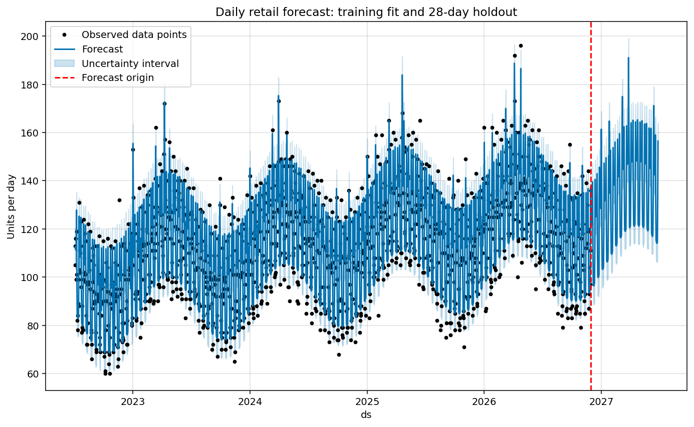

### 解读 Prophet 模型组件

前一张总预测图回答“每天预测多少”，`model.plot_components(forecast)` 则展示模型把预测分配给哪些成分 [9]。这些曲线适合检查模型结构与贡献分配，但只是拟合后的统计分解，不能单独证明某个业务因素对销量具有因果作用。

| 组件 | 图中表示的量 | 在零售案例中如何理解 |
| --- | --- | --- |
| `trend` | 各日期的长期趋势，包括历史区间的拟合与未来区间的外推 | 需求的基础水平怎样随时间变化；它还不是最终预测 |
| `weekly` | 模型学习的七天重复规律；横轴是星期几 | 各星期相对周平均水平增加或减少多少需求；本例周六贡献约为 +12.03 件 |
| `yearly` | 模型学习的年内重复规律；横轴是年内日期 | 不同季节相对全年基准增加或减少多少需求，不表示同比增长率 |
| `holidays` | 指定日期上所有假日及窗口特征的合计贡献 | Boxing Day 等事件在当天为预测增加或减少多少需求 |
| `extra_regressors_additive` | 所有加法回归变量的合计贡献 | 本例只有折扣；注册多个加法变量时，这一组件会汇总它们的贡献 |
| `extra_regressors_multiplicative` | 所有乘法回归变量的合计比例 | 该比例作用于趋势；本例没有配置乘法回归变量，因此不产生这一组件 |

读图时需要同时确认纵轴单位和横轴含义。本文采用全加法模式，因此 `weekly`、`yearly`、`holidays` 和 `extra_regressors_additive` 都以件数表示；负值表示相对基准减少需求，不表示最终预测为负。若使用乘法模式，相应组件表示趋势的相对比例，需要按第三章的混合公式计算。

`trend`、`holidays` 和回归变量面板沿实际日期展开，周、年面板则分别在标准的一周和一年网格上展示拟合规律。红色预测起点只适用于带日期横轴的面板。折扣面板中的平台表示连续多日采用相同折扣；平台边缘的斜线只是绘图程序连接相邻日级点的结果，不表示日内折扣逐渐变化。

对于本文的全加法配置，总预测满足：

$$
\texttt{yhat}
=
\texttt{trend}
+
\texttt{additive\_terms}
$$

其中，`additive_terms` 已经汇总周、年、假日和折扣贡献，不能在计算总预测时再次把这些组件重复相加。Notebook 同时验证：

$$
\texttt{additive\_terms}
=
\texttt{weekly}
+
\texttt{yearly}
+
\texttt{holidays}
+
\texttt{extra\_regressors\_additive}
$$

全历史组件图用于检查长期趋势和重复结构。教学案例的年周期在约 4 月中旬达到较高水平，周末与工作日贡献之差接近生成公式中的 16 件；这些对应关系说明模型恢复了部分已知结构，但不能代替样本外误差检验。

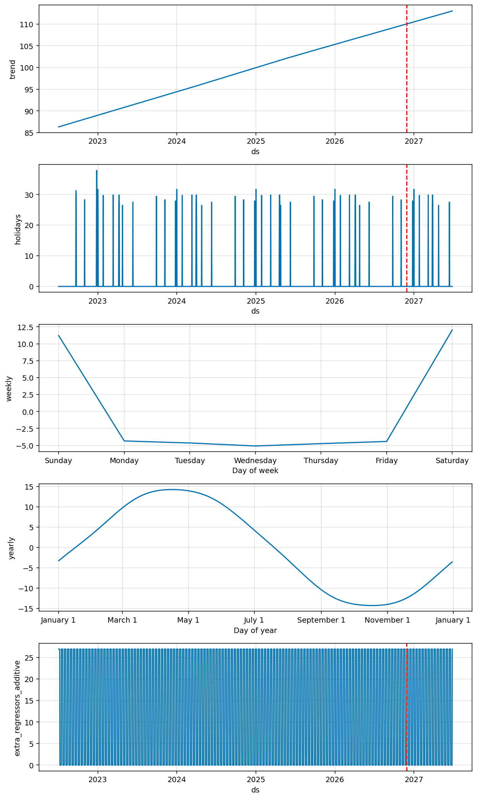

折扣贡献在全历史尺度上较为密集，因此局部图放大预测起点前两周和最后 28 天留出窗口。连续七天的折扣表现为平台，Boxing Day 等单日事件表现为尖峰，两种形状来自不同的输入机制。

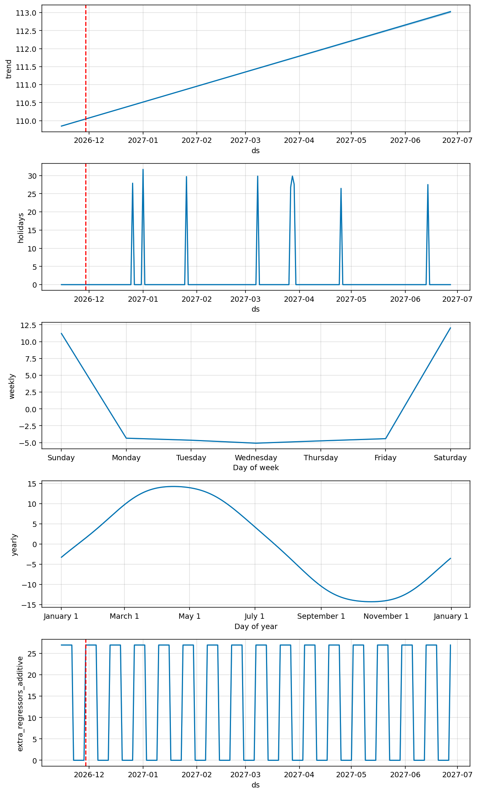

业务复核不应只看曲线是否平滑，还应检查：周规律是否符合门店客流，年规律是否被少数促销误导，假日效应是否与闭店混淆，趋势是否吸收了持续折扣。模型在联合拟合中分配这些贡献；当特征相关或历史较短时，分配结果可能不稳定。预测准确率和区间覆盖率仍需通过第六章的时间回测检验。

组件图解释的是假设门店正常营业时的需求。为了说明营业约束如何改变最终销售输出，下面再对比原始 `yhat` 与应用 `is_open` 后的 `forecast_units`：

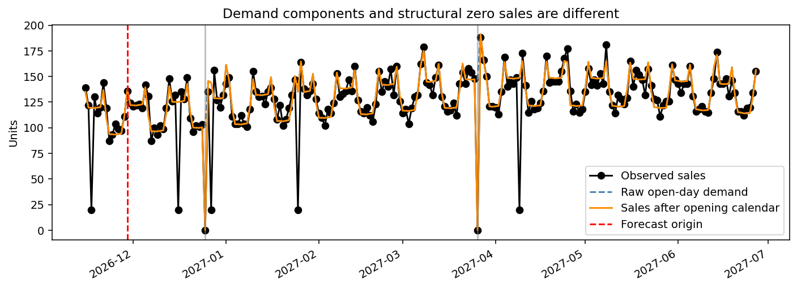

图中圣诞节的零销售由 `is_open=False` 决定，并不表示原始需求预测为零。营业计划确定时，闭店后的销售预测及其区间可以设为 $[0,0]$；假设营业时的潜在需求预测及其不确定性仍应单独保留。

到这里，数据准备、模型初始化、预测生成和组件检查已经形成完整流程。代码中的 `model.fit()` 已经估计各项参数；第五章将打开这一步的内部过程，解释统计模型、MAP 目标和优化求解。

## 五、优化求解与可解释性：参数怎样变成每日预测

第四章已经完成数据处理并确定模型配置。本章把趋势、季节性、节假日和额外回归变量纳入同一个统计模型，说明似然与先验怎样共同构成 MAP 目标，以及优化器怎样联合估计未知参数。最后沿着“拟合参数 → 特征贡献 → 模型组件 → 点预测”的路径，将内部计算结果还原为每日需求，并重建周六与 Boxing Day 的具体预测。

### 建立联合统计模型并区分已知量与未知量

#### 从各模块构造联合统计模型

把各模块合并后，模型先为第 $t$ 行数据计算条件均值 $\mu_t$：趋势与全部特征贡献之和。参与拟合的观测销量 $y_t$ 可以高于或低于这个水平。本例用正态分布描述这种波动，并用观测误差标准差表示典型波动幅度。在加法模式下：

$$
\begin{aligned}
\mu_t
&=g\!\left(\tau_t^{(g)}\right)+\mathbf f_t^\top\mathbf b,\\
y_t\mid\mu_t,\sigma
&\sim\mathcal N\!\left(\mu_t,\sigma^2\right).
\end{aligned}
$$

记号说明：

| 记号 | 定义与读法 |
| --- | --- |
| $t$ | 数据行或模型时间点的编号 |
| $y_t$ | 第 $t$ 个有效训练观测的目标值，即经过业务规则筛选后参与拟合的观测销量 |
| $\mu_t$ | 给定该日输入和模型参数后的条件均值；它不是当天必然出现的销量 |
| $\tau_t^{(g)}$ | 第 $t$ 行的日期经过转换后得到的归一化趋势坐标 |
| $g\!\left(\tau_t^{(g)}\right)$ | 第 $t$ 个时间点的趋势值 |
| $\mathbf{f}_t$ | 第 $t$ 个时间点的完整特征向量，包含季节性基函数、节假日特征和额外回归变量 |
| $\mathbf{b}$ | 与 $\mathbf{f}_t$ 各列一一对应的待估计系数 |
| $\mathbf{f}_t^\top\mathbf{b}$ | 将各特征值与对应系数相乘后相加；$\top$ 表示转置 |
| $\sigma$、$\sigma^2$ | 观测模型中随机误差项的标准差与方差，也称观测噪声尺度，要求 $\sigma>0$；它不等同于某次拟合残差或样本外预测误差 |
| $\mid$ | “在给定……的条件下”；这里表示给定条件均值 $\mu_t$ 和噪声尺度 $\sigma$ |
| $\mathcal N(\mu_t,\sigma^2)$ | 均值为 $\mu_t$、方差为 $\sigma^2$ 的正态分布 |

将所有训练时间点的 $\mathbf f_t^\top$ 按行排列，就得到设计矩阵（design matrix）$\mathbf F$；对应的系数构成向量 $\mathbf b$。矩阵乘积 $\mathbf F\mathbf b$ 一次计算全部训练时间点的季节性、节假日和额外回归变量贡献。本文按照业务含义区分这些系数，Prophet 的 Stan 实现则将它们统一存放在 `beta` 向量中 [10]。

对于任意一组趋势参数、特征系数和噪声尺度，模型都能计算各训练时间点的条件均值及其观测密度。拟合过程将这些单日密度汇总为整段训练历史的似然，再与参数先验共同构成 MAP 优化目标。进入具体目标函数之前，下一节先区分哪些量由优化器估计，哪些量在拟合前已经确定。

#### 优化器求解哪些量，哪些量在拟合前固定

将 Prophet 写成优化问题之前，需要先区分**优化变量**与**固定条件**。优化变量是 `model.fit()` 需要联合求解的未知参数；模型结构、先验超参数和数据变换量则在本次求解开始前已经确定。以教学案例为例：

| 类别 | 教学案例中的量 | 在优化问题中的作用 |
| --- | --- | --- |
| 优化变量 | 趋势斜率 $k$、截距 $m$、变点斜率变化 $\boldsymbol\delta$、完整特征系数 $\mathbf b$、观测噪声尺度 $\sigma$ | 共同组成待估参数集合 $\theta$；MAP 优化器根据训练数据与参数先验联合求解 |
| 模型结构 | 线性趋势、25 个候选变点的位置、周和年周期、傅里叶阶数、加法模式 | 确定条件均值 $\mu_t$ 的函数形式、设计矩阵 $\mathbf F$ 的列以及参数维数 |
| 先验超参数 | `changepoint_prior_scale=0.05`、各季节性和节假日的 `prior_scale=1.0`、折扣 `prior_scale=1.0` | 确定拉普拉斯或正态先验的尺度，从而控制 MAP 目标中的参数收缩强度 |
| 数据变换量 | `y_scale`、趋势时间起点与跨度；回归变量标准化时使用的训练均值和标准差 | 将业务尺度的数据转换为内部优化尺度，并在预测时执行逆变换 |

候选变点的位置由配置规则生成，$\delta_j$ 才是优化器在这些位置上估计的斜率变化量；傅里叶基函数由日期和周期配置确定，对应系数则包含在 $\mathbf b$ 中。类似地，`prior_scale` 决定先验惩罚的强弱，本次 `fit()` 求解的是受到该先验约束的参数，而不是 `prior_scale` 本身。

因此，在模型结构、训练输入、先验尺度和数据变换量固定后，本章的求解目标可以写成：寻找参数集合 $\theta=(k,m,\boldsymbol\delta,\mathbf b,\sigma)$，使训练数据的似然与参数的先验支持共同达到最大。下一节将这一目标正式写成 MAP 公式。

### 从联合似然到 MAP 数值求解

#### 用似然与先验定义 MAP 目标

上一节已经定义单日观测分布。给定参数集合 $\theta$ 后，趋势与特征系数决定条件均值 $\mu_t$，噪声尺度 $\sigma$ 决定观测值在该均值附近的离散程度。对于具有有效目标值的训练时间点集合 $\mathcal T_{\mathrm{train}}$，Prophet 将各日条件密度相乘，得到整段训练历史的似然：

$$
p(\mathcal{D}\mid\theta)
=\prod_{t\in\mathcal{T}_{\mathrm{train}}}
p\bigl(y_t\mid t,\mathbf{f}_t,\theta\bigr)
$$

其中，$\mathcal D$ 表示有效训练观测及其日期和输入，$\mathcal T_{\mathrm{train}}$ 表示具有有效目标值的训练时间点集合。单日密度 $p(y_t\mid t,\mathbf f_t,\theta)$ 的均值为 $\mu_t$，标准差为 $\sigma$。

这个连乘建立在条件独立假设上：给定日期特征和参数后，各日观测误差相互独立并服从正态分布。似然衡量当前参数与整段训练数据的相容程度；这里计算的是各观测点上条件密度的乘积。

如果只追求更高的训练似然，模型可能使用过大的变点变化量或特征系数来解释随机波动。Prophet 通过参数先验 $p(\theta)$ 降低这类复杂参数取值的支持程度。最大后验估计（Maximum a Posteriori Estimation，MAP）在拟合训练数据与遵守先验约束之间取得平衡，并选择后验密度最高的一组参数：

$$
\hat\theta_{\mathrm{MAP}}
=\operatorname*{arg\,max}_{\theta}
\left[
\log p(\mathcal D\mid\theta)
+\log p(\theta)
\right].
$$

其中，$\hat\theta_{\mathrm{MAP}}$ 表示使后验密度最高的一组参数。取对数后，联合似然中的连乘变为求和，优化器可以同时累积各日数据提供的证据和参数先验提供的约束。下一节将切换到 Prophet 的内部尺度，展开先验及其对应的优化惩罚。

#### 先验尺度怎样进入优化目标

先验尺度决定参数先验在零附近集中的程度。把 MAP 最大化问题改写成负对数最小化问题后，同一尺度又会表现为目标函数中的惩罚强度。下面依次说明 Prophet 的内部参数、先验对需求预测的影响，以及优化器最终最小化的目标。

**内部参数：优化器实际求解什么**

前文用 $\theta$ 表示业务尺度下的完整参数集合。Prophet 在优化前会缩放目标值并转换时间坐标，因此优化器实际求解的是内部参数集合 $\tilde\theta$；相应地，$\sigma$ 和 $\tilde\sigma$ 分别表示业务尺度与内部尺度下的观测噪声标准差。

在线性、全加法的教学案例中，优化器需要同时调整初始趋势、变点变化、全部特征系数和噪声尺度：

$$
\tilde\theta=
\left(\tilde k,\tilde m,
\tilde{\boldsymbol\delta},\tilde{\mathbf b},\tilde\sigma\right),
\qquad
\tilde{\mathbf b}=(\tilde b_1,\ldots,\tilde b_K)^\top
$$

其中，$\tilde\theta$ 是 $\theta$ 的内部参数化；$\tilde k$、$\tilde m$ 是内部趋势斜率与截距；$\tilde{\boldsymbol\delta}$ 收集 $J$ 个变点的斜率变化量；$\tilde{\mathbf b}$ 收集 $K$ 个傅里叶、节假日和额外回归变量系数；$\tilde\sigma>0$ 是内部观测噪声标准差。

对于第 $i$ 个有效训练观测，内部条件均值等于内部趋势与各特征贡献之和：

$$
\tilde\mu_i=\tilde g_i+
\sum_{r=1}^{K}f_{i,r}^{\mathrm{model}}\tilde b_r
$$

其中，$\tilde g_i$ 是内部趋势，$f_{i,r}^{\mathrm{model}}$ 是第 $i$ 个观测在第 $r$ 列模型特征上的取值，$\tilde b_r$ 是相应的内部系数。第五章后半部分再将这些内部结果还原为销量单位。

**参数先验：怎样影响未来需求预测**

先验不直接约束未来需求量，而是约束生成预测的趋势变化和特征系数。训练似然要求模型解释历史销量，参数先验则抑制缺少数据支持的过大变化。两者共同决定各组件的拟合幅度，并最终影响未来 28 天的需求预测。

| 模型参数 | 教学案例的先验配置 | 对未来需求预测的影响 |
| --- | --- | --- |
| 变点变化 $\tilde\delta_j$ | `changepoint_prior_scale=0.05` | 控制近期增长或下降趋势向未来延伸的幅度 |
| 周、年傅里叶系数 $\tilde b_r$ | `seasonality_prior_scale=1.0` | 控制星期和年度需求波动的幅度 |
| 节假日系数 $\tilde b_r$ | `holidays_prior_scale=1.0` | 控制 Boxing Day 等事件相对普通日期的需求增减 |
| 折扣系数 $\tilde b_r$ | 折扣 `prior_scale=1.0` | 控制给定折扣比例对未来需求的贡献 |

Prophet 对变点变化使用零中心拉普拉斯先验，对傅里叶、节假日和额外回归变量系数使用零中心正态先验：

$$
\tilde\delta_j\sim\operatorname{Laplace}(0,\tau),
\qquad
\tilde b_r\sim\mathcal N(0,s_r^2).
$$

这里的零是**拟合前先验分布的中心**，不是拟合后系数必须取得的值。以特征系数为例，$\mathbb E_{\mathrm{prior}}[\tilde b_r]=0$ 表示在观察训练销量之前，模型更支持幅度较小的正、负效应。加入训练数据后，似然与先验共同形成后验分布：

$$
p(\tilde b_r\mid\mathcal D)
\propto
p(\mathcal D\mid\tilde b_r)\,
p(\tilde b_r).
$$

因此，后验分布可以偏离零。本文采用的 MAP 估计取后验密度最高的位置，而不是先验分布的期望值。零中心正态先验会把证据不足的系数向零收缩，却不会把所有系数固定为零。

$\tau$ 对应 `changepoint_prior_scale`，$s_r$ 由相应特征的 `prior_scale` 决定。较小的 $\tau$ 会使更多变点变化量收缩到零，让未来趋势更接近稳定延伸；较小的 $s_r$ 会加强特征系数向零收缩，减弱季节性、节假日或促销对未来预测的影响。较大的尺度允许模型表达更强的变化，也提高模型追随少量异常观测的风险。

教学数据通过 $130q_t$ 生成折扣贡献；当 $q_t=0.20$ 时，合成数据中的隐藏真值为需求增加 26 件。真实项目在拟合前并不知道这一数值；本文能够看到它，只因为教学数据的生成机制由作者预先设定。因此，26 件只用于拟合后的恢复性检查，不参与先验尺度的配置。

拟合时，Prophet 同时估计趋势、季节性、节假日、折扣系数和噪声尺度。如果控制其他组件后，促销日的销量仍持续高于可比的非促销日，增大折扣系数就能降低这些日期的预测残差；但更大的系数也会增加零中心正态先验对应的 L2 代价 $\tilde b_{\mathrm{discount}}^2/(2s_{\mathrm{discount}}^2)$。MAP 优化器在似然改善与先验代价之间权衡。

$s_{\mathrm{discount}}$ 是拟合前配置的先验标准差，不是 `model.fit()` 从销量中估计的参数。教学案例设置 `prior_scale=1.0`，因此 $s_{\mathrm{discount}}=1.0$。由于 `y_scale=193`，折扣变量使用原始比例且采用加法模式，该配置对应折扣系数在原销量尺度上的先验标准差为：

$$
1.0\times196
=196\text{ 件/单位折扣}.
$$

对于 20% 折扣，折扣组件的先验标准差为：

$$
196\times0.20=39.2\text{ 件}.
$$

这表示在观察训练销量之前，模型允许 20% 折扣产生较宽的正向或负向需求变化。38.6 件描述的是先验尺度，不是已知的真实促销增量，也不是模型最终必须预测的数值。

教学数据中的促销每 14 天出现一次，并且历史中同时包含相同星期位置的促销日和非促销日。这些重复对照为折扣效应提供了数据证据，使正折扣系数带来的似然收益超过了系数偏离零所增加的先验代价。MAP 最终得到内部折扣系数：

$$
\tilde b_{\mathrm{discount}}
\approx\frac{134.78}{196}
\approx0.688.
$$

还原到原销量尺度后，折扣系数约为：

$$
\beta_{\mathrm{discount}}
\approx196\times0.688
\approx134.78.
$$

因此，未来 20% 折扣日的拟合贡献约为：

$$
134.78\times0.20
\approx26.96\text{ 件}.
$$

26.96 件接近合成数据中的 26 件隐藏真值，说明模型在当前教学数据和配置下恢复了折扣效应；它不能证明真实项目中的促销效应也等于 26 件。如果训练历史只有少量促销日，或者促销总与某个星期、节假日或其他业务事件同时出现，数据就难以单独识别折扣效应，先验会把证据不足的系数更多地拉向零。

真实项目无法预先知道促销效应的真实值。工程师可以根据预测起点前已有的促销分析、相似门店—商品、价格弹性研究或业务专家给出的合理范围，构造多个 `prior_scale` 候选值，再通过训练历史内部的滚动时间回测进行选择。最终评价窗口及事后观察到的促销效果不能用于反向调整先验。上述尺度换算依赖目标缩放、特征编码和标准化方式，也不能直接复制到其他门店—SKU 序列。`changepoint_prior_scale=0.05` 同样作用于内部斜率变化量，不能解释为每天增减 0.05 件。

$\tau$ 和 $s_r$ 是拟合前给定的超参数，$\tilde\delta_j$ 和 $\tilde b_r$ 才是优化器求解的参数。训练数据提供充分证据时，这些拟合参数可以明显偏离先验中心。

**联合先验：怎样组合不同参数的约束**

Prophet 分别设置各类参数的先验；在先验独立的设定下，将这些密度相乘即可得到完整参数集合的联合先验：

$$
\begin{aligned}
p(\tilde\theta\mid\tau,\mathbf s)
={}&p(\tilde k)\,p(\tilde m)\,p(\tilde\sigma)
\prod_{j=1}^{J}p(\tilde\delta_j\mid\tau)
\prod_{r=1}^{K}p(\tilde b_r\mid s_r)
\end{aligned}
$$

其中，$\mathbf s=(s_1,\ldots,s_K)^\top$ 收集 `beta` 中各特征系数的先验标准差。一般情况下，不同季节性、节假日和额外回归变量可以使用不同的 $s_r$。教学案例将 `seasonality_prior_scale`、`holidays_prior_scale` 和折扣变量的 `prior_scale` 都设为 1.0，因此这里有：

$$
\mathbf s=(1,\ldots,1)^\top=\mathbf 1_K.
$$

这些内部先验尺度虽然相同，但傅里叶、0/1 节假日和连续折扣特征的编码与取值范围不同，因此换算到每日需求贡献后，并不表示相同的业务效应范围。这里的 1.0 只是教学基线，不是已经验证的最优值。真实项目应结合预测起点前可获得的业务信息，为季节性、节假日和折扣系数分别设置少量候选尺度，再通过训练历史内部的滚动时间回测比较总体误差、相应日期分组的误差和组件稳定性；若单项实验显示这些模块会相互分摊同一段销量变化，还需对少量候选组合进行联合验证。先验过紧可能压掉真实变化，过松则可能把随机波动解释为趋势、季节性或事件效应；最终评价窗口不能参与超参数选择。

$\mathbf s$ 不包含变点变化的先验尺度 $\tau=0.05$，也不包含 $\tilde k$、$\tilde m$ 和 $\tilde\sigma$ 各自的先验尺度。先验能够写成乘积，不代表拟合后的参数彼此独立；不同参数仍可能因为共同解释销量而产生后验相关性。

**负对数后验：怎样转化为优化目标**

数值优化器通常求最小值，因此 Prophet 将 MAP 的最大化问题改写为负对数后验的最小化问题；两种写法得到相同的最优参数：

$$
\mathcal L(\tilde\theta)
=-\log p(\tilde{\mathcal D}\mid\tilde\theta)
-\log p(\tilde\theta\mid\tau,\mathbf s)
$$

其中，$\mathcal L$ 是负对数后验目标，$\tilde{\mathcal D}$ 是训练数据在模型内部尺度上的表示；$\tilde\theta$ 是待估参数，$\tau$ 和 $\mathbf s$ 是拟合前固定的先验尺度。式中省略了不随参数变化的后验归一化常数。

展开这个目标后，拉普拉斯先验产生 $|\tilde\delta_j|/\tau$，形成针对变点变化量的 L1 惩罚；正态先验产生 $\tilde b_r^2/(2s_r^2)$，形成针对特征系数的 L2 惩罚。把它们与正态观测模型的负对数似然合并，并省略与待估参数无关的常数，可得：

$$
\mathcal L(\tilde\theta)=
M\log\tilde\sigma+
\frac{1}{2\tilde\sigma^2}\sum_{i=1}^{M}
(\tilde y_i-\tilde\mu_i)^2
+\frac{1}{\tau}\sum_{j=1}^{J}|\tilde\delta_j|
+\sum_{r=1}^{K}\frac{\tilde b_r^2}{2s_r^2}
+\mathcal R(\tilde k,\tilde m,\tilde\sigma)
$$

| 记号 | 定义 |
| --- | --- |
| $\mathcal L(\tilde\theta)$ | 需要最小化的负对数后验目标；$\tilde\theta$ 是上面定义的内部待估参数集合 |
| $M$、$i$ | 有效训练观测数和观测编号 |
| $\tilde y_i$、$\tilde\mu_i$ | 内部尺度的观测值与模型均值；后者由内部趋势及特征贡献计算 |
| $\tilde\sigma>0$ | 内部观测噪声标准差；$M\log\tilde\sigma$ 是似然的一部分，不能在联合估计它时省略 |
| $J$、$j$、$\tilde\delta_j$ | 候选变点数、编号和内部斜率变化量 |
| $K$、$r$、$\tilde b_r$ | 完整特征数、编号和内部系数 |
| $\tau$、$s_r$ | 变点先验尺度和各特征先验标准差，属于给定配置而非此次优化的未知量 |
| $\mathcal R$ | 其余参数的先验惩罚；$\tilde k$、$\tilde m$ 是内部趋势斜率和截距 |

Prophet 1.4.0 对内部 $\tilde k$、$\tilde m$ 使用标准差 5 的正态先验，对正值约束的 $\tilde\sigma$ 使用标准差 0.5 的正态先验，汇入 $\mathcal R$。本式适用于线性、全加法的教学案例；固定先验尺度后可省略与待估参数无关的常数 [10]。

在教学配置中，`changepoint_prior_scale=0.05` 即 $\tau=0.05$，因此变点 L1 惩罚的权重为 $1/\tau=20$。若将该尺度减半，同一个变点变化量的惩罚会加倍。特征系数的惩罚由 $s_r$ 控制；将 $s_r$ 减半，会使同一系数的 L2 惩罚增为四倍。不同特征列可以使用不同的 $s_r$，所以逐项写出惩罚比使用统一权重更接近 Prophet 的实现。

至此，MAP 目标把四类信息放入同一个优化问题：训练残差、观测噪声、趋势变化的 L1 惩罚，以及特征系数的 L2 惩罚。所有参数需要联合估计，因此相关特征可能分摊同一段销量变化；先验独立也不意味着拟合后的后验独立，更不代表模型已经识别出业务因果效应。

#### 优化器怎样求出 MAP 参数

前一节已经把参数估计写成最小化问题：在内部参数空间中寻找使 $\mathcal L(\tilde\theta)$ 最小的一组 $\tilde\theta$。Prophet 先根据训练数据计算初始值，再让 Stan 优化器同时更新 $\tilde k$、$\tilde m$、$\tilde{\boldsymbol\delta}$、$\tilde{\mathbf b}$ 和 $\tilde\sigma$。这些参数共同决定趋势、各特征贡献和观测噪声，因此不能分成互不相关的步骤分别求解。

每次迭代中，Stan 通过自动微分计算目标函数对各参数的梯度。梯度反映参数发生微小变化时，训练残差、噪声项、变点 L1 惩罚和特征系数 L2 惩罚将怎样变化；优化器据此选择下一组参数，使 $\mathcal L(\tilde\theta)$ 逐步下降。当目标值、参数更新或梯度满足收敛条件时，迭代停止，并将当前参数作为 MAP 数值解 [11]。

在本文验证的 Prophet 1.4.0 Python 后端中，MAP 路径通常使用有限内存拟牛顿算法 L-BFGS（Limited-memory Broyden–Fletcher–Goldfarb–Shanno）。L-BFGS 使用有限的历史更新信息近似目标函数的曲率，适合参数较多的模型。有效观测少于 100 个时，后端默认使用 Newton 方法（牛顿法）；启用回退时，L-BFGS 异常结束也可能改用 Newton。这些选择属于版本相关的底层求解实现，通常不是零售建模人员需要调节的业务超参数 [12]。

优化收敛后，Prophet 将求得的参数写入 `model.params`。教学案例的 6 个周周期系数、10 个年周期系数、各节假日系数和折扣系数都存放在 `beta` 中；$k$、$m$ 和 `delta` 描述趋势，`sigma_obs` 描述观测噪声。数值优化正常结束只说明算法找到了满足收敛条件的解，工程上仍需检查异常终止、不同初始条件或配置下的稳定性，以及样本外预测表现。

拟合参数也不必逐项等于生成公式中的 16、14 或 130。周、年规律需要通过多列傅里叶基函数共同重建，先验收缩、随机噪声和有效目标筛选也会改变参数分配。本章下一部分将把内部参数重新组合成具体日期的预测，第六章再检验这些预测能否在未来窗口中保持准确。

#### 怎样在 MAP 与 MCMC 之间选择

`mcmc_samples` 是初始化 Prophet 模型时设置的非负整数参数。它的名称虽然包含 “samples”，但首先决定模型是否执行完整的贝叶斯后验采样：默认值 0 表示不运行 MCMC，正整数则启用 MCMC，并进一步影响采样迭代规模。

当 `mcmc_samples=0` 时，Stan 通过数值优化求一组最大后验参数；当 `mcmc_samples>0` 时，Stan 改用马尔可夫链蒙特卡洛（Markov Chain Monte Carlo，MCMC）从参数后验分布中采样。两条路径使用相同的模型结构、训练数据和参数先验，差别在于最终得到一组 MAP 参数，还是多组后验样本。

| 比较维度 | MAP：`mcmc_samples=0` | MCMC：`mcmc_samples>0` |
| --- | --- | --- |
| 参数结果 | 一组后验密度最高的参数 | 多组参数后验样本 |
| 点预测 | 使用单组 MAP 参数 | 汇总多组参数下的预测 |
| 预测不确定性 | 不对全部参数后验进行积分 | 传播趋势、季节性、节假日和回归系数的不确定性 |
| 计算与诊断 | 成本较低，便于批量训练 | 成本较高，还需检查采样质量 |
| 更适合的任务 | 大量门店—SKU 的点预测基线 | 后验分析、预测分位数及高价值或高风险序列 |

选择哪条路径，应由需求预测的输出用途决定，而不是把 MCMC 视为更高级、必然更准确的模型。MCMC 可以保留不同参数组合造成的预测差异，却不能修复未处理的缺货、错误的促销计划、遗漏的结构变化或训练信息不足；它也不保证降低 MAE、WAPE 或偏差。若业务主要使用未来每日需求的点预测，通常先采用 MAP；若补货决策依赖服务水平、安全库存或需求分位数，并且参数不确定性可能显著影响决策，再评估 MCMC。两种路径的点预测都应使用相同的滚动预测起点和预测窗口比较，预测区间则需要另外检查实际覆盖率 [4, 13]。

以教学案例为例，MAP 基线使用截至 2026 年 11 月 29 日的 1,554 个有效训练观测，预测随后 28 天的每日需求。如果要评估 MCMC，应保持训练数据、趋势形式、傅里叶阶数、节假日日历、折扣输入和全部先验尺度不变，只将 `mcmc_samples` 从 0 改为例如 300，并继续固定随机种子。这样，MAP 与 MCMC 的差异主要来自参数推断方式，而不是数据或模型结构的变化。

对这项诊断实验，应先检查 4 条链的收敛、有效样本量和 divergent transitions（发散转移），再比较同一批滚动预测起点上的 MAE、WAPE、偏差和预测区间覆盖率；还可以重点检查 Boxing Day 与 20% 折扣日的需求分布是否因纳入参数不确定性而明显变宽。这里的 300 只是初始采样配置，不是已经验证的最优值，也不表示最终保留 300 个后验样本。Prophet 1.4.0 会将该参数的一半用于每条链的预热、另一半用于正式采样。

Stan 后端使用 NUTS（No-U-Turn Sampler，无掉头采样器）生成后验样本。NUTS 建立在 HMC（Hamiltonian Monte Carlo，哈密顿蒙特卡洛）之上：HMC 利用后验密度的梯度在参数空间中构造采样轨迹，减少随机游走造成的低效探索；NUTS 则在轨迹开始折返时自动停止扩展，从而自适应地确定每次迭代的轨迹长度。对本例而言，每次保留的样本都是一组可能的趋势、季节性、节假日、折扣和噪声参数；将这些参数分别代入未来 28 天的输入，便可得到一组需求预测分布 [12, 14]。本文没有运行这组 MCMC 对照实验，因此不据此报告预测精度或区间覆盖率的改善。

`uncertainty_samples` 是 Prophet 在 `predict()` 阶段生成预测区间时使用的模拟次数，不属于教学数据字段，也不是由 `fit()` 估计的模型参数。Prophet 1.4.0 的默认值为 1000，本文在模型初始化时显式保留 `uncertainty_samples=1000`，以清楚展示预测区间的生成配置。Prophet 基于拟合结果重复模拟未来路径，再从模拟结果中提取由 `interval_width=0.80` 指定的 80% 区间。增加模拟次数通常只会减小区间分位数的蒙特卡洛波动并增加预测计算量，不会直接改善 `yhat` 的点预测；设置为 0 则不生成不确定性区间 [4, 13]。

`uncertainty_samples` 所模拟的不确定性还取决于参数推断方式。当 `mcmc_samples=0` 时，Prophet 以单组 MAP 参数为基础，预测区间主要传播观测噪声以及对未来趋势变化的模型假设，不包含季节性、节假日和折扣系数的完整后验不确定性；当 `mcmc_samples>0` 时，预测会进一步汇总多组后验参数下的未来路径。简言之，`mcmc_samples` 决定怎样估计未知参数，`uncertainty_samples` 决定怎样利用拟合结果近似未来预测分布。本文需要逐项重建一组确定的拟合参数，因此采用 `mcmc_samples=0`；后续参数重建均基于单组 MAP 估计。

### 从拟合参数重建未来预测

前文已经说明 Prophet 怎样通过 MAP 或 MCMC 求解未知参数。本节沿着“未来输入 → 模型特征 → 组件贡献 → 总预测”的顺序，把拟合结果还原为每日需求预测，并用教学案例中的周六和 Boxing Day 检查计算过程。

#### 未来输入怎样与拟合参数结合

对于每个未来日期，Prophet 先复用第四章定义的转换规则：将日期映射为趋势和季节性坐标，匹配节假日特征，并按照训练阶段的方式处理折扣等回归变量。模型随后把这些特征与已拟合参数相乘，得到趋势、季节性、节假日和额外回归变量的贡献，再组合为点预测 `yhat`。观测噪声不加入 `yhat`，但会进入预测区间的模拟。

在默认 MAP 路径中，点预测的趋势在训练期最后一个候选变点之后，按照最后估计的增长速度继续延伸。未来是否再次发生趋势变化仍然未知；Prophet 只在生成预测区间时，按照模型假设模拟可能的未来趋势变化。

因此，Prophet 可以一次生成未来 28 天的预测，但模型仍需要每个目标日期上已知或预先规划的业务输入。例如，训练阶段估计折扣与需求之间的参数关系，预测阶段则必须提供未来 28 天的折扣计划；模型不会自行推断尚未提供的促销安排。

#### 怎样重建周六与 Boxing Day 的预测

重建预测时，需要区分模型配置、拟合参数和每日贡献。周期与傅里叶阶数由工程师配置，特征系数由模型拟合得到，每日组件则由目标日期的特征值与相应系数相乘得到。Prophet 将季节性、节假日和额外回归变量的内部系数统一保存在 `beta` 中；数值重建必须遵循模型保存的特征列顺序，并按照目标值的缩放规则将内部结果还原到销量尺度。

教学案例使用 MAP、线性趋势、全加法模式、`absmax` 缩放，并且没有下限偏移。对任意目标日期，可以先在内部尺度上合计趋势与各组件贡献，再乘以训练阶段保存的目标缩放尺度，将预测还原为件数：

$$
\hat y_t=s_y\left(\tilde g_t+\mathbf f_t^\top\tilde{\mathbf b}\right)
$$

其中，$\hat y_t$ 是第 $t$ 个目标日期上、以原销量单位表示的点预测；$s_y$ 是训练目标缩放尺度；$\tilde g_t$ 是该日的内部趋势；$\mathbf f_t$ 是由日期 $d_t$ 和业务输入按模型保存的规则构造的完整特征行；$\tilde{\mathbf b}$ 是内部 `beta` 系数。$\top$ 表示转置，内积将特征值与对应系数逐项相乘后求和。本式不直接适用于乘法或带下限偏移的配置。

趋势也可以从初始直线逐段算出来。某个变点尚未到达时，它的额外贡献为零；经过该变点后，就用新的速度变化量乘以已经经过的时间，再加入原来的趋势：

$$
\tilde g_t=\tilde k\tau_t^{(g)}+\tilde m+
\sum_{j=1}^{J}\tilde\delta_j\max\bigl(\tau_t^{(g)}-\tilde c_j,0\bigr)
$$

这里，$\tau_t^{(g)}$ 是第四章定义的归一化趋势坐标，$\tilde k$、$\tilde m$、$\tilde\delta_j$ 是模型保存的内部趋势参数；$\tilde c_j$ 是归一化后的第 $j$ 个候选变点，$J$ 是候选数量，$\max$ 取两个值中较大者。变点前该项为零，变点后贡献随时间增长，等价于第三章的连续分段线性公式。

完整重建依次复用模型保存的输入转换，按照训练特征列顺序计算各项乘积，再将结果与 `predict()` 的输出进行数值一致性检查。下面选择 2026 年 12 月 5 日和 12 月 26 日，分别核对普通周六与 Boxing Day 的预测。

Prophet 1.4.0 的傅里叶特征按 `sin1`、`cos1`、`sin2`、`cos2` 等顺序排列，分别对应本文记号中的 $v$、$u$。本例 $s_y=193$，将周傅里叶内部系数还原到销量尺度后得到：

| 阶数 | 余弦系数 $u_{7,n}$，件 | 正弦系数 $v_{7,n}$，件 |
| --- | --- | --- |
| 1 | −5.2182 | 6.5351 |
| 2 | −1.1359 | −5.5705 |
| 3 | 1.3919 | 0.9225 |

下标 7 表示周期为 7 天，$n$ 表示傅里叶阶数。计算时应按照模型实际保存的正弦、余弦列顺序，将目标日期的六个周周期特征分别乘以对应系数。

2026 年 12 月 5 日（周六）的六项周周期贡献如下。源码按正弦、余弦成对排列，列顺序与本文写公式时的书写次序可以不同，但必须与保存的系数一致。

| 周特征列编号 | 特征值 | 内部系数 | 乘以 196 后的贡献，件 |
| --- | --- | --- | --- |
| 第 1 | 0.974928 | 0.034299 | 6.5540 |
| 第 2 | -0.222521 | -0.026949 | 1.1753 |
| 第 3 | -0.433884 | -0.027316 | 2.3230 |
| 第 4 | -0.900969 | -0.007297 | 1.2887 |
| 第 5 | -0.781831 | 0.003515 | -0.5387 |
| 第 6 | 0.623490 | 0.010058 | 1.2291 |

六项相加为 12.0314 件，对应周六组件。12 月 5 日实际折扣为 0.20，完整重建值为 139.5031 件；Boxing Day 无折扣，重建值为 145.5941 件。两次均通过与 `predict()` 的数值一致性断言。用特征列的实际值计算，不能为了手算方便任意改变那天的促销计划。

模型对 2026 年 12 月 26 日（Boxing Day，周六）的营业需求预测可拆为：

| 组件 | 拟合后的贡献，件/天 |
| --- | --- |
| `trend` | 110.43 |
| `weekly` | 12.03 |
| `yearly` | -4.76 |
| `holidays`：Boxing Day | 27.89 |
| `extra_regressors_additive`：当天无折扣 | 0.00 |
| **`yhat` 合计** | **145.59** |

将上述组件重建结果放回营业日历，可以再次看到原始需求预测与最终销售预测的区别：


Boxing Day 正常营业，因此营业日历不会改变模型重建得到的 145.59 件；圣诞节则不同，Prophet 给出的约 101.01 件表示假设门店营业时的需求预测，应用闭店状态后，最终销售预测为 0。业务系统应同时保留原始需求预测及其组件，以及应用营业规则后的销售输出；实际销量还会受到随机波动、取整和现场供给条件影响。至此，拟合参数已经还原为每日预测；第六章将进一步检验这些预测在未来窗口中的误差、偏差和区间覆盖率。

## 六、评估、诊断与参数选择：怎样判断模型是否可靠

第五章已经把拟合参数还原为未来 28 天的每日需求预测，但得到预测并不等于证明模型可靠。模型评估需要按照时间顺序划分历史窗口，在统一的评价对象、基准方法和指标口径下，检验点预测的误差与偏差、不同预测起点上的稳定性，以及预测区间的实际覆盖率。本章先固定评估协议，再通过滚动起点回测比较基准方法和候选配置，最后利用预测区间、残差与已知生成机制分析误差来源和模型边界。

本章会使用三组结果。第一组来自第四章配置的“教学基准模型”；第二组来自训练历史内部验证选出的“验证选定模型”；第三组来自单独构造的“缺货机制实验”，用于分析高需求更容易引发缺货时的目标值偏差。三组结果使用的数据或评价目的不同，因此不能直接混合比较。

### 先明确评估协议和数据边界

在计算指标之前，需要先明确哪些历史窗口用于选择配置，哪些用于评价模型表现，哪些实验只用于解释模型机制。若同一批数据既参与参数选择又用于报告最终结果，评估指标通常会过于乐观。本章采用以下协议：

| 分析任务 | 数据与时间窗口 | 在本章中的用途 | 评价对象 |
| --- | --- | --- | --- |
| 最后 28 天教学评价 | 教学案例；训练截止 2026 年 11 月 29 日，评价 11 月 30 日—12 月 27 日（2026 年 P13） | 报告教学案例的预测表现，不参与正文中的配置选择 | 营业且未缺货日期的销量，并与模拟生成过程中的已知真值对照 |
| 内部配置选择 | 在教学案例的训练历史中设置两个预测起点，每次预测 28 天 | 根据两个窗口的汇总 WAPE 选择候选配置 | 每个预测起点—目标日的销量 |
| 滚动性能与区间评价 | 在教学案例的训练历史中设置 12 个预测起点，每次预测 28 天 | 检查跨起点稳定性、分组误差和区间校准；不使用最后 28 天选择配置 | 每个预测起点—目标日的销量与区间覆盖情况 |
| 趋势、季节模式与先验尺度实验 | 根据实验目的分别生成数据，并划分相应的训练与验证窗口 | 解释单项配置怎样影响拟合与预测，不参与教学案例的配置选择 | 已知条件均值或相应观测值 |
| 缺货机制实验 | 单独生成高需求更容易缺货的数据 | 分析受限销量和缺货筛选造成的目标值偏差，不参与教学案例的配置选择 | 生成过程中已知的潜在需求 |

虽然最后 28 天没有用于正文中的配置选择，但其结果已在教程开发过程中被查看，因此只能作为教学评价，不能视为独立测试结果。真实项目应另外保留未参与任何开发决策的测试期；本文与条件均值和潜在需求的对照仅适用于模拟数据。

### 怎样选择评估指标和基准方法

指标只有在评价对象和数据口径一致时才具有可比性。记 $\mathcal T_{\mathrm{eval}}$ 为评价日期集合；本例只纳入营业、未缺货且目标值有效的日期。$y(t)$ 表示第 $t$ 日的实际销量，$\hat y(t)$ 表示经过非负处理和营业规则约束后、与该销量对应的 `forecast_units`。

零销量附近的平均绝对百分比误差（MAPE）不稳定，因此本文主要使用平均绝对误差（Mean Absolute Error，MAE）、加权绝对百分比误差（Weighted Absolute Percentage Error，WAPE）和汇总百分比偏差（aggregate percentage bias，本文简称 Bias）。这里的 Bias 是预测误差的汇总指标，不是统计学中估计量的偏差。

MAE 保留销量单位，用来回答模型平均每天相差多少件：

$$
\mathrm{MAE}=\frac{1}{|\mathcal T_{\mathrm{eval}}|}
\sum_{t\in\mathcal T_{\mathrm{eval}}}|y(t)-\hat y(t)|
$$

WAPE 将评价期内的总绝对误差除以实际销量总和，便于比较销量规模不同的窗口或序列。例如，累计绝对误差为 50 件、实际销量为 1,000 件时，WAPE 为 5%：

$$
\mathrm{WAPE}=\frac{\sum_{t\in\mathcal{T}_{\mathrm{eval}}}|y(t)-\hat y(t)|}{\sum_{t\in\mathcal{T}_{\mathrm{eval}}}y(t)}
$$

Bias 保留“预测减实际”的符号，用来判断模型整体倾向于高估还是低估：

$$
\mathrm{Bias}=\frac{\sum_{t\in\mathcal{T}_{\mathrm{eval}}}\bigl[\hat y(t)-y(t)\bigr]}{\sum_{t\in\mathcal{T}_{\mathrm{eval}}}y(t)}
$$

| 指标 | 回答的问题 | 主要限制 |
| --- | --- | --- |
| MAE | 平均每天相差多少件 | 数值随销量尺度变化，不适合直接比较规模差异很大的序列 |
| WAPE | 总绝对误差占实际销量的多大比例 | 汇总结果更受高销量日期或序列影响 |
| Bias | 整体倾向于高估还是低估 | 正负误差可能相互抵消，不能单独表示误差大小 |

MAE 和 WAPE 衡量误差大小，不区分高估或低估；Bias 的正值表示总体高估，负值表示总体低估，因此应与 MAE 或 WAPE 同时报告。当评价集合为空时，三项指标都不定义；当实际销量总和为零时，WAPE 和 Bias 不定义。

除指标外，评估还需要一个足够简单的参照。本文使用季节性朴素基准（seasonal naïve baseline）：对每个星期几，取预测截止日前最近一次有效销量，并在整个预测窗口中重复使用；若最近一周的对应日期缺少有效目标值，则向前回溯到更早的一周。基准只能使用截止日之前的信息，复杂模型只有在相同回测窗口和评价口径下稳定优于它，额外的训练与维护成本才可能具有价值。第七章将在相同评价日期上比较 Prophet、LightGBM 和这一基准。

所有候选模型和基准方法必须使用相同的营业日、缺货筛选和销售后处理规则，否则指标差异可能来自评价口径，而不是模型本身。本例中，Prophet 在营业日上的 MAE 为 4.81 件；加入预测值和实际销量都确定为零的闭店日后，MAE 降为 4.64 件，而 WAPE 保持不变。MAE 的下降来自评价集合增加了零误差日期，不代表模型本身得到改善。

单一汇总指标也不足以支持补货决策。零售系统还应分别观察 SKU 级误差、品类级偏差、高销量商品与长尾商品的表现，以及补货周期内的累计需求误差；补货团队通常更关心未来两周的总需求，而不只是某一天的预测误差。缺货日或闭店日的反事实需求则需要额外的验证信息，不能直接用已记录销量评价。

### 怎样用滚动起点回测检验稳定性

随机划分训练集和测试集会破坏时间顺序，还可能让模型间接看到未来信息。零售预测更适合使用滚动起点回测（rolling-origin backtesting）：依次选择多个历史截止日，只使用每个截止日之前可见的数据重新拟合模型，再预测当时尚未发生的未来 28 天。这样可以模拟模型在不同时间上线时的表现，并检查误差是否随预测起点或预测步长发生明显变化 [15]。

Prophet 的 `cross_validation()` 会在每个历史截止日复制当前模型的结构与配置，并使用截止日前的数据重新拟合，而不是让当前这组拟合参数直接回看历史。不过，内置回测会读取传入历史表中的额外回归变量。对于折扣等未来业务输入，每个回测窗口中的取值必须代表当时已经确定的促销计划；如果历史表只保存事后发生的实际折扣，直接回测就会把未来信息泄漏给模型。只有在计划值确实可以预先获得，或者能够恢复每个截止日的计划快照时，才适合直接使用下面的内置诊断：

```python
from prophet.diagnostics import cross_validation, performance_metrics

# 严格对齐 2026 年前向滑动窗口（P01 至 P12，每期 28 天）
cutoffs_2026 = [
    pd.Timestamp("2025-12-28") + pd.Timedelta(days=28 * i) for i in range(12)
]
cv = cross_validation(
    model, cutoffs=cutoffs_2026, horizon="28 days", parallel=None
)
assert cv["cutoff"].nunique() == 12

scores = performance_metrics(cv, rolling_window=0.1)
print(scores[["horizon", "mae", "rmse", "coverage"]].tail())
```

这组设置与教学案例的时间结构相对应：在 5 年跨度数据中，通过显式指定 2026 年前 12 期（P01 至 P12，每隔 28 天）作为 `cutoffs`，使回测严格覆盖 2026 全年滚动评估，并将最后一期 P13（2026-11-30 至 2026-12-27）留作最终 Holdout 测试；`horizon="28 days"` 对应未来四周的需求预测任务。本例由此得到 12 个预测起点。`parallel=None` 只表示依次执行各次拟合，不改变回测协议。

`cross_validation()` 生成每个 `cutoff` 与目标日期 `ds` 对应的样本外预测记录；`performance_metrics()` 再从这些记录计算 MAE、均方根误差（Root Mean Squared Error，RMSE）和预测区间覆盖率等内置指标。本文使用的 WAPE、Bias、营业日筛选和缺货筛选不由该函数自动完成，需要在 `cv` 明细上按照前一节的统一口径另外计算。

`performance_metrics(cv, rolling_window=0.1)` 会先按预测步长排列记录，再在约 10% 的预测—实际值对上滚动汇总，因此结果中的某个 `horizon` 不只代表该精确步长。若要分别比较第 1、7 和 28 天的误差，应先计算 `horizon_days=(ds-cutoff).dt.days`，再按精确天数分组 [15]。

如果无法从历史表恢复每个截止日当时可见的价格或促销计划，就应自行编写回测循环：按截止日加载对应的数据和计划快照，重新训练模型，再预测该窗口。回测使用的信息边界必须与真实上线时保持一致。

下面先通过独立对照实验区分候选变点范围、先验尺度、傅里叶阶数和季节模式的作用，再仅使用训练历史内的验证窗口选择配置。最后 28 天评价窗口不参与这一选择过程。

### 配置与模型结构怎样改变预测结果

本节使用四组对照实验解释不同配置和模型结构的作用。季节性与消融实验使用教学案例中的 2026 年 10 月 4 日和 11 月 1 日两个内部预测起点，每次预测 28 天（扣除闭店与缺货后得到 52 个有效评估样本）；趋势实验和加法／乘法实验则分别使用独立生成的数据及其末尾 28 天验证期。不同实验评价的对象可能是观测销量，也可能是生成过程中已知的条件均值，因此数值不能跨实验直接比较。这些实验用于解释模型机制和缩小候选范围，不代替下一节的配置选择，也不使用最后 28 天教学评价窗口挑选参数。

#### 趋势变点位置与变化幅度

趋势实验单独生成 700 天数据，并在第 600 天将增长斜率从 0.025 件/天提高到 0.275 件/天；前 672 天用于训练，后 28 天用于验证。`changepoint_range` (c-range) 决定候选变点可以分布到训练历史的什么位置，`changepoint_prior_scale` (cps) 决定模型允许斜率发生多大变化。当 `changepoint_range=0.8` 时，候选范围结束于真实转折之前；扩大到 0.95 后，候选变点才能覆盖转折附近。

| c-range | cps | 训练 MAE，件 | 验证 MAE，件 | 训练结束时的趋势斜率，件/天 |
| --- | --- | --- | --- | --- |
| 0.8 | 0.001 | 2.51 | 16.99 | 0.034 |
| 0.8 | 0.05 | 1.75 | 6.77 | 0.134 |
| 0.8 | 0.5 | 1.73 | 5.88 | 0.148 |
| 0.95 | 0.05 | 1.50 | 1.33 | 0.264 |
| 0.95 | 0.5 | 1.49 | 1.45 | 0.275 |

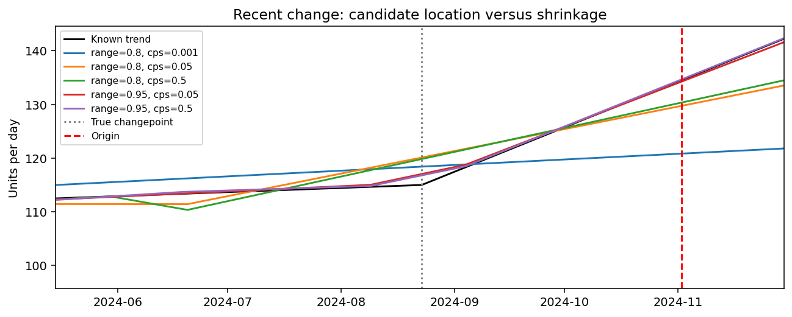

表中的 MAE 相对于加入随机噪声后的观测值计算；图中的黑线则表示无噪声的已知趋势。保持 `changepoint_range=0.8`，把先验尺度从 0.05 提高到 0.5，验证 MAE 仍为 5.88 件；将候选范围扩大到 0.95，并使用先验尺度 0.05，验证 MAE 降至 1.33 件。这个结果说明，放宽斜率变化幅度不能弥补候选位置没有覆盖真实转折的问题。候选范围和先验尺度需要配合选择，并通过历史验证判断。图中灰线标出真实转折，红线标出训练截止日，其他曲线为各配置拟合的趋势。

#### 季节性复杂度与先验收缩

傅里叶阶数决定季节性可以表达多复杂的曲线，`seasonality_prior_scale` 决定相应系数受到多强的收缩。教学案例在相同的两个内部预测起点上得到：

| 年周期阶数 | 季节性先验尺度 | 内部训练 MAE | 内部验证 WAPE |
| --- | --- | --- | --- |
| 1 | 0.01 | 4.72 | 4.26% |
| 5 | 0.01 | 4.72 | 4.31% |
| 5 | 1.0 | 4.72 | 4.29% |
| 15 | 1.0 | 4.69 | 4.24% |

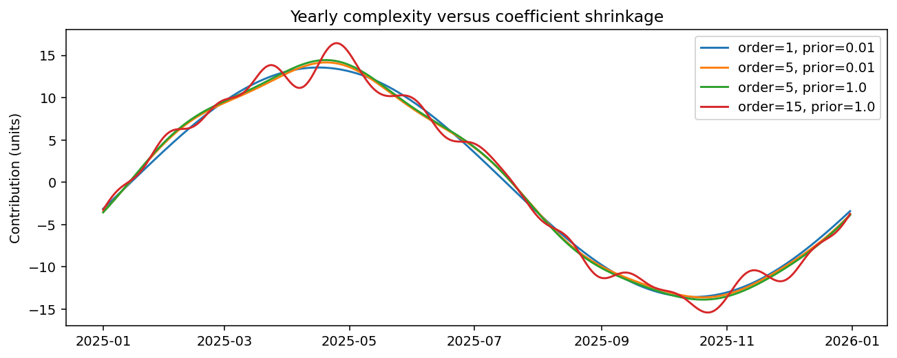

这四组配置没有覆盖阶数与先验尺度的全部组合，因此比较时需要保持其中一个参数不变。先验尺度同为 0.01 时，可以比较年周期阶数 1 和 5；年周期阶数同为 5 时，可以比较先验尺度 0.01 和 1.0；先验尺度同为 1.0 时，可以比较年周期阶数 5 和 15。在最后一组对照中，15 阶模型的训练 MAE 略低，验证 WAPE 却高于 5 阶模型，说明更复杂的曲线虽然改善了历史拟合，却没有带来更好的样本外预测。不同商品仍需根据各自的历史验证结果选择阶数和先验尺度；噪声水平、目标值尺度和样本量也会影响选择结果。

#### 移除模型组件的消融实验

消融实验（ablation study）从教学基准模型出发，每次只移除一个信息来源：移除折扣表示不再通过 `add_regressor("discount")` 加入折扣变量；移除节假日表示初始化模型时不传入节假日日历；移除年周期表示不再添加本文自定义的年周期季节性。其他配置、训练数据、预测起点和评价口径保持一致，并分别重新拟合模型。

| 模型结构 | 训练 MAE，件 | 内部验证 WAPE |
| --- | --- | --- |
| 完整教学基准模型 | 4.72 | 4.29% |
| 移除折扣 | 13.33 | 12.39% |
| 移除节假日 | 5.55 | 4.74% |
| 移除年周期 | 6.40 | 13.21% |

移除折扣、节假日或年周期后，验证误差均增加，但幅度不同。训练 MAE 与验证 WAPE 的单位和用途不同，应分别沿表格列比较模型，不能直接比较 4.72 件与 4.29%。

整体指标还可能掩盖稀疏事件上的大误差。两个内部验证窗口共 52 个有效样本，移除节假日后验证 WAPE 从 4.29% 升至 4.74%；移除年周期后 WAPE 更是大幅上升至 13.21%，移除折扣后 WAPE 飙升至 12.39%。单个样本不足以稳定估计模型在所有节假日上的表现，但这个对照说明，评价稀疏事件时必须同时报告分组规则、样本量和分组误差。

由于每个变体都会重新拟合，剩余组件的参数也会共同调整。因此，消融结果衡量的是删除一个信息来源后整个模型的预测变化，而不是从完整模型的 `yhat` 中简单减去原组件贡献。进一步检查促销日、节假日和普通日期的误差，以及 Boxing Day 附近其他组件的变化，可以判断缺失结构是否转而被趋势或其他季节性组件吸收。验证误差上升说明该组件在当前数据和模型中提供了样本外预测信息，但不能据此认定相应业务因素具有相同大小的因果效应。

#### 加法与乘法季节性

为了单独比较 `seasonality_mode` 的 "additive" 与 "multiplicative"，本实验构造两条日级门店—商品需求序列。两条序列使用相同的日期 `ds`、增长趋势和周周期位置，唯一差别是周波动以固定件数还是固定比例进入条件均值。记基础需求为 $\ell_t=50+0.15t$，周周期模式为 $W_t=\mathbb{I}(\text{周末})-2/7$；因此工作日取 $-2/7$，周末取 $5/7$，完整一周的平均值为 0。

| 数据机制 | 无噪声条件均值 $\mu_t$ | 直观含义 |
| --- | --- | --- |
| 固定件数波动 | $\mu_t=\ell_t+14W_t$ | 周末与工作日相差 14 件，不随基础需求增长而扩大 |
| 比例波动 | $\mu_t=\ell_t\left(1+0.28W_t\right)$ | 周末与工作日相差基础需求的 28%，绝对差值随基础需求增长而扩大 |

两条序列都按照 $y_t=\mu_t+\varepsilon_t$ 生成观测目标，其中 $\varepsilon_t\sim\mathcal N(0,2^2)$。对应本文教学数据的表达方式，`ds` 是日级日期，`y` 是模型实际使用的目标值；$\mu_t$ 只作为模拟实验中的诊断真值，不进入模型训练。为隔离季节性形式，实验不加入折扣、节假日、闭店或缺货机制，也不添加年周期和额外回归变量。

每条序列包含 730 天，前 702 天用于训练，末尾 28 天用于验证。两次拟合只改变 `seasonality_mode`，其他模型配置保持一致，因此结果主要反映季节性形式与数据生成机制是否匹配。

下表使用末尾 28 天的无噪声条件均值 $\mu_t$ 计算 MAE，目的是检查模型能否恢复系统性的趋势和周周期结构，避免单次随机噪声掩盖两种模式的差异。这个指标的评价对象与前面基于观测销量的 MAE 不同，因此数值不能直接比较。

| 数据机制 | 拟合模式 | 条件均值 MAE，件 |
| --- | --- | --- |
| 固定件数波动 | additive | 0.26 |
| 固定件数波动 | multiplicative | 2.69 |
| 随水平变化的比例波动 | additive | 6.37 |
| 随水平变化的比例波动 | multiplicative | 0.30 |

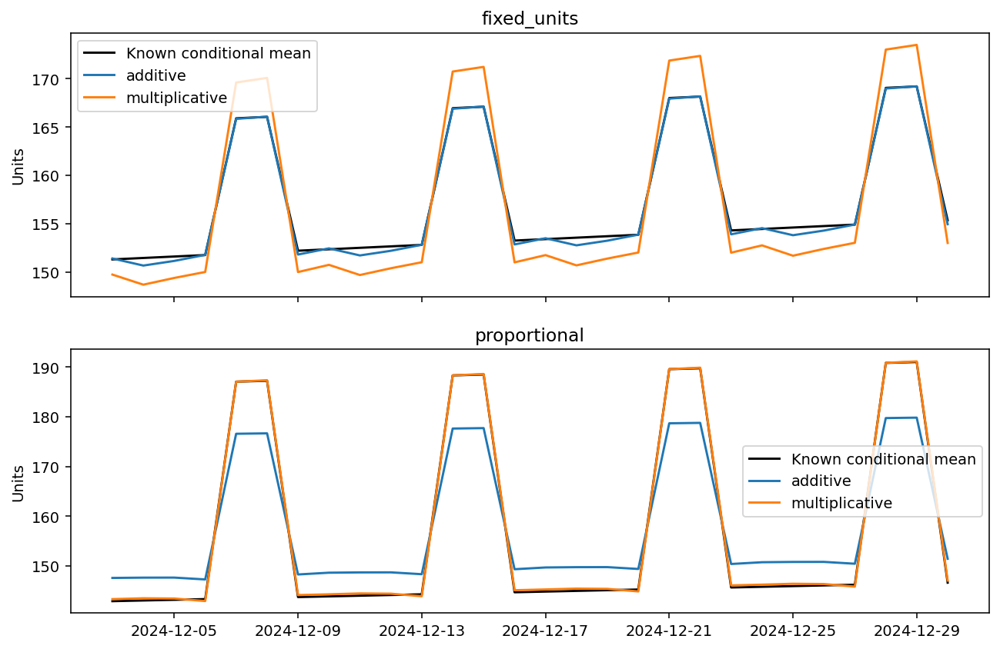

图中的黑线表示已知条件均值，其他曲线表示两种 `seasonality_mode` 下的预测。固定件数波动中，加法模型更贴近条件均值；比例波动中，乘法模型能够随基础需求同步扩大周周期振幅，这与表中的 MAE 结果一致。

真实业务没有可直接观测的生成公式，因此只能先检查季节波动幅度是否随需求水平变化，再通过滚动起点回测比较两种配置。还需要注意，`seasonality_mode` 是全局配置，未单独指定 `mode` 的节假日和额外回归变量也会沿用它。本实验只包含趋势与周周期，因此差异可以归因于季节性形式；在完整业务模型中，还应分别检查节假日和额外回归变量采用的是加法还是乘法模式。

以上实验解释了参数和组件可能怎样改变预测，但没有产生可以直接部署的“最优配置”。下一节将限定候选集合，只使用训练历史内部的时间窗口正式选择教学案例配置。

### 怎样在训练历史内选择配置

前面的对照实验用于理解参数作用，正式选择配置时仍需要限定候选集合和评价规则。本文预先固定三个 Prophet 候选，只使用教学案例训练历史中的 2026 年 10 月 4 日和 11 月 1 日两个预测起点；每个起点预测 28 天，再汇总 52 个有效样本的 WAPE。三个候选的其他模型结构和评价口径保持一致。 注：cps：`changepoint_prior_scale`，sps: `seasonality_prior_scale`。

| 候选 | cps | 年周期阶数 | sps | 内部验证 WAPE |
| --- | ---: | ---: | ---: | ---: |
| A | 0.01 | 5 | 1.0 | 4.283% |
| B：教学基准模型 | 0.05 | 5 | 1.0 | 4.293% |
| C | 0.05 | 1 | 0.1 | **4.239%** |

本节采用的选择规则是：优先选择内部验证 WAPE 最低的候选；若 WAPE 相同，则按照固定的候选顺序处理。该计算过程不读取最后 28 天的目标值，因此候选 C 成为“验证选定模型”。选定后，模型使用截至 2026 年 11 月 29 日的完整训练历史重新拟合，再预测 11 月 30 日—12 月 27 日（2026 年 P13）。

三个候选的内部验证 WAPE 都约为 4.2%—4.3%，候选 C 的优势约为 0.05 个百分点。这个结果支持在当前候选中选择 C，却不足以证明较低的年周期阶数和先验尺度对其他时间窗口或其他商品稳定更优。候选 C 的一阶年周期恰好接近教学数据的生成机制，但真实业务没有这项已知真值，仍需依靠更多历史起点和代表性门店—商品序列验证。

使用候选 C 拟合后，最后 28 天教学评价的营业日 WAPE 为 4.13%，与教学基准模型的 3.93% 处于同一良好水平。这说明内部选择流程可以规范配置决策，但不保证在单个未来窗口中取得明显改善。由于该窗口的结果已经在教程开发过程中被查看，它只能作为教学评价，不能重新用于扩充候选集合或调整选择规则。

真实项目应在开发前固定候选配置、滚动起点和选择指标，并保存每次验证结果与选择依据。完成内部选择后，还需要使用未参与任何开发决策的独立测试期（holdout period）评价最终模型；如果继续根据该测试期修改模型，这段数据也将失去独立测试的作用。

### 怎样解释和检验预测区间

点预测回答“预计销售多少件”，预测区间则描述在模型假设下未来观测可能落入的范围。本节回到教学基准模型，即年周期阶数 5、季节性先验尺度 1.0，以便与前文的组件和参数解释保持一致；这里不使用上一节的验证选定模型，也不重新选择配置。

在 `mcmc_samples=0` 的 MAP 路径下，Prophet 的预测区间主要传播观测噪声和模型假设下的未来趋势变化，不包含季节性、节假日和折扣系数的完整后验不确定性。未来趋势模拟还假设历史斜率变化能够代表未来；区间不会自动覆盖未知促销、异常冲击、缺货需求修复误差或模型结构遗漏 [13]。

本例在每个历史起点重新拟合教学基准模型，并保持 `uncertainty_samples=1000` 不变，只将 `interval_width` 分别设为 0.80 和 0.95。同一预测起点上的 MAP 参数和 `yhat` 完全相同，变化的只是从模拟预测分布中提取的上下分位数。增加 `uncertainty_samples` 可以减小分位数估计的模拟波动，但不会直接提高点预测准确率。

预测区间需要同时检查实际覆盖率和平均宽度。记下界和上界分别为 $\hat y_t^{\mathrm{lower}}$ 与 $\hat y_t^{\mathrm{upper}}$，则评价集合上的覆盖率为：

$$
\mathrm{Coverage}=\frac{1}{|\mathcal T_{\mathrm{eval}}|}
\sum_{t\in\mathcal T_{\mathrm{eval}}}
\mathbb{I}\!\left(\hat y_t^{\mathrm{lower}}\le y_t\le \hat y_t^{\mathrm{upper}}\right)
$$

平均区间宽度为：

$$
\mathrm{Width}=\frac{1}{|\mathcal T_{\mathrm{eval}}|}
\sum_{t\in\mathcal T_{\mathrm{eval}}}
\left(\hat y_t^{\mathrm{upper}}-\hat y_t^{\mathrm{lower}}\right)
$$

覆盖率越高并不一定越有用，因为把区间无限放宽也可以覆盖更多观测。有效的预测区间需要在接近名义覆盖率的同时保持足够窄，才能为补货决策提供区分度。

区间回测沿用 12 个历史起点，只评价营业且未缺货的 320 个样本：

| 名义区间 | 实际覆盖率 | 平均区间宽度，件 | 样本数 |
| --- | --- | --- | --- |
| 80.00% | 74.69% | 15.09 | 320 |
| 95.00% | 91.56% | 23.20 | 320 |

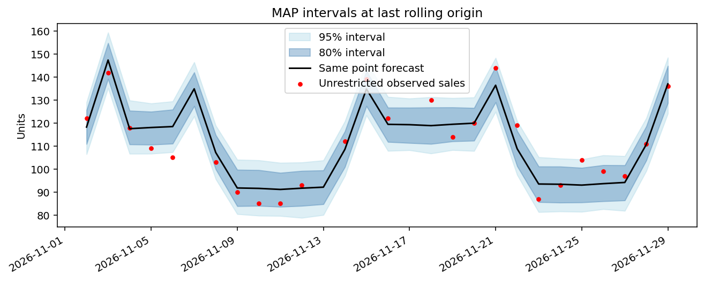

图中展示最后一个滚动起点，表格汇总全部 12 个起点。80% 区间实际覆盖 74.69%，与名义水平相差 5.31 个百分点；95% 区间实际覆盖 91.56%，相差 3.44 个百分点。名义覆盖率从 80% 提高到 95% 后，平均区间宽度也从 15.09 件增加到 23.20 件，体现了覆盖范围与区间宽度之间的权衡。这 320 个样本提供了当前教学序列的经验校准结果，实际项目还应在更多时间窗口和门店—商品序列上持续监测这一差异。

为了定位校准差异，可以进一步按照预测步长、促销状态、节假日和需求规模分别计算覆盖率与平均宽度。例如，第 28 天和稀疏节假日的分组结果能够说明总体覆盖率在具体业务场景中的构成。

在库存决策中，预测区间是计算服务水平的一项输入。制定 95% 服务水平策略时，应估计补货交期内的累计需求分布，并综合每日误差之间的相关性、补货批量、缺货成本和积压成本。业务系统可以将单日 `yhat_upper` 与这些约束共同输入库存优化过程，再计算安全库存和订货量。

### 怎样判断预测误差的来源

预测误差通常来自三类机制：未来随机波动、尚未纳入模型的系统性结构，以及闭店或缺货造成的受限目标值。判断来源时，需要为每类机制选择相应证据。本节使用教学基准模型和模拟生成真值分析前两类误差，再通过单独构造的缺货机制实验分析受限销量；两组实验的数据与目的分别说明。

#### 随机噪声与系统性误差

模拟数据允许把同一组预测分别与无噪声条件均值、含噪声潜在需求和最终观测销量比较。最后 28 天只评价营业日，并得到：

| 评价目标 | WAPE | MAE，件 | 含义 |
| --- | ---: | ---: | --- |
| 无噪声条件均值 | 0.61% | 0.71 | 模型恢复系统性趋势和业务规律的误差 |
| 含噪声潜在需求 | 3.96% | 4.66 | 加入随机波动后的误差 |
| 取整后的观测销量 | 3.93% | 4.63 | 加入随机波动和观测取整后的最终误差 |

模型相对于条件均值的误差很小，而相对于潜在需求和观测销量的误差明显增加。这组差异说明，教学基准模型已经恢复大部分已知的系统性结构，剩余误差主要来自随机扰动与销量取整。该窗口包含一个闭店日，营业期间没有发生缺货；表中指标只使用可以与销量对应的营业日。模拟数据提供了条件均值和潜在需求作为诊断真值；真实项目可以改用库存充足期、受控实验或需求修复结果建立近似参照。

#### 受限销量与需求相关缺货的选择偏差

教学案例原有的缺货标记与需求独立，可以演示怎样屏蔽受限销量。为了进一步观察“需求越高越容易缺货”形成的选择偏差，本节另外生成 730 天需求，并将可用供给固定为 115 件。潜在需求超过 115 件时，系统仍记录 115 件销量并标记缺货；真实需求量只知道至少达到 115 件，因此这类记录属于上限删失观测（right-censored observation），而不是被排除在样本之外的截断观测。前 702 天用于训练，最后 28 天用于评价，评价目标是生成过程中已知的潜在需求。

| 训练目标处理 | 可用训练标签数 | 潜在需求 WAPE | 潜在需求 Bias |
| --- | ---: | ---: | ---: |
| 将上限删失销量当作准确需求 | 702 | 6.74% | -3.74% |
| 屏蔽缺货日目标值 | 580 | 6.89% | -4.74% |

将上限删失销量当作准确需求时，模型保留了全部 702 条训练标签，但把超过 115 件的潜在需求压缩到了供给上限，得到 6.74% 的 WAPE 和 -3.74% 的 Bias。屏蔽缺货日后，可用标签降至 580 条，WAPE 为 6.89%，Bias 为 -4.74%。后一组样本只保留需求没有超过供给的日期，因此更集中于较低需求水平，预测偏差也进一步向负方向移动。

从统计学习角度看，屏蔽后的目标值属于缺失非随机（Missing Not At Random，MNAR）：潜在需求越高，目标值越可能被删除。缺货标记实际上提供了“潜在需求至少达到 115 件”的下界信息；直接删除观测会同时丢失这项信息。若每日可用供给上限可信，实际项目可以采用删失似然、库存约束需求模型或专门的需求修复流程，并结合库存、到货、货架可用性、搜索或订单信号和替代购买信息估计缺货期间的需求。

这组结果展示了需求相关缺货怎样形成选择偏差。实际项目可以在多个供给水平、缺货率和历史预测起点上重复验证，再评价需求修复方法在不同门店—商品序列上的稳定性。

#### 残差中的遗漏结构

残差（residual）定义为观测值减去拟合值。残差长期偏正或偏负，通常对应系统性低估或高估；固定间隔重复变化，可以提示遗漏的季节性；促销后连续向同一方向偏移，可以提示促销滞后或回落效应；残差幅度随需求水平扩大，则可以提示异方差或比例波动。少数极端残差还应结合缺货、异常订单、数据质量和同期业务事件复核。

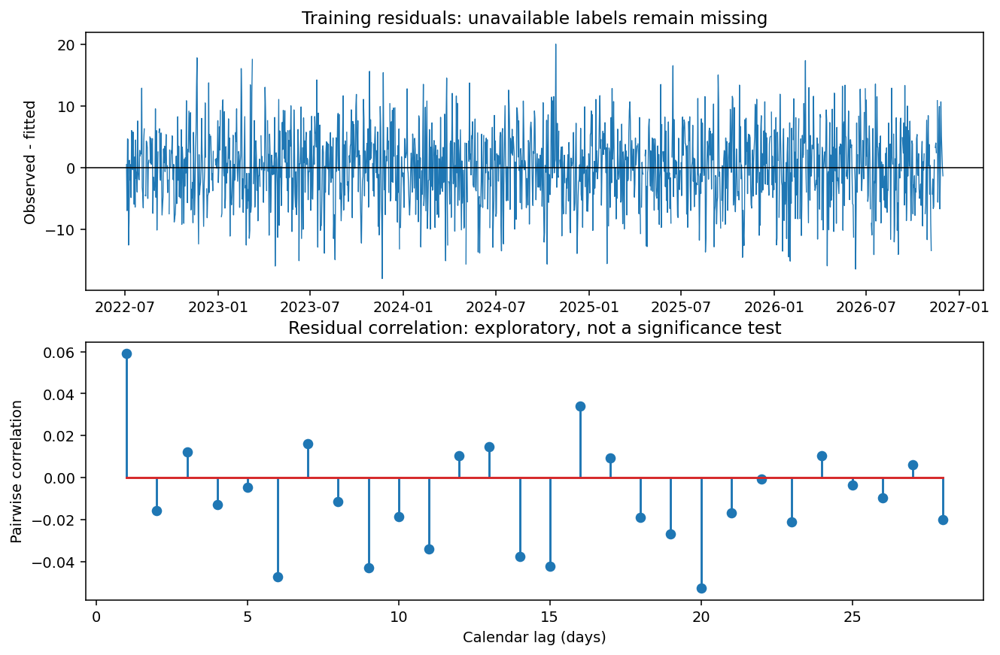

上图先按日期展示教学基准模型的样本内残差，再计算相隔 1—28 个自然日的日历滞后相关性（calendar-lag correlation）。闭店或受限目标值继续保持缺失，每个滞后量只配对真实日期间隔相同的残差，从而保留原始日历距离。这种计算方式适合包含日期缺口的零售序列，与先压缩时间轴再计算的标准等间隔自相关有所区别。

本例 1—28 天日历滞后的相关系数绝对值均低于约 0.08，7 天、14 天和 28 天附近的峰值也较弱。这表明教学基准模型拟合后保留的线性周期信号较少，残差形态接近围绕 0 随机波动的方向。进一步判断白噪声假设时，还应检查均值与方差稳定性，并加入置信区间、显著性检验和多重比较控制。

残差诊断的价值在于形成可验证的模型修改：7 天附近的峰值可以引导工程师重新检查周周期或营业模式；促销后的连续偏移可以转化为滞后变量或事件窗口；随需求水平扩大的波动可以引导加法与乘法模式或观测分布的比较；集中在缺货日的极端残差可以推动目标值筛选和需求修复。每项修改都应使用相同的滚动起点重新回测，再以样本外误差判断是否保留。

报告促销日、节假日和普通日期的分组误差时，还应同时给出分组规则、重叠关系和样本量。第七章将结合这些分组与精确预测步长，比较 Prophet、树模型和季节性朴素基准。

## 七、模型拓展与比较：什么时候继续使用 Prophet

前六章已经完成 Prophet 的拟合、解释和评估。本章从四个方面判断是否继续保留它：单条门店—商品序列是否提供足够信号，未来业务变量是否能在预测时获得，历史销量依赖是否需要其他模型表达，以及 Prophet 能否在统一回测协议下优于简单基准和其他候选。完成这些判断后，第八章再讨论系统交付。

### 怎样根据数据条件选择预测方法

#### 先区分真实零需求、受限销量与缺失记录

评估数据充分程度之前，应先确认零值的业务含义。商品正常在售、可以购买且供给充分时，没有成交可以记录为零销量；在本文的简化假设下，这类记录也作为零需求观测使用。尚未上架、已经退市、门店闭店、缺货造成的受限销量，以及接口失败造成的观测缺失，应分别保留状态标记。排除这些状态后，仍以不规则间隔出现的非零需求才构成间歇性需求候选。

清理业务状态后，如果序列仍然包含大量真实零需求，就应检验 Prophet 对条件均值的建模方式是否适合当前数据。对于非零事件仍然充足的序列，可以将 Prophet 作为平均需求率基线，并与 Croston、SBA、TSB 或两部分模型等间歇性需求方法比较 [16, 17, 18, 19]。附录 A 定义用于描述需求间隔和正需求量波动的指标，附录 B 使用这些指标比较四个教学场景，附录 C 给出各候选方法的基本机制与公式。

#### 有效历史与非零事件是否足够

Prophet 可以在日期存在间隔的数据上拟合，也能将零销量作为数值观测。稳定估计趋势、周期、节假日和业务变量贡献，还需要足够长的有效历史、足够多的有效观测，以及覆盖相应规律的样本外评价窗口。数值优化成功说明模型完成了参数求解；有效事件数量和历史覆盖范围则决定这些参数是否具有可学习、可验证的业务含义。

零值比例高与可用数据不足是两个相关但不同的问题。一条序列即使多数日期为零，只要观察期足够长、非零需求反复出现，仍可能提供可学习和验证的信号；新品或极低频商品即使零值比例相近，也可能只有少数几次非零销售。零售内部同时包含高频刚需品、季节性商品、新品和长尾商品，模型选择应以具体门店—商品序列提供的有效历史和事件数量为依据。

#### 怎样选择预测粒度和信息共享方式

单条序列的非零事件不足时，可以把日需求聚合为周需求，把单店需求聚合为门店组需求，或者采用能够跨门店和商品共享信息的全局模型。新品和极低频商品可以先使用类目基线、相似商品映射或业务回退规则，待事件积累后再评价独立局部模型。

聚合也会改变预测对象。若补货决策本身就在门店组—周粒度完成，可以直接在该粒度比较 Prophet、统计模型和树模型；若决策仍需要门店—日预测，则还要设计时间或门店维度的拆分，并考虑层级或分组预测的一致性约束。评价对象应覆盖“上层预测—拆分或协调—补货决策”的完整流程，而不仅是聚合层的预测误差 [20, 21]。

因此，可以先按数据充分程度和实际决策粒度分流：

| 数据与决策条件 | 优先处理方式 |
| --- | --- |
| 有效历史和非零事件充分 | 在当前粒度比较 Prophet 与基准方法 |
| 真实零需求很多，但非零事件仍然充足 | 加入间歇性需求方法进行比较 |
| 单条序列信号不足 | 使用全局模型、类目基线或相似商品信息 |
| 业务决策本身位于聚合粒度 | 直接在该粒度预测和评价 |
| 决策需要细粒度结果，但聚合序列更稳定 | 设计拆分或层级协调，并评价完整流程 |

建模从检查数据状态、有效历史和非零事件开始，再确定预测粒度、信息共享方式和候选模型。所有方案都应在实际决策粒度、相同信息集和滚动预测协议下比较。本文尚未运行间歇性需求方法、全局模型或层级协调实验，因此这里说明的是选择路径与适用边界，性能排序仍需由后续实验给出。

### 怎样判断业务变量能否用于未来预测

确定预测粒度和候选模型后，还需要界定预测发起时可用的信息。Prophet 的趋势、季节性和节假日组件可以根据未来日期直接计算；价格、折扣、陈列和天气等额外变量，则必须在调用 `predict()` 前提供未来各目标日的取值。工程师需要在拟合前通过 `add_regressor()` 注册这些变量，并保证训练表与预测表使用相同的字段定义、数值口径和缺失值处理规则 [6]。

前文的向量 $\mathbf{x}_t$ 就是这些额外变量的集合。一个变量是否适合进入需求预测，关键取决于发起预测时能否获得未来各目标日的取值；历史数据中的事后记录需要转换为当时可见的计划快照、外部预测或情景输入。

| 变量类型 | 发起 28 天预测时的可用性 | 适合怎样进入预测流程 |
| --- | --- | --- |
| VIC 节假日、星期和预定营业安排 | 通常提前已知 | 节假日与星期优先由 Prophet 的已有模块表达；营业安排按目标口径处理 |
| 价格、折扣、陈列和广告计划 | 取决于计划是否覆盖预测窗口 | 使用预测起点当时可见的计划快照，并在回测中保留对应版本 |
| 温度、降雨和客流 | 未来窗口通常来自外部预测或估计 | 使用外部预测、经过验证的估计或情景值，并回测完整预测链路 |
| 销量滞后与滚动统计 | 只在预测起点之前可见 | 按预测步长构造，具体的信息边界在下一节讨论 |
| 门店面积、区域和商品属性 | 已知，但在单条序列内通常固定 | 用于序列分组或跨序列模型，在多条序列之间估计差异 |
| 当前库存与未来库存 | 当前库存可见；未来库存由补货和销售共同决定 | 先明确目标是潜在需求还是供给受限销量，再决定是否以及怎样使用 |

教学案例中的折扣计划在预测发起时已经确定，因此可以作为额外回归变量。训练期和未来期都使用 0—1 比例表示折扣，并设置 `standardize=False`。真实项目中的价格、陈列和广告投入也应保存预测起点当时可见的计划版本；事后形成的执行记录只能用于对应时间之后发起的预测。

新增连续变量是否标准化、采用加法还是乘法模式，以及原尺度系数怎样解释，沿用第四、五章的规则。预处理参数只能从相应训练窗口估计；高度相关的变量需要检查可辨识性，非线性或交互关系则可以通过显式构造特征，或在后文的树模型比较中验证。所有新增变量都应通过时间回测和消融实验检验增量价值。

如果天气或客流等变量来自外部预测，可以将其预测值作为 Prophet 输入，也可以设置多个业务情景分别计算需求 [22]。外部变量的预测误差会继续传入需求预测，因此回测应覆盖“外部变量预测—需求预测”的完整链路，并保留每个预测起点实际可见的输入版本。

业务计划和外部预测解决的是未来输入从哪里获得；销量滞后和滚动统计还涉及另一项时间边界：随着预测步长增加，构造目标日特征所需的部分销量尚未发生。下一节具体讨论这类特征在 28 天多步预测中的构造方式和信息泄漏风险。

### 销量滞后特征在多步预测中怎样保持时间边界

销量滞后和滚动统计可以表达近期需求水平，但它们在多步预测中的可用性会随预测步长改变。设预测起点为日期 $d$ 的营业结束时，目标日为 $d+h$。目标日的前一日销量特征为 $y(d+h-1)$：当 $h=1$ 时，模型使用已经观测到的 $y(d)$；当 $h\geq2$ 时，所需销量位于预测起点之后，发起预测时尚未发生。目标日前七天均值也会随着 $h$ 增大而逐步包含未知日期。

因此，滞后特征必须围绕每个预测起点重新构造。如果先在包含评价窗口的完整数据表上调用 `shift(1)` 或滚动计算，再切出未来 28 天，较远目标日就会读到预测起点之后的真实销量，形成时间信息泄漏。训练、验证和上线流程都应记录预测起点，并逐项检查每个目标日的输入在当时是否可见。

使用近期销量信息时，可以根据业务更新频率和预测任务选择以下设计：

| 预测设计 | 怎样构造销量历史输入 | 主要权衡 |
| --- | --- | --- |
| 递归预测 | 先预测第 1 天，再用预测值更新第 2 天的滞后与滚动特征，逐日推进 | 能持续更新输入，但前期误差会传入后续预测；Prophet 需要额外编排，区间也应反映误差传播 |
| 按预测步长直接建模 | 分别为不同步长构造训练样本，每个样本只使用对应预测起点之前的实际销量 | 避免递归输入，但需要按步长训练模型，或在一个模型中显式表示预测步长 |
| 使用预测起点的历史摘要 | 在预测起点计算最近销量水平，并将同一份历史摘要提供给窗口内各目标日 | 输入始终可得，但需要加入目标日距预测起点的步长，使模型区分近端与远端预测 |

另一种设计是先用 Prophet 生成趋势、日历和业务计划基线，再让第二个模型学习基线之外仍可预测的残差结构。第二阶段的训练输入应来自历史滚动预测产生的样本外残差，而不是同一训练期内的拟合残差；完整回测也应同时运行两个阶段，才能反映未来窗口中的实际误差。

### ARIMA 怎样表达销量与误差的时间依赖

上一节讨论了怎样显式构造销量滞后特征。ARIMA（AutoRegressive Integrated Moving Average，自回归差分移动平均模型）提供了另一种表达时间依赖的方式：差分项用于处理序列水平的变化，自回归项使用差分后序列的历史值，移动平均项描述历史创新项——模型在当期新出现、此前无法预测的误差——怎样影响当前值 [23]。这里的“移动平均”属于误差结构，与特征工程中的“过去七天销量均值”不是同一个概念。

ARIMA 在多步预测中会按照已估计的时间依赖关系逐步生成未来值，因此不需要把未来真实销量作为滞后输入。自回归项在较远步长中使用前面生成的预测，尚未观测到的未来创新项按其条件期望处理，预测不确定性也随之传播。ARIMA 通常基于等间隔时间序列建模；零售数据中的闭店日、缺失日期和目标值屏蔽需要先按统一的日历与目标口径处理。

如果模型还需要价格、折扣或节假日等业务输入，可以采用带 ARIMA 误差的回归模型：回归部分表达外部变量的贡献，ARIMA 结构描述回归后仍然存在的时间相关性 [24]。这些外部变量在未来预测窗口中的取值仍需提前准备，历史回测也应使用各预测起点当时可见的计划或外部预测版本。

| 比较问题 | Prophet | ARIMA 或带 ARIMA 误差的回归 |
| --- | --- | --- |
| 主要表达的结构 | 显式趋势、周期、事件与业务变量贡献 | 差分后序列或回归误差的时间依赖 |
| 怎样利用历史销量 | 标准模型通过趋势和周期概括历史；销量滞后需要额外构造 | 根据自回归阶数直接使用历史序列值，并在多步预测中递推 |
| 怎样利用历史误差 | 默认模型不显式建立残差的自回归结构 | 根据移动平均阶数描述历史创新项的影响 |
| 怎样加入折扣和节假日 | 使用节假日模块与额外回归变量 | 将业务变量加入回归部分，并对剩余误差建立 ARIMA 结构 |
| 对时间索引的要求 | 可以在日期存在间隔的数据上拟合 | 通常需要定义等间隔序列，并明确处理缺失日期和闭店日 |
| 本文提供的证据 | 已完成教学案例的拟合与回测 | 留作后续同协议实验，本节只比较建模机制 |

当第六章的残差检查显示稳定的时间相关性时，可以把 ARIMA 类方法加入候选，并使用相同的目标变量、预测起点、未来业务输入和评价窗口检验其增量价值。若残差主要表现为节假日遗漏、缺货约束或业务计划偏差，则应先修正相应的数据或结构，再判断是否需要加入 ARIMA 误差。

### 怎样建立统一的候选模型比较协议

前面几节分别讨论了间歇性需求方法、额外业务变量、销量滞后和 ARIMA。把这些方法纳入候选集合后，需要先统一实验协议，再解释误差差异来自模型结构还是输入信息。

| 比较条件 | 需要统一或记录的内容 |
| --- | --- |
| 预测目标 | 使用相同的目标变量、商品单位、门店—商品粒度和缺货处理口径 |
| 信息边界 | 每个预测起点只使用当时可见的历史数据、业务计划和外部预测版本 |
| 时间切分 | 使用相同的训练截止日、滚动预测起点、评价日期和 28 天预测窗口 |
| 多步预测方式 | 记录直接多步、按步长建模或递归预测，以及预测值怎样进入后续输入 |
| 业务后处理 | 统一营业日历、非负约束、聚合或拆分规则及缺失预测的回退方式 |
| 参数选择 | 只在训练历史内调参，并为不同模型提供合理且可比较的搜索与计算预算 |
| 评价结果 | 使用相同指标和分组规则，同时报告样本量、训练时间、推理成本与失败情况 |

统一信息边界不要求所有模型使用完全相同的特征表示。Prophet 可以通过傅里叶项表达周期，树模型可以使用星期和月份等日期特征，神经网络也可以读取历史窗口；这些输入只能由同一组预测时可获得的信息构造。某个候选加入了额外业务变量、历史窗口或跨序列信息时，应把信息集变化单独报告，避免把新增信息带来的收益全部归因于算法。

当未来输入可靠、变量数量有限且关系适合线性表达时，可以保留 Prophet 加回归项。大量类别属性、阈值效应和非线性交互则值得比较树模型；多条相关序列能够共享规律，而且历史窗口具有稳定价值时，可以进一步验证相应的全局模型或神经网络架构。

回归树（regression tree）按照“折扣是否超过某个值”“是否周末”等规则分裂样本，并在每个叶节点给出预测值。梯度提升决策树（Gradient-Boosted Decision Trees，GBDT）组合多棵树，逐轮改善训练目标。LightGBM 和 XGBoost 都能表达分段非线性关系与交互：前者使用直方图等机制提高效率，后者提供带正则化的提升树框架 [25, 26]。实际误差、速度和内存占用仍需在目标数据与运行环境中比较。

神经网络预测模型则包含多种不同架构。Temporal Fusion Transformer（TFT）面向多步预测，区分静态变量、已知未来输入和仅在历史可见的输入 [27]；N-BEATS 的原始任务是主要依赖历史目标窗口的单变量点预测 [28]。因此，评价神经网络时应明确具体架构、输入窗口和预测方式，而不能把“神经网络”视为单一候选。

下表比较模型结构与工程要求，不构成固定的性能排名：

| 比较问题 | Prophet | LightGBM / XGBoost 回归 | 神经网络预测模型 |
| --- | --- | --- | --- |
| 怎样表达时间规律 | 显式趋势、傅里叶周期和事件模块 | 使用日期、周期及相关历史特征 | 根据架构从历史窗口学习，并可加入显式日历输入 |
| 怎样处理近期销量依赖 | 需要额外构造滞后特征或第二阶段模型 | 常通过滞后、滚动统计等特征表达 | 可以把历史销量窗口作为输入，预测方式由具体架构决定 |
| 怎样表达促销与价格交互 | 通过显式交互项或非线性变换扩展 | 通过树分裂学习阈值与交互 | 可以学习非线性关系，泛化能力仍需通过回测验证 |
| 怎样共享门店与商品信息 | 标准用法逐条序列拟合 | 可以合并多条序列，并加入门店与商品属性 | 可以设计跨序列全局模型，具体能力取决于架构与输入 |
| 怎样外推长期增长 | 显式趋势提供可检查的外推假设 | 常数叶节点回归树主要在训练特征范围内组合已有水平 | 取决于模型结构与训练分布，需要单独验证范围外表现 |
| 怎样解释预测 | 检查趋势、周期、节假日和回归贡献 | 检查特征重要性或局部特征贡献 | 使用具体架构提供的解释机制，并核对其业务含义 |
| 怎样生成未来 28 天 | 根据未来日期和已知输入直接计算 | 采用直接多步、按步长建模或递归预测 | 采用直接多步或自回归方式，取决于具体架构 |
| 主要工程投入 | 管理多个局部模型及其配置分流 | 构造时间特征、组织全局样本并维护未来输入 | 管理输入窗口、训练资源、推理流程和架构验证 |

模型家族与训练范围是两个选择：树模型和神经网络均可采用局部或全局训练。跨序列共享取决于样本与结构设计，新商品、新类别仍需单独验证冷启动。

下一节的教学实验统一了目标变量、时间切分、可用输入和预测后处理，重点报告预测误差与特征行为。当前结论因此限定在预测表现与特征使用方式；生产环境中的总体成本还需要结合训练时间、推理成本和批量失败率另行量化。

### 同数据的 Prophet 与 LightGBM 比较说明了什么

#### 实验设置与总体结果

同数据实验在一条教学序列上比较 Prophet、LightGBM 和季节性朴素法（seasonal naïve method，也常写作“季节性 Naïve 方法”）[29]。本文将它作为基准方法：对每个星期几读取预测起点之前最近一次有效销量，并将该数值作为未来同一星期几的预测，用于检验复杂模型是否真正优于一个只延续周规律的简单方法。

设训练截止日为 $T$，预测步长为 $h$，$\operatorname{dow}(t)$ 表示日期 $t$ 的星期几。本文的季节性朴素预测写为：

$$
\tau(T+h)=\max\left\{t\leq T:\operatorname{dow}(t)=\operatorname{dow}(T+h),\ y_t\text{ 是有效观测}\right\},
\qquad
\hat y_{T+h\mid T}^{\mathrm{SNaive}}=y_{\tau(T+h)}
$$

其中，$\tau(T+h)$ 是预测起点之前与目标日星期几相同的最近有效日期。若训练数据没有缺失或被屏蔽的目标值，这一定义就等价于周期为 7 天的标准季节性朴素法；本文向前查找有效观测，是为了跳过缺货或闭店造成的不可用目标值。这一基准还要求训练历史中每个星期几至少存在一个有效观测，教学数据满足该条件；真实数据若缺少某个星期几的有效历史，还需要另外定义均值基准或业务回退值。

LightGBM 使用日期特征、VIC 公共假日和预测时已知的折扣计划，不使用销量滞后或滚动统计；未来 28 天根据各目标日的已知特征直接生成预测。模型先在训练历史内部按时间顺序验证，通过早停（early stopping）选择树的数量，再使用全部有效训练历史重新拟合。三种方法使用相同的目标变量、评价日期、缺货筛选、营业日历和非负后处理。

| 模型 | 最后 28 天评价窗口 WAPE | 12 个滚动起点汇总 WAPE |
| --- | ---: | ---: |
| Prophet | 3.93% | 4.20% |
| LightGBM | 4.84% | 5.43% |
| 季节性朴素基准 | 15.85% | 15.44% |

在当前教学数据和特征集合下，Prophet 在最终评价窗口和滚动回测中都取得了较低 WAPE，Prophet 与 LightGBM 的 WAPE 也都远低于季节性朴素基准。教学数据的趋势、周期、节假日和折扣机制与 Prophet 的模型结构较为接近，因此这组结果说明 Prophet 与当前生成机制匹配较好；它对真实零售数据的相对表现仍需在相应业务样本上重新验证。

最终评价窗口包含 28 个日历日，其中 25 日营业且未缺货（排除了 1 个圣诞闭店日和 2 个缺货日）。12 个滚动起点共形成 320 条营业且未缺货的“预测起点—目标日”记录；同一个目标日期可能由不同起点重复预测，因此 320 应解释为预测记录数，而不是彼此独立的日历日期数。汇总 WAPE 是全部有效记录的绝对误差之和除以实际销量之和。三种方法使用相同的营业日历和非负规则，闭店销售固定为零。

Prophet 使用前文确定的教学配置；LightGBM 固定学习率、叶节点数和正则化参数，只通过内部时间验证与早停选择树的数量。后续节假日诊断另外比较三个预先指定的候选设置。因此，表中排序适用于当前有限的配置范围；更完整的模型排名还需要为各候选设计可比较的超参数搜索。XGBoost 和神经网络留作后续实验，表格只报告本次实际运行的方法。

#### LightGBM 为什么没有使用节假日特征

总体结果显示 LightGBM 的误差略高于 Prophet，分组检查进一步把部分差距定位到节假日记录。在最终评价窗口对应的训练数据中，原始 LightGBM 采用了英文中可表述为 *named-holiday indicator features* 的设计，即按节假日名称分别建立指示变量；本文简称“节假日分别编码”。为了说明这一设计，下面先使用可读的节假日名称表示概念列名：

| `ds` | `holiday_Boxing_Day` | `holiday_Australia_Day` | `is_public_holiday` |
| --- | ---: | ---: | ---: |
| `2023-01-26` | 0 | 1 | 1 |
| `2023-01-27` | 0 | 0 | 0 |
| `2023-12-26` | 1 | 0 | 1 |

前两列表示“节假日分别编码”：Boxing Day 只激活自己的列，Australia Day 也只激活自己的列。最后一列表示后续比较的“统一公共假日标记”，只区分当天是否为公共假日，不再区分具体名称。实际代码为了避免名称中的空格和特殊字符，使用 `holiday_00`、`holiday_01` 等列名，并另外保存编号与节假日名称的对应关系。

原始设计共生成 15 个节假日特征。在最终训练数据中，每个特征只有 0—3 个有效正例，最终拟合模型对这些特征的分裂次数和增益均为零。`min_child_samples=20` 要求叶节点获得更多训练样本，因此这些稀疏指示变量很难单独形成有效分裂；默认特征预过滤还可能进一步限制它们进入分裂搜索 [30]。

12 个滚动起点共形成 10 条门店营业的公共假日“预测起点—目标日”记录。在这组小样本中，LightGBM 和 Prophet 的 WAPE 分别约为 16.83% 和 4.23%；普通日期分别约为 5.81% 和 4.86%。这组结果用于定位误差集中位置，样本量尚不足以支持稳定的节假日性能排序。Good Friday 和 Christmas Day 等固定闭店节假日对应的指示变量，在有效训练样本中没有正例，因为这些日期的目标值已经被屏蔽；模型无法从这些训练样本中估计相应的销量效应，闭店后的零销量则由营业日历规则处理。

#### 合并节假日特征后结果怎样变化

上述诊断说明，按名称分列后，每个节假日特征获得的有效样本很少。为了检验特征稀疏性带来的影响，实验在最终 28 天评价窗口之前使用两个历史预测起点比较三种 LightGBM 节假日特征设置，每个起点评价未来 28 天：

| 节假日特征设计 | `min_child_samples` | 内部验证 WAPE |
| --- | ---: | ---: |
| 节假日分别编码 | 20 | 5.21% |
| 节假日分别编码 | 2 | 5.10% |
| 统一公共假日标记 | 20 | 4.42% |

降低最小叶样本门槛后，分别设置的节假日指示变量获得了更多参与分裂的机会。统一公共假日标记则把多个稀疏事件汇集为一个特征：教学数据为所有公共假日设置了相同的 $28H_t$ 加法效应，因此统一标记既增加了正例数量，也更接近数据生成机制，并在内部验证中取得较低 WAPE。由于闭店日的目标值已经被屏蔽，这个统一标记在有效训练样本中主要从营业的公共假日获得参数信息。若真实业务中的不同节假日具有不同方向或幅度，统一标记可能掩盖差异，仍需根据业务机制和历史样本量确定合并范围。

两个历史起点足以演示“先在训练历史中选择配置，再评价最终窗口”的流程，但候选排序仍可能受具体起点影响；真实项目应扩大历史起点数量，并检查不同门店和商品上的稳定性。

候选选择完全基于这两个历史起点，最终 28 天评价窗口继续保留用于一次独立评价。选中的统一公共假日标记配置在该窗口的 WAPE 为 4.45%，低于节假日分别编码的原始配置 4.84%，并缩小了它与 Prophet 约 3.93% 的差距。

下图展示节假日分别编码的原始 LightGBM 在最终 28 天评价窗口的预测和分裂增益；后来选出的统一公共假日标记候选未在图中展示。

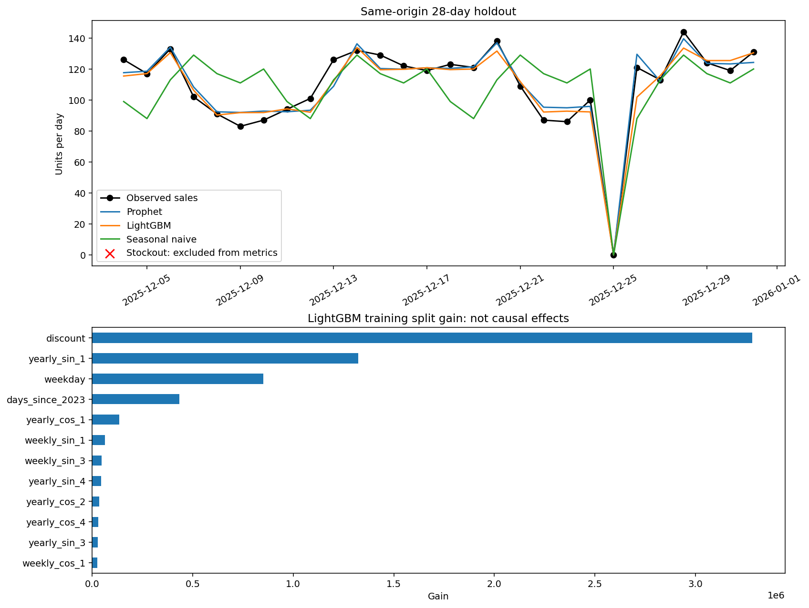

图中的特征重要性按训练目标的分裂增益汇总，用于描述模型如何使用特征；因果贡献需要通过相应的因果设计分析。图中缺少的稀疏节假日特征可以在完整增益表中核对，确认它们是否参与分裂。

这个实验说明，模型比较不仅取决于算法家族，也取决于特征怎样表示业务机制，以及每个特征获得多少有效样本。Prophet 在当前教学数据上受益于显式周期和节假日结构；统一公共假日标记则把 LightGBM 在最终评价窗口的 WAPE 从 4.84% 降至 4.45%，说明原始结果中的部分差距来自节假日特征表示与样本支持度。真实项目仍需在代表性门店、商品和独立评价窗口上重新比较。

### 怎样在候选模型体系中定位 Prophet

在候选模型体系中，Prophet 首先是一种结构明确、便于复核的时间序列模型，也可以作为其他方法的可解释基线。工程师可以显式配置趋势、周期、事件和计划变量，根据未来日期直接生成预测，并检查各组件对结果的贡献。对于有效历史充分、规律相对稳定，而且业务团队需要复核预测结构的序列，Prophet 值得进入正式回测。

不同的数据机制对应不同的候选方向。下表用于确定优先实验顺序，不表示所有数据集上的固定性能排名：

| 数据与任务条件 | 优先加入候选的模型或方法 |
| --- | --- |
| 有效历史覆盖所需周期，未来事件与业务输入可获得，并且需要复核模型组件 | Prophet |
| 价格、促销、陈列等特征丰富，重点检验阈值与交互 | LightGBM、XGBoost 等树模型 |
| 销量或回归残差具有稳定的时间依赖 | ARIMA 或带 ARIMA 误差的回归 |
| 多条相关序列能够共享信息，历史窗口具有稳定预测价值 | 跨序列训练的全局树模型或具体神经网络架构 |
| 需求间歇出现，而且非零事件足以估计发生率与需求量 | Croston、SBA、TSB、零膨胀或两部分模型 |
| 单条序列信号仍不足以训练和验证局部模型 | 聚合预测、类目基线、相似商品映射或业务回退 |

本章已经运行 Prophet、LightGBM 和季节性朴素基准；对于 XGBoost、ARIMA、神经网络和间歇性需求方法，正文说明其建模机制与候选条件，性能排序留给后续实验。无论序列进入哪条模型路径，都应保留与任务匹配的简单基准，例如季节性朴素法、类目基线或业务规则。

所有候选沿用前一节的统一比较协议。最终选择综合第六章的滚动回测、关键日期与商品分组误差，以及下一章讨论的训练成本、交付成功率和回滚条件；候选使用额外业务变量、历史窗口或跨序列信息时，还应单独报告信息集变化。

当目标粒度拥有足够数据、未来输入在上线时可获得，并且统一回测显示 Prophet 的误差具有竞争力、组件解释具有业务价值时，可以将 Prophet 作为主要候选。其他方法取得更低且更稳定的误差时，Prophet 仍可作为可解释基线或回退方法；当其他路径在预测效果、运行成本和维护性方面都更适合当前序列时，可以将该序列交给相应模型，不再单独维护 Prophet。

完成门店—SKU 序列的模型分流后，还需要把目标值、计划快照、模型版本、预测结果、回测和回退规则接成可追溯的交付流程。第八章将讨论这一工程边界，第九章再据此给出实施建议。

## 八、MLOps：从候选模型到可运行的需求预测系统

第七章根据需求序列的数据条件确定候选模型。本章进一步把这些模型接入可运行的批量预测流程：先界定教学实验与生产系统之间的差距，说明需求预测怎样进入补货决策；再讨论日级数据构造、任务规模、并行执行、模型版本和失败回退；最后说明上线后的持续评估、模型发布与责任交接。

零售系统通常按日批量生成未来 28 天的预测，但预测频率、模型重训频率和模型发布时间可以分别设定。系统需要根据数据变化、计算成本和回测结果安排这三种运行节奏。

### 明确系统边界与业务输出

#### 从教学实验到生产系统还需要验证什么

配套 Notebook 提供了教学数据上的模型行为与实验流程证据。将候选模型接入补货系统，还需要验证真实接口、生产规模和运行责任，并明确下面的证据边界：

| 工作维度 | 本文 Notebook 已验证的内容 | 生产系统仍需验证或建设的内容 |
| --- | --- | --- |
| 业务与目标变量 | 区分潜在需求、观测销量、缺货和闭店；固定门店—SKU 粒度及 28 天预测窗口 | 与补货团队确认目标变量、商品单位、预测频率、使用者、服务时限及验收标准 |
| 数据与时间可用性 | 使用教学 CSV、VIC 假日日历和预先已知的折扣计划完成拟合与回测 | 建立带版本的交易、库存、营业日历和计划快照；保证历史回测只使用各预测起点当时可见的信息 |
| 模型开发与评估 | 复现 Prophet 拟合、组件重建、滚动回测、超参数选择及 LightGBM 对照 | 在代表性门店和商品上扩大验证，保留独立评价窗口，定义分组指标、质量门槛和模型分流规则 |
| 批量交付 | 验证单序列模型的保存、加载及点预测一致性 | 编排大量序列的聚合、训练、预测和写入，控制并行资源，保存运行版本，并保证幂等交付 |
| 运行与恢复 | 教学实验说明了监控指标和回退原则 | 实际验证数据延迟、任务失败、回退预测、告警、重训、发布、回滚及责任交接 |

**模型训练与发布流程。** 候选模型使用历史数据完成回测和质量检查；只有通过质量门槛的候选才会替换当前生产版本：

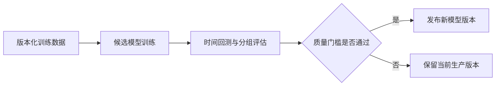

**日常批量预测流程。** 日常任务读取已经发布的模型。输入不合格、模型加载失败或推理失败时，系统执行对应的冷启动或回退规则，并明确记录状态：

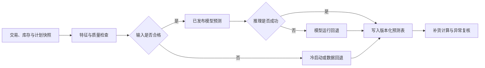

#### 怎样把需求预测转换为补货建议

需求预测进入补货决策后，系统首先要确定当前库存需要覆盖多长时间。这个时间范围称为保护期，通常由补货交期（lead time）和两次库存检查之间的周期（review period）共同决定。沿用前文的记号，设 $T$ 为预测起点，$h$ 为预测步长，$\hat y_{T+h\mid T}$ 表示模型在 $T$ 时刻对未来第 $h$ 天给出的点预测。将保护期内的逐日预测相加，可以得到这段时间的累计需求预测：

$$
\hat y_{\mathrm{prot}\mid T}=
\sum_{h=1}^{H_{\mathrm{prot}}}\hat y_{T+h\mid T}
$$

其中，$H_{\mathrm{prot}}$ 是保护期包含的预测步数，$\hat y_{\mathrm{prot}\mid T}$ 是相应的累计需求预测。教学案例中，Prophet 返回的 `yhat` 已经恢复为 SKU 的业务单位，表示逐日需求点预测。如果补货只需要覆盖实际营业日，则应先根据已知营业日历得到 `forecast_units`，再计算保护期合计。

补货系统在累计需求预测上增加安全库存，形成目标库存水平，再减去当前库存位置；已有库存足以覆盖目标时，建议订货量为零。这个简化规则写为：

$$
Q_T=\max\left(0,\hat y_{\mathrm{prot}\mid T}+S_T^{\mathrm{safe}}-I_T^{\mathrm{pos}}\right)
$$

记号说明：

| 记号 | 定义与读法 |
| --- | --- |
| $Q_T$ | 在预测起点 $T$ 计算的初步建议订货量，尚未应用箱规等业务约束 |
| $\hat y_{\mathrm{prot}\mid T}$ | 保护期内逐日预测 $\hat y_{T+h\mid T}$ 的合计；这是前文模型预测进入补货公式的位置 |
| $S_T^{\mathrm{safe}}$ | 在预测起点 $T$ 为需求和供给不确定性预留的安全库存（safety stock） |
| $I_T^{\mathrm{pos}}$ | 在预测起点 $T$ 的库存位置（inventory position），按业务口径综合可用库存、可计入的在途库存与已承诺需求 |
| $\mathrm{prot}$、$\mathrm{safe}$、$\mathrm{pos}$ | 分别是保护期、安全库存和库存位置的英文标签；上标用于标明数量的业务含义，不表示乘方 |
| $\max(0,\cdot)$ | 取零与括号内计算结果的较大值，避免得到负订货量 |

**零售案例。** 为便于比较，下面假设库存位置按照“现有可用库存＋已下单的在途库存－已承诺数量”计算，并且预测、库存和订货量都使用同一 SKU 单位：

| 场景 | 保护期需求预测 $\hat y_{\mathrm{prot}\mid T}$ | 安全库存 $S_T^{\mathrm{safe}}$ | 库存位置 $I_T^{\mathrm{pos}}$ | 初步建议订货量 $Q_T$ |
| --- | ---: | ---: | ---: | ---: |
| 鸡蛋正常补货 | 未来 7 天预测需求 420 盒 | 60 盒 | 现有 180 盒＋在途 120 盒－已承诺 30 盒＝270 盒 | $420+60-270=210$ 盒 |
| 红酒库存充足 | 未来 7 天预测需求 24 瓶 | 6 瓶 | 38 瓶 | $\max(0,24+6-38)=0$ 瓶 |
| 促销饮料补货 | 促销保护期预测需求 560 罐 | 90 罐 | 260 罐 | $560+90-260=390$ 罐 |

鸡蛋案例的目标库存水平为 $420+60=480$ 盒；当前库存位置为 270 盒，因此初步建议订购 210 盒。红酒案例的目标库存水平为 30 瓶，低于当前 38 瓶的库存位置，因此建议订货量为零。促销饮料案例得到的初步建议为 390 罐；如果供应商要求按每箱 24 罐订货，则需要向上调整为 17 箱，即 408 罐，再检查最小订货量、仓储容量和保质期。

这三个例子也说明，需求预测只是补货计算的一项输入。公式中的数量必须采用相同的 SKU 单位，库存和在途数量的统计范围也要与保护期匹配。$Q_T$ 是应用业务约束前的初步建议，实际订单还要考虑箱规、最小订货量、保质期、供应商限制和仓储容量。

安全库存应根据保护期累计需求的误差分布和业务能够接受的缺货风险确定。不同日期的预测误差可能相关，因此计算时需要保留这种相关性。如果系统已经使用需求分位数设定目标库存，还需要检查其中是否已经包含同一风险缓冲，避免重复增加安全库存。

### 构建可扩展的批量预测流程

批量预测流程先把交易记录转换为可建模的门店—SKU 日级序列，再根据有效序列数量估算训练与预测规模。系统随后以完整序列为任务单元执行模型训练和预测，并保存模型、输入条件、预测结果及失败状态，使每次运行都可以追踪和重现。

#### 先把交易记录聚合为门店—SKU 日级序列

数据管道先在数仓或分布式引擎中按照 `(store_id, sku_id, business_date)` 聚合交易记录，得到统一单位的每日观测销量 `SUM(sold_units)`。这里假设 `business_date` 已按门店当地营业日生成；`sold_units` 表示系统记录的售出数量，不一定等于未受供给约束的潜在需求。退货也需要单独核对：如果目标是顾客购买需求，直接把退货作为负销量相减可能改变目标变量的业务含义。

交易聚合结果通常只包含发生过交易的日期。系统还需要按相同粒度连接商品在售区间、门店营业日历、库存、价格和促销快照，再为每条有效门店—SKU 序列建立完整的日期索引。只有确认商品当日在售、门店营业且交易数据完整，缺失交易记录才可以补为零销量；闭店、未上架和接口缺失应保留各自的业务状态。连接维表前还要检查键是否唯一，防止多对多连接重复放大销量。

单条门店—SKU 序列的三年历史只有约 1,095 个日级观测。分布式引擎负责清洗、聚合、连接和日期补全，各序列的 `fit()` 则作为独立任务执行。

#### 怎样估算局部模型的任务规模

标准 Prophet 是局部预测模型（local forecasting model），即每条序列独立拟合；把多条门店—SKU 序列放进同一张表不会自动共享参数或表示。与之相对，全局预测模型（global forecasting model）联合多条序列训练，使它们共享部分参数或表示。这里的“局部/全局”描述跨序列的训练范围，不是局部最优与全局最优。

1,000 家门店各有 10,000 个候选商品，理论组合数为一千万。生产系统先排除未在售、已退市或不符合预测条件的组合，再按照目标期间的有效在售组合计算真实序列数量：

$$
N_{\mathrm{series}}=
\left|\{(\mathrm{store},\mathrm{SKU})\mid
\text{目标期间有效在售}\}\right|,
\qquad
N_{\mathrm{outputs}}=N_{\mathrm{series}}\times H
$$

其中，$N_{\mathrm{series}}$ 是需要预测的有效门店—SKU 组合数，$H$ 是每条序列的预测步数。当所有序列都生成完整的 $H$ 个目标日期时，$N_{\mathrm{outputs}}$ 是一次批量预测产生的结果行数。不同渠道和履约节点可能采用不同的有效组合口径，因此生产任务规模应根据目标期间的实际预测对象计算；有效组合也会随商品上架、退市和门店状态变化。

系统应先建立有效在售组合，再计算历史长度、非零事件数、平均需求间隔（Average Demand Interval，ADI）和非零需求量的平方变异系数等序列画像。画像需要同时标明时间粒度和组织粒度：同一商品在单店—日粒度可能稀疏，在区域—周粒度却可能稳定。系统沿用第七章确定的分流规则，为每条序列分配 Prophet、间歇性需求基线、全局模型或冷启动策略；本章只讨论这些任务怎样批量执行。ADI 与需求量变异的具体定义和时间口径见附录 A。

#### 以完整序列为单位并行训练

对适合 Prophet 的序列，通常以 `(store_id, sku_id)` 为任务单元，把完整训练窗口交给一个执行进程或节点（worker）。每个任务都保留同一条序列的完整时间历史，使模型能够在一条连续时间轴上估计趋势、季节性和事件效应；调度系统则在不同序列之间分配并行任务。

批量训练可使用进程池、任务队列或分布式框架。Spark 分组训练时，各 worker 需有相同依赖且能容纳完整序列；序列长度不同也会造成耗时不均。

批量回测的总拟合工作量取决于参与回测的序列数、每条序列比较的配置数、每组配置使用的历史起点数，以及实测的单次平均拟合时间。四者相乘得到所有拟合任务的累计耗时，而不是并行运行后的实际等待时间：

$$
W_{\mathrm{fit}}\approx N_{\mathrm{fit}}\times N_{\mathrm{cfg}}\times N_{\mathrm{fold}}\times\bar d_{\mathrm{fit}}
$$

记号说明：

| 记号 | 定义与读法 |
| --- | --- |
| $W_{\mathrm{fit}}$ | 拟合任务耗时的总和，以秒计；并行批次的实际完成时间还取决于资源与调度 |
| $N_{\mathrm{fit}}$ | 本轮进入当前模型训练或回测流程的序列数量 |
| $N_{\mathrm{cfg}}$ | 每条序列比较的参数配置数量 |
| $N_{\mathrm{fold}}$ | 每组配置使用的回测起点数量 |
| $\bar d_{\mathrm{fit}}$ | 单次拟合的平均耗时，以秒计；上方横线表示平均值 |
| $\approx$、$\times$ | 分别表示“近似等于”和乘法；这里假设各序列使用相同数量的配置与回测起点 |

这里的 $N_{\mathrm{fit}}$ 是 $N_{\mathrm{series}}$ 的子集。以 Prophet 批量回测为例，它只统计经过模型分流后进入 Prophet 候选路径的序列，不包含交给间歇性需求方法、全局模型或冷启动规则的序列。

假设本轮参与回测的序列数 $N_{\mathrm{fit}}=100{,}000$，配置数量为 4，回测起点数量为 5，平均拟合耗时为 2 秒，则总工作量约为 400 万秒，即 1,111 小时。在 200 个计算槽位利用率达到 100% 的理想条件下，计算时间约为 5.6 小时；实际运行还需要考虑任务长尾、调度开销、预测、最终模型重训、数据读取和失败重试。这里的 2 秒只是容量估算值，实际规划应代入目标环境中的实测结果。

系统可以定期在代表性序列上筛选分组配置，并在计划重训时复用已经验证的配置；每日预测则读取当前发布的模型。对于高价值、漂移明显或预测效果恶化的序列，再触发更完整的参数搜索。

Prophet 的诊断接口支持进程、线程和 Dask 并行回测 [15]。这解决的是回测任务的执行方式。生产环境仍需另外编排序列之间的训练，并控制嵌套并行，避免每个 worker 又启动一组进程耗尽资源。

#### 保存模型及其预测条件

Prophet 模型包含 Stan 后端对象，官方建议使用 JSON 格式完成模型序列化与还原，而不是直接使用 Python `pickle` [22]。

配套实现通过 `model_to_json()` / `model_from_json()` 保存和加载模型，并检查加载后的点预测是否与保存前一致；随机生成的区间端点不用于确定性一致性检查。

模型文件只能还原已经拟合的参数。为了重现某次预测，系统还需要记录训练数据快照、训练截止日、预测输入快照、特征定义、计划版本、参数配置、代码版本、依赖版本和回测结果。

预测表则建议保存以下字段：

| 字段 | 作用 |
| --- | --- |
| `store_id`、`sku_id`、`ds` | 标识预测对象和目标日 |
| `forecast_origin`、`horizon` | 标识这次预测从何时发起及距离目标日的预测步长 |
| `run_id`、`model_family`、`model_version` | 追踪运行、模型类别和模型版本 |
| `training_data_version` | 追踪模型拟合使用的训练数据 |
| `feature_snapshot_version`、`plan_version` | 追踪本次预测使用的库存、营业日历、促销和价格输入 |
| `target_definition`、`unit` | 说明预测目标及盒、瓶、罐等 SKU 业务单位 |
| `yhat_raw`、`forecast_units` | 分别保存模型输出和业务规则结果 |
| `status`、`fallback_reason` | 标明正常结果、回退结果或异常 |

系统可以使用 `(store_id, sku_id, forecast_origin, ds, run_id)` 标识一条不可变预测记录，使同一运行重试时保持幂等写入（idempotent write）。系统保留各次运行的不可变结果，再通过“当前生效版本”指针发布供下游使用的预测；部分任务失败时按规则回退，并记录每条预测的来源。

#### 怎样处理失败并生成可追踪结果

批量作业应隔离每条序列的异常，使单个模型失败只影响对应任务。工程师可以事先定义回退策略（fallback strategy），例如使用上一个仍在有效期内且特征结构兼容的模型配合当前计划预测、季节性朴素预测，或品类规则。各策略需要分别回测，异常状态与回退预测应一并保存。

系统还应区分正常预测、输入数据不合格、模型不可用、推理失败、回退成功和商品停用等状态。真实零需求保留为数值零；无法生成预测的记录保留为空值，并写入失败原因和回退来源。这样可以防止下游补货系统把运行异常解释为零需求。

### 持续评估、发布与责任交接

模型发布后，系统需要持续记录真实发出的预测，并在目标值成熟后评价不同预测步长的表现。监控结果可以触发数据排查、候选模型重训和受控发布，但每个环节都需要独立的质量门槛和责任人。本节依次说明线上评估、CI／CT／CD 流程以及系统交接要求。

#### 上线后怎样持续记录和评估预测

上线监控需要分别观察运行状态、数据质量、预测表现和业务结果：

| 监控层面 | 需要回答的问题 | 示例指标 |
| --- | --- | --- |
| 运行状态 | 批量任务是否按时完成 | 批次成功率、失败序列数、回退比例、预测结果时效性 |
| 数据质量 | 模型输入和目标值是否完整可靠 | 计划覆盖率、特征缺失率、目标值可用率、异常值比例 |
| 预测表现 | 模型在成熟样本上的误差是否变化 | WAPE、Bias、预测区间覆盖率、不同预测步长的误差 |
| 业务结果 | 预测与补货流程是否支持业务目标 | 缺货率、库存周转、报损、人工调整比例 |

缺货率、库存周转和报损还会受到补货策略、供应执行和门店操作影响，因此这些指标用于评价完整的决策系统，不单独归因于预测模型。预测误差也必须使用与建模目标一致的实际值：只评价库存充足日期可能遗漏缺货风险，直接使用受限销量评价潜在需求预测又可能把合理的高预测视为误差。监控报表需要明确目标变量口径、有效观测条件和目标值覆盖率。

持续评估核对当时真实发出的不可变预测，而不是使用新模型重新计算历史预测。系统可以按照 `store_id`、`sku_id`、`forecast_origin`、`ds` 和 `run_id` 连接预测与实际值，并保留 `model_version`：`forecast_origin` 区分同一目标日从不同起点发出的预测，`run_id` 标识具体交付批次，`model_version` 则记录当时使用的生产模型。离线回测模拟历史时点，线上评估检查实际交付结果，两者承担不同作用。

目标日期结束后，销量记录仍可能因为退货、接口补传或库存状态修订而变化。系统应定义目标值成熟规则；只有达到规定等待时间、完成必要修订并通过质量检查的记录，才进入正式性能评估。评估数据可以保存 `actual_available_at`、`actual_version`、`stockout_status` 和 `evaluation_status`，用于说明目标值何时可用、采用哪个修订版本以及能否参加评价。

同一个目标日可能同时存在提前 1 天、7 天和 28 天发出的预测。例如，某个门店—SKU 在 2026 年 12 月 19 日的需求，可以来自三次不同的批量预测：

| `forecast_origin` | 目标日 `ds` | `horizon` | 典型业务用途 |
| --- | --- | ---: | --- |
| 2026-11-21 | 2026-12-19 | 28 天 | 提前安排采购、供应能力或促销资源 |
| 2026-12-12 | 2026-12-19 | 7 天 | 制定下一周的门店补货计划 |
| 2026-12-18 | 2026-12-19 | 1 天 | 支持临近补货和执行调整 |

三次预测的目标日期相同，但每次只能使用当时已经发布的模型版本和可获得的业务计划；如果期间发生计划重训，训练历史截止日也会随模型版本改变，因此三个预测值可能不同。等 12 月 20 日的目标值成熟后，系统会把同一个实际值分别与三次预测比较，从而评价模型在 1 天、7 天和 28 天预测步长上的表现。系统应保留每次预测，并按照精确预测步长分别汇总；滚动窗口相互重叠时，同一个实际值还可能进入多个预测—实际值对，因此报告需要同时给出预测记录数、目标日期数和预测起点数。

统计窗口还要明确按照预测起点还是目标日期划分。尚未到达或尚未成熟的目标值保持缺失；只有比较窗口达到相同的成熟程度后，不同周期的指标才具有可比性。指标可以继续按照预测步长、品类、门店、销量规模和促销状态分组，检查总体结果是否掩盖重要场景中的系统性低估。

漂移监控需要区分三类变化：价格等输入特征的分布变化属于特征漂移（feature drift），销量目标的分布变化属于目标漂移（target drift），输入与目标之间关系的变化属于概念漂移（concept drift）。输入和目标分布变化可以提供早期预警；待目标值成熟后，团队再结合预测误差、偏差和残差结构判断模型关系是否发生变化。指标突然改善时，也要检查缺货日是否被排除、商品组合是否改变以及目标值覆盖率是否下降。

重训规则应同时规定误差门槛、最小有效样本量、连续触发窗口和数据质量条件。例如，某个品类在连续多个有效样本充足的窗口中明显低估时，团队先排查计划覆盖、缺货状态和业务变化，再决定是否启动候选模型重训。

#### CI、CT 和 CD 怎样连接测试、训练与发布

机器学习运维（MLOps）需要区分代码和配置验证、候选模型训练、模型发布以及日常批量预测。持续集成（Continuous Integration，CI）、持续训练（Continuous Training，CT）和持续交付（Continuous Delivery，CD）分别负责前三个环节 [31]：

| 环节 | 在零售预测系统中的责任 |
| --- | --- |
| CI | 在代码或配置变更时验证特征计算、数据契约（data contract）、模型接口、测试用例和流程集成 |
| CT | 按计划或经确认的性能信号重新训练与回测候选模型，生成带版本的候选结果；这里的持续训练不表示参数始终在线更新 |
| CD | 将通过质量门槛的代码、配置和模型版本发布到运行环境，并支持受控回滚 |

每日批量预测读取当前生效的模型版本，本身不属于 CT，也不表示每天重新训练。CT 负责生成和评价候选版本，CD 决定哪个版本进入生产；预测、评估、重训与发布因此可以采用不同频率。

持续评估为 CT 提供触发信号。监控告警先进入数据和计划输入排查，再让候选模型在相同信息条件与评价窗口下对照当前版本和基准方法。候选版本通过质量门槛后，CD 才将其发布；其余情况继续使用当前合格版本或执行既定回退规则。

例如，系统可以每天生成预测、每周启动一次候选模型训练，并只在候选版本通过总体指标、关键商品分组和低估风险检查后发布新版本。性能持续下降时可以额外启动训练，但仍沿用相同的评价与发布门槛。

#### 系统交接时需要明确哪些责任

系统交付时，团队需要明确数据质量、模型审批、批量运行和补货决策分别由谁负责：

| 责任范围 | 主要职责 |
| --- | --- |
| 数据责任 | 维护交易、库存、在售状态和计划快照的口径、版本与质量 |
| 模型责任 | 维护特征、候选模型、回测协议、质量门槛和模型说明 |
| 平台责任 | 维护批量调度、计算资源、版本发布、告警、回退与回滚 |
| 业务责任 | 确认预测目标、补货规则、例外处理和业务验收标准 |

这些条目描述责任范围，不要求企业设置四个独立岗位；同一个团队可以承担多项责任。交接材料应覆盖数据契约与目标变量定义、模型配置与评估报告、运行排期与发布标准、告警与回退规则，以及故障恢复和历史预测重现步骤。接手团队需要能够根据已保存的运行版本重现预测，并演练数据缺失、批量失败或候选发布失败时的恢复流程。

持续监控发现数据异常时，问题返回数据管道处理；模型误差在有效样本上持续恶化时，系统启动重训或重新比较候选模型；业务目标、商品范围或补货规则发生变化时，团队重新确认预测对象和验收标准。责任交接的目的，是让每类问题都有明确的证据、处理流程和负责人。

## 九、总结与实施建议

### 核心结论

本文从一个门店—SKU 的 28 天日级需求预测任务出发，依次讨论预测对象、Prophet 模型结构、数据转换、参数求解、时间回测、候选模型比较和生产交付。全文得到的核心结论是：Prophet 是否适合一条零售需求序列，不由模型名称决定，而取决于目标变量是否明确、历史信息是否充分、时间规律是否可以识别、未来业务变量是否能够获得，以及模型能否在时间回测中稳定超过简单基准。

| 数据与业务条件 | Prophet 在候选模型体系中的位置 |
| --- | --- |
| 历史充分，趋势、周规律、年规律或节假日效应可以识别 | 作为主要候选，与简单基准和其他模型进行时间回测 |
| 未来促销、价格和营业日历能够在预测时获得 | 将这些信息作为额外回归变量或事件输入，并验证样本外收益 |
| 单店—SKU 序列零值较多、非零事件有限 | 先检查预测粒度，再比较间歇性需求方法或能够共享跨序列信息的模型 |
| 新商品或新门店缺少自身历史 | 使用相似商品、品类信息或全局模型，Prophet 只作为有限候选 |
| 其他方法在统一协议下得到更低且更稳定的误差 | 将 Prophet 保留为可解释基准或回退模型 |
| Prophet 在预测效果、运行成本和维护性上都不占优势 | 将该序列交给更合适的模型路径 |

### 建议的实施顺序

真实项目可以按照下面的顺序逐步扩大范围：

| 阶段 | 主要工作 | 进入下一阶段前需要确认 |
| --- | --- | --- |
| 1. 定义任务 | 明确门店—SKU 粒度、目标变量、商品单位、预测窗口和业务用途 | 团队对需求、销量和补货口径达成一致 |
| 2. 审查数据 | 检查营业状态、在售区间、缺货、退货、促销及未来变量可用性 | 训练与预测输入具有明确的时间边界 |
| 3. 建立候选 | 实现季节性朴素基准、Prophet 及与数据条件匹配的其他方法 | 所有候选使用相同的目标、信息集和预测方式 |
| 4. 时间验证 | 执行滚动起点回测、最终评价窗口和关键分组诊断 | 候选模型稳定超过基准，并满足关键场景的低估风险要求 |
| 5. 小范围试运行 | 在代表性门店和商品上并行生成预测，暂不直接替代正式补货决策 | 数据、预测、回退和补货接口能够稳定运行 |
| 6. 生产交付 | 保存输入与运行版本，执行质量门槛，发布模型并建立失败回退 | 每条预测都可以追踪、重现和回滚 |
| 7. 持续运营 | 等目标值成熟后评估误差、漂移和业务结果 | 数据、模型、平台和业务责任人能够按照既定流程处理异常 |

完整 Python 代码、配套 Notebook 和运行说明见 GitHub 仓库：[retail-demand-forecast](https://github.com/cuicaihao/retail-demand-forecast)。教学代码用于复现数据生成、模型拟合、组件重建和回测结果；迁移到真实业务时，仍需根据企业的数据口径、可用信息和业务约束重新验证。

生产实施应沿用正文建立的证据链：保存预测时真实可用的数据与计划快照，在时间回测中比较候选模型，通过小范围试运行验证数据、预测和回退流程，再将满足质量门槛的版本接入补货系统。上线后，团队使用成熟且口径一致的目标值持续评估预测，并保留模型版本、运行状态和业务责任。Prophet 可以是主要模型、可解释基准或回退方法；它在系统中的最终位置，应由数据条件、样本外表现、业务价值、运行成本和维护复杂度共同决定。

## 附录：补充需求机制与候选方法

本附录按照“定义画像指标—比较教学场景—介绍候选方法”的顺序展开。附录 A 定义平均需求间隔和非零需求量变异，附录 B 使用统一口径比较杂货、红酒、庭院耗材和奢侈品手袋四个场景，附录 C 再介绍适用于间歇性需求的候选方法。四套教学数据采用相同的日期范围，便于在统一口径下比较需求特征。

四套数据沿用同一教学营业日历，将 Good Friday 与 Christmas Day 的观测销量设为零，同时保留假设门店正常营业时的潜在需求。图中的 `y` 表示应用营业状态及相应供给规则后的观测销量，不等同于公式中的潜在需求。真实项目需要使用具体门店的营业记录替换这些教学规则。

四个场景沿用正文教学案例的数据设计。第 $t$ 条记录的日历日期存入 `ds`，$t$ 是从样本起点开始计算的日数；公式先根据日期和业务变量生成潜在需求，再应用营业与供给规则得到观测销量 $y_t$，并将其写入 `y`。这里的 $t$ 用于表达教学数据的生成规律，不是需要另外提供给 Prophet 的原始字段。

| 数据或符号 | 在教学数据中的含义 | 与 Prophet 的关系 |
| --- | --- | --- |
| `ds` | 第 $t$ 条记录的日历日期 | Prophet 必需的时间列；趋势、周规律和年规律都以它为时间基础 |
| `y`、$y_t$ | 应用营业与供给规则后的观测销量 | 构造 Prophet 目标列的基础；闭店和缺货记录仍需按预测目标处理 |
| $t$ | 根据 `ds` 从样本起点计算的日数 | 用于书写生成公式，不作为额外输入字段 |
| 节假日、活动和折扣 | 从日期或业务计划得到的解释变量 | 预测期可以预先获得时，才可配置为节假日特征或额外回归变量 |
| 无噪声水平、潜在需求和发生概率 | 合成数据生成过程中的诊断真值 | 用于核对生成机制，不作为模型特征 |

### 附录 A：用 ADI 和需求量变异描述需求序列

系统可以先用平均需求间隔（Average Demand Interval，ADI）和非零需求量的平方变异系数描述序列 [32]：

$$
\widehat{\mathrm{ADI}}=\frac{T}{N_+},
\qquad
\widehat{\mathrm{CV}}_+^2=\frac{s_+^2}{\bar y_+^2}
$$

先从按 `ds` 排序的日级记录中确定有效观察集合。本文排除闭店日，并保留正常营业且目标值可用的日期。$T$ 是这些有效日期的数量，$N_+$ 是其中满足 $y_t>0$ 的日期数；$\bar y_+$ 和 $s_+^2$ 分别是所有正销量 $y_t$ 的样本均值和样本方差。

**ADI 描述需求事件出现得有多频繁。** 当 $\widehat{\mathrm{ADI}}=1$ 时，平均每个有效观察期都有一次正需求；当 $\widehat{\mathrm{ADI}}=2$ 时，正需求平均约每两个观察期出现一次。ADI 越大，非零事件之间的间隔通常越长，序列也越稀疏。

**$\widehat{\mathrm{CV}}_+^2$ 描述需求一旦出现，正需求量有多不稳定。** 变异系数等于标准差除以均值，平方后得到 $\widehat{\mathrm{CV}}_+^2$；它没有商品单位，因此可以比较平均销量不同的序列。数值接近零表示各次正需求量相对集中，数值增大表示正需求量相对于自身均值波动更强。

两个指标描述不同维度：ADI 关注正需求出现的间隔，$\widehat{\mathrm{CV}}_+^2$ 只关注正需求量的大小变化。它们描述的是经过业务状态处理后的目标序列 `y`，而不是仿真潜在需求；如果缺货日仍保留在 `y` 中，指标也会受到受限销量影响。模型选择需要同时查看两者，并结合历史长度、时间规律、业务状态和时间回测。

计算时还要明确采用连续日历时间，还是只包含正常营业和有效销售机会的运营时间，并在训练、回测和生产监控中保持同一口径。闭店和商品不在售可以按业务定义从运营时间中排除；缺货截断和接口缺失则应保留原日期及未知状态。没有非零需求事件时，这两个统计量需要单独标记，不能按照普通公式计算。

### 附录 B：四个教学场景的数据画像

#### 四个场景的统一比较

下表比较四套教学数据使用固定随机种子生成的结果，统一以 `is_open=True` 的日期作为有效营业日，并以观测销量 `y` 计算序列画像。这里的 $N_+$ 表示 $y>0$ 的营业日数；$\widehat{\mathrm{ADI}}$ 和 $\widehat{\mathrm{CV}}_+^2$ 的定义见附录 A。

| 统计量 | 杂货教学案例 | 红酒场景 | 庭院耗材场景 | 奢侈品手袋场景 |
| --- | ---: | ---: | ---: | ---: |
| 日历日数 | 1,820 | 1,820 | 1,820 | 1,820 |
| 有效营业日数 | 1,810 | 1,810 | 1,810 | 1,810 |
| 闭店日数 | 10 | 10 | 10 | 10 |
| 缺货日数 | 52 | 0 | 0 | 0 |
| 营业日平均观测销量 | 111.46 | 10.71 | 66.50 | 0.10 |
| 营业日零销量日数 | 0 | 18 | 4 | 1,702 |
| 营业日零值比例 | 0% | 0.99% | 0.22% | 94.03% |
| 非零观测事件数 $N_+$ | 1,810 | 1,792 | 1,806 | 108 |
| $\widehat{\mathrm{ADI}}$ | 1.000 | 1.010 | 1.002 | 16.759 |
| $\widehat{\mathrm{CV}}_+^2$ | 0.058 | 0.368 | 0.250 | 0.713 |

前三个场景都以频繁出现的非零销量为主，没有形成明显的间歇性需求。红酒场景出现少量营业日零销量，因此 ADI 略高于 1；杂货场景和庭院耗材场景在每个有效营业日都有正销量。奢侈品手袋场景则有 94.03% 的营业日销量为零，正销量平均间隔约为 16.76 个营业日，并且正销量的相对波动明显更大。需求类型取决于具体的门店—SKU—时间粒度，不能只根据商品类别或生成分布的名称判断。

结合 $\widehat{\mathrm{ADI}}$ 和 $\widehat{\mathrm{CV}}_+^2$，四个场景呈现出不同的需求画像：前者区分正需求出现得是否频繁，后者区分需求发生后购买数量是否稳定。同样的方法可以扩展到一家门店的数百或数千个 SKU，先根据各自的历史序列进行初步分组，再为特征相近的 SKU 设计共同的候选模型、特征模板和参数搜索范围。这样的分组能够减少逐条序列重复设计和调参的工作量，但不能直接替代时间回测；最终模型和配置仍需根据各组及重要 SKU 的样本外表现确定。

#### 杂货教学案例：高频需求与缺货约束

正文使用杂货场景贯穿 Prophet 的模型定义、配置、求解和评估。该序列在每个有效营业日都有正销量，主要用于展示趋势、周规律、年规律、节假日、促销和缺货怎样共同影响观测销量，因此代表 Prophet 较容易建立有效基线的数据条件。

当前数据包含 52 个缺货日。表中的营业日平均销量和 $\widehat{\mathrm{CV}}_+^2$ 来自观测销量 `y`，因而保留了库存约束造成的受限记录，不等同于完整的潜在需求。数据生成公式和时间序列图见第二章，这里不再重复。

拟合 Prophet 时，`ds` 和按照正文业务规则处理后的 `y` 构成基础输入；折扣可以在未来计划已知时作为额外回归变量，节假日和营业状态则分别用于构造事件特征与销售机会约束。无噪声需求均值和潜在需求只用于检验教学数据的生成机制。

#### 红酒场景：非零需求频繁出现的计数序列

以 750 mL 单瓶红酒为假想商品，先合成每天的泊松强度，再采样潜在需求瓶数：

$$
\begin{aligned}
\lambda_t=\max\bigl(&10^{-6},4.5+0.002t+2.8I_{\mathrm{Thu},t}
+7.5I_{\mathrm{FriSat},t}+2I_{\mathrm{Sun},t}\\
&+3.5\cos\!\left(\frac{2\pi(t-190)}{365.25}\right)
+6I_{\mathrm{Dec},t}+12I_{\mathrm{party},t}+15C_t\bigr),\\
D_t^{\mathrm{wine}}&\sim\operatorname{Poisson}(\lambda_t)
\end{aligned}
$$

当前场景不模拟缺货。潜在需求经过营业日历后得到观测销量：

$$
y_t=O_tD_t^{\mathrm{wine}}
$$

记号说明：

| 记号 | 含义 |
| --- | --- |
| $t$ | 根据 `ds` 从样本起点开始计算的日数 |
| $\lambda_t$ | 第 $t$ 天的非负泊松强度，也是泊松分布的均值和方差 |
| $I_{\mathrm{Thu},t}$、$I_{\mathrm{FriSat},t}$、$I_{\mathrm{Sun},t}$ | 分别标记周四、周五或周六、周日 |
| $I_{\mathrm{Dec},t}$ | 标记 12 月 15—24 日 |
| $I_{\mathrm{party},t}$ | 标记 AFL 决赛前周五、墨尔本杯前夜及当天、跨年夜 |
| $C_t$ | 成箱促销二元标记；教学数据将每 28 天的前三天设为 1 |
| $D_t^{\mathrm{wine}}$ | 从泊松分布采样得到的仿真潜在需求，单位为瓶；上标 `wine` 是场景标签 |
| $O_t$ | 第 $t$ 个 `ds` 对应的营业状态；营业为 1，闭店为 0 |
| $y_t$ | 应用营业状态后的观测销量，对应 Prophet 数据中的 `y` |

式中的 $10^{-6}$ 为保持泊松强度为正而设置的极小下界；$\max$ 表示取较大值，$\sim$ 表示“服从……分布”。

公式先根据 `ds` 对应的星期、日期和活动安排计算 $\lambda_t$，再采样潜在需求 $D_t^{\mathrm{wine}}$，最后通过 $O_t$ 得到观测销量 $y_t$。因此，营业日的 `y` 等于本场景生成的潜在需求，闭店日的 `y` 为零。

拟合 Prophet 时，`ds` 和处理后的 `y` 构成基础输入。周内规律和年度规律由 Prophet 根据 `ds` 构造；派对活动和成箱促销只有在预测期可以预先确定时，才能配置为节假日特征或额外回归变量。泊松强度 $\lambda_t$ 和潜在需求 $D_t^{\mathrm{wine}}$ 是仿真诊断真值，不作为模型特征。

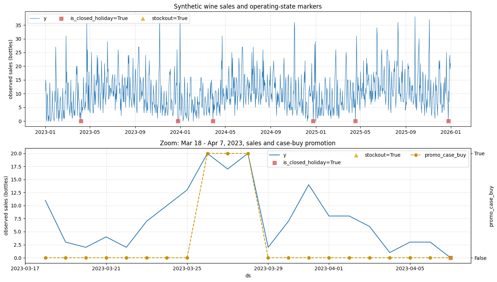

上图展示完整历史中的观测销量以及闭店和缺货标记；下图放大 2023 年 3 月 18 日至 4 月 7 日，并标出成箱促销窗口。局部图用于核对促销标记、销量变化和供给状态是否在日期上正确对齐。它展示的是合成数据的生成结果，不单独证明促销对销量具有相同幅度的因果效应。

**数据特征与比较建议。**

泊松分布用于非负整数计数，并不自动表示间歇性需求。给定当天强度 $\lambda_t$，泊松变量取零的概率为：

$$
P\!\left(D_t^{\mathrm{wine}}=0\mid\lambda_t\right)=e^{-\lambda_t}
$$

强度越低，零需求概率越高；例如 $\lambda_t=3$ 时约为 5.0%，$\lambda_t=0.2$ 时约为 81.9%。是否属于间歇性需求，还要结合选定粒度下的实际零值比例、非零事件数、需求间隔和非零需求量波动判断。

统一画像表显示，当前红酒场景有 1,810 个有效营业日，其中 1,792 天出现正销量，营业日零值比例约为 0.99%，$\widehat{\mathrm{ADI}}\approx1.010$，$\widehat{\mathrm{CV}}_+^2\approx0.368$。它虽然采用泊松观测分布，却仍是非零需求频繁出现的计数序列，没有形成明显的间歇性需求。

读者可以比较带事件输入的 Prophet 与泊松回归，并检查负预测比例、事件分组误差与区间覆盖率。若要研究间歇性需求，可以降低需求强度或改变需求发生机制，再重新检查零值率、ADI 和非零需求量波动。需求类型应由目标粒度下的数据特征判断，而不是由品牌或分布名称决定。

#### 庭院耗材场景：具有强季节性的连续需求

以落叶收集袋或秋季补播草籽中的一款商品为情景，合成营业需求后加入独立随机噪声：

$$
\begin{aligned}
\mu_t^{\mathrm{garden}}
={}&50+0.01t+35I_{\mathrm{Sat},t}+25I_{\mathrm{Sun},t}\\
&+38\sin\!\left(\frac{2\pi(t-10)}{365.25}\right)
+30L_t+12A_t,\\
D_t^{\mathrm{garden}}
={}&\max(0,\mu_t^{\mathrm{garden}}+\eta_t),
\qquad \eta_t\sim\mathcal N(0,7^2)
\end{aligned}
$$

当前场景不模拟缺货，因此观测销量为：

$$
y_t=O_tD_t^{\mathrm{garden}}
$$

记号说明：

| 记号 | 含义 |
| --- | --- |
| $t$ | 根据 `ds` 从样本起点开始计算的日数 |
| $\mu_t^{\mathrm{garden}}$ | 假设门店正常营业时的无噪声需求水平 |
| $I_{\mathrm{Sat},t}$、$I_{\mathrm{Sun},t}$ | 分别标记周六和周日 |
| $L_t$ | 标记劳动节及前两天、复活节周六至周一 |
| $A_t$ | 标记每年 5 月 25—31 日的清仓活动 |
| $\eta_t$ | 独立正态噪声，标准差为 7 |
| $D_t^{\mathrm{garden}}$ | 加入噪声并执行非负截断后的仿真潜在需求；上标 `garden` 是场景标签 |
| $O_t$ | 第 $t$ 个 `ds` 对应的营业状态；营业为 1，闭店为 0 |
| $y_t$ | 应用营业状态后的观测销量，对应 Prophet 数据中的 `y` |

公式先根据 `ds` 对应的日期生成趋势、年度周期、周末和事件效应，再加入随机噪声得到潜在需求 $D_t^{\mathrm{garden}}$。营业日的 `y` 等于该潜在需求，闭店日则通过 $O_t$ 将 `y` 设为零。

拟合 Prophet 时，`ds` 和处理后的 `y` 构成基础输入。周末与年度周期可以从 `ds` 构造；劳动节、复活节和清仓活动需要转换为节假日特征或预测期可获得的业务变量。无噪声需求水平 $\mu_t^{\mathrm{garden}}$、随机噪声 $\eta_t$ 和潜在需求 $D_t^{\mathrm{garden}}$ 只用于仿真与诊断。

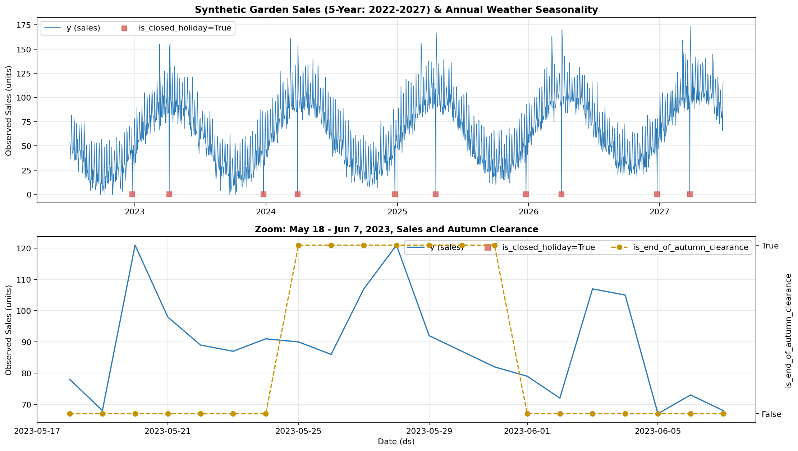

上图展示完整历史中的年度变化、周内波动和闭店日期；下图放大 2023 年 5 月 18 日至 6 月 7 日，并标出 5 月 25—31 日的秋末清仓窗口。局部图用于检查清仓标记与销量序列的日期对齐；销量仍同时受到趋势、季节性、周末效应和随机噪声影响。

**实验建议。**

统一画像表显示，庭院耗材场景的 1,090 个有效营业日均出现正销量，营业日平均观测销量约为 64.92 件，$\widehat{\mathrm{ADI}}=1.000$，$\widehat{\mathrm{CV}}_+^2\approx0.235$。这一场景用于研究连续需求中的强季节性、周末效应和事件变化，不是间歇性需求案例。

二元清仓标记对应额外 12 件，天气影响需要另外构造输入。读者可比较加法与乘法模式，检查淡季误差与非负后处理；`floor=0` 限制趋势，总预测及区间下界还受其他成分影响 [4, 5]。

四个教学场景可以采用共同的预测截止日、多起点回测和多个随机种子进行比较。配置选择只使用训练历史，最终评价窗口保留到开发结束后使用一次；真实项目还应另行保留未参与开发的独立测试期。解释结果时，需要同时报告 WAPE、营业日零值比例和事件观测数，模型排序由实验结果决定。

#### 奢侈品手袋场景：间歇性高价值需求

以墨尔本 CBD 门店的一款高端手袋为例，本场景将“当天是否出现正需求”与“出现后购买多少件”分开模拟。令 $R_t$ 表示第 $t$ 天是否出现正需求，$p_t$ 表示相应的发生概率：

$$
\begin{aligned}
\operatorname{logit}(p_t)
={}&-3.2+0.5I_{\mathrm{Sat},t}+0.3I_{\mathrm{Sun},t}
+1.1I_{\mathrm{Dec},t}\\
&+1.4I_{\mathrm{VIP},t}+0.8q_t,\\
p_t={}&\frac{1}{1+\exp\!\left[-\operatorname{logit}(p_t)\right]},
\qquad R_t\sim\operatorname{Bernoulli}(p_t).
\end{aligned}
$$

当 $R_t=1$ 时，正需求量 $Z_t$ 从下列离散分布中抽取：

$$
P(Z_t=z)=
\begin{cases}
0.75,&z=1,\\
0.15,&z=2,\\
0.08,&z=5,\\
0.02,&z=10.
\end{cases}
\qquad
D_t^{\mathrm{luxury}}=R_tZ_t
$$

记号说明：

| 记号 | 含义 |
| --- | --- |
| $t$ | 根据 `ds` 从样本起点开始计算的日数 |
| $p_t$ | 第 $t$ 天出现正需求的概率，对应 `occurrence_probability` |
| $R_t$ | 正需求事件指示变量；出现正需求时为 1，否则为 0 |
| $I_{\mathrm{Sat},t}$、$I_{\mathrm{Sun},t}$ | 分别标记周六和周日 |
| $I_{\mathrm{Dec},t}$ | 标记 12 月旺季 |
| $I_{\mathrm{VIP},t}$ | 标记每年 3、6、9、12 月第一个周末的 VIP 预览活动 |
| $q_t$ | 折扣比例；6 月 20—26 日清仓期间为 0.20，其余日期为 0 |
| $Z_t$ | 需求发生后的正需求量，对应 `positive_demand` |
| $D_t^{\mathrm{luxury}}$ | 当天的仿真潜在需求，对应 `latent_demand`；上标 `luxury` 是场景标签 |
| $O_t$ | 第 $t$ 个 `ds` 对应的营业状态；营业为 1，闭店为 0 |
| $y_t$ | 应用营业状态后的观测销量，对应 Prophet 数据中的 `y` |

正需求量分布的理论均值和平方变异系数分别为：

$$
\begin{aligned}
\operatorname E(Z_t)&=1(0.75)+2(0.15)+5(0.08)+10(0.02)=1.65,\\
\operatorname{Var}(Z_t)&=2.6275,\\
\mathrm{CV}_+^2&=\frac{2.6275}{1.65^2}\approx0.97.
\end{aligned}
$$

因此，第 $t$ 天潜在需求的条件均值为 $\operatorname E(D_t^{\mathrm{luxury}}\mid p_t)=1.65p_t$，对应数据中的 `conditional_mean`。教学门店在 Good Friday 和 Christmas Day 闭店，且本场景不模拟缺货，所以观测销量为：

$$
y_t=O_tD_t^{\mathrm{luxury}}
$$

最终建模表将第 $t$ 条记录的日期写入 `ds`，将观测销量 $y_t$ 写入 `y`。周末和 12 月旺季可以从 `ds` 构造；VIP 活动和折扣只有在预测期已经排定时，才能配置为 Prophet 的额外输入。`occurrence_probability`、`positive_demand`、`conditional_mean` 和 `latent_demand` 记录的是合成数据生成过程中的诊断真值，真实业务通常无法直接观测，也不能把它们作为模型特征。

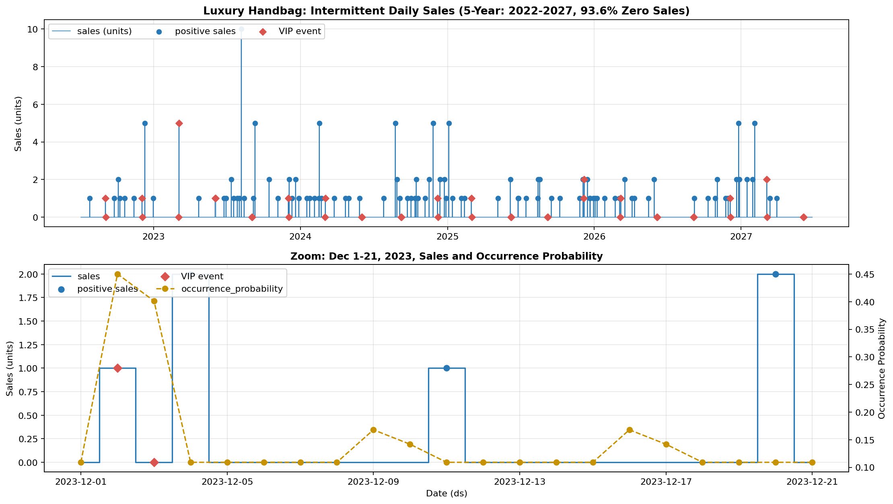

上图展示完整历史中的稀疏正销量和 VIP 活动日期；下图放大 2023 年 12 月 1—21 日，同时显示销量与生成过程中的需求发生概率。周末、12 月旺季和 VIP 活动会提高 $p_t$，但 $R_t$ 仍由伯努利分布随机生成，因此较高的发生概率并不保证当天一定产生销量。该图用于核对生成机制及日期对齐，不代表真实门店中这些因素具有相同大小的因果效应。

**数据特征与比较建议。**

当前固定随机种子生成 1,090 个有效营业日，其中 70 天出现正销量；营业日零值比例约为 93.58%，$\widehat{\mathrm{ADI}}\approx15.571$，$\widehat{\mathrm{CV}}_+^2\approx0.949$。样本正需求均值为 1.30 件，与理论均值 1.65 件存在抽样差异；理论量描述生成分布，样本量则描述这一次生成的有限序列，两者不应混用。

这一场景同时具有较长的正需求间隔和波动较大的正需求量，适合比较季节性朴素基准、Prophet、Croston、SBA、TSB 以及障碍模型等候选方法。Prophet 可以利用日期、VIP 活动和已知折扣解释平均需求率，但其连续曲线结构未必适合直接描述大量零值和离散购买件数。实验需要使用一致的预测截止日、未来可获得的输入和滚动起点回测，并分别检查零值日、正需求日、活动窗口及库存决策相关指标；最终选择由样本外结果决定。

### 附录 C：间歇性需求的候选方法

奢侈品手袋场景说明，在日级需求大量为零时，模型需要同时考虑正需求出现的频率和出现后的购买数量。本附录介绍第七章列入候选集合的间歇性需求方法。这类需求也常见于工业备件等场景 [33]，但具体方法仍应根据目标零售序列的数据条件选择。正文使用这些方法界定 Prophet 的适用边界，不对其预测性能进行预先排序。

本节使用 $Y_t$ 表示第 $t$ 个日期销量的随机变量，使用 $y_t$ 表示数据表中已经观测到的具体销量，对应 Prophet 的 `y`。比较不同方法时，所有候选模型都使用相同的 `ds` 日期范围、目标值处理规则、预测截止日和预测窗口；各方法再按照自身结构使用这些按时间排序的观测。

#### Croston 与 SBA：分别平滑需求量和需求间隔

Croston 方法只在出现非零需求时，分别对非零需求量 $z_i$ 和两次非零需求之间的间隔 $\ell_i$ 做指数平滑 [16]：

$$
\hat z_i=\alpha z_i+(1-\alpha)\hat z_{i-1},
\qquad
\hat \ell_i=\alpha \ell_i+(1-\alpha)\hat \ell_{i-1},
\qquad
\hat y=\frac{\hat z_i}{\hat \ell_i}
$$

这里的 $z_i$ 是目标列 `y` 中第 $i$ 次正销量，$\ell_i$ 是根据按 `ds` 排序的有效日期计算的非零需求间隔，$\alpha\in(0,1]$ 是平滑参数。$\hat y$ 表示单位时间的平均需求率，而不是下一次需求发生时间。SBA（Syntetos–Boylan Approximation）在相同分解上加入偏差修正 [17]：

$$
\hat y_{\mathrm{SBA}}=\left(1-\frac{\alpha}{2}\right)\frac{\hat z_i}{\hat \ell_i}
$$

这个修正来自特定假设下对 Croston 估计偏差的分析。实际选择还要结合商品数据、评价指标和库存目标进行验证。

#### TSB：逐期更新需求发生概率

TSB（Teunter–Syntetos–Babai）方法改为每一期都更新需求发生概率。对于按 `ds` 排序的目标列 `y`，令 $o_t=\mathbf 1(y_t>0)$，以 $\alpha_p$ 平滑发生概率；非零需求量使用 $\alpha_z$，并且只在 $y_t>0$ 时更新 [18]：

$$
\hat p_t=\alpha_p o_t+(1-\alpha_p)\hat p_{t-1},
\qquad
\hat z_t=\alpha_z y_t+(1-\alpha_z)\hat z_{t-1}\quad\text{（仅当 }y_t>0\text{）},
\qquad
\hat y_t=\hat p_t\hat z_t
$$

其中，$\alpha_p,\alpha_z\in(0,1]$。连续零值会使 TSB 的需求发生概率逐期下降，从而较快反映需求消退。商品上架、退市和经营状态可以作为额外业务信息，与这一统计更新机制共同使用。

#### 零膨胀模型与障碍模型：显式建模大量零值

零膨胀模型用混合分布处理零值。例如，零膨胀泊松模型（Zero-Inflated Poisson，ZIP）以 $\pi_t$ 表示额外零值成分的概率，以 $\lambda_t$ 表示泊松计数均值 [19]：

$$
P(Y_t=0)=\pi_t+(1-\pi_t)e^{-\lambda_t},
\qquad
P(Y_t=a)=(1-\pi_t)e^{-\lambda_t}\frac{\lambda_t^a}{a!},\quad a=1,2,\ldots
$$

其中，$a!$ 是正整数需求量 $a$ 的阶乘。计数分布本身也可以产生零值，“结构零”表示模型中的潜在混合成分；业务状态标记可以帮助判断它与未上架、闭店或销售机会缺失之间的关系。障碍模型（hurdle model，也称两部分模型）采用另一种分解：第一部分预测需求是否大于零，第二部分只对正需求量拟合零截断分布。两类模型都将需求发生与需求量联系起来，但采用不同的零值生成假设。

#### 方法差异与实验边界

| 方法 | 分别建模的对象 | 连续零值期间怎样更新 | 主要输出含义 |
| --- | --- | --- | --- |
| Croston | 非零需求量、非零需求间隔 | 两个平滑量都不更新 | 单位时间平均需求率 |
| SBA | 与 Croston 相同，并修正其偏差 | 与 Croston 相同 | 经偏差修正的平均需求率 |
| TSB | 需求发生概率、非零需求量 | 每期降低发生概率；需求量不更新 | 发生概率与非零需求量乘积 |
| 零膨胀模型 | 额外零值成分、计数分布 | 由协变量和估计参数共同决定 | 完整计数概率分布 |
| 障碍／两部分模型 | 是否为正、正值条件分布 | 根据当期输入计算发生概率；参数是否更新取决于训练机制 | 发生概率与正需求条件分布 |

这张表比较的是模型机制，不代表预先确定的性能排序。实际实验仍需统一目标变量、时间粒度、预测窗口和可用信息，并使用与正文一致的滚动起点回测比较 Prophet、间歇性需求方法和其他候选模型。

## 参考文献

[1] Taylor, S. J., & Letham, B. Forecasting at Scale. *The American Statistician*, 72(1), 37–45, 2018. <https://doi.org/10.1080/00031305.2017.1380080>。作者预印本：<https://facebook.github.io/prophet/static/prophet_paper_20170113.pdf>

[2] Business Victoria. Operating on a restricted trading day. <https://business.vic.gov.au/business-information/public-holidays/operating-on-a-restricted-trading-day>

[3] Prophet. Trend Changepoints. <https://facebook.github.io/prophet/docs/trend_changepoints.html>

[4] Prophet 1.4.0. Date preprocessing and forecast components. `forecaster.py`. <https://github.com/facebook/prophet/blob/v1.4.0/python/prophet/forecaster.py>

[5] Prophet. Saturating Forecasts. <https://facebook.github.io/prophet/docs/saturating_forecasts.html>

[6] Prophet. Seasonality, Holiday Effects, and Regressors. <https://facebook.github.io/prophet/docs/seasonality,_holiday_effects,_and_regressors.html>

[7] Prophet. Multiplicative Seasonality. <https://facebook.github.io/prophet/docs/multiplicative_seasonality.html>

[8] Prophet. Installation. <https://facebook.github.io/prophet/docs/installation.html>

[9] Prophet. Quick Start. <https://facebook.github.io/prophet/docs/quick_start.html>

[10] Prophet 1.4.0. Stan model source. `prophet.stan`. <https://github.com/facebook/prophet/blob/v1.4.0/python/stan/prophet.stan>

[11] Stan. CmdStan User’s Guide: Optimization. <https://mc-stan.org/docs/cmdstan-guide/optimize_config.html>

[12] Prophet 1.4.0. Python Stan backend source. `models.py`. <https://github.com/facebook/prophet/blob/v1.4.0/python/prophet/models.py>

[13] Prophet. Uncertainty Intervals. <https://facebook.github.io/prophet/docs/uncertainty_intervals.html>

[14] Stan. Reference Manual: MCMC Sampling. <https://mc-stan.org/docs/reference-manual/mcmc.html>

[15] Prophet. Diagnostics. <https://facebook.github.io/prophet/docs/diagnostics.html>

[16] Croston, J. D. Forecasting and Stock Control for Intermittent Demands. *Operational Research Quarterly*, 23(3), 289–303, 1972. <https://doi.org/10.1057/jors.1972.50>

[17] Syntetos, A. A., & Boylan, J. E. The accuracy of intermittent demand estimates. *International Journal of Forecasting*, 21(2), 303–314, 2005. <https://doi.org/10.1016/j.ijforecast.2004.10.001>

[18] Teunter, R. H., Syntetos, A. A., & Babai, M. Z. Intermittent demand: Linking forecasting to inventory obsolescence. *European Journal of Operational Research*, 214(3), 606–615, 2011. <https://doi.org/10.1016/j.ejor.2011.05.018>

[19] Lambert, D. Zero-Inflated Poisson Regression, with an Application to Defects in Manufacturing. *Technometrics*, 34(1), 1–14, 1992. <https://doi.org/10.1080/00401706.1992.10485228>

[20] Hyndman, R. J., & Athanasopoulos, G. *Forecasting: Principles and Practice*, 3rd edition. Chapter 11: Forecasting hierarchical and grouped time series. OTexts. <https://otexts.com/fpp3/hierarchical.html>

[21] Prophet. Non-Daily Data. <https://facebook.github.io/prophet/docs/non-daily_data.html>

[22] Prophet. Additional Topics. <https://facebook.github.io/prophet/docs/additional_topics.html>

[23] Hyndman, R. J., & Athanasopoulos, G. *Forecasting: Principles and Practice*, 3rd edition. Section 9.5: Non-seasonal ARIMA models. OTexts. <https://otexts.com/fpp3/non-seasonal-arima.html>

[24] Hyndman, R. J., & Athanasopoulos, G. *Forecasting: Principles and Practice*, 3rd edition. Section 10.2: Regression with ARIMA errors using fable. OTexts. <https://otexts.com/fpp3/regarima.html>

[25] LightGBM. Features. <https://lightgbm.readthedocs.io/en/v4.6.0/Features.html>

[26] XGBoost. Introduction to Boosted Trees. <https://xgboost.readthedocs.io/en/stable/tutorials/model.html>

[27] Lim, B., Arik, S. O., Loeff, N., & Pfister, T. Temporal Fusion Transformers for Interpretable Multi-horizon Time Series Forecasting. arXiv:1912.09363, 2019; revised 2020. <https://arxiv.org/abs/1912.09363>

[28] Oreshkin, B. N., Carpov, D., Chapados, N., & Bengio, Y. N-BEATS: Neural basis expansion analysis for interpretable time series forecasting. arXiv:1905.10437, 2019; revised 2020. <https://arxiv.org/abs/1905.10437>

[29] Hyndman, R. J., & Athanasopoulos, G. *Forecasting: Principles and Practice*, 2nd edition. Section 3.1: Seasonal naïve method. OTexts. <https://otexts.com/fpp2/simple-methods.html>

[30] LightGBM 4.6.0. Parameters: `min_data_in_leaf` and `feature_pre_filter`. <https://lightgbm.readthedocs.io/en/v4.6.0/Parameters.html>

[31] Google Cloud. MLOps: Continuous delivery and automation pipelines in machine learning. <https://cloud.google.com/architecture/mlops-continuous-delivery-and-automation-pipelines-in-machine-learning>

[32] Syntetos, A. A., Boylan, J. E., & Croston, J. D. On the categorization of demand patterns. *Journal of the Operational Research Society*, 56(5), 495–503, 2005. <https://doi.org/10.1057/palgrave.jors.2601841>

[33] Pennings, C. L. P., van Dalen, J., & van der Laan, E. A. Exploiting elapsed time for managing intermittent demand for spare parts. *European Journal of Operational Research*, 258(3), 958–969, 2017. <https://doi.org/10.1016/j.ejor.2016.09.017>
