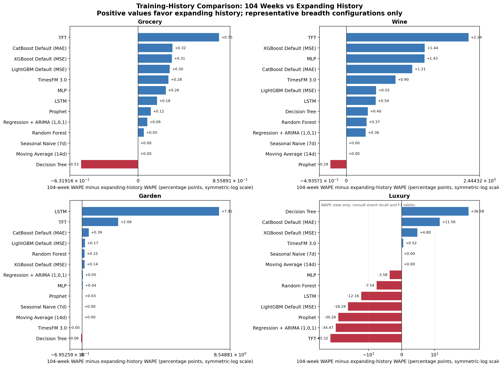
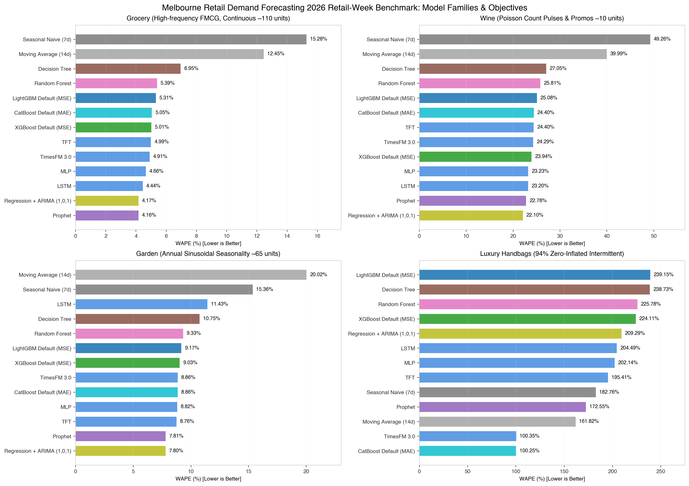

> 📌 **阶段归属**：阶段二/三 · 基础模型探索与双协议验证 (Stage 2/3: Foundation Model Evaluation)  
> 🔗 **配套交互实验 Notebook**：[`notebooks/36-timesfm-bigquery-tutorial.ipynb`](../../notebooks/36-timesfm-bigquery-tutorial.ipynb)  
> 📊 **统一评测横向对比报告**：[`docs/reports/2026-retail-week-v4-first-stage-report.md`](../reports/2026-retail-week-v4-first-stage-report.md) · [天梯榜 Leaderboard](../../README.md#综合排行榜)

## 问题不是“基础模型能不能跑”，而是“比较是否公平”

零售预测很容易把不同信息条件混成一张排行榜：一个模型只看历史销量，另一个模型读取未来
促销计划，还有一个 AutoML 系统在每个预测起点重新选择组件。即使它们预测的是同一批日期，
结果也不能自动视为同一种实验。

本文只分析不可变 release `20261106-timesfm-v1`。TimesFM 3.0 被预先冻结为两个配置：

- `timesfm-3-0-univariate`：只读取预测起点以前的有效销量历史，作为 TimesFM 工具包的广度代表；
- `timesfm-3-0-known-covariates`：额外读取预测时已知的营业状态、日历、节假日和业务计划变量，
  作为配置消融，不重复占据广度榜名次。

完整参数、输入哈希和 checkpoint revision 均写入模型 manifest。正式 2026 标签不参与配置选择。

## 两套历史策略，共用同一组预测日期

实验使用四套固定生成协议的日粒度合成数据，并在 2025-12-29 至 2026-12-27 之间设置
13 个互不重叠的 28 日 fold，共覆盖 364 个评估日：

- `2026-retail-week-expanding-v4`：每个预测起点读取此前全部历史；
- `2026-retail-week-104w-rolling-v4`：每个起点只读取此前 104 个完整周，再预测随后 4 周。

第二套协议模拟现实中“每月用最近两年数据更新模型，再预测下个月”的滚动 MLOps 流程。
104 周严格等于 728 天，因此这里讨论的是两个零售年度，而不是两个完整日历年。

## 单变量与已知协变量：三个场景改善，一个场景没有解决

扩展历史协议的 pooled WAPE 如下。指标由全部有效逐日预测重新汇总，不是 13 个 fold WAPE
的简单平均。

| 场景 | TimesFM 单变量 | TimesFM + 已知协变量 | WAPE 变化 |
| :--- | ---: | ---: | ---: |
| Grocery | 4.91% | 4.54% | -0.37 pp |
| Wine | 24.29% | 22.69% | -1.60 pp |
| Garden | 8.86% | 8.17% | -0.69 pp |
| Luxury | 100.35% | 100.41% | +0.06 pp |

Grocery 的折扣计划、Wine 的促销与事件标记、Garden 的清仓和长周末信息都带来了描述性改善。
这支持一个有限结论：在当前合成机制中，TimesFM 3.0 能利用与生成过程一致、且在预测起点
真实可知的业务变量。它不能证明任何协变量在真实企业数据上都会产生相同收益。

Luxury 必须单独解释。两个 TimesFM 配置的 `DemandRecall@0.5` 和事件 F1 都是 0%。接近
100% 的 WAPE 主要来自接近零的保守预测，而不是模型成功识别了购买事件。因此，不能把
Luxury 的 WAPE 排名写成“TimesFM 擅长极端间歇需求”。

## 104 周窗口改变了什么

固定 104 周后，TimesFM 单变量在 Grocery、Wine、Garden 的 WAPE 分别变为 5.19%、
25.19% 和 8.86%；已知协变量版本分别变为 4.93%、23.98% 和 8.55%。三个连续或低量
场景都没有从更短历史中获益，但差异远小于“模型完全失效”。Garden 单变量两种历史策略
几乎持平，说明增加历史长度的价值依赖具体需求机制。

Luxury 的两种配置在 104 周协议下事件 F1 仍为 0%。改变历史长度没有修复事件识别边界。

## 分位数区间不是库存服务水平保证

TimesFM 同时输出 P10/P90。扩展历史单变量配置在 Grocery、Wine、Garden、Luxury 的
Coverage80 分别为 83.19%、75.69%、74.03% 和 93.65%；已知协变量配置分别为
81.45%、77.07%、79.56% 和 91.44%。这些是当前回测中的经验覆盖率，尚未经过业务校准。

特别是 Luxury：高覆盖率与极窄区间可以和事件召回为 0 同时出现。零值占绝大多数时，覆盖
大量零销量日期并不能证明区间能覆盖真正的购买事件，更不能直接转换成安全库存或服务水平。

## 与普通模型和 AutoML 的关系

TimesFM 单变量配置进入普通工具包广度榜，但没有成为四个场景的统一冠军：Grocery 的最低
广度 WAPE 来自 Prophet，Wine 和 Garden 来自 Regression + ARIMA，Luxury 则必须联合
CatBoost 的 WAPE 与事件 F1 阅读。仓库不计算跨四种需求尺度的单一总冠军。

AutoGluon 仍是独立 AutoML 对比层。扩展历史 release 中，AutoGluon 套件记录约 2,398 秒
总耗时；TimesFM 单变量和协变量配置分别约 10 秒和 63 秒。这个数字只能描述本机本次执行：
AutoGluon 包含训练、内部验证和集成，TimesFM 使用预训练权重做零样本推理，两者不是等价的
计算任务。

## 可复现边界

- TimesFM 包版本固定为 `3.0.2`；
- checkpoint 固定为 `google/timesfm-3.0-pytorch` revision
  `43046b85ec22d584a13f8098c2ed39c889e129c2`；
- 本次在 16GB Apple M4 Mac mini 上使用 CPU 串行运行，模型在每个进程只加载一次；
- 两个协议、四个场景、13 个 fold 的预测、指标和 manifest 均已发布并通过哈希复算；
- TimesFM 3.0 默认权重受非商业许可证约束，实验结果不等于商业生产部署授权。

完整证据见：

- [V4 实验设计](../reports/experiment-design.md)
- [V4 完整技术报告](../reports/2026-retail-week-v4-first-stage-report.md)
- [模型接入与发布协议](../reports/model-onboarding-protocol.md)

旧版单一切片和 BigQuery 实验已移入
[历史文章](archive/timesfm-retail-demand-forecast-v2.md)，不再作为当前模型比较结论。
