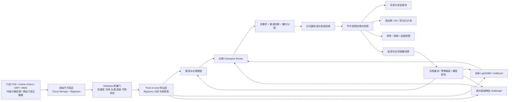
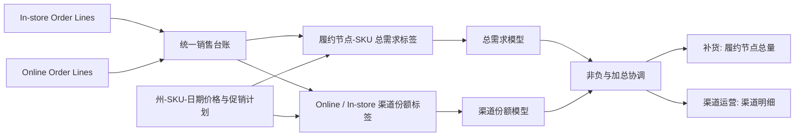
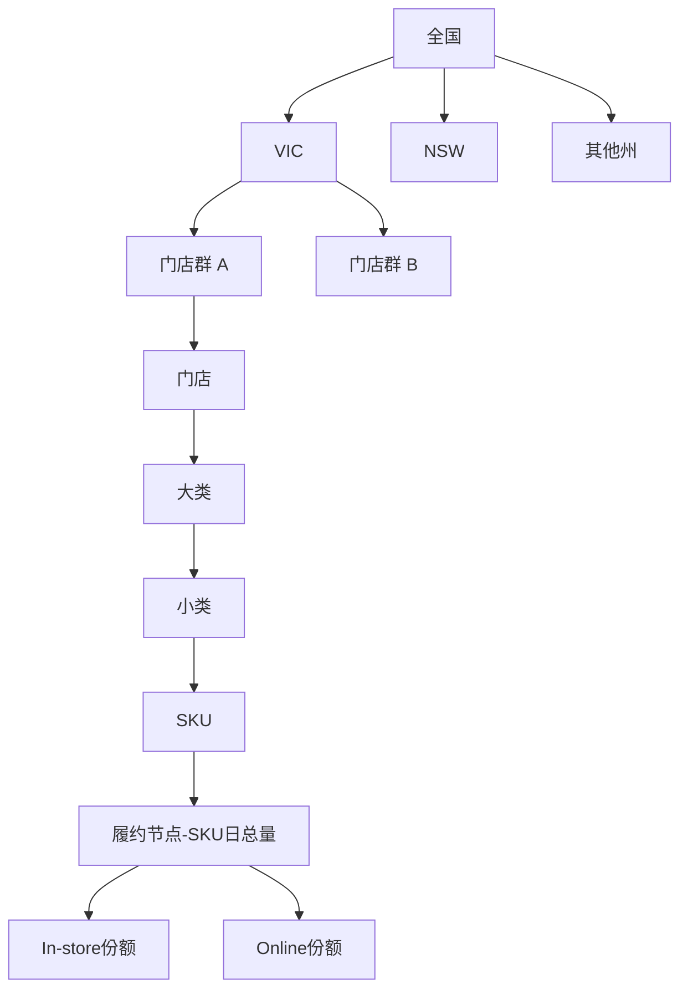
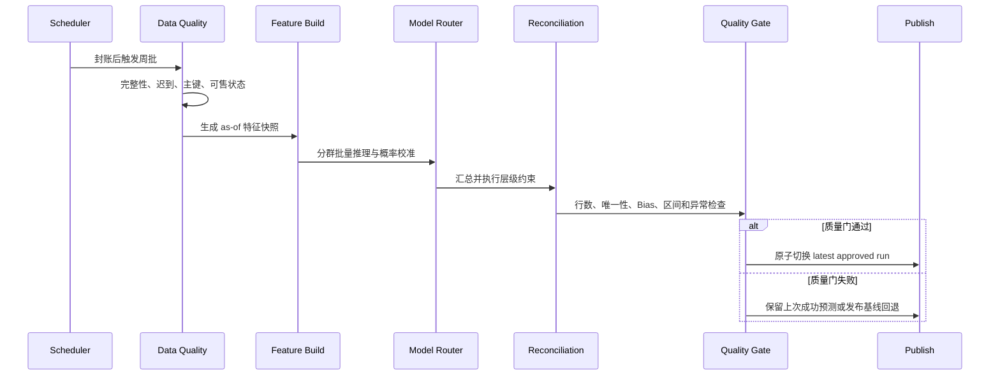

# 大型零售需求预测系统：架构、模型、运行与 GCP 成本思想实验

> 报告日期：2026-10-20
>
> 本次修订：2026-10-21（增加全渠道、州级统一定价与多模型管理设计）
>
> 部署假设：Google Cloud Sydney（`australia-southeast1`），USD 计价
>
> 预测节奏：每周全量发布未来 56 天，月度重训，季度重新调参与模型评审
>
> 数据假设：拥有超过 6 年的完整日数据；生产模型默认使用预测起点前最近 3 年训练
>
> 渠道假设：销售记录同时覆盖门店内销售（in-store）和线上销售（online），且每笔线上订单都有唯一履约节点
>
> 定价约束：按题设，商品价格、促销和折扣在州内统一；模型不得产生门店级或客户级差异化价格
>
> 报告性质：容量规划和技术决策思想实验，不是 Google Cloud 报价单，也不是对具体企业现状的陈述

## 执行摘要

这套系统的核心挑战不是“选 LightGBM 还是 TFT”，而是如何在数百万至数千万条活动门店—SKU 序列上，持续产生**及时、层级一致、可解释、可回退，并能转化为库存决策**的预测。

日常用品零售商在 1,142 家门店和 25,000 个 SKU 的理论笛卡尔积下有 2,855 万条序列。若 60% 的组合实际在架，每周要为 1,713 万条活动序列生成未来 56 天预测，即约 9.59 亿行。酒类零售商按 292 家门店、单店平均 5,500 个在架 SKU 估算，有约 161 万条活动序列和约 8,994 万行预测。这个规模不适合逐序列训练 Prophet、ARIMA 或 AutoGluon；生产系统应以共享参数的全局树模型为主，按需求形态分群，并让统计模型、神经网络和 AutoML 承担更窄的角色。

销售数据同时包含 in-store 和 online，但“渠道”与“履约地点”不能混为一谈。线上订单可能由门店、配送中心或其他节点履约；库存系统关心从哪个节点出货，商业团队关心客户通过哪个渠道下单。推荐同时保存 `order_channel` 与 `fulfillment_node_id`，先预测履约节点—SKU总需求，再预测渠道份额并进行加总约束。Click & Collect 只计算一次销量：渠道是 online，履约节点是实际拣货门店。

按题设，价格、促销和折扣由州×SKU×日期决定，同州门店和渠道必须同价。这个约束会降低价格特征表的规模，也意味着模型不能从州内门店价格差异识别弹性。门店之间的预测差异只能来自历史需求、客群、选品、库存、天气、门店属性和履约角色，不能来自个性化价格。该设定作为本报告的业务与合规前提；现实法律解释和例外仍须由企业法务确认。

建议的第一版生产组合是：

1. Seasonal naive、移动平均和 Croston/TSB 提供基线与故障回退。
2. LightGBM 或 CatBoost 作为大多数连续需求的全局主模型。
3. 两阶段“是否发生需求 × 正需求量”模型处理稀疏长尾。
4. Prophet/ARIMA 只服务重要汇总层级、诊断和计划解释。
5. LSTM/TFT 只作为高价值、高频需求段的 challenger；AutoGluon 用于离线发现候选模型，不进入逐序列周批拟合。

在本文的中心假设下，Sydney 区域每月纯云平台成本估算如下。这里不含 GST、企业折扣、人员、SAP/ERP/WMS 许可和跨云费用。

| 企业规模 | 精简版 | 推荐生产版 | 高可用版 |
|---|---:|---:|---:|
| 日常用品零售 | USD 4,000–13,000 | **USD 14,000–40,000** | USD 42,000–109,000 |
| 酒类零售 | USD 1,000–3,500 | **USD 3,000–11,000** | USD 11,000–31,000 |

这些区间不是从公开价目表直接读出的套餐价格，而是“单价 × 工作负载”的容量估算。正式预算前必须用真实数据完成两周影子运行，记录 BigQuery processed bytes、Vertex AI node-hours、预测吞吐和压缩后行宽，再把估算替换为实测账单。

本报告进一步假设企业保存了超过 6 年的日级销售、库存、价格、促销和主数据历史。生产训练并不默认吃完全部历史，而是使用预测起点前最近 3 年的滚动窗口：三年通常能够提供三个完整年度周期，同时降低门店改造、商品换代、通胀、促销机制和消费者行为变化造成的陈旧数据偏差。更早的数据继续保留，用于跨年度回测、极端事件分析、长期漂移判断和训练窗口敏感性实验。

从商业角度，最终上线标准不应是最低 WAPE，而应是：在 Bias、概率覆盖和关键需求段不退化的前提下，减少缺货、废弃、紧急调拨或人工改写。预测系统的价值应通过库存仿真和受控试点确认，而不是从离线误差直接推断。

## 1. 规模到底有多大

### 1.1 活动序列，而不是理论笛卡尔积

“门店数 × 全部 SKU 数”是容量上界，不是应当实际生成的序列数。只有在预测生效日期内已上架、计划上架或明确需要规划的门店—SKU 才进入活动集合。

日常用品零售的理论上限为：

$$
N_{\text{series,max}}
= 1{,}142 \times 25{,}000
= 28{,}550{,}000
$$

对活动率做敏感性分析：

| 活动率 | 活动门店—SKU | 56 天日预测行数 | 8 周周预测行数 |
|---:|---:|---:|---:|
| 40% | 11.42 million | 639.5 million | 91.4 million |
| 60%（中心假设） | 17.13 million | 959.3 million | 137.0 million |
| 80% | 22.84 million | 1.279 billion | 182.7 million |
| 100% 理论上限 | 28.55 million | 1.599 billion | 228.4 million |

酒类零售的活动集合由单店实际选品决定：

| 单店在架 SKU | 活动门店—SKU | 56 天日预测行数 |
|---:|---:|---:|
| 3,500 | 1.022 million | 57.2 million |
| 5,500（中心假设） | 1.606 million | 89.9 million |
| 7,500 | 2.190 million | 122.6 million |

日常用品零售采用日粒度有明显业务价值：工作日模式、闭店、保质期、短促销和配送日都不能在周总量中完整表达。酒类也需要日粒度处理周末、公共假日和节庆高峰。为控制存储，在线明细保留 90 天，旧批次压缩为 Parquet 后进入 Cloud Storage；报表不应反复扫描全部历史预测快照。

上表按每个履约节点—SKU—日期一条**总需求预测**计算，因此不会因为同时存在两个渠道就自动翻倍。推荐物理存储总量和 online 明细，in-store 通过“总量减 online”派生。设存在有效线上渠道的节点—SKU占比为 $q_{\text{online}}$：

$$
q_{\text{online}}
= \frac{N_{\text{active online node--SKU}}}
       {N_{\text{active node--SKU}}},
\qquad 0\le q_{\text{online}}\le 1.
$$

因此总量表加 online 明细表的物理行数是基础行数的 $1+q_{\text{online}}$ 倍，最大为 2 倍。并非所有门店—SKU都有线上销售，所以 $q_{\text{online}}$ 应从最近 13 周的活动渠道集合计算。若业务坚持同时物理保存总量、in-store 和 online 三类行，最大才会达到 3 倍；这没有必要，因为 in-store 可以无损派生。库存补货继续消费不重复的履约节点总量；渠道明细主要服务电商容量、营销和渠道运营。

### 1.2 每行大小和存储量假设

容量估算采用每条预测记录 96 bytes 的 BigQuery 逻辑行宽作为中心值，范围为 64–160 bytes。实际大小受字符串键、重复层级字段、分位数数量和 BigQuery 编码影响，必须用真实表的 `INFORMATION_SCHEMA.TABLE_STORAGE` 校准。

在中心行宽下：

- 日常用品 60% 活动率：单次约 92 GB；13 个周批次约 1.20 TB。
- 酒类平均 5,500 个 SKU：单次约 8.6 GB；13 个周批次约 112 GB。

因此“输出接近十亿行”并不等于存储账单必然失控。更可能推高费用的是反复全表扫描、为多个候选模型重复构造训练集，以及没有按日期、门店和品类裁剪的交互式查询。

### 1.3 六年以上历史如何使用

完整历史与默认训练窗口承担不同职责：

| 数据范围 | 默认用途 | 是否直接进入当期生产拟合 |
|---|---|---|
| 最近 3 年 | 特征构造、月度重训、概率校准和分群统计 | 是 |
| 第 4–6 年及更早 | 生成历史预测起点、制度变化分析、极端事件参考和数据质量基线 | 否 |
| 全部 6 年以上 | 年度训练窗口比较、商品/门店生命周期研究和审计追溯 | 只在专项实验中 |

设预测起点为 $t$，默认训练标签区间为：

$$
\mathcal{T}(t)
= \left[t-3\ \text{years},\;t-1\ \text{day}\right]
$$

每个历史回测起点也执行同样规则，不能在较早回测中使用该起点之后的数据、促销修订或当前商品层级。拥有 6 年历史意味着可以在后 3 年设置大量真实的滚动预测起点，同时每个起点仍然拥有最多 3 年训练数据；这比“用前 5 年训练、只测试最后一年”更能观察模型在不同季节和制度下是否稳定。

三年是生产默认值，不是不可变定律。年度模型评审应对 2 年、3 年、4 年和全部可用历史做统一回测。只有当某个需求段在多个预测起点上稳定改善、训练成本仍在预算内，才允许偏离三年窗口，并把例外写入模型卡。例如极低频高价酒品可能从更长的事件历史受益；经历重大门店改造、品类重组或定价制度变化的商品则可能只应使用更短窗口。

## 2. 目标架构



### 2.1 服务选择

| 能力 | 推荐 GCP 服务 | 为什么这样用 |
|---|---|---|
| 分析仓库与特征计算 | BigQuery | 适合分区、聚类、批量 SQL 和授权视图；按扫描量或 slot 计费 |
| 原始快照、模型和归档 | Cloud Storage | 便宜、不可变对象和生命周期规则清晰 |
| 大规模训练与推理 | Vertex AI Custom Jobs | 批处理结束即释放资源，不维护常驻集群 |
| 流水线 | Vertex AI Pipelines + Workflows | 记录 ML 步骤、低成本调用外部步骤 |
| 调度 | Cloud Scheduler | 每周、每月和监控作业触发 |
| 模型与元数据 | Vertex AI Model Registry + ML Metadata | 保存批准状态、版本、数据与模型血缘 |
| 轻量查询/控制接口 | Cloud Run | 只负责控制面或小结果查询，不承载十亿行推理 |
| 日志与告警 | Cloud Logging、Monitoring、Alerting | 统一批次、数据、模型和成本告警 |

Cloud Composer 适合已经标准化在 Airflow 上、且有大量跨系统 DAG 的组织；仅为每周预测维护 Composer 环境会引入不必要的固定费用和运维面，因此不作为第一版默认选择。

### 2.2 数据分区和聚类

- 销售与库存事实按 `business_date` 分区，优先按 `fulfillment_node_id, sku_id` 聚类；订单事实额外保存 `order_channel`。
- 预测事实按 `as_of_date` 分区，按 `state, category_id, store_cluster_id, sku_id` 聚类。
- 价格与促销表的业务主键是 `state, sku_id, business_date`。若同一州、SKU、日期出现多个有效价格或渠道价格不一致，数据质量门必须阻止训练和发布。
- 促销计划必须带 `valid_from、valid_to、loaded_at、plan_version`，特征生成只读取预测起点当时已知的版本。
- 商品、门店和品类使用带生效日期的慢变维度。历史预测必须按当时层级保存，同时提供当前组织视图，不能用当前层级静默重写历史。
- 高频报表读取预聚合表；补货系统通过分区过滤读取最新有效批次，避免每次从所有快照求 `MAX(as_of_date)`。

### 2.3 统一预测事实接口

明细表的业务主键为：

```text
(forecast_run_id, target_date, fulfillment_node_id, sku_id, forecast_view, order_channel)
```

最小字段如下：

| 字段组 | 字段 |
|---|---|
| 运行 | `forecast_run_id, as_of_date, target_date, horizon_day` |
| 组织 | `fulfillment_node_id, store_id, store_cluster_id, state` |
| 商品 | `sku_id, subcategory_id, category_id` |
| 渠道 | `forecast_view, order_channel` |
| 预测 | `p10, p50, p90, mean_forecast` |
| 血缘 | `model_version, feature_snapshot_id, reconciliation_version` |
| 状态 | `cold_start, stockout_censored, promotion, quality_flag` |

`forecast_view` 至少区分 `fulfillment_total` 和 `channel_detail`。总量行的 `order_channel` 为空，物理渠道明细保存 `online`；`instore` 授权视图用总量减 online 派生。发布检查必须保证 online 不大于对应履约总量，并且派生的 in-store 非负。`p50` 服务销售和财务计划；补货应根据缺货成本和目标服务水平选择较高分位，而不是机械使用均值；清仓和保守采购可参考较低分位。下游接口还要发布模型适用范围、更新时间、单位和舍入规则。

### 2.4 全渠道与州级统一定价的数据契约



统一销售台账每个订单行只能出现一次，并保存四个不同概念：

| 概念 | 示例 | 用途 |
|---|---|---|
| `order_channel` | `instore`、`online` | 识别客户下单渠道和渠道份额 |
| `fulfillment_node_id` | 门店、Dark Store、DC | 决定库存从哪里消耗 |
| `customer_state` | VIC、NSW | 分析需求来源；只能使用合规、足够聚合的信息 |
| `price_state` | 实际适用价格的州 | 连接州级价格和促销计划 |

`store_id` 不应被强制当作线上需求位置。若线上订单由 DC 履约，则补货目标属于 DC；若由门店拣货，则属于该门店。订单取消、退货、拆单、替代品和部分履约都要保留原订单行与最终履约行的映射，否则线上销量可能被重复计算。

州内统一定价通过数据契约实现：

1. 价格维表在 `state × sku_id × business_date` 上唯一。
2. 未来 56 天价格、促销和折扣必须来自预测起点时已批准的计划版本。
3. 门店或客户级表不得覆盖州级价格；异常覆盖进入隔离表并阻止发布。
4. 模型输出只包含需求预测，不生成个性化价格、客户报价或门店级价格建议。
5. 价格弹性属于观察性关联；除非有合规实验或可信准实验，不把特征重要性解释为因果价格效应。

线上订单的 `price_state` 不能由模型猜测。企业需要由法务和商业规则明确它取自配送地址州、Click & Collect 门店州，还是其他适用辖区，并把规则版本写入订单事实。训练、在线报价、预测和事后评分必须使用同一规则；跨州履约节点只决定库存从哪里扣减，不能自行改变顾客适用价格。

## 3. 模型系统，而不是单一模型

本章中的 Woolworth 和 Dan Murphy 示例均基于题设规模与典型零售场景，用于解释设计方法，不代表两家企业真实的商品编号、分类体系、模型数量或内部系统。模型设计应从业务决策反推，而不是先选算法：补货需要门店或履约节点—SKU 粒度，州和品类计划需要可加总的汇总结果，Online 运营需要渠道视图，因此系统必须先生成一致的叶子预测，再进行渠道拆分和层级协调。


设计逻辑可以概括为八个依次回答的问题：

1. **预测给谁使用？** 补货、州级计划、促销还是财务预算决定输出粒度和分位数。
2. **最小可行动单位是什么？** 通常是 `fulfillment_node_id × sku_id × target_date`，而不是全国总量。
3. **哪些序列可以共享规律？** 门店、SKU 和州作为特征进入全局模型，相同需求机制共享参数。
4. **哪些对象确实需要不同模型？** 连续、季节、促销和间歇需求使用不同标签、损失和容量。
5. **模型怎样学到规律？** 用历史预测起点构造 point-in-time 训练行，通过滚动验证选择 Champion。
6. **训练后怎样获得未来结果？** 固定批准参数，为每个活动 Store–SKU 生成未来 1–56 天输入并批量推理。
7. **怎样保证数字一致？** 总需求、Online/In-store、州、门店和品类必须经过同一协调规则。
8. **怎样安全运行？** 用模型包、路由配置、回退和质量门管理，而不是人工维护数百万条序列。

### 3.1 先理解建模挑战，再定义预测对象

大型零售预测的困难并不只是数据行数多。Woolworth 风格日常用品零售商与 Dan Murphy 风格酒类零售商至少同时面对以下问题：

| 建模挑战 | 为什么困难 | Woolworth 风格示例 | Dan Murphy 风格示例 | 设计响应 |
|---|---|---|---|---|
| 叶子规模巨大 | 无法逐序列拟合和维护 | 约 1,713 万条活动门店—SKU 序列 | 约 160.6 万条活动门店—SKU 序列 | 共享参数全局模型，按机理分包 |
| 门店与商品异质 | 同州同价也不等于需求相同 | 两家 VIC 门店的鲜奶基线不同 | Store 123 与 456 的 VB 销量不同 | `store_id`、`sku_id`、属性和历史共同入模 |
| 销量不等于潜在需求 | 缺货把真实需求截断 | 货架缺货时 POS 销量为零 | 热门 Beer 促销期售罄 | 缺货标记、截尾标签或可信窗口训练 |
| 未来信息边界 | 计划会修订，事后数据会泄漏 | 后来修改的促销不能进入历史回测 | 未来真实库存和实际折扣执行未知 | Point-in-time 快照与 `as_of` 语义 |
| 全渠道重复风险 | 下单渠道不等于出库节点 | Online 订单可能由门店或 DC 履约 | Click & Collect 由 Store 123 拣货 | 先预测履约总量，再建渠道份额 |
| 多层级要求 | 单店、州和品类预测可能互相矛盾 | 门店鲜奶之和应等于 VIC 鲜奶 | 各店 Beer 之和应等于 VIC Beer | 叶子预测加约束协调 |
| 1–8 周误差结构不同 | 远期已知信息少，不确定性更高 | 明日配送较确定，第 8 周促销可能未定 | 近期周末活动已知，远期事件未知 | Direct multi-horizon 与分 horizon 校准 |

因此第一步不是选择 LightGBM 或 TFT，而是确定系统要预测什么。补货使用的最小可行动单位为：

```text
fulfillment_node_id × sku_id × target_date
```

例如 Woolworth 风格系统可以预测 `VIC × Store 501 × 某款鲜奶 × 明日`；Dan Murphy 风格系统可以预测 `VIC × Store 123 × SKU_VB_375X24 × 未来第14天`。州、大类和小类结果原则上由这些叶子预测汇总并协调产生，而不是先预测 VIC 总量再平均摊给门店。

定义叶子对象后，再按价值、波动和需求机制分群。每月根据最近 52 周重新计算需求段，但设置最短驻留期，防止商品在模型之间频繁跳动。

| 需求段 | 识别信号 | 默认模型 | Challenger | 主要风险指标 |
|---|---|---|---|---|
| AX：高价值、稳定连续 | 高销售额、低变异、低零销量 | 全局 LightGBM/CatBoost | LSTM/TFT | WAPE、Bias、服务水平 |
| AY/AZ：高价值、波动 | 高销售额、促销或事件敏感 | 全局 boosting + 分位数校准 | 全局神经模型 | RMSE、pinball loss、促销切片 |
| BX/CX：稳定中长尾 | 中低价值、规律稳定 | boosting 或 Seasonal naive | 自动选择 challenger | MASE、预测增值 |
| 间歇需求 | 高零销量、间隔不规则 | 两阶段模型、Croston/TSB | CatBoost hurdle model | 事件召回、库存成本 |
| 新品/新店 | 历史不足 | 相似商品/门店迁移、层级先验 | 属性模型 | 冷启动 Bias、人工覆盖率 |
| 退市/不可售 | 明确生命周期状态 | 业务规则置零或衰减 | 无 | 错误补货金额 |

ABC 反映价值，XYZ 反映波动；零销量率、新品状态和生命周期是额外维度。分群不是为了生成几十套完全独立的平台，而是为了控制损失函数、特征、模型容量、回退规则和业务阈值。

例如，Woolworth 风格日常用品零售商中的高频鲜奶可能属于 AX/M1：几乎每天有销量，缺货成本高，但保质期限制了过量库存；适合以 Bias、服务水平和废弃成本共同评价。Dan Murphy 风格酒类零售商中的高价年份酒可能属于间歇/M4：多数日期销量为零，但偶发需求价值高；如果只优化总体 MAE，模型可能长期预测零，因此还必须考察正需求召回和缺货成本。两类商品不能因为都叫“SKU”就使用完全相同的目标函数和上线门槛。

### 3.2 模型如何训练：从历史事实到批准的 Champion

训练阶段的任务是利用过去三年的历史预测场景学习一个函数，而不是预测未来。每条监督学习记录对应“在历史时点 $t$，当时能看到什么，以及 $h$ 天后实际发生了什么”：

```text
as_of_date × fulfillment_node_id × sku_id × horizon_day
    → target_demand
```

输入由两部分组成：$X_{n,i,t}^{\text{observed}}$ 只包含历史起点前已经观察到的销量、库存、门店和商品状态；$K_{s(n),i,t+h}^{\text{known}}$ 只包含当时已经批准、对目标日已知的州级价格、促销、日历和营业计划。训练目标为：

$$
\theta_g^*
=\arg\min_{\theta_g}
\sum_{(n,i,t,h)\in\mathcal{T}_g}
w_{n,i,t,h}
L\!\left(
y_{n,i,t+h},
F_{\theta_g}\!\left(
X_{n,i,t}^{\text{observed}},
K_{s(n),i,t+h}^{\text{known}},
h
\right)
\right).
$$

其中 $g$ 是大类—需求机制模型包，$n$ 是履约节点，$i$ 是 SKU，$t$ 是历史预测起点，$h=1,\ldots,56$。$w$ 可以提高高价值、促销、节假日和稀缺事件样本权重；$L$ 根据机制选择 Tweedie、Poisson、稳健损失、分位数损失或两阶段损失。求解得到的 $\theta_g^*$ 才是随后用于预测的批准模型参数。

`store_id` 和 `sku_id` 会参加训练，但作为类别身份和层级连接键，不是独立模型。以 Dan Murphy 风格的 `DM_BEER_M3` 为例，同一次拟合同时包含：

```text
Store 123 × VB
Store 456 × VB
Store 123 × 其他促销型 Beer
NSW 门店 × 促销型 Beer
```

模型从跨店、跨商品样本学习共同的周末和促销规律，同时通过 Store–SKU 滞后、门店属性和类别编码保留 Store 123 的局部基线。编号 123 不能作为连续数值使用；CatBoost 将其作为类别变量，LightGBM 则使用训练折内、符合时间边界的编码。Woolworth 风格的新门店或新鲜奶 SKU 没有已见 ID 时，模型退化到州、门店 cluster、大类、小类、品牌、包装和相似门店先验。

按 Dan Murphy 的中心规模，292 家门店、每店平均 5,500 个活动 SKU，共约：

$$
N_s=292\times5{,}500=1{,}606{,}000
$$

条活动序列。三年日标签理论上限约为：

$$
N_{3\text{y}}=1{,}606{,}000\times1{,}095=1{,}758{,}570{,}000.
$$

Direct multi-horizon 若使用最近 52 个周起点、此前 24 个每月起点和 8 个重点事件起点，未经裁剪的候选记录上限为：

$$
N_{\text{candidate}}
=1{,}606{,}000\times(52+24+8)\times56
=7{,}554{,}624{,}000.
$$

系统不会为每个候选模型重新扫描这 75.5 亿行。训练流水线先冻结一份 point-in-time 特征快照，再按模型包裁剪活动组合；完整保留高价值、促销、节假日、缺货前后和 Online 峰值，对普通低信息日期做可复现的分层采样。验证和正式推理不采样。

训练采用按时间滚动的历史预测起点，而不是随机拆行。一个候选模型必须依次经过训练窗口内部早停、多个外部滚动窗口、关键业务切片和最终留出期；测试期不得参与选参。通过 WAPE、MASE、Bias、概率覆盖、事件召回、运行时间和成本硬门槛后，模型才注册为 Champion。到这里模型训练已经结束，下一节才使用固定的 $\theta_g^*$ 预测未知未来。

| 阶段 | 是否已有目标销量 | 是否更新参数 | 产物 |
|---|---:|---:|---|
| 训练 | 是 | 是 | 候选参数 $\theta_g$ |
| 滚动验证/最终留出 | 是，但不进入对应拟合 | 否 | 指标、校准结果和 Champion 决策 |
| 未来推理 | 否 | 否 | 未来 1–56 天的预测分布 |

### 3.3 训练完成后如何获得预测：Dan Murphy Store 123 × VB

本节不再训练或调整参数，只加载上一节已经批准的 $\theta_g^*$ 做推理。按 160.6 万条活动序列估算，一次 56 天叶子预测约为：

$$
N_{56}
=1{,}606{,}000\times56
=89{,}936{,}000
$$

行。推理阶段没有未来真实目标值，每条记录只定义预测对象和当时可用输入：

```text
as_of_date × target_date × fulfillment_node_id × sku_id
```

再连接以下层级和特征：

| 层级 | 示例值（虚构） | 在模型中的作用 |
|---|---|---|
| `state` | `VIC`、`NSW` | 州假日、法规环境、天气以及州级统一价格和促销 |
| `store_id` | `123` | 门店客群、规模、营业时间、历史基线和本地需求差异 |
| `category_id` | `BEER` | 商品大类的共享需求机制 |
| `subcategory_id` | `FULL_STRENGTH_LAGER` | 更细的季节性、替代关系和促销响应 |
| `sku_id` | `SKU_VB_375X24` | 包装、品牌、规格和该商品自身的历史信号 |
| `horizon_day` | `1` 至 `56` | 区分未来第 1 天和第 8 周的误差结构 |

下面具体说明如何取得“VIC、`store_id=123`、某款 VB 啤酒”的未来需求。`SKU_VB_375X24`、价格、销量和门店属性均为解释模型流程而设置的虚构值；实际 SKU 主数据和分类以企业系统为准。

#### 第一步：确认叶子预测对象

预测运行先检查 `store_id=123` 在目标日期是否营业、该 SKU 是否在架或计划上架，以及由该门店承担哪些 Online 履约。只有有效的 `fulfillment_node_id=123 × sku_id=SKU_VB_375X24` 组合进入活动集合。若商品明确退市或门店不再履约，则按生命周期规则处理，而不是让模型从旧销量外推。

#### 第二步：选择模型包，而不是为它单独训练模型

路由器用最近 52 周的正销量率、ADI、波动、周末模式和历史促销增量判断该组合属于 M1–M4。假设 VB 的这类包装历史上多数周都有销量，且促销响应明显，则可以路由到虚构的 `beer_promo_continuous` 模型包。这个模型包同时从其他 VIC/NSW 门店、其他啤酒 SKU 和相似促销中学习，不是只用 Store 123 的单条序列。

#### 第三步：为未来 56 天生成 56 条推理记录

假设本次预测起点为 $t$，未来第 $h$ 天的模型输入可以表示为：

| 特征组 | Store 123 × VB 的示例输入 |
|---|---|
| 标识和层级 | `VIC, 123, BEER, FULL_STRENGTH_LAGER, SKU_VB_375X24` |
| 本店本 SKU 历史 | 1、7、14、28、364 日滞后；7/28/91 日滚动均值、波动和零销量率 |
| 跨店和层级历史 | VIC 同 SKU、相似门店 cluster、该店 Beer 类和同小类的近期走势 |
| 已知未来信息 | 目标日星期、VIC 公共假日、州级统一价格、折扣、促销机制和活动窗口 |
| 门店和履约 | 门店规模、营业时间、cluster、Click & Collect 能力和预计渠道容量 |
| 商品属性 | 品牌、包装数量、容量、价格带、生命周期和可售状态 |
| 预测位置 | `horizon_day=1,...,56`，距促销开始或结束的天数 |

这里最关键的特征通常不是字符串 `store_id=123` 或 `sku_id=...` 本身，而是“这个店过去卖这款商品的速度”、相似门店的表现、商品属性以及目标日已知条件。ID 帮助 CatBoost 或受控编码区分实体，但不能替代历史和业务特征。

#### 第四步：共享模型直接输出 Store 123 × VB 的日需求

对每个 $h=1,\ldots,56$，模型计算：

$$
\widehat{D}_{123,\mathrm{VB},t+h}^{\mathrm{total}}
=F_{\mathrm{beer,promo}}\!\left(
\mathrm{VIC},
123,
\mathrm{VB},
X_{123,\mathrm{VB},t},
K_{\mathrm{VIC},\mathrm{VB},t+h},
h
\right).
$$

$X$ 只包含预测起点前已经观察到的信息；$K$ 包含目标日已经批准的 VIC 统一价格、折扣、促销和日历。假设模型给未来第一周的日均值预测为 4.2、4.0、4.5、6.8、8.1、7.3 和 5.6 箱，则该店该 SKU 的第一周均值需求为：

$$
\widehat{D}_{123,\mathrm{VB},\mathrm{week\ 1}}^{\mathrm{mean}}
=4.2+4.0+4.5+6.8+8.1+7.3+5.6
=40.5\ \text{箱}.
$$

库存系统可以据此再结合现有库存、在途库存、箱规、最小订货量、交货周期和服务水平计算订单；不能简单把 40.5 直接四舍五入成补货量。P10/P50/P90 周区间应由联合预测样本或校准器产生，不能机械地把七个日分位数相加。

#### 第五步：拆分渠道

若渠道份额模型给该周 Store 123 的 VB Online Share 均值为 22%，则在保持加总一致的前提下：

$$
\begin{aligned}
\widehat{D}^{\mathrm{online}}
&=0.22\times40.5=8.91, \\
\widehat{D}^{\mathrm{instore}}
&=(1-0.22)\times40.5=31.59.
\end{aligned}
$$

这 40.5 箱是该门店真实承担的履约总需求。由 Store 123 拣货的 Click & Collect 计入其中；由独立 DC 履约的 VIC Online 订单属于 DC 的库存需求，不能再计入 Store 123。

#### 第六步：从预测事实表读取结果

调用方无需再次运行模型，只需按预测运行、履约节点和 SKU 查询：

```sql
SELECT
  target_date,
  horizon_day,
  mean_forecast,
  p10,
  p50,
  p90
FROM forecast_fact
WHERE forecast_run_id = @approved_run_id
  AND fulfillment_node_id = '123'
  AND sku_id = 'SKU_VB_375X24'
  AND forecast_view = 'fulfillment_total'
ORDER BY target_date;
```

查询会返回 56 条日预测；按目标周求和得到未来 1–8 周的 Store 123 × VB 均值需求。若需要完整概率区间，应读取系统已经校准的周级物化视图，而不是在查询端自行相加分位数。

同一条记录进入一个跨门店、跨 SKU 共享参数的 LightGBM 或 CatBoost 模型，其一般形式为：

$$
\widehat{Y}_{n,i,t+h}^{\text{total}}
=F_g\!\left(
\text{state}_n,
\text{store}_n,
\text{category}_i,
\text{subcategory}_i,
\text{sku}_i,
X_{n,i,t},
K_{s(n),i,t+h},
h
\right).
$$

这里 $g$ 是模型包路由，而不是门店编号。`store_id`、`subcategory_id` 和 `sku_id` 是模型特征，所以同一个模型包可以同时给 VIC 与 NSW 的许多门店和商品预测；州级价格与促销通过 $K$ 进入，并且同州所有门店取值一致。门店差异来自历史销量、选品、客群、营业与履约特征，不来自同州价格差异。

该虚构叶子记录在事实表中的渠道视图可以表示为：

| `state` | `store_id` | `category_id` | `subcategory_id` | `sku_id` | `target_date` | `view` | P10 | P50 | P90 |
|---|---|---|---|---|---|---|---:|---:|---:|
| VIC | 123 | BEER | FULL_STRENGTH_LAGER | SKU_VB_375X24 | 示例目标日 | fulfillment total | 4.0 | 5.6 | 7.9 |
| VIC | 123 | BEER | FULL_STRENGTH_LAGER | SKU_VB_375X24 | 示例目标日 | online | 0.5 | 1.2 | 2.3 |
| VIC | 123 | BEER | FULL_STRENGTH_LAGER | SKU_VB_375X24 | 示例目标日 | in-store（派生） | — | 4.4 | — |

表中的 P50 满足 $5.6=1.2+4.4$。P10 和 P90 需要联合校准，不能用上下界直接相减。约 8,994 万行叶子预测生成后，同一批准批次可以用 SQL 或物化视图得到各管理层级，而不是重新运行一套模型：

$$
\begin{aligned}
\widehat{Y}_{\text{VIC,BEER},t}
&=\sum_{n:\,\text{state}(n)=\text{VIC}}
  \sum_{i:\,\text{category}(i)=\text{BEER}}
  \widehat{Y}_{n,i,t}, \\
\widehat{Y}_{123,\text{FULL\_STRENGTH\_LAGER},t}
&=\sum_{i:\,\text{subcategory}(i)=\text{FULL\_STRENGTH\_LAGER}}
  \widehat{Y}_{123,i,t}, \\
\widehat{Y}_{\text{NSW},t}
&=\sum_{n:\,\text{state}(n)=\text{NSW}}
  \sum_i \widehat{Y}_{n,i,t}.
\end{aligned}
$$

因此，一个叶子预测事实表既能直接回答“Store 123 的 VB 未来 8 周需要多少”，也能通过加总回答“VIC 的 Beer 未来 8 周是多少”以及“NSW 某个 sub-category 的促销需求是多少”。大类、小类和州控制模型可以提供更稳定的汇总预测，再通过第 4 章的协调步骤修正叶子结果，但发布后所有视图必须保持加总一致。

如果 Store 123 从未销售过这款 VB，模型仍可利用该 SKU 在其他 VIC 门店、相似门店 cluster、Beer 大类和同包装商品的表现生成冷启动预测；随着本店历史积累，再逐步提高本店滞后特征的权重。如果历史上出现缺货，缺货日的实际销售只能作为被截断观测，不能把“库存为零所以卖出零箱”教给模型作为真实需求。

对 Online 还要明确两种州口径：

- **商业需求视图：** 按适用价格州或顾客需求州聚合，用于销售、营销和州级品类计划。
- **库存履约视图：** 按 `fulfillment_node_id` 所在州和节点聚合，用于门店、Dark Store 或 DC 补货。

例如，NSW 顾客下单但由 VIC 节点出库时，这一单在商业需求视图属于依法确定的适用价格州，在库存视图属于实际扣减库存的 VIC 节点。两套视图共享同一个订单事实和预测运行 ID，但不得混成一个含义不清的 `state` 字段。门店级结果只代表该门店真实销售或履约的数量；由 DC 履约的订单不能为了报表方便而虚构到某个 `store_id`。

### 3.4 预测结构的进一步解释：全局模型与渠道拆分

第一版以全局 LightGBM 或 CatBoost 为主。这里的“全局”表示一套模型同时读取许多门店和 SKU 的训练行，并不表示只预测全国总量。训练样本是一行“履约节点—SKU—日期”，`store_id`、`sku_id`、大类、小类和州都是类别或层级特征，标签是该节点当天承担的总销量；线上份额由第二个渠道份额模型预测。价格和促销在州内统一，因此它们按 `state × sku_id × date` 连接到所有节点，而不是复制出虚假的门店级价格信号。

这个选择对应三个现实问题：逐序列模型无法管理数百万条序列；完全汇总模型又不能回答单店补货；共享参数的叶子模型则既能从全网借力，又能保留 Store–SKU 输出。例如，Woolworth 风格系统中的两家 VIC 门店面对相同州级促销，但其中一家大型门店过去 28 天某款牛奶日均销售更高，模型会根据 `store_id`、门店属性和 Store–SKU 滞后给出不同预测。Dan Murphy 风格系统中的 Store 123 与 Store 456 即使面对相同的 VB 价格，也会因为门店规模、历史 Beer 需求和 Click & Collect 履约角色得到不同结果。

推荐将最终预测拆成两个互相约束的部分：

$$
\begin{aligned}
\widehat{Y}_{n,i,t}^{\text{total}}
&= f_{g(n,i)}\!\left(X_{n,i,t}\right), \\
\widehat{s}_{n,i,t}^{\text{online}}
&= \sigma\!\left(h_{g(n,i)}\!\left(Z_{n,i,t}\right)\right), \\
\widehat{Y}_{n,i,t}^{\text{online}}
&= \widehat{s}_{n,i,t}^{\text{online}}
   \widehat{Y}_{n,i,t}^{\text{total}}, \\
\widehat{Y}_{n,i,t}^{\text{instore}}
&= \left(1-\widehat{s}_{n,i,t}^{\text{online}}\right)
   \widehat{Y}_{n,i,t}^{\text{total}}.
\end{aligned}
$$

其中 $n$ 是履约节点，$i$ 是 SKU，$t$ 是目标日期，$g(n,i)$ 是需求段和模型组路由。$f$ 预测履约总需求，$h$ 预测线上份额，$\sigma(\cdot)$ 把份额约束到 $[0,1]$。这个结构天然保证两个渠道之和等于履约总量，也避免分别训练两个互不约束的销量模型后再强行缩放。

渠道份额标签只在总销量为正时定义。训练时应以销量作为权重拟合 binomial、beta-binomial 或受约束回归损失；大量总销量为零的日期不应被填成“线上份额为 0”。对极低量序列，可先在“州 × 商品组 × 履约类型 × 周”层级估计平滑份额，再结合节点历史收缩，避免一单线上订单把份额从 0 推到 100%。若业务需要分别预测渠道需求事件，则可以增加渠道发生模型，但其输出仍须经过总量约束。

上述等式描述点预测或中位数预测。P10/P90 不能简单使用同一个份额相乘，因为总量与渠道份额都存在不确定性；生产中应通过联合残差抽样、分位数回归后的约束投影或校准样本生成渠道分位数，再检查各分位数的非负性、单调性和渠道加总关系。没有线上履约能力的节点—SKU由路由规则把 online share 固定为 0。

如果线上订单可以在多个节点之间动态改派，还需要独立的履约分配步骤。它以需求地区、承诺时效、库存、节点容量和配送成本为输入，把线上需求分配到履约节点；该步骤属于供应与履约规划，不应被混入纯需求模型。用于补货的最终目标是分配后的节点需求。

这比“每条序列一个模型”有四个优点：

- 新品和稀疏商品可以借用同类商品信息。
- 模型数量从数百万降至几十或几百。
- 批量矩阵推理远快于启动数百万次拟合。
- 版本、审批、监控和回退仍处于可管理范围。

类别型高基数特征需要防止记忆式过拟合。CatBoost 可直接处理类别变量；LightGBM 可使用受控类别编码、目标编码的 point-in-time 版本或门店/商品嵌入。任何目标编码都必须在训练折内计算。

`store_id` 进入训练不等于每店一个模型，也不能把编号 123 当成有大小顺序的连续数字。它必须作为类别变量，并与门店面积、cluster、营业时间、选品和 Store–SKU 历史共同使用。对于 Woolworth 风格的新门店，系统先使用同州相似门店和商品层级先验；对于首次进入 Dan Murphy Store 123 的新酒款，系统先借用该 SKU 在其他门店及相同品牌、包装和价格带的表现，积累本店历史后再提高本店信号权重。

### 3.5 到底需要训练多少个模型

模型数量应由“需求机制 × 商品模型组”决定，而不是由门店—SKU序列数决定。州和渠道优先作为共享模型的特征及交互项；只有在跨起点回测证明一个州或渠道存在稳定、显著且无法由特征表达的结构差异时，才拆成独立模型。

下表是第一版的运维目标，不是预先锁死的统计结论；最终分组数量由真实数据回测决定。

| 零售类型 | 商品模型组 | 需求机制 | 常规 champion 包 | 专项/冷启动包 | 建议生产总量 |
|---|---:|---:|---:|---:|---:|
| 日常用品 | 20–40 个需求机理相近组 | 连续稳定、波动促销、间歇长尾 | 60–120 | 20–30 | **80–150 个模型包** |
| 酒类 | 6–7 个大类或 8–12 个机理组 | 连续稳定、日历季节、促销事件、间歇长尾 | 18–36 | 7–15 | **25–50 个模型包** |

这里的“4 个需求机制”不是四种算法名称，而是四种不同的数据生成方式。它们决定标签、损失函数、特征重点和回退策略：

| 机制 | 如何识别 | 酒类示例 | 默认构造 | 主要风险 |
|---|---|---|---|---|
| M1 连续稳定 | 大多数营业日有销量；去除日历和促销影响后波动较低 | 高频主流商品、常规包装 | 全局 LightGBM/CatBoost，Tweedie/Poisson 或稳健损失；强调滞后和门店基线 | 低估缓慢趋势或突然结构变化 |
| M2 日历与季节驱动 | 周末、月份、公共假日或年度节庆模式可重复；价格并非主要解释变量 | 周末需求明显的商品、圣诞或夏季周期商品 | 全局 boosting 加星期、州假日、年度 Fourier、距事件天数；必要时汇总层 Prophet 作诊断 | 节庆日期移动、一次性事件被误当季节性 |
| M3 促销与事件驱动 | 销量提升集中在已知促销、折扣、陈列或大型活动窗口，并且跨多个历史事件可重复 | 整箱促销、节庆活动、目录促销商品 | boosting 加州级价格、折扣深度、促销机制、活动前后窗口及交互项；提高促销样本权重 | 促销与供货、陈列同时变化，相关性被误当价格因果 |
| M4 间歇与长尾 | 零销量日多、两次正需求间隔长，正销量大小也可能高度波动 | 稀有年份、精品酒、高价低频 SKU | 两阶段模型：先预测发生概率，再预测正需求量；Croston/TSB 作基线 | 全零预测取得低 MAE，却漏掉真正购买事件 |

路由使用最近 52 周、多个门店或门店 cluster 的收缩统计，而不是凭一次促销或单店短样本判断。三个基础诊断量可以写成：

$$
\begin{aligned}
p_+
&=\frac{1}{T}\sum_{t=1}^{T}\mathbb{1}(y_t>0), \\
\operatorname{ADI}
&=\frac{T}{\sum_{t=1}^{T}\mathbb{1}(y_t>0)}, \\
\operatorname{CV}_+^2
&=\left(
\frac{\operatorname{sd}(y_t\mid y_t>0)}
     {\operatorname{mean}(y_t\mid y_t>0)}
\right)^2.
\end{aligned}
$$

$p_+$ 是有销量日期占比，ADI 是平均正需求间隔，$\operatorname{CV}_+^2$ 描述正销量大小的波动。系统还计算 7 日和年度季节信号、促销窗口相对正常窗口的增量，以及这些信号在不同历史预测起点上的稳定性。阈值应在每个大类内按分位数和库存成本校准，而不是把一个固定阈值强加给所有商品。

四种机制并不天然互斥。例如某个起泡酒既可能有圣诞季节性，又对促销敏感。路由器应比较 M2 与 M3 在多个滚动起点上的增量误差和 Bias，把它放入表现更稳定的主机制；另一个信号仍作为特征保留。设置至少 13 周的最短驻留期，只有连续多个评分周期越过阈值才迁移模型包，避免在 M2 和 M3 之间反复切换。

新品和新店不算第五种需求机制。历史不足时先进入冷启动专项包，利用大类、小类、品牌、包装、价格带和相似门店先验；积累足够观测后再分配到 M1–M4。退市和不可售商品则由生命周期规则处理，不能继续参与普通需求路由。

以酒类的 7 个大类和 M1–M4 为例，$7\times4=28$ 表示最多 28 个“大类—主机制”路由单元，不表示必须训练 28 个完全不同的算法。样本充分且需求规律接近的单元可以共用一个模型，只使用不同的路由和评估切片；样本不足的空单元也不会创建。再增加少量新品、稀疏高价和聚合校准包后，整体仍约为 25–50 个。州、门店和小类首先作为特征进入这些共享模型，不参与机械乘法。假设系统覆盖 8 个运营辖区和约 110 个小类，错误的拆分方式会分别产生：

| 拆分方式 | 模型包数量 | 问题 |
|---|---:|---|
| 7 个大类 × 4 个机制 | 28 | 推荐起点，可共享跨州和跨店信息 |
| 7 个大类 × 4 个机制 × 8 个州 | 224 | 每州样本变少，重复维护相似模型 |
| 110 个小类 × 4 个机制 × 8 个州 | 3,520 | 长尾小类容易过拟合，运维复杂 |
| 110 个小类 × 4 个机制 × 292 家店 | 128,480 | 接近逐店拆模，训练、审批和监控不可取 |

对 Dan Murphy 规模，可以把第一版中心设计进一步具体化：28 个“大类—机制”叶子预测单元、7 个按大类共享的 Online Share 模型、4 个冷启动属性模型和 7 个含州特征的品类汇总控制模型，共约 46 个逻辑模型单元。由于 7 个 M4 单元各自包含“发生概率”和“正需求量”两个估计器，实际需要训练的 champion 约为 53 个。三个分位数若由同一概率模型或残差校准器产生，不再机械乘以三；每周只做推理，月度才重训这些 champion。

Woolworth 规模不应使用 $82\text{ 个大类}\times4$ 的生硬拆分。82 个业务大类可以先合并为约 20–40 个需求机理相近的模型组，例如高频常温、易腐短保、强促销、季节用品和间歇长尾。若以 30 个模型组、平均 3 个有效主机制估算，约有 90 个常规模型包，再加约 20 个冷启动、易腐或特殊供应包，中心值约 110 个，落在 80–150 个建议范围内。牛奶和冷冻食品即使都高频，也可能因保质期和补货目标不同而分包；两个样本不足但规律相似的小类则可共享模型。

如果跨起点回测持续证明 NSW 与 VIC 对同一已知特征仍有无法解释的残差结构，可以只为相关模型包批准州级变体，而不是一次性把全部 28 个包乘以州数。同理，只有门店规模或履约机制形成稳定且有足够样本的 cluster 时，才按 cluster 拆分；单个 `store_id` 默认永远是特征和输出键，不是模型边界。

这里的“模型包”是一个可独立批准和回滚的业务单元，内部可以包含：

- 总需求点预测模型。
- P10/P50/P90 分位数模型或残差校准器。
- 渠道份额模型。
- 两阶段发生概率与正需求量模型。
- 特征清单、路由条件、训练窗口、阈值和模型卡。

这些内部组件在 Registry 中作为一个 package 管理，因此不能把三个分位数和两个渠道机械地统计为五套业务模型。相反，Vertex AI 上为了吞吐而启动的 50 个并行 worker 只是计算分片，也不是 50 个模型。

不建议直接采用“82 个大类 × 3 个需求段 × 8 个州 × 2 个渠道”的拆分；它会产生 3,936 个模型包，减少跨州、跨门店和跨渠道的信息共享，并把审批、监控和回滚复杂度推高。默认国家级共享模型通过州、渠道、门店类型和商品组特征表达差异；只有证据支持时才拆分。

### 3.6 月度重训、回测与模型批准

月度训练按以下顺序执行：

1. **冻结快照：** 一次性物化最近 3 年的 point-in-time 训练集，所有候选复用同一快照。
2. **确定路由：** 根据上一次批准的 ABC/XYZ、零销量率、生命周期和商品机理分组，把活动序列分配到模型包。
3. **构造标签：** 分别构造履约总量、online share、缺货截断标记和间歇需求发生标签，保证订单不重复。
4. **时间回测：** 用共同预测起点比较当前 champion、一个受控 challenger 和基线；不在门店或 SKU 维度随机切分。
5. **拟合与校准：** 连续需求优先使用 Tweedie、Poisson 或稳健回归目标；间歇需求使用两阶段模型；分位数通过 quantile loss 或保留期残差校准获得。
6. **层级与渠道协调：** 执行非负约束、渠道加总和关键州×品类总量协调。
7. **质量门：** 检查总体、州、渠道、品类、需求段和 horizon 的误差、Bias、覆盖率、事件召回、运行时间与成本。
8. **注册审批：** 只有通过硬门槛的 package 才升级为 production；失败组继续使用现有 champion。

同一训练流程在两类零售中的重点不同：

| 训练环节 | Woolworth 风格示例 | Dan Murphy 风格示例 |
|---|---|---|
| 标签 | 某店某款鲜奶的潜在需求；缺货日按截断观测处理 | Store 123 的 VB 履约总需求；Online 与 In-store 不重复 |
| 路由 | 高频易腐品进入连续需求但带废弃成本的模型包 | VB 根据周末与促销稳定性进入 M2 或 M3 |
| 已知未来特征 | 州级促销、营业日、配送日、天气预报 | VIC 统一价格、折扣、公共假日和活动窗口 |
| 回测 | 普通周、复活节、圣诞、极端天气和缺货恢复期 | 普通周、长周末、圣诞、新年和整箱促销期 |
| 质量门 | WAPE 之外检查 Bias、服务水平和预计废弃 | 检查 Beer/州/渠道 Bias、促销 uplift 和区间覆盖 |

例如在 2026 年 10 月做月度重训时，系统只能读取该预测起点之前最近三年的事实和当时版本的促销计划。不能用后来修正的圣诞促销执行情况训练较早回测，也不能把实际发生的未来缺货作为已知特征。Woolworth 风格的易腐模型与 Dan Murphy 风格的 Beer 促销模型可以并行训练，但必须复用同一 `as_of` 规则、输入快照和滚动起点，才能公平比较 champion 与 challenger。

大类本身不一定是最佳模型边界。应该先根据需求机理合并，例如常温高频、易腐短保、强促销、季节性家居和间歇高价；如果同一大类内部机制差异显著，再按小类拆分。反过来，多个样本不足但机制相近的小类可以共享一个模型。分组每季度评审，不能随单次测试排名频繁变化。

训练数据量过大时，先按日期和模型组分区，再在组内采用以下策略：

- 保留所有高价值、促销、节假日、缺货前后和线上峰值样本。
- 对大量普通零销量或低信息日期做可复现的分层下采样，并使用样本权重恢复总体分布。
- 验证与最终推理不得采样；必须覆盖完整活动集合。
- 大规模特征矩阵按组写入 Parquet 或 BigQuery 临时表，多个候选复用，避免重复扫描六年原始事实。

### 3.7 模型包如何管理和回退

建议建立 `model_routing_config` 控制表：

| 字段 | 含义 |
|---|---|
| `model_package_id` | 稳定业务标识，不随每次训练变化 |
| `model_version` | 不可变训练版本 |
| `retailer, product_group, demand_regime` | 路由范围 |
| `states, channels` | 默认 `ALL`；仅在批准拆分后限定 |
| `training_start, training_end` | 实际三年或批准的例外窗口 |
| `feature_snapshot_id, code_commit, container_digest` | 完整训练血缘 |
| `champion_version, challenger_version` | 当前正式版和影子版 |
| `fallback_policy` | 旧 champion、Seasonal naive 或业务规则 |
| `approval_status, approved_by, approved_at` | 治理状态 |

控制表中的两行示意如下，名称均为虚构：

| `model_package_id` | `product_group` | `demand_regime` | `states` | 覆盖对象 | 回退策略 |
|---|---|---|---|---|---|
| `WW_CHILLED_STAPLES_M1` | chilled staples | M1 连续稳定 | `ALL` | 所有州、相关门店与 SKU | 上一 champion → Seasonal naive |
| `DM_BEER_M3` | beer | M3 促销事件 | `ALL` | VIC/NSW 等州、所有活动门店 Beer SKU | 上一 champion → 去促销基线 |

例如 `DM_BEER_M3` 一次训练只生成一个批准版本，但推理时可以覆盖 Store 123 × VB 和其他促销型 Beer 组合。若只有这个包训练失败，Wine、Spirits 以及 Woolworth 风格系统的其他包不受影响；路由清单中的 Beer/M3 分区继续使用上一批准版本。这样管理的是几十个模型包，而不是逐一操作 160.6 万条酒类活动序列或 1,713 万条日常用品活动序列。

训练流水线读取控制表并并行提交“模型包 × 候选配置”任务；推理流水线只读取已批准 champion。某一个模型包失败时，不应阻塞所有商品：失败分区回退，成功分区继续发布，最终 manifest 明确列出每个包的状态、覆盖序列数和回退原因。

### 3.8 为什么一个模型能预测未来 1–8 周

不建议递归地先预测第 1 天，再把预测值当作真实滞后推到第 56 天；这种做法会累积误差，并让远期预测依赖未经观测的中间结果。默认采用 direct multi-horizon 全局模型：

$$
\widehat{Y}_{n,i,t+h}
=F_{g(n,i)}\!\left(
X_{n,i,t}^{\text{observed}},
K_{s(n),i,t+h}^{\text{known}},
h
\right),
\qquad h=1,\ldots,56.
$$

$X^{\text{observed}}$ 只包含预测起点 $t$ 前已观察到的销量、库存和滞后特征；$K^{\text{known}}$ 包含目标日期已批准的州级价格、促销、日历、营业状态和可用天气预报；$h$ 是预测步长。一个共享模型通过 `horizon_day` 学习近端和远端误差结构，不需要为 56 天建立 56 套模型。

Woolworth 风格的鲜奶预测中，第 1–3 天更依赖最近销量、现有供应节奏和短期天气，第 29–56 天更依赖星期、季节和已批准促销；`horizon_day` 让同一个模型学习这种差异。Dan Murphy Store 123 × VB 也是一次生成 56 条输入：第一个周末可能已有确定促销，远期第 8 周可能只有日历和州级计划，因此预测区间应随 horizon 扩大。二者都不把第 1 天预测销量回填成第 2 天的“真实”滞后。

业务消费时再从日结果生成 1、2、4、8 周视图。Woolworth 的门店补货可以使用未来 1–7 天较高分位，DC 容量和财务计划查看 4–8 周聚合；Dan Murphy 的 Store 123 查看 VB 的日级箱数，VIC 品类团队查看未来 8 周 Beer 汇总。所有视图来自同一批 56 天叶子预测，而不是分别训练日模型、周模型和州模型后产生三套不一致数字。

训练表按“历史预测起点 × 活动节点—SKU × horizon”构造。为控制规模，最近 52 周保留每周起点，较早两年可保留每月起点，并额外保留圣诞、复活节、长周末和大型促销前的事件起点。每个起点都重新执行 as-of 特征逻辑。验证发现不同 horizon 的误差机制稳定分离时，最多按 1–7、8–14、15–28、29–56 天四个区间拆模型；这属于有证据的例外，而非默认把模型数乘以 56。

### 3.9 不同模型家族的角色

- **Seasonal naive、移动平均：** 不是“过时模型”，而是可解释的最低门槛、故障回退和预测增值基准。例如 Woolworth 风格门店的高频常规商品至少应超过“上周同一天”，Dan Murphy Store 123 × VB 至少应超过近期同星期基线。
- **Croston/TSB、两阶段模型：** 用于间歇需求。例如 Dan Murphy 风格的高价低频酒款先预测会不会发生购买，再预测正需求数量；总体 MAE 很低但正需求全漏掉的模型不能上线。
- **Prophet/ARIMA：** 适合国家、州、品类等重要汇总层级的解释和 sanity check。例如用 Prophet 检查 VIC Beer 的年度季节和假日结构，或用 ARIMA 对 Woolworth 风格的全国大类总量作独立参照；不适合逐一拟合千万条序列。
- **Random Forest：** 可作局部诊断和稳健非线性基线，例如检查某一日常用品模型组的变量关系；但模型体积和大批量推理成本通常不如 boosting 有利。
- **LightGBM/CatBoost：** 默认生产主力。例如一个 `DM_BEER_M3` 模型同时输出各州各店促销型 Beer SKU，一个 Woolworth 高频模型包同时输出同机理商品的门店—SKU 需求；CPU 性价比高，也容易做批量推理和全局特征解释。
- **LSTM/TFT：** 只进入数据充分且潜在收益足以覆盖 GPU、维护和稳定性成本的需求段。例如 Woolworth 风格高频、长历史、强交互商品组可作为 challenger；TFT 不应默认覆盖 Dan Murphy 高价长尾，注意力也不应被当作因果解释。
- **AutoGluon：** 在离线样本和需求段上寻找候选结构、基线和 ensemble。例如在 VIC Beer 或易腐品样本上比较统计、表格和轻量神经候选；不为每条门店—SKU 启动独立 AutoML 搜索。

当前仓库的四套教学实验显示：结构化时间序列模型在连续需求上可以非常稳定，boosting 相对单树更可靠，神经网络可能在特定阶段领先但验证方差更高，AutoGluon 能提高内部组件的稳健性却不保证超过领域模型。这些观察用于确定生产候选池，不能替代企业真实数据回测。

上述观察来自旧版单切分实验，仅作为历史背景，详见
[四类零售需求预测模型实验报告](archive/2026-10-20-all-models-validation-report.md)和
[AutoGluon TimeSeries 对比报告](archive/2026-10-20-autogluon-comparison-report.md)。当前可比较结论
以 [V4 分阶段基准报告](2026-retail-week-v4-first-stage-report.md) 为准。

### 3.10 特征边界

预测起点前可用：

- 销量滞后、滚动中位数/均值/波动、售罄前销售速度。
- 州级价格、折扣深度、促销机制、陈列计划和媒体计划的当时版本。
- 门店、商品、品牌、包装、产区、保质期和配送属性。
- `order_channel`、历史 online share、履约节点类型、配送承诺和渠道容量。
- 星期、学校假期、公共假日、季节、天气预报和区域事件。
- 可售状态、计划库存到货和已确认供应约束，但必须区分“需求预测”和“受约束销售预测”。

两个具体样例如下：

| 场景 | 可以在预测起点使用 | 不允许使用 |
|---|---|---|
| Woolworth 风格 Store 501 × 某款鲜奶 | 本店历史销量、缺货标记、保质期、门店 cluster、目标日已批准促销、配送日和天气预报 | 目标日实际销量、后来才知道的缺货、事后修订促销、未来真实天气 |
| Dan Murphy Store 123 × VB | Store–SKU 滞后、Beer 类趋势、VIC 统一价格和折扣、周末/假日、Click & Collect 能力 | NSW 或 VIC 的事后促销执行、未来实际库存、客户身份或客户级支付意愿 |

`store_id` 和 `sku_id` 可以进入模型，但只能作为类别身份和层级连接键，不能按整数大小解释。CatBoost 可以原生处理类别特征；LightGBM 的目标编码必须在训练折内、按时间计算。模型还必须同时拥有门店属性、商品属性和 Store–SKU 历史，否则容易只记住训练期平均值。新店或新 SKU 没有已见 ID 时，应退化到州、门店 cluster、大类、小类、品牌和包装属性，而不是报错或预测零。

禁止进入：未来实际销量、事后修正的促销执行、未来真实缺货、事后天气、预测期结束后才知道的退货或层级映射。训练和推理必须使用同一特征生成代码和相同的 `as_of` 语义。

所有滞后和滚动特征都在三年训练边界内计算。若特征本身需要更早的暖启动数据，例如训练窗口首日的 28 天滚动均值，可以额外读取最长特征窗口所需的历史，但这些暖启动行不作为训练标签。年度季节特征由日历直接生成，不需要通过加入第 4–6 年标签来获得。

模型不得包含客户身份、客户级价格或可推导个体支付意愿的特征。即使某些客户变量能降低离线误差，也不允许它们影响州级价格或产生差异化报价。渠道和门店特征只用于预测销量与履约量。

## 4. 分层预测和一致性

用户希望按州、门店群、大类、小类和全国查看结果。简单地在每个层级独立训练模型会产生矛盾，例如 VIC 门店预测之和不等于 VIC 总量。



业务层级实际上是“地理树 × 商品树”的交叉层级。图中只展开一条路径；系统不能为每个交叉节点保存一套互相独立的真相，而应从同一个批准明细批次派生视图。

| 方法 | 优点 | 缺点 | 使用建议 |
|---|---|---|---|
| Bottom-up | 明细可追溯，聚合天然一致 | 长尾噪声会累积 | 第一版的发布骨架 |
| Top-down | 汇总预测稳定、计算便宜 | 分摊比例难反映新品和局部促销 | 仅作回退或战略层 |
| MinT/加权最小二乘 | 综合各层信号，理论上降低整体误差 | 协方差估计和超大层级计算复杂 | 在稀疏/块对角近似下逐步引入 |

推荐第一版：先生成履约节点—SKU bottom-up 预测；在节点内部约束 in-store 与 online 之和等于总量；对州×品类等关键控制总量单独建模；再用非负、保持总量的比例缩放或受约束最小二乘协调。待残差协方差稳定后，再引入按州或大类分块的 MinT。每次协调保存 `reconciliation_version`，并单独监控调整前后误差。

## 5. 每周运行流程与 SLA



建议周批 SLA：

| 阶段 | 推荐时间预算 |
|---|---:|
| 数据封账和质量门 | 30–60 分钟 |
| 特征构建 | 30–90 分钟 |
| 批量推理 | 30–120 分钟 |
| 概率校准和层级协调 | 20–60 分钟 |
| 质量检查、物化和发布 | 20–45 分钟 |
| 总体目标 | 3–5 小时；6 小时硬 SLA |

模型训练与每周推理解耦。月度训练可在周批之前完成并经审批，周批只加载已批准模型；新模型失败不影响当前生产模型。季度调参可以运行更多候选，但必须设置预算和早停。

## 6. 两类零售的不同设计重点

### 6.1 日常用品零售

- **缺货截断：**设潜在需求为 $D_t$、可售库存为 $I_t$，POS 只能观察到 $Y_t=\min(D_t,I_t)$。缺货日不能直接作为低销量标签；应使用缺货标记、截尾损失、需求插补或只在可信窗口训练。
- **替代和蚕食：**同品牌、规格和品类内部的促销会转移需求。需要相对价格、同类促销数量和可用替代品特征。
- **易腐品：**优化目标应加入废弃和保质期成本；较高分位并非总是更好。
- **门店异质性：**通勤、社区、旅游和大型门店可形成稳定 cluster，但 cluster 只能作为特征和汇总视角，不能替代门店本身。
- **全渠道替代：**online share 上升可能只是渠道迁移，不等于总需求增加。总需求模型和渠道份额模型应分开评价，防止把线上增长和门店下降重复计为净增长。
- **履约节点：**门店拣货、Dark Store 和 DC 的在线订单必须归属于真实出库节点；节点改派规则变化需要单独版本化。
- **新品：**使用商品属性、同类上市曲线、门店相似性和全国/州级先验，随历史积累逐步切换到本品信号。

### 6.2 酒类零售

- **事件峰值：**圣诞、新年、复活节、长周末、体育赛事和婚庆季可能比平常周高很多，验证必须包含多个事件周期。
- **促销机制：**整箱折扣、多买优惠、会员价和媒体曝光不能压成一个二元促销变量。
- **州级同价：**模型可以学习不同州在不同时期的统一价格变化，但不能估计或建议同州门店、渠道或客户的差异化价格。
- **线上长尾：**线上可展示的 SKU 可能多于单店在架范围；活动集合必须区分“可在线订购”与“当前履约节点可售”，不能把未分配履约节点的订单需求强行映射到某一家门店。
- **选品差异：**未上架、暂停售卖、州法规限制和缺货必须与真实零需求区分。
- **商品层级：**品类之外还需品牌、产区、葡萄品种、年份、包装和价格带，以支持新品迁移和长尾收缩。
- **高价稀疏商品：**除 MAE 外报告正需求召回、漏单金额、库存持有成本和服务水平，防止全零预测“赢得”平均误差。

## 7. GCP 成本模型

### 7.1 官方单价锚点和限制

以下公开价在 2026-10-20 查询，用于建立估算锚点：

- BigQuery 按需查询从每 TiB USD 6.25 起，每月首个 1 TiB 免费；分区和聚类可以减少扫描字节。[BigQuery pricing](https://cloud.google.com/bigquery/pricing)
- Cloud Storage 单区域 Standard 的页面价为每 GiB-hour USD 0.000027397，约 USD 0.020/GiB-month；Nearline、Coldline、Archive 有最低保留期和读取费。[Cloud Storage pricing](https://cloud.google.com/storage/pricing)
- Cloud Run 按 vCPU-second 和 GiB-second 计费，Sydney 属于较高价格区域；同区域服务间传输免费。[Cloud Run pricing](https://cloud.google.com/run/pricing)
- Workflows 每月前 5,000 个内部步骤和 2,000 个外部步骤免费，之后分别为 USD 0.01/千步和 USD 0.025/千步。[Workflows pricing](https://cloud.google.com/workflows/pricing)
- Cloud Scheduler 每个 billing account 有 3 个免费 job，之后约 USD 0.10/job-month。[Cloud Scheduler pricing](https://cloud.google.com/scheduler/pricing)
- Vertex AI 训练和批预测按所选机器和实际 node-hours 计费；正式采购必须在 Pricing Calculator 中选择 Sydney 的具体 CPU、GPU、磁盘和折扣类型。[Vertex AI pricing](https://cloud.google.com/vertex-ai/pricing)

价目表会变化，且 Vertex AI 机器、抢占式资源、GPU 可用性和企业折扣会显著改变账单。因此下面不伪造某个固定机器的“精确到美元”报价，而是明确给出资源预算区间。

### 7.2 中心工作负载假设

| 假设 | 日常用品 | 酒类 |
|---|---:|---:|
| 活动门店—SKU | 17.13m | 1.606m |
| 每周预测行 | 959m | 89.9m |
| 在线预测保留 | 13 个周批次 | 13 个周批次 |
| 可用原始历史 | 6 年以上日数据 | 6 年以上日数据 |
| 默认生产训练窗口 | 最近 3 年滚动日数据 | 最近 3 年滚动日数据 |
| 渠道处理 | 履约总量 + online share | 履约总量 + online share |
| 生产 champion 模型包 | 80–150 | 25–50 |
| Online 明细展开 | $0\le q_{\text{online}}\le1$，以实测为准 | $0\le q_{\text{online}}\le1$，以实测为准 |
| 每月正式重训 | 1 次 | 1 次 |
| 每季度候选调参 | 1 次 | 1 次 |
| 推理资源 | CPU 分片并行 | CPU 分片并行 |
| 神经 challenger | 高价值段、小比例 GPU | 事件敏感高价值段、小比例 GPU |

### 7.3 月度费用拆分

#### 日常用品零售

| 成本项 | 精简版 | 推荐生产版 | 高可用版 |
|---|---:|---:|---:|
| BigQuery 存储、扫描和特征计算 | 800–2,500 | 3,000–8,000 | 8,000–20,000 |
| Vertex AI 训练、调参和批推理 | 2,500–7,000 | 8,000–22,000 | 25,000–60,000 |
| Cloud Storage 与模型归档 | 300–800 | 1,000–3,000 | 4,000–10,000 |
| 编排与 Registry | 50–200 | 100–500 | 300–1,000 |
| Logging、Monitoring 与告警 | 200–700 | 800–2,500 | 2,000–6,000 |
| Cloud Run 控制面和查询 API | 100–500 | 300–1,500 | 1,000–4,000 |
| 网络、备份和余量 | 100–1,300 | 800–2,500 | 1,700–8,000 |
| **合计** | **4,050–13,000** | **14,000–40,000** | **42,000–109,000** |

#### 酒类零售

| 成本项 | 精简版 | 推荐生产版 | 高可用版 |
|---|---:|---:|---:|
| BigQuery 存储、扫描和特征计算 | 200–700 | 700–2,200 | 2,000–6,000 |
| Vertex AI 训练、调参和批推理 | 500–1,600 | 1,400–5,000 | 5,000–14,000 |
| Cloud Storage 与模型归档 | 80–250 | 250–900 | 1,000–3,000 |
| 编排与 Registry | 40–150 | 100–400 | 250–900 |
| Logging、Monitoring 与告警 | 100–400 | 300–1,000 | 900–3,000 |
| Cloud Run 控制面和查询 API | 50–250 | 150–700 | 500–2,000 |
| 网络、备份和余量 | 30–150 | 100–800 | 1,350–2,100 |
| **合计** | **1,000–3,500** | **3,000–11,000** | **11,000–31,000** |

高可用版包含更长在线保留、多模型并行、更多 GPU 实验、Sydney—Melbourne 副本和更严格 SLA；推荐生产版只在 Sydney 运行，Melbourne 保存恢复所需的数据和基础设施定义，不保持完整热备计算。

成本表已经按“三年训练窗口、六年以上历史存储”估算。原始历史继续增长主要增加低成本存储和年度回测费用，不会让每月生产训练扫描量无限增长。实现时应先物化当期三年训练快照，所有候选模型复用该快照；如果每个候选都从六年原始事实重新扫描和构造特征，BigQuery 与流水线耗时会被不必要地放大。

成本区间同时覆盖只保存履约总量和增加 online 明细两种情况。下界接近 $q_{\text{online}}=0$，上界包含更高线上覆盖、渠道份额模型和额外预测表；正式预算必须用实测 $q_{\text{online}}$ 重算。州级统一价格表只有“州数 × SKU × 日期”量级，远小于门店—SKU事实表，本身不会成为主要成本项；它的主要价值是减少重复和阻止不合规的门店级价格覆盖。

### 7.4 敏感性

| 决策变化 | 对行数/主要成本的近似影响 | 判断 |
|---|---|---|
| 每周改每日全量 | 推理与新增快照约 ×7 | 除非日内补货收益明确，否则不建议全量每日跑 |
| 日预测改周预测 | 输出行数约 ÷7 | 适合战略计划，不足以支持日补货 |
| 活动率 40%→80% | 明细规模约 ×2 | 必须维护精确的有效选品集合 |
| 90天→1年在线快照 | 预测存储约 ×4 | 旧批次应归档而不是全部留在热表 |
| 单 champion→3模型并行 | 推理成本接近 ×2–3 | 只在高价值需求段长期保留 challenger |
| 仅保存履约总量 → 增加 online 明细 | 输出行数乘以 $1+q_{\text{online}}$，最大约 ×2 | in-store 用总量减 online 派生 |
| CPU boosting → 全量 GPU 深度模型 | 训练成本和运维复杂度显著上升 | 需用真实库存收益证明增量价值 |
| 同区数据流→跨区域读写 | 新增复制和网络费 | 数据仓库、训练和推理应保持同区 |

推荐生产版中心值折算：

- 日常用品约 USD 817–2,335 / 百万活动序列 / 月。
- 酒类约 USD 1,868–6,849 / 百万活动序列 / 月。

酒类单位成本较高是因为数据规模较小，但 Registry、监控、治理、测试环境等固定成本不会同比缩小。该指标只能比较同一 SLA 和候选模型预算下的系统。

### 7.5 用增量价值比较模型

模型不能只按训练账单排序。建议记录：

$$
C_{\text{per WAPE point}}
=
\frac{C_{\text{challenger}}-C_{\text{champion}}}
{\operatorname{WAPE}_{\text{champion}}-
 \operatorname{WAPE}_{\text{challenger}}}
$$

其中成本按“USD/月”计，WAPE 差值按百分点计，因此结果单位为“USD/月/每个 WAPE 百分点”。

该比率只在 $\operatorname{WAPE}_{\text{challenger}}<\operatorname{WAPE}_{\text{champion}}$ 时定义。若 challenger 没有改善 WAPE，报告应直接标记为“无增量精度收益”，而不是输出负值或无穷大。

但这个指标只有在 Bias、覆盖率和业务切片通过硬门槛后才有意义。最终应把预测输入库存仿真，计算缺货、持有、废弃、调拨和订货成本变化。若模型每月多花 USD 10,000，却稳定减少 USD 200,000 的缺货与废弃，它比更便宜但没有业务改善的模型更有性价比。

## 8. DataOps：首先保证输入可相信

| 检查域 | 每批必须检查 | 失败动作 |
|---|---|---|
| 时效 | POS、库存、价格、促销和主数据水位 | 阻止发布或降级到旧快照 |
| 完整性 | 门店、日期、交易数、活动 SKU 覆盖率 | 与历史和计划值比较并告警 |
| 唯一性 | 事实主键和预测主键 | 隔离重复分区，不做静默去重 |
| 合法性 | 负销量、异常价格、关闭门店、不可售 SKU | 按规则隔离并记录原因 |
| 层级 | SKU 到小类/大类、门店到州/cluster | 使用带生效日期映射，禁止孤儿键 |
| 促销版本 | 预测起点时已知计划 | 禁止事后执行状态回灌训练快照 |
| 州级同价 | `state × sku_id × date` 价格唯一，渠道折扣一致 | 阻止训练和发布；隔离异常覆盖 |
| 渠道台账 | 订单行唯一、渠道与履约节点齐全 | 阻止重复销量进入标签 |
| 缺货 | 可售库存、货架可用性、补货延迟 | 标记截断标签，分别输出观测和修正指标 |
| 回补 | 迟到交易、退货、取消和更正 | 创建新数据版本并触发影响评估 |

每个批次都必须保存：输入分区和哈希、特征版本、代码 commit、容器 digest、模型版本、参数、训练窗口、预测窗口、数据质量结果、审批人和发布时间。原始输入、发布预测与评价结果应不可变；“latest”只是指向已批准版本的视图。

## 9. MLOps：让模型可以安全替换

- 开发、回测、shadow、canary、production 使用分离项目和服务账号。
- 模型注册状态至少包括 `candidate、validated、approved、production、retired`。
- 训练容器固定依赖锁和随机种子；特征 SQL、模型和协调器作为一个可追溯发布单元。
- Champion–challenger 的路由按需求段配置，不能在测试期后按最好成绩临时选择。
- 模型包而非 worker 是治理单位；扩缩容、分片或重试不能生成新的业务模型版本。
- 总需求、渠道份额、分位数校准器和路由配置作为同一 package 原子批准，避免组件版本不匹配。
- 每周推理失败时先重试幂等步骤；超过 SLA 后使用上次成功预测，对新增序列采用基线，并显式设置 `quality_flag`。
- 模型回滚只切换批准版本指针，不重写历史预测。
- 服务账号遵循最小权限；价格、促销和供应计划属于商业敏感数据，日志中不得输出明细载荷。
- 配置预算告警、每个作业标签和项目级成本归因；季度删除未引用模型、中间表和过期日志。

80–150 个模型包不应靠人工逐个启动或查看。控制面按配置表自动生成训练 DAG，并采用以下分层管理：

| 管理层 | 自动化内容 | 人工职责 |
|---|---|---|
| Fleet | 快照、并发上限、配额、重试、成本标签和总 SLA | 批准预算和紧急停机策略 |
| Model package | 路由、训练、回测、阈值、版本和回退 | 审批重要 champion 变更 |
| Segment | 州、渠道、品类和需求段指标聚合 | 调查结构性退化 |
| Series | 自动异常、冷启动和不可售规则 | 只处理高价值例外，不逐条调参 |

月度重训默认固定已批准超参数，只更新三年滚动数据和校准器；季度调参才启动有限候选。这样每月计算量近似“模型包数量 × 1 次正式训练”，而不是“模型包数量 × 完整搜索网格”。对高风险包可保留一个影子 challenger，其余 challenger 训练完成后下线计算资源，只保留模型、指标和血缘。

流水线设置全局并发上限和每个商品组的资源预算。调度顺序优先高价值和长耗时包，以便在 SLA 逼近时先停止低价值 challenger，而不影响 champion 发布。监控界面默认展示 fleet 和 segment 汇总；只有告警时才下钻到单个模型包或序列。

## 10. 数据科学评估框架

### 10.1 离线回测

利用超过 6 年的历史，在最近 3 年设置多个预测起点；每个起点最多只读取它之前 3 年的训练标签，并模拟当时真实可用的数据和计划版本。回测应至少按月设置起点，在圣诞、新年、复活节、长周末、大促、异常天气和供应扰动前增加专门起点。这样通常可得到 36 个以上常规起点和若干事件起点，而不是只依赖最后一次留出测试。

最终模型评审分成三层：

1. **窗口内验证：**在每个三年训练窗口内部完成早停、概率校准和参数选择。
2. **跨起点回测：**汇总最近三年所有预测起点，判断季节、事件和制度变化下的稳定性。
3. **最终留出：**最近 8–13 周只用于最终确认，不参与模型、特征或训练窗口选择。

年度训练窗口敏感性实验使用完全相同的预测起点，比较 2 年、3 年、4 年和全部历史；不能让更长窗口拥有更多或更容易的测试日期。

| 维度 | 必报内容 |
|---|---|
| Horizon | 1 周、2 周、4 周、8 周分别报告，不只合并平均 |
| 点预测 | MAE、RMSE、WAPE、MASE、Bias |
| 概率预测 | P10/P50/P90 覆盖率、pinball loss、区间宽度 |
| 层级 | SKU、门店、cluster、州、小类、大类、全国 |
| 需求段 | ABC/XYZ、零销量率、新品、退市、高价值长尾 |
| 业务状态 | 普通、促销、节假日、缺货、关闭、异常天气 |
| 渠道与履约 | in-store、online 分别报告 WAPE/Bias；online share MAE；履约改派切片 |
| 定价约束 | 州级价格唯一性、渠道价格一致性、异常覆盖次数 |
| 相对价值 | 相对 Seasonal naive 的 Forecast Value Added |
| 一致性 | 协调前后层级加总差异和误差变化 |

WAPE 适合在同一业务切片比较总误差，但小分母和稀疏需求会失真；MASE 便于跨序列比较；Bias 直接揭示系统性缺货或积压风险；RMSE 强调少数大错；pinball loss 评价分位数。不得只选一个总体 WAPE 决定上线。

### 10.2 模型晋级门槛

推荐使用“硬门槛 + 加权评分”：

1. 关键州×大类和 AX 商品的绝对 Bias 不得超过业务阈值。
2. P10–P90 覆盖率必须落在校准容忍区间，不能靠无限加宽取得覆盖。
3. 间歇高价值商品的正需求召回和成本损失不得恶化。
4. online 不得超过履约总量，派生的 in-store 不得为负；渠道分位数必须单调。
5. 州级价格和促销唯一性检查必须为零异常，模型产物不得包含客户或门店级价格建议。
6. 运行必须在 6 小时 SLA 和批准预算内完成。
7. 通过硬门槛后，再以业务加权的 WAPE、MASE、pinball loss 和成本仿真选择 champion。

### 10.3 从预测误差走向业务结果

离线预测只是中间证据。下一步将每个模型的分位数预测输入相同的补货规则，比较：

- 门店和 DC 服务水平、缺货率。
- 库存周转、平均库存和资金占用。
- 易腐品废弃与清仓折损。
- 紧急调拨、加急运输和供应商订单波动。
- 计划员人工覆盖比例，以及覆盖后是否真正改善。

上线顺序为 shadow test → 少量门店/品类受控试点 → 分阶段扩大。若不能随机化，采用匹配门店、差分中的差分或交错上线，避免把季节变化误认成模型收益。

## 11. 生产监控仪表盘

### 11.1 四层监控

| 层 | 核心指标 | 建议告警示例 |
|---|---|---|
| 数据 | 水位、活动 SKU 覆盖、空值、重复、价格/库存异常、特征漂移 | 关键源迟到 30 分钟；活动集合骤降 5% |
| 系统 | 成功率、阶段耗时、行数、成本、重试、SLA | 预计不能在 6 小时内完成；成本超过预算 120% |
| 模型 | WAPE、MASE、Bias、覆盖率、FVA、分群退化 | 关键层 Bias 连续两周越界；FVA 为负 |
| 渠道 | online share、渠道加总差、履约改派率、渠道 Bias | 渠道之和不等于总量；online share 明显漂移 |
| 业务 | 缺货、废弃、服务水平、周转、紧急调拨、人工覆盖 | 试点组库存成本显著恶化 |

### 11.2 评价时钟

- **D+1 初步监控：**检查数据、运行、明显 Bias 和预测覆盖；实际销量仍可能回补。
- **D+7 稳定监控：**吸收退货、迟到交易和库存修正后，形成周运营评价。
- **月度正式评分：**冻结评价快照，更新模型卡、champion–challenger 状态和财务价值。
- **季度评审：**重新调参、检查分群和特征、复核成本与公平比较协议。

缺货修正前后的误差必须同时保留。只用 POS 销量评分会奖励低估潜在需求；只用插补需求又会引入模型化假设。两者并列才能说明证据边界。

## 12. 实施路线图

| 阶段 | 时间 | 交付物 | 放行条件 |
|---|---:|---|---|
| 0. 数据契约 | 4–6 周 | 渠道/履约主键、州级价格唯一性、活动集合、缺货定义、层级 SCD | 订单不重复；价格和渠道约束通过 |
| 1. 基线与回测 | 6–8 周 | Seasonal naive、boosting、总需求/渠道份额回测、库存仿真 | 基线可复现，业务指标可计算 |
| 2. Shadow 生产 | 6–8 周 | 每周流水线、预测事实、模型包路由、监控、回退 | 连续 8 周按 SLA 运行，无数据泄漏 |
| 3. 受控试点 | 8–12 周 | 选定门店/品类使用预测 | 库存价值改善且风险门槛通过 |
| 4. 扩展与优化 | 持续 | 概率补货、层级协调、神经 challenger、成本优化 | 每次扩展均有增量价值证据 |

第一阶段不应同时上线所有模型和所有下游。先保证活动集合、缺货标签、预测事实接口、回测协议和回退可靠，再增加复杂模型。对于大型零售商，治理和数据正确性通常比把离线WAPE再降低零点几个百分点更有价值。

## 13. 最终建议

1. **每周发布、每月重训是合理默认值。**它能吸收新销售和促销计划，同时把计算预算控制在可解释范围。
2. **生产拟合默认使用最近 3 年，完整 6 年以上历史用于验证。**这样既覆盖三个年度周期，又能用更早数据构造真实的跨年度回测，而不会让陈旧制度无限稀释当前信号。
3. **以履约节点总量为补货真相，以 online share 衍生渠道视图。**同时保存渠道和履约节点，避免在线订单重复计数或错误归属门店。
4. **把州级统一价格写成数据契约。**价格和促销在州×SKU×日期上唯一，模型不得输出门店级或客户级差异化价格。
5. **用 80–150 个或 25–50 个共享模型包覆盖全部序列。**不要为门店—SKU单独建模，也不要把计算 worker 数误认为模型数。
6. **CPU 全局 boosting 作为生产主干。**统计模型提供解释和基线，神经模型只投向有证据的高价值段，AutoML 用于离线发现而不是全量逐序列运行。
7. **把概率预测连接到成本。**分位数只有在补货规则、服务水平和不对称成本中才产生业务意义。
8. **把 DataOps 放在模型之前。**渠道台账、缺货、不可售、促销版本和层级历史若处理错误，再复杂的模型也只会稳定地产生错误结果。
9. **用试点业务价值决定扩展。**推荐生产版的云成本对大型零售企业并不高，但人员、集成和错误决策成本更高；是否升级到高可用和 GPU 方案，应由库存收益而非技术偏好决定。

## 附录 A：成本计算公式

设 $N_s$ 为活动履约节点—SKU序列数、$N_r^{\text{total}}$ 为单批总需求行数、$N_r^{\text{physical}}$ 为加上 online 明细后的物理行数、$b$ 为每行逻辑字节数，则：

$$
\begin{aligned}
N_s
&= N_{\text{stores}}\times \bar{N}_{\text{active SKU per store}}, \\
N_r^{\text{total}}
&= 56N_s, \\
N_r^{\text{physical}}
&= \left(1+q_{\text{online}}\right)N_r^{\text{total}}, \\
S_{\text{snapshot}}
&= bN_r^{\text{physical}}, \\
S_{90\text{d}}
&= 13S_{\text{snapshot}}.
\end{aligned}
$$

BigQuery 按需查询和 Vertex AI 计算成本分别估算为：

$$
\begin{aligned}
C_{\text{BQ}}
&= \max\!\left(0,\;Q_{\text{monthly}}-Q_{\text{free}}\right)
   \times P_{\text{TiB}}, \\
C_{\text{Vertex}}
&= \sum_{m} P_m H_m.
\end{aligned}
$$

其中 $Q_{\text{monthly}}$ 是月扫描 TiB 数，$P_{\text{TiB}}$ 是每 TiB 单价；$P_m$ 和 $H_m$ 分别是机器类型 $m$ 的小时价格和使用小时数。总月成本为：

$$
\begin{aligned}
C_{\text{monthly}}
={}&C_{\text{BQ}}+C_{\text{storage}}+C_{\text{Vertex}}
+C_{\text{orchestration}} \\
&+C_{\text{monitoring}}+C_{\text{serving}}+C_{\text{network}}.
\end{aligned}
$$

符号和单位统一如下：

| 符号 | 含义 | 单位 |
|---|---|---|
| $N_s$ | 活动履约节点—SKU序列数 | 条序列 |
| $N_r^{\text{total}}$ | 单次 56 天履约总需求的明细行数 | 行 |
| $N_r^{\text{physical}}$ | 总量加 online 明细后的物理行数 | 行 |
| $q_{\text{online}}$ | 有有效线上渠道的活动节点—SKU占比 | 0–1 |
| $b$ | 每条预测的 BigQuery 逻辑行宽 | bytes/行 |
| $S_{\text{snapshot}}$ | 单个周批预测快照大小 | bytes |
| $S_{90\text{d}}$ | 13 个周批次的在线存储量 | bytes |
| $Q_{\text{monthly}}$ | 每月 BigQuery 扫描量 | TiB/月 |
| $P_{\text{TiB}}$ | BigQuery 按需查询单价 | USD/TiB |
| $P_m$ | 机器类型 $m$ 的小时价格 | USD/node-hour |
| $H_m$ | 机器类型 $m$ 的使用量 | node-hours/月 |
| $C_{\text{monthly}}$ | 预测平台总月成本 | USD/月 |

正式估算需要从概念验证取得以下观测值：

- 每张源表和预测表的逻辑/物理字节。
- 六年以上原始历史存储量、三年训练快照大小，以及每次快照物化的扫描量。
- 每个 SQL 步骤实际 processed bytes 和 slot milliseconds。
- 每个模型训练、校准、协调和推理的 node-hours。
- 每秒预测行数、分片大小、失败与重试比例。
- Logging 摄入量、保留期和 API 查询量。
- Sydney 区具体机器的当期报价、企业折扣和配额。

## 附录 B：解释边界

- 特征重要性说明模型依赖关系，不说明促销、天气或价格的因果效应。
- 层级协调改善数字一致性，不保证每一层误差都下降。
- 单次测试期冠军不等于长期最优；必须依赖多个滚动起点和业务试点。
- 数据充分不等于标签无偏；缺货和不可售仍会使观测销量低于潜在需求。
- 本文规模来自题设，未用来声明任何现实企业的准确门店、SKU或系统现状。
