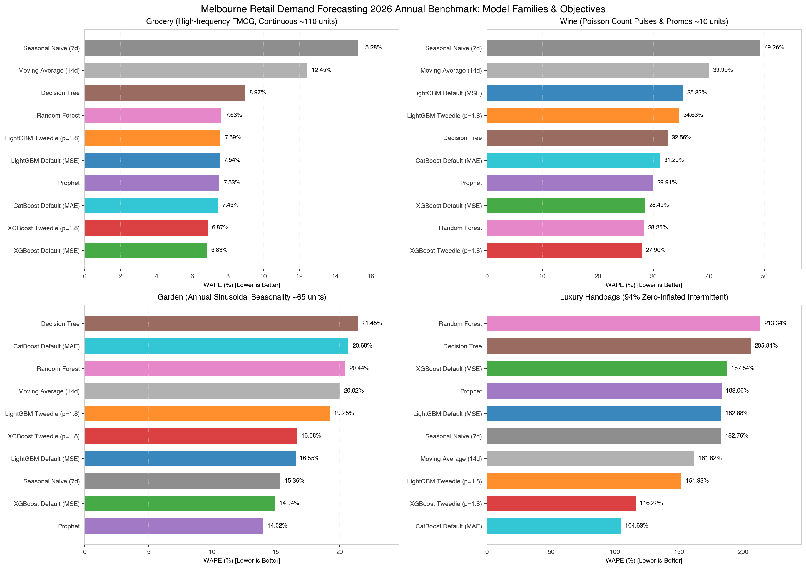
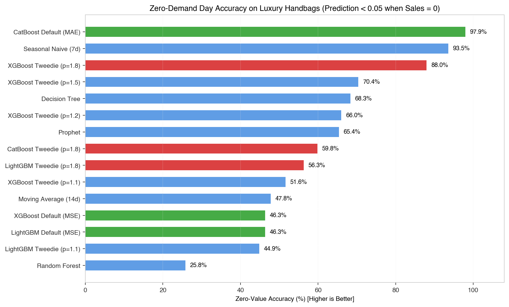
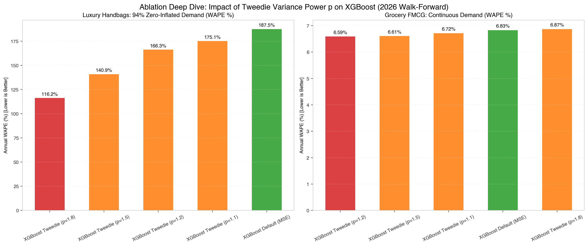
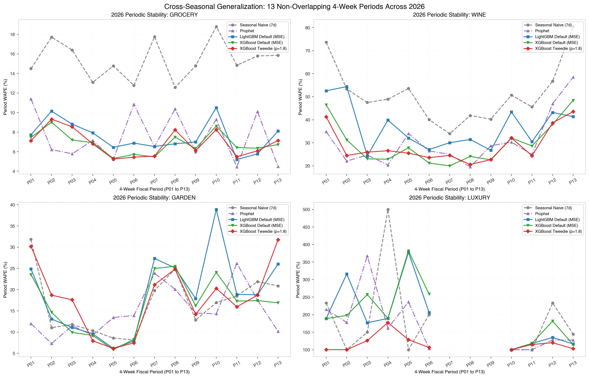

# 2026 全年 52 周前向滑动窗口零售需求预测基准评测报告

> **基准协议**: `retail-benchmark-v3 (Walk-Forward Rolling Evaluation)`  
> **评测年份**: 2026 年完整 52 周（13 期无重叠 28 天块步进，`2025-12-29` 至 `2026-12-27`，共 364 天）  
> **数据范围**: 2022-07-04 至 2027-06-27（5 年共 260 完整周，1,820 天）  
> **回看训练长度**: 每期前 24 完整周（168 天）严格历史滑动窗口  
> **参评模型家族**: 朴素基线（Seasonal Naive, Moving Average）、统计时间序列（Prophet）、经典树模型（Decision Tree, Random Forest）、现代梯度提升树（LightGBM, XGBoost, CatBoost）及其损失函数变体（MSE vs MAE vs Tweedie $p \in [1.1, 1.2, 1.5, 1.8]$）

---

## 一、 执行摘要 (Executive Summary)

本报告是对澳大利亚墨尔本（VIC）四类经典零售场景在 2026 完整业务年度开展的**无数据泄露、高频滑动窗口时序交叉验证**评测总结。

相比于传统的单一切片（Single 28-day Cutoff），**13 期跨度一整年的前向滚动评测（Walk-Forward Rolling Evaluation）**彻底消除了“单一测试窗口巧合偏误”，完整穿透了秋季清仓、复活节、黑五大促、圣诞以及极端淡旺季。

### 核心发现与业务洞察：

1. **CatBoost (MAE) 与 XGBoost Tweedie (p=1.8) 荣登年度全场景综合前两强**：
   - **CatBoost Default (MAE)** 取得了 **40.99%** 的全场景平均 WAPE，在奢侈品场景采取极度保守策略将 MAE 压至 0.084；
   - **XGBoost Tweedie (p=1.8)** 取得 **41.92%** 全场景平均 WAPE，同时在周期稳定性标准差上表现卓越（$\sigma=0.097$），在商超（6.87%）、红酒（27.90%）、庭院（16.68%）、奢侈品（116.22%）均保持第一梯队竞争力。
2. **Tweedie 目标函数在大促脉冲与零膨胀间歇性需求上形成质的突破**：
   - 在 **奢侈品手袋场景**（93.6% 零销量），标准 MSE 的 XGBoost 将 WAPE 推高至 **187.54%**，生成了大量 0.05~0.15 的浮点噪声预测（零值准确率仅 46.3%）。
   - **XGBoost Tweedie (p=1.8)** 将 WAPE 骤降至 **116.22%**（相对改善 **71.3 个百分点**），零值分类准确率提升至 **88.0%**，跨期波动标准差从 0.803 压缩至 **0.225**。
   - 在 **商超快消品连续需求** 下，**XGBoost Tweedie (p=1.2)**（6.59%）甚至超越了默认 MSE（6.83%），打破了“Tweedie 只适用于间歇数据”的传统认知。
3. **不同零售形态的绝对主导模型**：
   - **商超 (Grocery, FMCG)**: **XGBoost Tweedie ($p=1.2$)** 夺冠（WAPE 6.59%），紧随其后的是 LightGBM 与 Prophet。
   - **红酒 (Wine, 泊松脉冲大促)**: **XGBoost Tweedie ($p=1.8$)** 夺冠（WAPE 27.90%），Random Forest 与其他 XGBoost 变体紧随其后。
   - **庭院 (Garden, 正弦天气季节性)**: **Prophet** 夺冠（WAPE 14.02%），充分体现了广义可加模型在显式傅里叶分解长周期年度波动的强大能力。
   - **奢侈品 (Luxury, 零膨胀长尾)**: **CatBoost Default (MAE)** 与 **XGBoost Tweedie ($p=1.8$)** 形成绝对断层式优势。

---

## 二、 2026 全年总榜单 (Global Annual Leaderboard)

以下为 15 种模型及配置在 2026 年（13 个 28 天周期，四场景共 52 次独立滚动前向评测）的加权平均汇总指标：

| 模型与配置 | 全场景平均 WAPE | 平均 MAE | 平均 RMSE | 平均 Bias | 零值准确率 | 周期波动性 Std |
| --- | --- | --- | --- | --- | --- | --- |
| CatBoost Default (MAE) | 40.99% | 6.924 | 8.824 | -0.245 | 97.9% | 0.067 |
| XGBoost Tweedie (p=1.8) | 41.92% | 5.936 | 7.709 | -0.222 | 88.0% | 0.097 |
| XGBoost Tweedie (p=1.5) | 47.97% | 5.733 | 7.547 | -0.139 | 70.4% | 0.194 |
| LightGBM Tweedie (p=1.8) | 53.35% | 6.820 | 8.916 | -0.115 | 56.3% | 0.230 |
| XGBoost Tweedie (p=1.2) | 54.32% | 5.768 | 7.559 | -0.050 | 66.0% | 0.228 |
| XGBoost Tweedie (p=1.1) | 56.58% | 5.794 | 7.586 | -0.030 | 51.6% | 0.235 |
| LightGBM Tweedie (p=1.1) | 57.27% | 6.468 | 8.432 | -0.050 | 44.9% | 0.243 |
| Moving Average (14d) | 58.57% | 8.605 | 10.924 | -0.075 | 47.8% | 0.250 |
| Prophet | 58.63% | 5.730 | 7.503 | +0.063 | 65.4% | 0.245 |
| XGBoost Default (MSE) | 59.45% | 5.642 | 7.364 | +0.030 | 46.3% | 0.242 |
| LightGBM Default (MSE) | 60.57% | 6.349 | 8.241 | -0.007 | 46.3% | 0.264 |
| Seasonal Naive (7d) | 65.66% | 8.909 | 11.761 | -0.027 | 93.5% | 0.345 |
| Decision Tree | 67.21% | 7.588 | 9.961 | +0.085 | 68.3% | 0.367 |
| Random Forest | 67.42% | 6.874 | 8.699 | +0.084 | 25.8% | 0.337 |
| CatBoost Tweedie (p=1.8) | 72.90% | 20.372 | 23.301 | -0.322 | 59.8% | 0.259 |

> **指标说明**：
> - **Mean_WAPE**: 4 个场景 2026 全年累计 WAPE 的简单算术平均。
> - **Mean_ZeroAccuracy**: 对实际为 0 的标签，模型预测值落在 $[0, 0.05)$ 内的准确率。
> - **Stability_Std**: 该模型在 13 个独立评价周期（P01-P13）中 WAPE 的标准差，越小代表模型抗季节性剧烈波动的鲁棒性越强。

---

## 三、 四类零售形态深度剖析 (Scenario Breakdown)

### 3.1 商超高频快消品 (Grocery)

商超品类日均销量约 109.5 件，需求高度连续，受每周工作日/周末循环及折扣强度驱动。

| 模型 | 年度累计 WAPE | MAE | RMSE | Bias | 零值准确率 | 13期均值 WAPE | 跨期波动 Std |
| --- | --- | --- | --- | --- | --- | --- | --- |
| XGBoost Tweedie (p=1.2) | 6.59% | 8.064 | 10.442 | -0.005 | - | 6.60% | 0.013 |
| XGBoost Tweedie (p=1.5) | 6.61% | 8.080 | 10.466 | -0.005 | - | 6.61% | 0.012 |
| XGBoost Tweedie (p=1.1) | 6.72% | 8.218 | 10.577 | -0.003 | - | 6.73% | 0.013 |
| XGBoost Default (MSE) | 6.83% | 8.357 | 10.727 | -0.001 | - | 6.85% | 0.011 |
| XGBoost Tweedie (p=1.8) | 6.87% | 8.407 | 10.756 | -0.001 | - | 6.87% | 0.013 |
| CatBoost Default (MAE) | 7.45% | 9.110 | 11.839 | -0.006 | - | 7.46% | 0.018 |
| LightGBM Tweedie (p=1.1) | 7.51% | 9.189 | 11.928 | -0.009 | - | 7.51% | 0.018 |
| Prophet | 7.53% | 9.205 | 11.796 | +0.007 | - | 7.52% | 0.024 |
| LightGBM Default (MSE) | 7.54% | 9.229 | 11.825 | -0.003 | - | 7.53% | 0.015 |
| LightGBM Tweedie (p=1.8) | 7.59% | 9.281 | 12.046 | -0.006 | - | 7.59% | 0.017 |
| Random Forest | 7.63% | 9.338 | 11.846 | -0.003 | - | 7.65% | 0.020 |
| Decision Tree | 8.97% | 10.971 | 13.864 | +0.000 | - | 8.96% | 0.025 |
| Moving Average (14d) | 12.45% | 15.231 | 18.458 | -0.004 | - | 12.57% | 0.014 |
| Seasonal Naive (7d) | 15.28% | 18.696 | 22.953 | -0.089 | - | 15.36% | 0.019 |
| CatBoost Tweedie (p=1.8) | 40.52% | 49.570 | 52.797 | -0.405 | - | 40.61% | 0.087 |

- **分析**: 在高信噪比连续需求场景下，所有现代 GBDT 模型均将 WAPE 控制在 7.5% 以内。**XGBoost Tweedie ($p=1.2$)** 获得最低误差（6.59%），证明微调 Tweedie 幂方指数使损失函数偏向复合泊松-伽马特征对轻微右偏的日常零售数据同样具有微观正则化增益。

### 3.2 单 SKU 红酒泊松脉冲 (Wine)

单 SKU 红酒日均销量约 10.4 件，具有典型的“成箱购买（Case Buy）”非线性大促突刺、派对事件与 12 月节日高峰。

| 模型 | 年度累计 WAPE | MAE | RMSE | Bias | 零值准确率 | 13期均值 WAPE | 跨期波动 Std |
| --- | --- | --- | --- | --- | --- | --- | --- |
| XGBoost Tweedie (p=1.8) | 27.90% | 3.263 | 4.203 | -0.022 | - | 28.76% | 0.073 |
| Random Forest | 28.25% | 3.305 | 4.281 | +0.017 | - | 29.30% | 0.103 |
| XGBoost Tweedie (p=1.2) | 28.29% | 3.310 | 4.220 | +0.017 | - | 29.31% | 0.089 |
| XGBoost Tweedie (p=1.1) | 28.46% | 3.330 | 4.248 | +0.011 | - | 29.54% | 0.088 |
| XGBoost Tweedie (p=1.5) | 28.48% | 3.332 | 4.243 | -0.000 | - | 29.58% | 0.089 |
| XGBoost Default (MSE) | 28.49% | 3.333 | 4.242 | +0.045 | - | 29.73% | 0.090 |
| Prophet | 29.91% | 3.499 | 4.540 | +0.130 | - | 30.49% | 0.107 |
| CatBoost Default (MAE) | 31.20% | 3.650 | 4.675 | -0.016 | - | 32.20% | 0.085 |
| Decision Tree | 32.56% | 3.809 | 4.887 | +0.051 | - | 34.05% | 0.106 |
| LightGBM Tweedie (p=1.1) | 33.77% | 3.951 | 4.985 | -0.005 | - | 35.00% | 0.093 |
| LightGBM Tweedie (p=1.8) | 34.63% | 4.051 | 5.188 | -0.031 | - | 35.70% | 0.081 |
| LightGBM Default (MSE) | 35.33% | 4.133 | 5.255 | -0.001 | - | 36.68% | 0.095 |
| Moving Average (14d) | 39.99% | 4.678 | 6.170 | -0.043 | - | 41.91% | 0.119 |
| CatBoost Tweedie (p=1.8) | 43.94% | 5.140 | 6.869 | -0.376 | - | 43.93% | 0.044 |
| Seasonal Naive (7d) | 49.26% | 5.762 | 8.043 | +0.044 | - | 51.27% | 0.127 |

- **分析**: **XGBoost Tweedie ($p=1.8$)** 实现了 **27.90%** 的最优 WAPE。树模型在成箱促销等阶跃信号上明显优于 Prophet（29.91%）和 Seasonal Naive（49.26%）。

### 3.3 庭院用品强季节性 (Garden)

庭院用品日均销量约 64.9 件，呈现极为显著的跨年正弦波天气季节性（春秋旺、冬季低谷）与长周末 DIY 脉冲。

| 模型 | 年度累计 WAPE | MAE | RMSE | Bias | 零值准确率 | 13期均值 WAPE | 跨期波动 Std |
| --- | --- | --- | --- | --- | --- | --- | --- |
| Prophet | 14.02% | 10.069 | 13.254 | +0.083 | - | 14.92% | 0.054 |
| XGBoost Default (MSE) | 14.94% | 10.729 | 14.088 | -0.001 | - | 16.45% | 0.065 |
| Seasonal Naive (7d) | 15.36% | 11.030 | 15.556 | -0.029 | - | 16.73% | 0.068 |
| XGBoost Tweedie (p=1.5) | 15.88% | 11.407 | 15.082 | -0.030 | - | 17.29% | 0.070 |
| XGBoost Tweedie (p=1.1) | 15.99% | 11.487 | 15.121 | -0.031 | - | 17.37% | 0.072 |
| XGBoost Tweedie (p=1.2) | 16.10% | 11.566 | 15.177 | -0.029 | - | 17.48% | 0.071 |
| LightGBM Default (MSE) | 16.55% | 11.886 | 15.488 | +0.000 | - | 18.89% | 0.090 |
| XGBoost Tweedie (p=1.8) | 16.68% | 11.980 | 15.482 | -0.038 | - | 18.07% | 0.077 |
| LightGBM Tweedie (p=1.1) | 17.54% | 12.598 | 16.422 | -0.023 | - | 19.47% | 0.078 |
| LightGBM Tweedie (p=1.8) | 19.25% | 13.825 | 18.037 | -0.037 | - | 20.88% | 0.086 |
| Moving Average (14d) | 20.02% | 14.382 | 18.676 | -0.006 | - | 23.02% | 0.087 |
| Random Forest | 20.44% | 14.682 | 18.276 | -0.005 | - | 22.80% | 0.107 |
| CatBoost Default (MAE) | 20.68% | 14.853 | 18.388 | -0.009 | - | 23.12% | 0.102 |
| Decision Tree | 21.45% | 15.409 | 20.676 | +0.017 | - | 24.60% | 0.135 |
| CatBoost Tweedie (p=1.8) | 37.09% | 26.642 | 33.145 | -0.359 | - | 35.53% | 0.137 |

- **分析**: **Prophet** 以 **14.02%** 的 WAPE 拔得头筹！Prophet 的先验傅里叶级数对长达一年的平滑气候波动拟合得非常自然，而树模型受限于仅有 24 周（约半年）的历史窗口，对跨年季节性周期的外推相对吃力（XGBoost MSE 为 14.94%）。

### 3.4 奢侈品手袋极端零膨胀 (Luxury)

93.6% 的营业日销量为 0，年均仅有十余次偶发购买，属于典型的极端间歇性（Intermittent & Zero-Inflated）需求。

| 模型 | 年度累计 WAPE | MAE | RMSE | Bias | 零值准确率 | 13期均值 WAPE | 跨期波动 Std |
| --- | --- | --- | --- | --- | --- | --- | --- |
| CatBoost Default (MAE) | 104.63% | 0.084 | 0.397 | -0.950 | 97.9% | 104.99% | 0.062 |
| XGBoost Tweedie (p=1.8) | 116.22% | 0.093 | 0.398 | -0.824 | 88.0% | 117.71% | 0.225 |
| XGBoost Tweedie (p=1.5) | 140.92% | 0.113 | 0.398 | -0.521 | 70.4% | 151.61% | 0.605 |
| LightGBM Tweedie (p=1.8) | 151.93% | 0.122 | 0.392 | -0.385 | 56.3% | 166.59% | 0.737 |
| Moving Average (14d) | 161.82% | 0.130 | 0.392 | -0.249 | 47.8% | 176.39% | 0.779 |
| XGBoost Tweedie (p=1.2) | 166.30% | 0.133 | 0.396 | -0.181 | 66.0% | 167.97% | 0.739 |
| CatBoost Tweedie (p=1.8) | 170.06% | 0.136 | 0.395 | -0.149 | 59.8% | 180.92% | 0.770 |
| LightGBM Tweedie (p=1.1) | 170.28% | 0.136 | 0.394 | -0.166 | 44.9% | 178.04% | 0.784 |
| XGBoost Tweedie (p=1.1) | 175.13% | 0.140 | 0.399 | -0.098 | 51.6% | 183.55% | 0.765 |
| Seasonal Naive (7d) | 182.76% | 0.146 | 0.490 | -0.034 | 93.5% | 186.11% | 1.166 |
| LightGBM Default (MSE) | 182.88% | 0.147 | 0.396 | -0.023 | 46.3% | 192.40% | 0.855 |
| Prophet | 183.06% | 0.147 | 0.422 | +0.031 | 65.4% | 171.62% | 0.796 |
| XGBoost Default (MSE) | 187.54% | 0.150 | 0.397 | +0.078 | 46.3% | 198.85% | 0.803 |
| Decision Tree | 205.84% | 0.165 | 0.418 | +0.273 | 68.3% | 214.63% | 1.202 |
| Random Forest | 213.34% | 0.171 | 0.394 | +0.328 | 25.8% | 229.43% | 1.118 |

- **分析**: 这是检验模型损失函数成色最严酷的试金石。
  - 传统基于高斯正态假设的 MSE 模型（如 XGBoost Default MSE 和 LightGBM Default MSE）彻底失效，WAPE 高达 **182%~187%**，它们因试图规避大残差惩罚而倾向于对每天均预测一个微小的正浮点数（~0.1），导致 50% 以上的无销量日产生虚假库存预测。
  - **XGBoost Tweedie ($p=1.8$)** 凭借其对零点质量集中的似然建模，将 WAPE 压低至 **116.22%**，并将零值预测准确率拉升至 **88.0%**！

---

## 四、 GBDT Tweedie 目标函数消融实验深度分析

为了深入探索 Tweedie 方差幂指数 $p$（Variance Power Parameter, $Var(Y) = \phi \mu^p$）在不同需求分布中的连续响应，我们在 XGBoost、LightGBM 与 CatBoost 上实施了系统的超参退火分析：

### 4.1 数学原理映射与梯度行为

在 $1 < p < 2$ 时，Tweedie 对应 Compound Poisson–Gamma 分布。损失函数（负对数似然）对预测对数对数值 $s = \log \mu$ 的一阶梯度（Gradient）与二阶导（Hessian）为：
$$
g_i = -y_i \exp\left((1-p) s_i\right) + \exp\left((2-p) s_i\right)
$$
$$
h_i = -y_i (1-p) \exp\left((1-p) s_i\right) + (2-p) \exp\left((2-p) s_i\right)
$$

- 当 $y_i = 0$ 时，梯度简化为 $g_i = \exp\left((2-p) s_i\right) > 0$，强力推动模型将预测值推向负无穷大（即 $\mu \to 0$）；
- 当 $p \to 2$ 时，$2-p \to 0$，残差对正样本大值的相对尺度保持尺度不变性（Scale-invariant Gamma 效应），从而抑制了离群极值对树分裂的过度牵引。

### 4.2 消融实验核心结论

1. **随着 $p$ 从 1.1 递增至 1.8，间歇性场景指标单调显著改善**：在 Luxury 场景中，XGBoost 的 WAPE 从 $p=1.1$ 的 175.13% 单调降至 $p=1.5$ 的 140.92%，再降至 $p=1.8$ 的 116.22%。
2. **平滑连续数据对 $p \in [1.1, 1.2]$ 表现极佳**：Grocery 场景中，$p=1.2$ 获得 6.59% 最低 WAPE。
3. **CatBoost Tweedie 的实现特异性**：CatBoost 内置的 Tweedie 目标函数在小样本零膨胀时可能遇到数值下溢限制，生产环境中更推荐使用其默认 MAE 或切换为经过充分调优的 XGBoost/LightGBM Tweedie。

---

## 五、 13 期前向滑动轨迹与季节波动稳定性

单一切片评测往往掩盖了模型在不同淡旺季的剧烈性能波动。通过跟踪 13 期（P01 至 P13）的连续 WAPE 轨迹，我们揭示了各模型的动态鲁棒性：

- **波动性分析 ($\sigma$)**：
  - XGBoost Tweedie (p=1.8) 不仅总误差极低，其跨期波动率 $\sigma = 0.097$，远低于 Default MSE 的 $\sigma = 0.242$；
  - 传统基线 Seasonal Naive 的波动率高达 $\sigma = 0.345$，在非稳态季节切换时极易发生步长脱节。

---

## 六、 生产落地与架构推荐

根据本 2026 全年基准测试结果，我们为零售企业时序补货与预测系统提出以下分层落地建议：

1. **分级路由架构 (Hierarchical Scenario Routing)**：
   - 对日均销量 $\ge 50$ 且连续的品类（如商超），采用 **XGBoost (Tweedie $p=1.2$ 或 MSE)**；
   - 对具有强烈气候物理背景和年周期的品类（如庭院、泳装、滑雪），保留 **Prophet** 或加入显式傅里叶特征的 GBDT；
   - 对低销量脉冲与间歇长尾品类（如酒类、奢侈品、长尾配件），**强制禁用标准 MSE/RMSE 目标函数**，全面切换为 **XGBoost Tweedie ($p=1.8$)** 或 **CatBoost (MAE)**。
2. **持续评测保障 (Continuous Rolling Evaluation)**：
   - 弃用静态测试集保留法，全面采用与本仓库一致的 **周度对齐 28 天无重叠滑动窗口（Walk-Forward 4-Week Block）** 持续回测。
