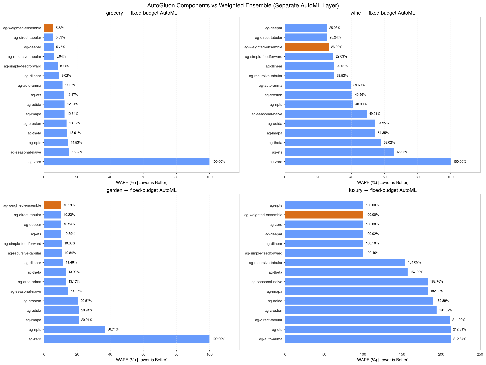
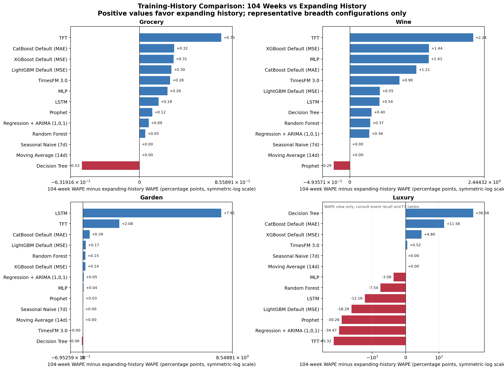

# 2026 零售周 V4 分阶段基准报告（第一阶段 + ARIMA + 神经模型 + AutoML + TimesFM）

本报告记录 `2026-retail-week-expanding-v4` 的首阶段审核结果，并使用
`2026-retail-week-104w-rolling-v4` 模拟每月以此前两年数据训练、预测随后 4 周的生产流程。正式评估覆盖
2025-12-29 至 2026-12-27，共 13 个互不重叠的 28 天 fold，也就是 52 个完整零售周
和 364 个评估日；它不是完整日历年。

当前发布包含基线、Prophet、ARIMA 动态回归、经典树、MLP、LSTM、TFT，以及
LightGBM、XGBoost、CatBoost 的默认配置与对称 Tweedie `p=1.1/1.2/1.5/1.8`
消融，以及 TimesFM 3.0 单变量代表和已知协变量消融，共 26 个普通模型配置。AutoGluon
另以固定 240 秒预算运行 15 个 `ag-*` 配置，只进入独立 AutoML 对比层，不占据普通广度榜名次。

## 1. 证据边界与主要结论

- 在全部 41 个普通与 AutoML 配置中，扩展历史相对固定 104 周在 Grocery、Wine、Garden
  分别取得 `30/4/7`、`32/2/7`、`23/13/5`（扩展历史胜 / 104 周胜 / 平局）。因此，
  两年滚动窗口在 Grocery 与 Wine 上多数略逊，但在 Garden 上并非单向劣化。
- 扩展历史下，ARIMA 在 Grocery、Wine、Garden 的 WAPE 分别为 `4.17%`、`22.10%`、
  `7.80%`，其中 Wine 与 Garden 为广度榜最低值，Grocery 与 Prophet 的 `4.16%` 接近。
  这只是当前合成机制和固定配置下的结果，不构成统计模型的一般优越性结论。
- 104 周生产滚动实验与扩展历史使用相同的模型配置、预测日期和已知未来信息，只改变
  每个 forecast origin 可见的训练历史范围。代表配置的 WAPE 差值中位数在 Grocery、
  Wine、Garden 分别为 `+0.18`、`+0.54`、`+0.05` 个百分点；Luxury 为 `-3.58`
  个百分点，但不同模型的方向并不一致，必须同时检查事件召回与 F1，不能只看 WAPE。
- 广度榜每个工具包只保留一个预先声明的代表配置；Tweedie power 的比较单列为配置
  消融，不重复占据工具包广度排名。
- AutoGluon 加权集成在扩展历史 Grocery、Garden 的 WAPE 为 `5.52%`、`10.19%`，
  但 Wine 的 `ag-deepar` 优于加权集成；Luxury 加权集成虽然 WAPE 为 `100%`，需求事件
  召回和 F1 均为 `0%`，本质是漏掉全部需求事件，不能视为有效胜出。
- TimesFM 3.0 单变量配置在 Grocery、Wine、Garden 的扩展历史 WAPE 为 `4.91%`、
  `24.29%`、`8.86%`；加入预测起点已知协变量后分别降至 `4.54%`、`22.69%`、
  `8.17%`。Luxury 两个配置的需求事件召回和 F1 仍均为 `0%`，因此该消融没有解决
  极端间歇需求的事件识别问题。
- 所有区间和 fold 分布只用于描述稳定性。本报告没有进行预注册的显著性检验，也不把
  bootstrap 描述区间表述为统计显著。

## 2. 主榜发布来源

<!-- BENCHMARK_BLOCK:provenance:START -->
> Benchmark ID: `2026-retail-week-expanding-v4` 
> Release ID: `20261106-timesfm-v1` 
> Protocol hash: `281307a393825938d595cf34f22be25c9a894f634ddbadcf073c2d82eea8612e` 
> Release manifest SHA-256: `4a086433f728cfa48ea301b4876a011ef1a6b4ca3b42eb32f55053224c34c51e` 
> Fold uncertainty intervals are descriptive; they are not claims of statistical significance.
<!-- BENCHMARK_BLOCK:provenance:END -->

模型执行使用冻结参数和正式评估开始前结束的选择窗口。发布快照只保存轻量预测、指标、
配置和 manifest；模型权重与临时训练产物不进入 Git。

## 3. 工具包广度榜

<!-- BENCHMARK_BLOCK:scenario_leaderboards:START -->
## grocery

| 模型 | 工具包 | 配置 | WAPE | MAE | RMSE | Bias | MASE | Fold WAPE median | Fold WAPE IQR |
| :--- | :--- | :--- | :--- | :--- | :--- | :--- | :--- | :--- | :--- |
| Prophet | prophet | default | 4.16% | 5.0931 | 6.4422 | 0.19% | 0.1864 | 0.0414 | 0.0058 |
| Regression + ARIMA (1,0,1) | statsmodels | default | 4.17% | 5.1005 | 6.4488 | 0.19% | 0.1867 | 0.0413 | 0.0062 |
| LSTM | pytorch_lstm | default | 4.44% | 5.4350 | 6.8335 | -0.19% | 0.1989 | 0.0424 | 0.0079 |
| MLP | pytorch_mlp | default | 4.66% | 5.6944 | 7.1760 | 0.81% | 0.2084 | 0.0478 | 0.0088 |
| TimesFM 3.0 | timesfm_3_0 | univariate | 4.91% | 6.0039 | 8.2953 | -0.65% | 0.2198 | 0.0479 | 0.0106 |
| TFT | pytorch_forecasting | default | 4.99% | 6.1063 | 7.8900 | -1.96% | 0.2235 | 0.0506 | 0.0076 |
| XGBoost Default (MSE) | xgboost | default | 5.01% | 6.1295 | 7.8354 | -1.17% | 0.2244 | 0.0485 | 0.0178 |
| CatBoost Default (MAE) | catboost | default | 5.05% | 6.1832 | 8.2256 | -1.33% | 0.2263 | 0.0512 | 0.0154 |
| LightGBM Default (MSE) | lightgbm | default | 5.31% | 6.5005 | 8.5586 | -1.48% | 0.2379 | 0.0533 | 0.0138 |
| Random Forest | random_forest | default | 5.39% | 6.5940 | 8.5277 | -1.67% | 0.2414 | 0.0546 | 0.0048 |
| Decision Tree | decision_tree | default | 6.95% | 8.5039 | 10.8132 | -1.51% | 0.3113 | 0.0672 | 0.0160 |
| Moving Average (14d) | moving_average | default | 12.45% | 15.2312 | 18.4582 | -0.38% | 0.5575 | 0.1240 | 0.0202 |
| Seasonal Naive (7d) | seasonal_naive | default | 15.28% | 18.6957 | 22.9534 | -8.89% | 0.6843 | 0.1484 | 0.0190 |

## wine

| 模型 | 工具包 | 配置 | WAPE | MAE | RMSE | Bias | MASE | Fold WAPE median | Fold WAPE IQR |
| :--- | :--- | :--- | :--- | :--- | :--- | :--- | :--- | :--- | :--- |
| Regression + ARIMA (1,0,1) | statsmodels | default | 22.10% | 2.5856 | 3.2650 | 2.14% | 0.4299 | 0.2127 | 0.0319 |
| Prophet | prophet | default | 22.78% | 2.6649 | 3.3746 | -1.03% | 0.4431 | 0.2223 | 0.0432 |
| LSTM | pytorch_lstm | default | 23.20% | 2.7146 | 3.4496 | 2.54% | 0.4514 | 0.2244 | 0.0489 |
| MLP | pytorch_mlp | default | 23.23% | 2.7173 | 3.4086 | 3.17% | 0.4518 | 0.2221 | 0.0473 |
| XGBoost Default (MSE) | xgboost | default | 23.94% | 2.8004 | 3.5918 | -2.26% | 0.4656 | 0.2278 | 0.0671 |
| TimesFM 3.0 | timesfm_3_0 | univariate | 24.29% | 2.8419 | 3.6736 | -2.51% | 0.4725 | 0.2320 | 0.0654 |
| TFT | pytorch_forecasting | default | 24.40% | 2.8544 | 3.5873 | 0.49% | 0.4746 | 0.2307 | 0.0588 |
| CatBoost Default (MAE) | catboost | default | 24.40% | 2.8551 | 3.7194 | -6.04% | 0.4747 | 0.2307 | 0.0692 |
| LightGBM Default (MSE) | lightgbm | default | 25.08% | 2.9346 | 3.7990 | -4.04% | 0.4879 | 0.2440 | 0.0786 |
| Random Forest | random_forest | default | 25.81% | 3.0190 | 3.8472 | 0.19% | 0.5020 | 0.2554 | 0.0344 |
| Decision Tree | decision_tree | default | 27.05% | 3.1644 | 4.0257 | -5.54% | 0.5261 | 0.2800 | 0.0726 |
| Moving Average (14d) | moving_average | default | 39.99% | 4.6780 | 6.1696 | -4.28% | 0.7778 | 0.4073 | 0.1260 |
| Seasonal Naive (7d) | seasonal_naive | default | 49.26% | 5.7624 | 8.0430 | 4.39% | 0.9581 | 0.4893 | 0.1176 |

## garden

| 模型 | 工具包 | 配置 | WAPE | MAE | RMSE | Bias | MASE | Fold WAPE median | Fold WAPE IQR |
| :--- | :--- | :--- | :--- | :--- | :--- | :--- | :--- | :--- | :--- |
| Regression + ARIMA (1,0,1) | statsmodels | default | 7.80% | 5.6053 | 6.9706 | -0.21% | 0.5901 | 0.0880 | 0.0630 |
| Prophet | prophet | default | 7.81% | 5.6108 | 6.9749 | -0.23% | 0.5906 | 0.0881 | 0.0628 |
| TFT | pytorch_forecasting | default | 8.76% | 6.2915 | 7.9981 | -1.11% | 0.6623 | 0.0975 | 0.0658 |
| MLP | pytorch_mlp | default | 8.82% | 6.3334 | 7.8508 | -0.62% | 0.6667 | 0.0942 | 0.0539 |
| CatBoost Default (MAE) | catboost | default | 8.86% | 6.3611 | 7.8148 | -1.59% | 0.6696 | 0.0889 | 0.0848 |
| TimesFM 3.0 | timesfm_3_0 | univariate | 8.86% | 6.3649 | 8.4272 | -0.58% | 0.6700 | 0.0869 | 0.0402 |
| XGBoost Default (MSE) | xgboost | default | 9.03% | 6.4864 | 8.0532 | -1.53% | 0.6828 | 0.0880 | 0.0855 |
| LightGBM Default (MSE) | lightgbm | default | 9.17% | 6.5871 | 8.0916 | -1.21% | 0.6934 | 0.0880 | 0.0747 |
| Random Forest | random_forest | default | 9.33% | 6.7041 | 8.2132 | -4.16% | 0.7057 | 0.1032 | 0.0773 |
| Decision Tree | decision_tree | default | 10.75% | 7.7236 | 9.4988 | -3.46% | 0.8130 | 0.1214 | 0.0724 |
| LSTM | pytorch_lstm | default | 11.43% | 8.2119 | 11.0806 | 3.44% | 0.8644 | 0.0994 | 0.0663 |
| Seasonal Naive (7d) | seasonal_naive | default | 15.36% | 11.0304 | 15.5556 | -2.92% | 1.1611 | 0.1695 | 0.0984 |
| Moving Average (14d) | moving_average | default | 20.02% | 14.3816 | 18.6762 | -0.62% | 1.5139 | 0.2301 | 0.1179 |

## luxury

| 模型 | 工具包 | 配置 | WAPE | MAE | ZeroRecall@0.5 | DemandRecall@0.5 | Event F1@0.5 | Positive-demand MAE |
| :--- | :--- | :--- | :--- | :--- | :--- | :--- | :--- | :--- |
| CatBoost Default (MAE) | catboost | default | 100.25% | 0.0803 | 100.00% | 4.76% | 9.09% | 1.3355 |
| TimesFM 3.0 | timesfm_3_0 | univariate | 100.35% | 0.0804 | 100.00% | 0.00% | 0.00% | 1.3807 |
| Moving Average (14d) | moving_average | default | 161.82% | 0.1296 | 100.00% | 0.00% | 0.00% | 1.2891 |
| Prophet | prophet | default | 172.55% | 0.1382 | 99.12% | 4.76% | 8.00% | 1.2954 |
| Seasonal Naive (7d) | seasonal_naive | default | 182.76% | 0.1464 | 93.55% | 9.52% | 8.89% | 1.2857 |
| TFT | pytorch_forecasting | default | 195.41% | 0.1565 | 99.71% | 0.00% | 0.00% | 1.2744 |
| MLP | pytorch_mlp | default | 202.14% | 0.1619 | 99.71% | 4.76% | 8.70% | 1.2361 |
| LSTM | pytorch_lstm | default | 204.49% | 0.1638 | 99.71% | 4.76% | 8.70% | 1.2357 |
| Regression + ARIMA (1,0,1) | statsmodels | default | 209.29% | 0.1677 | 99.12% | 9.52% | 15.38% | 1.2297 |
| XGBoost Default (MSE) | xgboost | default | 224.11% | 0.1795 | 98.24% | 0.00% | 0.00% | 1.2531 |
| Random Forest | random_forest | default | 225.78% | 0.1809 | 99.41% | 14.29% | 23.08% | 1.1967 |
| Decision Tree | decision_tree | default | 238.73% | 0.1912 | 96.77% | 9.52% | 11.76% | 1.2593 |
| LightGBM Default (MSE) | lightgbm | default | 239.15% | 0.1916 | 98.53% | 4.76% | 7.41% | 1.2444 |
<!-- BENCHMARK_BLOCK:scenario_leaderboards:END -->

Luxury 表必须联合阅读 WAPE、`ZeroRecall@0.5`、`DemandRecall@0.5`、事件 F1 和正需求
MAE。高零值召回可能仅表示模型倾向预测零，不能独立证明它识别了真实需求事件。

## 4. 配置消融

<!-- BENCHMARK_BLOCK:configuration_ablations:START -->
## grocery / catboost

| 模型 | 工具包 | 配置 | WAPE | MAE | RMSE | Bias | MASE | Fold WAPE median | Fold WAPE IQR |
| :--- | :--- | :--- | :--- | :--- | :--- | :--- | :--- | :--- | :--- |
| CatBoost Tweedie (p=1.2) | catboost | tweedie_p12 | 4.94% | 6.0435 | 7.7332 | -1.24% | 0.2212 | 0.0461 | 0.0116 |
| CatBoost Tweedie (p=1.5) | catboost | tweedie_p15 | 4.97% | 6.0820 | 7.7716 | -1.61% | 0.2226 | 0.0487 | 0.0148 |
| CatBoost Tweedie (p=1.1) | catboost | tweedie_p11 | 5.00% | 6.1199 | 7.7418 | -1.44% | 0.2240 | 0.0486 | 0.0078 |
| CatBoost Default (MAE) | catboost | default | 5.05% | 6.1832 | 8.2256 | -1.33% | 0.2263 | 0.0512 | 0.0154 |
| CatBoost Tweedie (p=1.8) | catboost | tweedie_p18 | 5.15% | 6.2981 | 8.0769 | -2.21% | 0.2305 | 0.0519 | 0.0161 |

## grocery / lightgbm

| 模型 | 工具包 | 配置 | WAPE | MAE | RMSE | Bias | MASE | Fold WAPE median | Fold WAPE IQR |
| :--- | :--- | :--- | :--- | :--- | :--- | :--- | :--- | :--- | :--- |
| LightGBM Default (MSE) | lightgbm | default | 5.31% | 6.5005 | 8.5586 | -1.48% | 0.2379 | 0.0533 | 0.0138 |
| LightGBM Tweedie (p=1.5) | lightgbm | tweedie_p15 | 5.37% | 6.5632 | 8.7291 | -1.95% | 0.2402 | 0.0557 | 0.0137 |
| LightGBM Tweedie (p=1.1) | lightgbm | tweedie_p11 | 5.40% | 6.6071 | 8.7282 | -1.78% | 0.2418 | 0.0548 | 0.0142 |
| LightGBM Tweedie (p=1.8) | lightgbm | tweedie_p18 | 5.44% | 6.6556 | 8.7709 | -1.88% | 0.2436 | 0.0558 | 0.0094 |
| LightGBM Tweedie (p=1.2) | lightgbm | tweedie_p12 | 5.55% | 6.7829 | 8.9827 | -1.96% | 0.2483 | 0.0567 | 0.0161 |

## grocery / timesfm_3_0

| 模型 | 工具包 | 配置 | WAPE | MAE | RMSE | Bias | MASE | Fold WAPE median | Fold WAPE IQR |
| :--- | :--- | :--- | :--- | :--- | :--- | :--- | :--- | :--- | :--- |
| TimesFM 3.0 + Known Covariates | timesfm_3_0 | known_covariates | 4.54% | 5.5501 | 7.1767 | -1.06% | 0.2032 | 0.0448 | 0.0058 |
| TimesFM 3.0 | timesfm_3_0 | univariate | 4.91% | 6.0039 | 8.2953 | -0.65% | 0.2198 | 0.0479 | 0.0106 |

## grocery / xgboost

| 模型 | 工具包 | 配置 | WAPE | MAE | RMSE | Bias | MASE | Fold WAPE median | Fold WAPE IQR |
| :--- | :--- | :--- | :--- | :--- | :--- | :--- | :--- | :--- | :--- |
| XGBoost Tweedie (p=1.1) | xgboost | tweedie_p11 | 4.86% | 5.9501 | 7.5671 | -1.22% | 0.2178 | 0.0513 | 0.0141 |
| XGBoost Tweedie (p=1.2) | xgboost | tweedie_p12 | 4.87% | 5.9590 | 7.5603 | -1.30% | 0.2181 | 0.0510 | 0.0118 |
| XGBoost Tweedie (p=1.5) | xgboost | tweedie_p15 | 4.92% | 6.0206 | 7.7636 | -1.48% | 0.2204 | 0.0499 | 0.0170 |
| XGBoost Default (MSE) | xgboost | default | 5.01% | 6.1295 | 7.8354 | -1.17% | 0.2244 | 0.0485 | 0.0178 |
| XGBoost Tweedie (p=1.8) | xgboost | tweedie_p18 | 5.03% | 6.1537 | 7.8465 | -1.32% | 0.2253 | 0.0514 | 0.0156 |

## wine / catboost

| 模型 | 工具包 | 配置 | WAPE | MAE | RMSE | Bias | MASE | Fold WAPE median | Fold WAPE IQR |
| :--- | :--- | :--- | :--- | :--- | :--- | :--- | :--- | :--- | :--- |
| CatBoost Tweedie (p=1.8) | catboost | tweedie_p18 | 23.26% | 2.7208 | 3.4742 | -4.10% | 0.4524 | 0.2271 | 0.0538 |
| CatBoost Tweedie (p=1.1) | catboost | tweedie_p11 | 23.65% | 2.7671 | 3.5196 | -2.94% | 0.4601 | 0.2380 | 0.0288 |
| CatBoost Tweedie (p=1.5) | catboost | tweedie_p15 | 23.67% | 2.7693 | 3.5554 | -3.75% | 0.4605 | 0.2351 | 0.0373 |
| CatBoost Tweedie (p=1.2) | catboost | tweedie_p12 | 24.06% | 2.8150 | 3.5914 | -3.82% | 0.4680 | 0.2397 | 0.0504 |
| CatBoost Default (MAE) | catboost | default | 24.40% | 2.8551 | 3.7194 | -6.04% | 0.4747 | 0.2307 | 0.0692 |

## wine / lightgbm

| 模型 | 工具包 | 配置 | WAPE | MAE | RMSE | Bias | MASE | Fold WAPE median | Fold WAPE IQR |
| :--- | :--- | :--- | :--- | :--- | :--- | :--- | :--- | :--- | :--- |
| LightGBM Tweedie (p=1.5) | lightgbm | tweedie_p15 | 23.92% | 2.7989 | 3.6101 | -4.02% | 0.4654 | 0.2329 | 0.0870 |
| LightGBM Tweedie (p=1.1) | lightgbm | tweedie_p11 | 23.96% | 2.8033 | 3.6476 | -3.58% | 0.4661 | 0.2366 | 0.0830 |
| LightGBM Tweedie (p=1.2) | lightgbm | tweedie_p12 | 24.21% | 2.8320 | 3.6899 | -4.43% | 0.4709 | 0.2364 | 0.0869 |
| LightGBM Tweedie (p=1.8) | lightgbm | tweedie_p18 | 24.48% | 2.8639 | 3.6991 | -5.54% | 0.4762 | 0.2332 | 0.0877 |
| LightGBM Default (MSE) | lightgbm | default | 25.08% | 2.9346 | 3.7990 | -4.04% | 0.4879 | 0.2440 | 0.0786 |

## wine / timesfm_3_0

| 模型 | 工具包 | 配置 | WAPE | MAE | RMSE | Bias | MASE | Fold WAPE median | Fold WAPE IQR |
| :--- | :--- | :--- | :--- | :--- | :--- | :--- | :--- | :--- | :--- |
| TimesFM 3.0 + Known Covariates | timesfm_3_0 | known_covariates | 22.69% | 2.6543 | 3.4164 | -3.11% | 0.4413 | 0.2219 | 0.0314 |
| TimesFM 3.0 | timesfm_3_0 | univariate | 24.29% | 2.8419 | 3.6736 | -2.51% | 0.4725 | 0.2320 | 0.0654 |

## wine / xgboost

| 模型 | 工具包 | 配置 | WAPE | MAE | RMSE | Bias | MASE | Fold WAPE median | Fold WAPE IQR |
| :--- | :--- | :--- | :--- | :--- | :--- | :--- | :--- | :--- | :--- |
| XGBoost Default (MSE) | xgboost | default | 23.94% | 2.8004 | 3.5918 | -2.26% | 0.4656 | 0.2278 | 0.0671 |
| XGBoost Tweedie (p=1.8) | xgboost | tweedie_p18 | 24.48% | 2.8639 | 3.7620 | -6.95% | 0.4762 | 0.2402 | 0.0863 |
| XGBoost Tweedie (p=1.1) | xgboost | tweedie_p11 | 24.63% | 2.8810 | 3.7107 | -4.92% | 0.4790 | 0.2476 | 0.0858 |
| XGBoost Tweedie (p=1.5) | xgboost | tweedie_p15 | 24.83% | 2.9049 | 3.8082 | -7.01% | 0.4830 | 0.2443 | 0.0934 |
| XGBoost Tweedie (p=1.2) | xgboost | tweedie_p12 | 24.83% | 2.9050 | 3.7344 | -5.26% | 0.4830 | 0.2451 | 0.0934 |

## garden / catboost

| 模型 | 工具包 | 配置 | WAPE | MAE | RMSE | Bias | MASE | Fold WAPE median | Fold WAPE IQR |
| :--- | :--- | :--- | :--- | :--- | :--- | :--- | :--- | :--- | :--- |
| CatBoost Tweedie (p=1.5) | catboost | tweedie_p15 | 8.73% | 6.2690 | 7.8811 | -3.02% | 0.6599 | 0.0878 | 0.0719 |
| CatBoost Tweedie (p=1.8) | catboost | tweedie_p18 | 8.85% | 6.3561 | 7.8965 | -3.21% | 0.6691 | 0.0853 | 0.0693 |
| CatBoost Default (MAE) | catboost | default | 8.86% | 6.3611 | 7.8148 | -1.59% | 0.6696 | 0.0889 | 0.0848 |
| CatBoost Tweedie (p=1.2) | catboost | tweedie_p12 | 8.96% | 6.4367 | 8.1183 | -3.32% | 0.6776 | 0.0873 | 0.0742 |
| CatBoost Tweedie (p=1.1) | catboost | tweedie_p11 | 9.07% | 6.5158 | 8.2189 | -3.24% | 0.6859 | 0.0934 | 0.0687 |

## garden / lightgbm

| 模型 | 工具包 | 配置 | WAPE | MAE | RMSE | Bias | MASE | Fold WAPE median | Fold WAPE IQR |
| :--- | :--- | :--- | :--- | :--- | :--- | :--- | :--- | :--- | :--- |
| LightGBM Tweedie (p=1.2) | lightgbm | tweedie_p12 | 9.15% | 6.5691 | 8.2037 | -2.28% | 0.6915 | 0.0896 | 0.0892 |
| LightGBM Default (MSE) | lightgbm | default | 9.17% | 6.5871 | 8.0916 | -1.21% | 0.6934 | 0.0880 | 0.0747 |
| LightGBM Tweedie (p=1.1) | lightgbm | tweedie_p11 | 9.21% | 6.6189 | 8.1860 | -2.52% | 0.6967 | 0.0946 | 0.0638 |
| LightGBM Tweedie (p=1.8) | lightgbm | tweedie_p18 | 9.32% | 6.6937 | 8.3763 | -2.98% | 0.7046 | 0.0855 | 0.0901 |
| LightGBM Tweedie (p=1.5) | lightgbm | tweedie_p15 | 9.39% | 6.7460 | 8.3332 | -2.56% | 0.7101 | 0.0924 | 0.0839 |

## garden / timesfm_3_0

| 模型 | 工具包 | 配置 | WAPE | MAE | RMSE | Bias | MASE | Fold WAPE median | Fold WAPE IQR |
| :--- | :--- | :--- | :--- | :--- | :--- | :--- | :--- | :--- | :--- |
| TimesFM 3.0 + Known Covariates | timesfm_3_0 | known_covariates | 8.17% | 5.8716 | 7.2434 | -0.22% | 0.6181 | 0.0874 | 0.0609 |
| TimesFM 3.0 | timesfm_3_0 | univariate | 8.86% | 6.3649 | 8.4272 | -0.58% | 0.6700 | 0.0869 | 0.0402 |

## garden / xgboost

| 模型 | 工具包 | 配置 | WAPE | MAE | RMSE | Bias | MASE | Fold WAPE median | Fold WAPE IQR |
| :--- | :--- | :--- | :--- | :--- | :--- | :--- | :--- | :--- | :--- |
| XGBoost Tweedie (p=1.8) | xgboost | tweedie_p18 | 8.88% | 6.3793 | 7.9584 | -2.95% | 0.6715 | 0.0874 | 0.0807 |
| XGBoost Tweedie (p=1.5) | xgboost | tweedie_p15 | 8.94% | 6.4216 | 8.0111 | -2.17% | 0.6760 | 0.0814 | 0.0890 |
| XGBoost Tweedie (p=1.2) | xgboost | tweedie_p12 | 8.97% | 6.4425 | 7.9938 | -2.06% | 0.6782 | 0.0842 | 0.0840 |
| XGBoost Tweedie (p=1.1) | xgboost | tweedie_p11 | 9.02% | 6.4817 | 8.0127 | -2.07% | 0.6823 | 0.0888 | 0.0902 |
| XGBoost Default (MSE) | xgboost | default | 9.03% | 6.4864 | 8.0532 | -1.53% | 0.6828 | 0.0880 | 0.0855 |

## luxury / catboost

| 模型 | 工具包 | 配置 | WAPE | MAE | ZeroRecall@0.5 | DemandRecall@0.5 | Event F1@0.5 | Positive-demand MAE |
| :--- | :--- | :--- | :--- | :--- | :--- | :--- | :--- | :--- |
| CatBoost Default (MAE) | catboost | default | 100.25% | 0.0803 | 100.00% | 4.76% | 9.09% | 1.3355 |
| CatBoost Tweedie (p=1.8) | catboost | tweedie_p18 | 186.46% | 0.1494 | 100.00% | 4.76% | 9.09% | 1.2322 |
| CatBoost Tweedie (p=1.5) | catboost | tweedie_p15 | 190.03% | 0.1522 | 100.00% | 0.00% | 0.00% | 1.2252 |
| CatBoost Tweedie (p=1.2) | catboost | tweedie_p12 | 198.23% | 0.1588 | 100.00% | 0.00% | 0.00% | 1.2227 |
| CatBoost Tweedie (p=1.1) | catboost | tweedie_p11 | 205.06% | 0.1643 | 100.00% | 0.00% | 0.00% | 1.2142 |

## luxury / lightgbm

| 模型 | 工具包 | 配置 | WAPE | MAE | ZeroRecall@0.5 | DemandRecall@0.5 | Event F1@0.5 | Positive-demand MAE |
| :--- | :--- | :--- | :--- | :--- | :--- | :--- | :--- | :--- |
| LightGBM Tweedie (p=1.8) | lightgbm | tweedie_p18 | 150.80% | 0.1208 | 100.00% | 0.00% | 0.00% | 1.2985 |
| LightGBM Tweedie (p=1.5) | lightgbm | tweedie_p15 | 161.70% | 0.1295 | 100.00% | 0.00% | 0.00% | 1.3018 |
| LightGBM Tweedie (p=1.2) | lightgbm | tweedie_p12 | 168.45% | 0.1349 | 100.00% | 0.00% | 0.00% | 1.3010 |
| LightGBM Tweedie (p=1.1) | lightgbm | tweedie_p11 | 172.96% | 0.1386 | 100.00% | 0.00% | 0.00% | 1.2950 |
| LightGBM Default (MSE) | lightgbm | default | 239.15% | 0.1916 | 98.53% | 4.76% | 7.41% | 1.2444 |

## luxury / timesfm_3_0

| 模型 | 工具包 | 配置 | WAPE | MAE | ZeroRecall@0.5 | DemandRecall@0.5 | Event F1@0.5 | Positive-demand MAE |
| :--- | :--- | :--- | :--- | :--- | :--- | :--- | :--- | :--- |
| TimesFM 3.0 | timesfm_3_0 | univariate | 100.35% | 0.0804 | 100.00% | 0.00% | 0.00% | 1.3807 |
| TimesFM 3.0 + Known Covariates | timesfm_3_0 | known_covariates | 100.41% | 0.0804 | 100.00% | 0.00% | 0.00% | 1.3800 |

## luxury / xgboost

| 模型 | 工具包 | 配置 | WAPE | MAE | ZeroRecall@0.5 | DemandRecall@0.5 | Event F1@0.5 | Positive-demand MAE |
| :--- | :--- | :--- | :--- | :--- | :--- | :--- | :--- | :--- |
| XGBoost Tweedie (p=1.8) | xgboost | tweedie_p18 | 109.29% | 0.0876 | 99.71% | 0.00% | 0.00% | 1.3789 |
| XGBoost Tweedie (p=1.5) | xgboost | tweedie_p15 | 128.79% | 0.1032 | 99.12% | 0.00% | 0.00% | 1.3508 |
| XGBoost Tweedie (p=1.2) | xgboost | tweedie_p12 | 164.77% | 0.1320 | 98.83% | 0.00% | 0.00% | 1.3113 |
| XGBoost Tweedie (p=1.1) | xgboost | tweedie_p11 | 185.16% | 0.1483 | 98.53% | 0.00% | 0.00% | 1.3065 |
| XGBoost Default (MSE) | xgboost | default | 224.11% | 0.1795 | 98.24% | 0.00% | 0.00% | 1.2531 |
<!-- BENCHMARK_BLOCK:configuration_ablations:END -->

配置表回答的是同一工具包内损失函数、Tweedie power 或已知协变量输入的敏感性问题，
不用于增加该工具包在广度榜中的投票权。完整图表位于：

- [扩展历史场景图](../../images/benchmarks/2026-retail-week-expanding-v4/20261106-timesfm-v1/fig-01-retail-week-leaderboard-all-scenarios.png)
- [扩展历史 Tweedie 消融图](../../images/benchmarks/2026-retail-week-expanding-v4/20261106-timesfm-v1/fig-03-gbdt-tweedie-ablation-deepdive.png)

## 5. 固定预算 AutoML 独立对比

AutoGluon 每个场景、每个 fold 共享一次最多 240 秒的 fit。表中所有模型统一使用 `ag-`
前缀，并且都完整覆盖 4 场景 × 13 folds。它们不进入第 3 节的普通工具包广度榜。

<!-- BENCHMARK_BLOCK:automl_vs_standard:START -->
| 场景 | 观察到的最佳普通广度模型 | 普通模型 WAPE | AutoML 输出 | AutoML WAPE | 差值 (AutoML-普通) | 普通模型 Event F1 | AutoML Event F1 |
| :--- | :--- | :--- | :--- | :--- | :--- | :--- | :--- |
| garden | Regression + ARIMA (1,0,1) | 7.80% | AG Weighted Ensemble | 10.19% | +2.39 pp | 100.00% | 100.00% |
| grocery | Prophet | 4.16% | AG Weighted Ensemble | 5.52% | +1.36 pp | 100.00% | 100.00% |
| luxury | CatBoost Default (MAE) | 100.25% | AG Weighted Ensemble | 100.00% | -0.25 pp | 9.09% | 0.00% |
| wine | Regression + ARIMA (1,0,1) | 22.10% | AG Weighted Ensemble | 26.20% | +4.10 pp | 100.00% | 100.00% |
<!-- BENCHMARK_BLOCK:automl_vs_standard:END -->

上表将 AutoGluon 已选择的加权集成与各场景中观察到的最佳普通广度配置并列，用于描述
“使用 AutoML 管线”与“不使用 AutoML 管线”的结果差异；它不是事前选择规则，也不代表
两个方案具有相同计算成本。

<!-- BENCHMARK_BLOCK:automl_scorecard:START -->
## grocery

| 模型 | WAPE | MAE | Coverage80 | 80% interval width | 80% pinball loss | Fold WAPE median | Fold WAPE IQR |
| :--- | :--- | :--- | :--- | :--- | :--- | :--- | :--- |
| AG Weighted Ensemble | 5.52% | 6.7580 | 95.07% | 47.3557 | 2.5322 | 0.0553 | 0.0154 |
| AG DirectTabular | 5.53% | 6.7681 | 97.97% | 77.6236 | 3.9374 | 0.0536 | 0.0090 |
| AG DeepAR | 5.75% | 7.0371 | 66.38% | 17.1773 | 1.7577 | 0.0590 | 0.0221 |
| AG RecursiveTabular | 5.94% | 7.2608 | 98.55% | 89.8882 | 4.5492 | 0.0590 | 0.0114 |
| AG SimpleFeedForward | 8.14% | 9.9571 | 82.03% | 33.0240 | 2.3345 | 0.0797 | 0.0247 |
| AG DLinear | 9.02% | 11.0377 | 76.23% | 32.9463 | 2.5542 | 0.0906 | 0.0089 |
| AG AutoARIMA | 11.07% | 13.5427 | 78.55% | 40.1865 | 2.9678 | 0.1108 | 0.0114 |
| AG ETS | 12.17% | 14.8901 | 98.84% | 119.4130 | 6.0480 | 0.1252 | 0.0248 |
| AG ADIDA | 12.34% | 15.0916 | 79.42% | 47.1989 | 3.1087 | 0.1237 | 0.0180 |
| AG IMAPA | 12.34% | 15.0916 | 79.42% | 47.1989 | 3.1087 | 0.1237 | 0.0180 |
| AG Croston | 13.59% | 16.6284 | 80.58% | 48.8249 | 3.5309 | 0.1364 | 0.0222 |
| AG Theta | 13.91% | 17.0123 | 99.13% | 121.5342 | 6.0935 | 0.1338 | 0.0255 |
| AG NPTS | 14.53% | 17.7739 | 76.81% | 52.1623 | 3.8197 | 0.1344 | 0.0349 |
| AG SeasonalNaive | 15.28% | 18.6899 | 96.52% | 118.3091 | 6.0859 | 0.1484 | 0.0148 |
| AG Zero | 100.00% | 122.3246 | 76.52% | 137.5710 | 8.4713 | 1.0000 | 0.0000 |

## wine

| 模型 | WAPE | MAE | Coverage80 | 80% interval width | 80% pinball loss | Fold WAPE median | Fold WAPE IQR |
| :--- | :--- | :--- | :--- | :--- | :--- | :--- | :--- |
| AG DeepAR | 25.03% | 2.9287 | 68.78% | 7.4799 | 0.6665 | 0.2475 | 0.0606 |
| AG DirectTabular | 25.24% | 2.9526 | 96.96% | 25.8253 | 1.3360 | 0.2416 | 0.0621 |
| AG Weighted Ensemble | 26.20% | 3.0647 | 94.20% | 16.3570 | 0.8877 | 0.2422 | 0.1317 |
| AG SimpleFeedForward | 29.03% | 3.3959 | 83.15% | 11.7263 | 0.7719 | 0.2547 | 0.1257 |
| AG DLinear | 29.51% | 3.4520 | 79.56% | 11.0236 | 0.7681 | 0.2793 | 0.1341 |
| AG RecursiveTabular | 29.52% | 3.4539 | 98.07% | 29.5030 | 1.5005 | 0.2818 | 0.0864 |
| AG AutoARIMA | 39.69% | 4.6436 | 84.25% | 16.5809 | 1.0420 | 0.4018 | 0.1564 |
| AG Croston | 40.56% | 4.7455 | 80.39% | 14.4457 | 1.0935 | 0.4118 | 0.1336 |
| AG NPTS | 40.90% | 4.7845 | 81.22% | 14.8066 | 1.0318 | 0.4081 | 0.0727 |
| AG SeasonalNaive | 49.21% | 5.7569 | 91.44% | 28.3877 | 1.6341 | 0.4893 | 0.1176 |
| AG ADIDA | 54.35% | 6.3585 | 80.11% | 19.4931 | 1.2003 | 0.5169 | 0.1025 |
| AG IMAPA | 54.35% | 6.3585 | 80.11% | 19.4931 | 1.2003 | 0.5169 | 0.1025 |
| AG Theta | 58.02% | 6.7879 | 95.03% | 31.8363 | 1.6387 | 0.5541 | 0.1359 |
| AG ETS | 65.95% | 7.7150 | 91.71% | 29.4265 | 1.5818 | 0.6544 | 0.1704 |
| AG Zero | 100.00% | 11.6989 | 80.94% | 16.3867 | 1.4160 | 1.0000 | 0.0000 |

## garden

| 模型 | WAPE | MAE | Coverage80 | 80% interval width | 80% pinball loss | Fold WAPE median | Fold WAPE IQR |
| :--- | :--- | :--- | :--- | :--- | :--- | :--- | :--- |
| AG Weighted Ensemble | 10.19% | 7.3197 | 90.06% | 31.8988 | 1.8348 | 0.1105 | 0.0689 |
| AG DirectTabular | 10.23% | 7.3474 | 97.51% | 72.6931 | 3.6858 | 0.0991 | 0.0355 |
| AG DeepAR | 10.24% | 7.3564 | 64.64% | 17.5980 | 1.7439 | 0.1139 | 0.0666 |
| AG ETS | 10.39% | 7.4652 | 90.06% | 31.0106 | 1.8055 | 0.0943 | 0.0661 |
| AG SimpleFeedForward | 10.63% | 7.6373 | 77.62% | 23.8511 | 1.7910 | 0.1147 | 0.0675 |
| AG RecursiveTabular | 10.84% | 7.7873 | 97.79% | 79.2299 | 3.9953 | 0.1067 | 0.0674 |
| AG DLinear | 11.48% | 8.2441 | 84.53% | 31.7124 | 1.9758 | 0.1182 | 0.0727 |
| AG Theta | 13.09% | 9.4022 | 98.34% | 61.8879 | 3.2201 | 0.1458 | 0.0475 |
| AG AutoARIMA | 13.17% | 9.4578 | 78.18% | 29.5132 | 2.1801 | 0.1523 | 0.0761 |
| AG SeasonalNaive | 14.57% | 10.4669 | 91.44% | 49.9011 | 2.8321 | 0.1695 | 0.0984 |
| AG Croston | 20.57% | 14.7751 | 80.39% | 51.8738 | 3.5334 | 0.2415 | 0.1093 |
| AG ADIDA | 20.91% | 15.0214 | 80.66% | 50.2129 | 3.3899 | 0.2321 | 0.1489 |
| AG IMAPA | 20.91% | 15.0214 | 80.66% | 50.2129 | 3.3899 | 0.2321 | 0.1489 |
| AG NPTS | 36.74% | 26.3923 | 82.32% | 74.7597 | 4.6482 | 0.3745 | 0.2108 |
| AG Zero | 100.00% | 71.8287 | 66.30% | 90.9917 | 8.0137 | 1.0000 | 0.0000 |

## luxury

| 模型 | WAPE | MAE | ZeroRecall@0.5 | DemandRecall@0.5 | Event F1@0.5 | Positive-demand MAE | Coverage80 | 80% interval width | 80% pinball loss |
| :--- | :--- | :--- | :--- | :--- | :--- | :--- | :--- | :--- | :--- |
| AG NPTS | 100.00% | 0.0801 | 100.00% | 0.00% | 0.00% | 1.3810 | 94.20% | 0.1133 | 0.0430 |
| AG Weighted Ensemble | 100.00% | 0.0801 | 100.00% | 0.00% | 0.00% | 1.3810 | 94.20% | 0.1133 | 0.0430 |
| AG Zero | 100.00% | 0.0801 | 100.00% | 0.00% | 0.00% | 1.3810 | 94.20% | 0.0000 | 0.0401 |
| AG DeepAR | 100.02% | 0.0801 | 100.00% | 0.00% | 0.00% | 1.3809 | 93.92% | 0.0002 | 0.0401 |
| AG DLinear | 100.10% | 0.0802 | 100.00% | 0.00% | 0.00% | 1.3808 | 93.65% | 0.0004 | 0.0401 |
| AG SimpleFeedForward | 100.19% | 0.0803 | 100.00% | 0.00% | 0.00% | 1.3808 | 93.65% | 0.0008 | 0.0401 |
| AG RecursiveTabular | 154.05% | 0.1234 | 96.19% | 9.52% | 11.11% | 1.2551 | 95.03% | 1.2761 | 0.0728 |
| AG Theta | 157.09% | 0.1258 | 100.00% | 0.00% | 0.00% | 1.2980 | 94.20% | 0.7724 | 0.0558 |
| AG SeasonalNaive | 182.76% | 0.1464 | 93.55% | 9.52% | 8.89% | 1.2857 | 95.03% | 1.5565 | 0.0879 |
| AG IMAPA | 182.88% | 0.1465 | 100.00% | 0.00% | 0.00% | 1.2935 | 80.94% | 0.1859 | 0.0462 |
| AG ADIDA | 189.89% | 0.1521 | 100.00% | 0.00% | 0.00% | 1.2966 | 87.29% | 0.1839 | 0.0445 |
| AG Croston | 194.32% | 0.1557 | 100.00% | 0.00% | 0.00% | 1.2986 | 80.11% | 0.1876 | 0.0448 |
| AG DirectTabular | 211.20% | 0.1692 | 99.41% | 0.00% | 0.00% | 1.2759 | 97.24% | 1.4324 | 0.0810 |
| AG ETS | 212.31% | 0.1701 | 100.00% | 0.00% | 0.00% | 1.2793 | 94.20% | 0.7774 | 0.0564 |
| AG AutoARIMA | 212.34% | 0.1701 | 100.00% | 0.00% | 0.00% | 1.2793 | 94.20% | 0.7767 | 0.0563 |
<!-- BENCHMARK_BLOCK:automl_scorecard:END -->

加权集成的内部验证选择不保证在正式测试上优于每个组件，因此本报告同时展示组件，但不根据
正式测试结果事后替换已选择的集成。区间指标是 AutoGluon 的原生 10%–90% 分位数诊断，
不能直接解释为库存服务水平。

## 6. 生产式训练历史比较：104 周训练 → 4 周预测

<!-- BENCHMARK_BLOCK:history_provenance:START -->
> Comparison ID: `2026-retail-week-expanding-v4--vs--2026-retail-week-104w-rolling-v4` 
> Release ID: `20261106-timesfm-v1` 
> Main source: `2026-retail-week-expanding-v4` / `20261106-timesfm-v1` 
> Fixed-window source: `2026-retail-week-104w-rolling-v4` / `20261106-timesfm-v1` 
> Comparison release manifest SHA-256: `3711fa3d1cbc6f3a8874d3a7f534cb374cf3168d7b23941a0aa056508508c385` 
> WAPE differences are paired descriptive results, not statistical significance claims.
<!-- BENCHMARK_BLOCK:history_provenance:END -->

<!-- BENCHMARK_BLOCK:history_policy_summary:START -->
| 场景 | 配置数 | 扩展历史胜 | 104 周胜 | 平局 | WAPE 差值中位数 (104w-expanding) | 广度配置 WAPE 差值中位数 |
| :--- | :--- | :--- | :--- | :--- | :--- | :--- |
| garden | 41 | 23 | 13 | 5 | +0.03 pp | +0.05 pp |
| grocery | 41 | 30 | 4 | 7 | +0.19 pp | +0.18 pp |
| luxury | 41 | 17 | 19 | 5 | +0.00 pp | -3.58 pp |
| wine | 41 | 32 | 2 | 7 | +0.75 pp | +0.54 pp |
<!-- BENCHMARK_BLOCK:history_policy_summary:END -->

正差值表示 104 周 WAPE 更高，因而扩展历史更好；负差值表示 104 周结果更低。该方向只描述
相同模型、场景和评估日期下的配对差异，不跨不同需求尺度计算总冠军。

<!-- BENCHMARK_BLOCK:history_policy_breadth:START -->
## grocery

| 代表模型 | 工具包 | 扩展历史 WAPE | 104 周 WAPE | 差值 | WAPE 胜者 |
| :--- | :--- | :--- | :--- | :--- | :--- |
| TFT | pytorch_forecasting | 4.99% | 5.75% | +0.75 pp | expanding |
| CatBoost Default (MAE) | catboost | 5.05% | 5.37% | +0.32 pp | expanding |
| XGBoost Default (MSE) | xgboost | 5.01% | 5.33% | +0.31 pp | expanding |
| LightGBM Default (MSE) | lightgbm | 5.31% | 5.61% | +0.30 pp | expanding |
| TimesFM 3.0 | timesfm_3_0 | 4.91% | 5.19% | +0.28 pp | expanding |
| MLP | pytorch_mlp | 4.66% | 4.91% | +0.26 pp | expanding |
| LSTM | pytorch_lstm | 4.44% | 4.62% | +0.18 pp | expanding |
| Prophet | prophet | 4.16% | 4.28% | +0.12 pp | expanding |
| Regression + ARIMA (1,0,1) | statsmodels | 4.17% | 4.26% | +0.09 pp | expanding |
| Random Forest | random_forest | 5.39% | 5.45% | +0.05 pp | expanding |
| Moving Average (14d) | moving_average | 12.45% | 12.45% | +0.00 pp | tie |
| Seasonal Naive (7d) | seasonal_naive | 15.28% | 15.28% | +0.00 pp | tie |
| Decision Tree | decision_tree | 6.95% | 6.42% | -0.53 pp | sliding_104w |

## wine

| 代表模型 | 工具包 | 扩展历史 WAPE | 104 周 WAPE | 差值 | WAPE 胜者 |
| :--- | :--- | :--- | :--- | :--- | :--- |
| TFT | pytorch_forecasting | 24.40% | 26.64% | +2.24 pp | expanding |
| XGBoost Default (MSE) | xgboost | 23.94% | 25.38% | +1.44 pp | expanding |
| MLP | pytorch_mlp | 23.23% | 24.66% | +1.43 pp | expanding |
| CatBoost Default (MAE) | catboost | 24.40% | 25.61% | +1.21 pp | expanding |
| TimesFM 3.0 | timesfm_3_0 | 24.29% | 25.19% | +0.90 pp | expanding |
| LightGBM Default (MSE) | lightgbm | 25.08% | 25.63% | +0.55 pp | expanding |
| LSTM | pytorch_lstm | 23.20% | 23.74% | +0.54 pp | expanding |
| Decision Tree | decision_tree | 27.05% | 27.44% | +0.40 pp | expanding |
| Random Forest | random_forest | 25.81% | 26.18% | +0.37 pp | expanding |
| Regression + ARIMA (1,0,1) | statsmodels | 22.10% | 22.46% | +0.36 pp | expanding |
| Moving Average (14d) | moving_average | 39.99% | 39.99% | +0.00 pp | tie |
| Seasonal Naive (7d) | seasonal_naive | 49.26% | 49.26% | +0.00 pp | tie |
| Prophet | prophet | 22.78% | 22.49% | -0.29 pp | sliding_104w |

## garden

| 代表模型 | 工具包 | 扩展历史 WAPE | 104 周 WAPE | 差值 | WAPE 胜者 |
| :--- | :--- | :--- | :--- | :--- | :--- |
| LSTM | pytorch_lstm | 11.43% | 19.34% | +7.91 pp | expanding |
| TFT | pytorch_forecasting | 8.76% | 10.84% | +2.08 pp | expanding |
| CatBoost Default (MAE) | catboost | 8.86% | 9.25% | +0.39 pp | expanding |
| LightGBM Default (MSE) | lightgbm | 9.17% | 9.34% | +0.17 pp | expanding |
| Random Forest | random_forest | 9.33% | 9.48% | +0.15 pp | expanding |
| XGBoost Default (MSE) | xgboost | 9.03% | 9.17% | +0.14 pp | expanding |
| Regression + ARIMA (1,0,1) | statsmodels | 7.80% | 7.85% | +0.05 pp | expanding |
| MLP | pytorch_mlp | 8.82% | 8.86% | +0.04 pp | expanding |
| Prophet | prophet | 7.81% | 7.84% | +0.03 pp | expanding |
| Moving Average (14d) | moving_average | 20.02% | 20.02% | +0.00 pp | tie |
| Seasonal Naive (7d) | seasonal_naive | 15.36% | 15.36% | +0.00 pp | tie |
| TimesFM 3.0 | timesfm_3_0 | 8.86% | 8.86% | -0.00 pp | sliding_104w |
| Decision Tree | decision_tree | 10.75% | 10.70% | -0.06 pp | sliding_104w |

## luxury

| 代表模型 | 工具包 | 扩展历史 WAPE | 104 周 WAPE | 差值 | WAPE 胜者 | 扩展历史 Event F1 | 104 周 Event F1 |
| :--- | :--- | :--- | :--- | :--- | :--- | :--- | :--- |
| Decision Tree | decision_tree | 238.73% | 275.31% | +36.58 pp | expanding | 11.76% | 13.56% |
| CatBoost Default (MAE) | catboost | 100.25% | 111.81% | +11.56 pp | expanding | 9.09% | 16.00% |
| XGBoost Default (MSE) | xgboost | 224.11% | 228.91% | +4.80 pp | expanding | 0.00% | 8.33% |
| TimesFM 3.0 | timesfm_3_0 | 100.35% | 100.87% | +0.52 pp | expanding | 0.00% | 0.00% |
| Moving Average (14d) | moving_average | 161.82% | 161.82% | +0.00 pp | tie | 0.00% | 0.00% |
| Seasonal Naive (7d) | seasonal_naive | 182.76% | 182.76% | +0.00 pp | tie | 8.89% | 8.89% |
| MLP | pytorch_mlp | 202.14% | 198.56% | -3.58 pp | sliding_104w | 8.70% | 8.70% |
| Random Forest | random_forest | 225.78% | 218.24% | -7.54 pp | sliding_104w | 23.08% | 23.08% |
| LSTM | pytorch_lstm | 204.49% | 192.33% | -12.16 pp | sliding_104w | 8.70% | 0.00% |
| LightGBM Default (MSE) | lightgbm | 239.15% | 220.86% | -18.29 pp | sliding_104w | 7.41% | 7.14% |
| Prophet | prophet | 172.55% | 142.28% | -30.26 pp | sliding_104w | 8.00% | 0.00% |
| Regression + ARIMA (1,0,1) | statsmodels | 209.29% | 174.82% | -34.47 pp | sliding_104w | 15.38% | 9.09% |
| TFT | pytorch_forecasting | 195.41% | 150.09% | -45.32 pp | sliding_104w | 0.00% | 9.09% |
<!-- BENCHMARK_BLOCK:history_policy_breadth:END -->

### 配置消融的训练历史差异

<!-- BENCHMARK_BLOCK:history_policy_ablations:START -->
## grocery

| 消融配置 | 工具包 | 扩展历史 WAPE | 104 周 WAPE | 差值 | WAPE 胜者 |
| :--- | :--- | :--- | :--- | :--- | :--- |
| CatBoost Tweedie (p=1.1) | catboost | 5.00% | 17.03% | +12.02 pp | expanding |
| CatBoost Tweedie (p=1.2) | catboost | 4.94% | 12.19% | +7.25 pp | expanding |
| CatBoost Tweedie (p=1.5) | catboost | 4.97% | 8.78% | +3.80 pp | expanding |
| CatBoost Tweedie (p=1.8) | catboost | 5.15% | 7.48% | +2.33 pp | expanding |
| LightGBM Tweedie (p=1.1) | lightgbm | 5.40% | 5.70% | +0.30 pp | expanding |
| LightGBM Tweedie (p=1.5) | lightgbm | 5.37% | 5.64% | +0.28 pp | expanding |
| LightGBM Tweedie (p=1.2) | lightgbm | 5.55% | 5.75% | +0.21 pp | expanding |
| LightGBM Tweedie (p=1.8) | lightgbm | 5.44% | 5.61% | +0.17 pp | expanding |
| TimesFM 3.0 + Known Covariates | timesfm_3_0 | 4.54% | 4.93% | +0.39 pp | expanding |
| XGBoost Tweedie (p=1.2) | xgboost | 4.87% | 5.28% | +0.41 pp | expanding |
| XGBoost Tweedie (p=1.1) | xgboost | 4.86% | 5.20% | +0.34 pp | expanding |
| XGBoost Tweedie (p=1.8) | xgboost | 5.03% | 5.19% | +0.16 pp | expanding |
| XGBoost Tweedie (p=1.5) | xgboost | 4.92% | 5.04% | +0.12 pp | expanding |

## wine

| 消融配置 | 工具包 | 扩展历史 WAPE | 104 周 WAPE | 差值 | WAPE 胜者 |
| :--- | :--- | :--- | :--- | :--- | :--- |
| CatBoost Tweedie (p=1.8) | catboost | 23.26% | 24.93% | +1.68 pp | expanding |
| CatBoost Tweedie (p=1.1) | catboost | 23.65% | 25.32% | +1.67 pp | expanding |
| CatBoost Tweedie (p=1.5) | catboost | 23.67% | 24.97% | +1.29 pp | expanding |
| CatBoost Tweedie (p=1.2) | catboost | 24.06% | 25.27% | +1.21 pp | expanding |
| LightGBM Tweedie (p=1.1) | lightgbm | 23.96% | 25.68% | +1.71 pp | expanding |
| LightGBM Tweedie (p=1.2) | lightgbm | 24.21% | 25.55% | +1.34 pp | expanding |
| LightGBM Tweedie (p=1.5) | lightgbm | 23.92% | 24.94% | +1.02 pp | expanding |
| LightGBM Tweedie (p=1.8) | lightgbm | 24.48% | 25.16% | +0.68 pp | expanding |
| TimesFM 3.0 + Known Covariates | timesfm_3_0 | 22.69% | 23.98% | +1.30 pp | expanding |
| XGBoost Tweedie (p=1.8) | xgboost | 24.48% | 25.84% | +1.36 pp | expanding |
| XGBoost Tweedie (p=1.5) | xgboost | 24.83% | 25.46% | +0.63 pp | expanding |
| XGBoost Tweedie (p=1.1) | xgboost | 24.63% | 24.98% | +0.36 pp | expanding |
| XGBoost Tweedie (p=1.2) | xgboost | 24.83% | 24.99% | +0.16 pp | expanding |

## garden

| 消融配置 | 工具包 | 扩展历史 WAPE | 104 周 WAPE | 差值 | WAPE 胜者 |
| :--- | :--- | :--- | :--- | :--- | :--- |
| CatBoost Tweedie (p=1.8) | catboost | 8.85% | 9.55% | +0.70 pp | expanding |
| CatBoost Tweedie (p=1.5) | catboost | 8.73% | 8.76% | +0.03 pp | expanding |
| CatBoost Tweedie (p=1.2) | catboost | 8.96% | 8.80% | -0.16 pp | sliding_104w |
| CatBoost Tweedie (p=1.1) | catboost | 9.07% | 8.80% | -0.27 pp | sliding_104w |
| LightGBM Tweedie (p=1.1) | lightgbm | 9.21% | 9.10% | -0.12 pp | sliding_104w |
| LightGBM Tweedie (p=1.8) | lightgbm | 9.32% | 9.09% | -0.23 pp | sliding_104w |
| LightGBM Tweedie (p=1.2) | lightgbm | 9.15% | 8.87% | -0.27 pp | sliding_104w |
| LightGBM Tweedie (p=1.5) | lightgbm | 9.39% | 9.12% | -0.28 pp | sliding_104w |
| TimesFM 3.0 + Known Covariates | timesfm_3_0 | 8.17% | 8.55% | +0.37 pp | expanding |
| XGBoost Tweedie (p=1.8) | xgboost | 8.88% | 9.44% | +0.56 pp | expanding |
| XGBoost Tweedie (p=1.5) | xgboost | 8.94% | 9.35% | +0.41 pp | expanding |
| XGBoost Tweedie (p=1.2) | xgboost | 8.97% | 9.10% | +0.13 pp | expanding |
| XGBoost Tweedie (p=1.1) | xgboost | 9.02% | 8.80% | -0.23 pp | sliding_104w |

## luxury

| 消融配置 | 工具包 | 扩展历史 WAPE | 104 周 WAPE | 差值 | WAPE 胜者 | 扩展历史 Event F1 | 104 周 Event F1 |
| :--- | :--- | :--- | :--- | :--- | :--- | :--- | :--- |
| CatBoost Tweedie (p=1.8) | catboost | 186.46% | 196.71% | +10.25 pp | expanding | 9.09% | 16.67% |
| CatBoost Tweedie (p=1.2) | catboost | 198.23% | 207.72% | +9.48 pp | expanding | 0.00% | 8.70% |
| CatBoost Tweedie (p=1.1) | catboost | 205.06% | 209.56% | +4.50 pp | expanding | 0.00% | 16.00% |
| CatBoost Tweedie (p=1.5) | catboost | 190.03% | 191.72% | +1.69 pp | expanding | 0.00% | 17.39% |
| LightGBM Tweedie (p=1.8) | lightgbm | 150.80% | 154.47% | +3.67 pp | expanding | 0.00% | 0.00% |
| LightGBM Tweedie (p=1.5) | lightgbm | 161.70% | 160.63% | -1.08 pp | sliding_104w | 0.00% | 0.00% |
| LightGBM Tweedie (p=1.2) | lightgbm | 168.45% | 164.43% | -4.02 pp | sliding_104w | 0.00% | 0.00% |
| LightGBM Tweedie (p=1.1) | lightgbm | 172.96% | 161.84% | -11.12 pp | sliding_104w | 0.00% | 0.00% |
| TimesFM 3.0 + Known Covariates | timesfm_3_0 | 100.41% | 100.47% | +0.06 pp | expanding | 0.00% | 0.00% |
| XGBoost Tweedie (p=1.2) | xgboost | 164.77% | 182.84% | +18.07 pp | expanding | 0.00% | 14.29% |
| XGBoost Tweedie (p=1.5) | xgboost | 128.79% | 146.28% | +17.49 pp | expanding | 0.00% | 7.69% |
| XGBoost Tweedie (p=1.8) | xgboost | 109.29% | 108.42% | -0.87 pp | sliding_104w | 0.00% | 0.00% |
| XGBoost Tweedie (p=1.1) | xgboost | 185.16% | 170.89% | -14.27 pp | sliding_104w | 0.00% | 7.41% |
<!-- BENCHMARK_BLOCK:history_policy_ablations:END -->

### AutoML 组件的训练历史差异

<!-- BENCHMARK_BLOCK:history_policy_automl:START -->
## grocery

| 代表模型 | 工具包 | 扩展历史 WAPE | 104 周 WAPE | 差值 | WAPE 胜者 |
| :--- | :--- | :--- | :--- | :--- | :--- |
| AG DeepAR | autogluon_timeseries | 5.75% | 6.65% | +0.90 pp | expanding |
| AG Theta | autogluon_timeseries | 13.91% | 14.61% | +0.70 pp | expanding |
| AG Weighted Ensemble | autogluon_timeseries | 5.52% | 6.06% | +0.53 pp | expanding |
| AG RecursiveTabular | autogluon_timeseries | 5.94% | 6.20% | +0.27 pp | expanding |
| AG DirectTabular | autogluon_timeseries | 5.53% | 5.73% | +0.19 pp | expanding |
| AG SimpleFeedForward | autogluon_timeseries | 8.14% | 8.30% | +0.16 pp | expanding |
| AG ETS | autogluon_timeseries | 12.17% | 12.18% | +0.00 pp | expanding |
| AG ADIDA | autogluon_timeseries | 12.34% | 12.34% | +0.00 pp | tie |
| AG Croston | autogluon_timeseries | 13.59% | 13.59% | +0.00 pp | tie |
| AG IMAPA | autogluon_timeseries | 12.34% | 12.34% | +0.00 pp | tie |
| AG SeasonalNaive | autogluon_timeseries | 15.28% | 15.28% | +0.00 pp | tie |
| AG Zero | autogluon_timeseries | 100.00% | 100.00% | +0.00 pp | tie |
| AG DLinear | autogluon_timeseries | 9.02% | 8.92% | -0.11 pp | sliding_104w |
| AG AutoARIMA | autogluon_timeseries | 11.07% | 10.51% | -0.56 pp | sliding_104w |
| AG NPTS | autogluon_timeseries | 14.53% | 13.49% | -1.04 pp | sliding_104w |

## wine

| 代表模型 | 工具包 | 扩展历史 WAPE | 104 周 WAPE | 差值 | WAPE 胜者 |
| :--- | :--- | :--- | :--- | :--- | :--- |
| AG RecursiveTabular | autogluon_timeseries | 29.52% | 33.93% | +4.41 pp | expanding |
| AG ETS | autogluon_timeseries | 65.95% | 69.16% | +3.22 pp | expanding |
| AG Theta | autogluon_timeseries | 58.02% | 60.23% | +2.20 pp | expanding |
| AG DeepAR | autogluon_timeseries | 25.03% | 26.97% | +1.93 pp | expanding |
| AG AutoARIMA | autogluon_timeseries | 39.69% | 41.49% | +1.80 pp | expanding |
| AG DirectTabular | autogluon_timeseries | 25.24% | 26.98% | +1.74 pp | expanding |
| AG SimpleFeedForward | autogluon_timeseries | 29.03% | 29.77% | +0.75 pp | expanding |
| AG DLinear | autogluon_timeseries | 29.51% | 30.15% | +0.64 pp | expanding |
| AG Weighted Ensemble | autogluon_timeseries | 26.20% | 26.72% | +0.53 pp | expanding |
| AG ADIDA | autogluon_timeseries | 54.35% | 54.35% | +0.00 pp | tie |
| AG Croston | autogluon_timeseries | 40.56% | 40.56% | +0.00 pp | tie |
| AG IMAPA | autogluon_timeseries | 54.35% | 54.35% | +0.00 pp | tie |
| AG SeasonalNaive | autogluon_timeseries | 49.21% | 49.21% | +0.00 pp | tie |
| AG Zero | autogluon_timeseries | 100.00% | 100.00% | +0.00 pp | tie |
| AG NPTS | autogluon_timeseries | 40.90% | 39.93% | -0.97 pp | sliding_104w |

## garden

| 代表模型 | 工具包 | 扩展历史 WAPE | 104 周 WAPE | 差值 | WAPE 胜者 |
| :--- | :--- | :--- | :--- | :--- | :--- |
| AG Theta | autogluon_timeseries | 13.09% | 16.95% | +3.86 pp | expanding |
| AG RecursiveTabular | autogluon_timeseries | 10.84% | 12.00% | +1.16 pp | expanding |
| AG Weighted Ensemble | autogluon_timeseries | 10.19% | 10.98% | +0.78 pp | expanding |
| AG DLinear | autogluon_timeseries | 11.48% | 11.76% | +0.29 pp | expanding |
| AG DeepAR | autogluon_timeseries | 10.24% | 10.43% | +0.19 pp | expanding |
| AG NPTS | autogluon_timeseries | 36.74% | 36.92% | +0.17 pp | expanding |
| AG DirectTabular | autogluon_timeseries | 10.23% | 10.31% | +0.08 pp | expanding |
| AG ETS | autogluon_timeseries | 10.39% | 10.43% | +0.03 pp | expanding |
| AG Croston | autogluon_timeseries | 20.57% | 20.57% | +0.00 pp | tie |
| AG SeasonalNaive | autogluon_timeseries | 14.57% | 14.57% | +0.00 pp | tie |
| AG Zero | autogluon_timeseries | 100.00% | 100.00% | +0.00 pp | tie |
| AG ADIDA | autogluon_timeseries | 20.91% | 20.90% | -0.01 pp | sliding_104w |
| AG IMAPA | autogluon_timeseries | 20.91% | 20.90% | -0.01 pp | sliding_104w |
| AG SimpleFeedForward | autogluon_timeseries | 10.63% | 10.57% | -0.06 pp | sliding_104w |
| AG AutoARIMA | autogluon_timeseries | 13.17% | 12.60% | -0.57 pp | sliding_104w |

## luxury

| 代表模型 | 工具包 | 扩展历史 WAPE | 104 周 WAPE | 差值 | WAPE 胜者 | 扩展历史 Event F1 | 104 周 Event F1 |
| :--- | :--- | :--- | :--- | :--- | :--- | :--- | :--- |
| AG Weighted Ensemble | autogluon_timeseries | 100.00% | 127.59% | +27.59 pp | expanding | 0.00% | 12.12% |
| AG RecursiveTabular | autogluon_timeseries | 154.05% | 162.50% | +8.45 pp | expanding | 11.11% | 12.90% |
| AG Theta | autogluon_timeseries | 157.09% | 158.51% | +1.42 pp | expanding | 0.00% | 0.00% |
| AG Croston | autogluon_timeseries | 194.32% | 194.38% | +0.06 pp | expanding | 0.00% | 0.00% |
| AG DLinear | autogluon_timeseries | 100.10% | 100.13% | +0.03 pp | expanding | 0.00% | 0.00% |
| AG NPTS | autogluon_timeseries | 100.00% | 100.00% | +0.00 pp | tie | 0.00% | 0.00% |
| AG SeasonalNaive | autogluon_timeseries | 182.76% | 182.76% | +0.00 pp | tie | 8.89% | 8.89% |
| AG Zero | autogluon_timeseries | 100.00% | 100.00% | +0.00 pp | tie | 0.00% | 0.00% |
| AG DeepAR | autogluon_timeseries | 100.02% | 100.02% | -0.01 pp | sliding_104w | 0.00% | 0.00% |
| AG SimpleFeedForward | autogluon_timeseries | 100.19% | 100.14% | -0.06 pp | sliding_104w | 0.00% | 0.00% |
| AG IMAPA | autogluon_timeseries | 182.88% | 178.24% | -4.63 pp | sliding_104w | 0.00% | 0.00% |
| AG ADIDA | autogluon_timeseries | 189.89% | 179.84% | -10.05 pp | sliding_104w | 0.00% | 0.00% |
| AG DirectTabular | autogluon_timeseries | 211.20% | 197.71% | -13.49 pp | sliding_104w | 0.00% | 8.70% |
| AG ETS | autogluon_timeseries | 212.31% | 189.32% | -22.99 pp | sliding_104w | 0.00% | 0.00% |
| AG AutoARIMA | autogluon_timeseries | 212.34% | 188.75% | -23.59 pp | sliding_104w | 0.00% | 0.00% |
<!-- BENCHMARK_BLOCK:history_policy_automl:END -->

图中只展示代表配置。Luxury 面板仍需回到表中的事件 F1 一起解释：例如 Prophet 和
ARIMA 在 104 周窗口下 WAPE 更低，但 Event F1 同时下降，不能据此宣称事件识别能力改善。

## 7. 局限与后续工作

1. 数据为固定生成协议下的教学合成数据，支持受控机制分析，但不能直接外推到真实企业。
2. 104 周窗口代表两个完整的 52 周零售周期，用于模拟现实中每月滚动重训、预测未来
   4 周的 MLOps 流程。它严格等于 728 天，不等于两个完整日历年；Prophet 因而会触发
   “少于 730 天”的年度季节性提示。这是周对齐协议的已知边界，不是对所有企业历史
   保留策略的普遍建议。
3. 普通模型中 ARIMA 和 TimesFM 3.0 输出区间；AutoGluon 组件另输出原生 10%–90% 分位数区间。
   ARIMA 的名义 80% 区间在扩展历史下覆盖率依次为 `76.81%`、`78.73%`、`80.66%`、
   `94.75%`；这些区间都未经业务校准，不能直接解释为库存服务水平。
4. TimesFM 3.0 权重受非商业许可证约束；这里的本地实验结果不能直接转换为商业生产部署许可。
