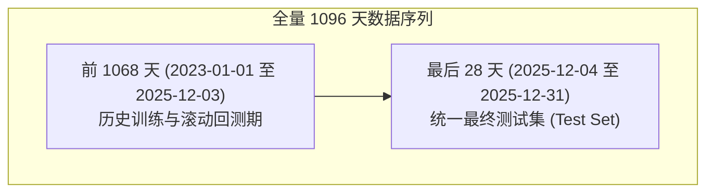
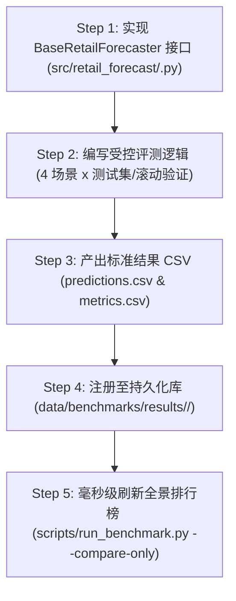

# 零售需求预测基准评测：新模型接入与设计规范 (New Model Onboarding Protocol)

> **版本**：v2.0 (Extensible Benchmark Architecture)  
> **适用对象**：人类算法研发工程师、开源贡献者，以及负责代码拓展的 AI Coding Agents。  
> **核心目标**：指导如何在不重复计算已有模型的前提下，独立增加新的时间序列预测模型（如 Chronos、MOIRAI、TiDE、PatchTST、DLinear 等），并一键并入全景基准排行榜。

---

## 一、 为什么设计四大场景？（地基与业务锚点）

本项目最重要的学术与工程贡献，并非简单的调参，而是**抽象并严密实现了四个具有行业典型挑战的墨尔本零售场景**（位于 `data/teaching/`，由 `notebooks/00-generate-teaching-data.ipynb` 确定性生成）。

任何新模型接入时，必须经受这四种不同“需求形态”的检验：

| 场景代码 | 场景名称 | 需求机制与统计特性 | 核心检验挑战 |
| :--- | :--- | :--- | :--- |
| **`grocery`** | 商超日用杂货 | 高频连续消费、均值 ~109.5、明显周周期、**含 24 个缺货截断日（销量被强行压制至 20 件）** 及 Good Friday / Christmas 闭店 | **缺货删失（Stockout Censoring）去偏能力** 与 80% 预测区间覆盖度。 |
| **`wine`** | 红酒促销 | 泊松计数脉冲、均值 ~10.4、$\widehat{\mathrm{ADI}}=1.013$、强外部成箱促销（`promo_case_buy`）、大型派对与 12 月年末高峰 | **短时脉冲捕获** 与非线性外生协变量吸收能力。 |
| **`garden`** | 庭院耗材 | 强冬夏正弦年季节性（跨度极长）、均值 ~64.9、周末效应、澳洲长周末 DIY 活动与秋末清仓 | **跨年长周期先验** 与日历事件叠加效应。 |
| **`luxury`** | 奢侈品手袋 | **极端稀疏间歇需求**（零值率高达 **93.58%**，$\widehat{\mathrm{ADI}}=15.571$）、高单价、VIP 专场活动 | **零膨胀分布（Zero-Inflated）** 与避免全零死锁的概率校准能力。 |

---

## 二、 受控实验切分协议（不可跨越的红线）

为了保证所有模型在完全相同的起跑线上公平对比，所有模型必须遵循 **`retail-benchmark-v2`** 协议：



### 1. 时间不可变性与信息边界
- **测试期**：严格限定为最后的 **28 个日历日**（`2025-12-04` 至 `2025-12-31`）。
- **已知未来协变量（Known Future Covariates）**：日历特征（星期、月份）、VIC 公共假日（`vic_holidays`）、计划内促销（`discount`, `promo_case_buy`）在预测期**已知**。
- **严禁未来目标穿越（No Data Leakage）**：预测期内的 `y`（真实销量）在推理时对模型必须为不可见（通过 `valid_labels` 掩码隔离）。

---

## 三、 新模型接入的 5 步标准操作规程 (SOP)



### Step 1: 遵循统一接口抽象
在 `src/retail_forecast/<model_key>.py` 中编写模型封装，继承 `BaseRetailForecaster`：

```python
from retail_forecast.benchmark_registry import BaseRetailForecaster, ForecastOutput
import pandas as pd

class MyNewForecaster(BaseRetailForecaster):
    def __init__(self):
        super().__init__(name="MyNewModel", family="foundation_model")

    def fit(self, history: pd.DataFrame, scenario: str) -> None:
        # 在此处执行模型拟合或加载预训练权重
        pass

    def predict(self, future: pd.DataFrame, scenario: str) -> ForecastOutput:
        # 返回标准的 ForecastOutput 对象
        # point_forecast: 必填 1D array
        # q10, q90: 可选 80% 预测区间
        # latency_ms: 推理耗时 (毫秒)
        return ForecastOutput(
            point_forecast=predictions,
            q10=q10_band,
            q90=q90_band,
            latency_ms=elapsed_ms
        )
```

### Step 2 & 3: 运行评测并导出标准契约
每个模型独立运行后，生成以下两张轻量级 CSV（每个模型仅 ~100 KB，彻底消除重复重训）：

1. **`predictions.csv`**（点预测与分位数）：
   | scenario | model | split | forecast_origin | ds | y | prediction | q10 | q90 |
   | :--- | :--- | :--- | :--- | :--- | :--- | :--- | :--- | :--- |
   | `grocery` | `MyNewModel` | `test` | `2025-12-03` | `2025-12-04` | 114.0 | 116.5 | 108.2 | 125.1 |

2. **`metrics.csv`**（统一量化指标）：
   | scenario | model | split | forecast_origin | MAE | RMSE | WAPE | Bias | Coverage80 | latency_ms | n |
   | :--- | :--- | :--- | :--- | :--- | :--- | :--- | :--- | :--- | :--- | :--- |
   | `grocery` | `MyNewModel` | `test` | `2025-12-03` | 4.85 | 6.12 | 0.049 | -0.012 | 0.821 | 45.0 | 27 |

### Step 4: 保存至持久化基准库
调用框架提供的标准持久化函数：

```python
from retail_forecast.benchmark_registry import save_benchmark_results

save_benchmark_results(
    model_key="my_new_model",
    predictions_df=predictions_df,
    metrics_df=metrics_df,
    manifest_meta={
        "model_name": "MyNewModel",
        "parameters": 300_000_000,
        "device": "cuda:0"
    }
)
```
该函数会自动写入：`data/benchmarks/results/my_new_model/`。

### Step 5: 并入全局横向排行榜与交叉比对
运行聚合脚本，**无需重跑任何其他模型**，毫秒级将新模型纳入综合排行榜与对比图：

```bash
# 仅重新聚合已有的所有模型结果
uv run python scripts/run_benchmark.py --compare-only
```
生成的全景横向榜单将保存在 `data/benchmarks/summary/global_leaderboard.csv`。

---

## 四、 独立重复实验操作指南 (Granular CLI)

在日常实验中，**严禁为了微调某个参数而整体重跑全库**。利用统一运行入口执行按需重跑：

```bash
# 1. 查看当前所有已支持独立重跑的模型以及已持久化的离线模型
uv run python scripts/run_benchmark.py --list

# 2. 独立重跑某个模型（例如仅优化 LightGBM）
uv run python scripts/run_benchmark.py --models lightgbm

# 3. 选择几个模型组合实验（如 Prophet 与 TimesFM）
uv run python scripts/run_benchmark.py --models prophet,timesfm

# 4. 毫秒级刷新多模型全景榜单（零重跑）
uv run python scripts/run_benchmark.py --compare-only
```

---

## 五、 配套交付标准检查清单 (Checklist)

新模型如果要作为正式篇章合入主线，需提交以下三件套：
- [ ] **核心算法实现**：`src/retail_forecast/<model>.py`；
- [ ] **交互式教学 Notebook**：`notebooks/3X-<model>-tutorial.ipynb`（单元格 `outputs` 必须为 `[]`，`execution_count` 必须为 `null`）；
- [ ] **持久化基准结果**：`data/benchmarks/results/<model>/`；
- [ ] **回归测试保证**：`.venv/bin/python -m unittest discover -s tests -v` 全绿。

