# 交互式实验与教学 Notebook 导航索引

> 本目录存放零售需求预测项目的 Jupyter Notebook。编号严格对齐仓库三阶段开发生命周期：
> - **阶段一（`1X`）**：数据底座生成入口
> - **阶段二（`2X`）**：单模型探索沙盒与深度剖析教程
> - **阶段三（`3X`）**：统一评测辅助对比与历史存档

---

## 目录分层与生命周期映射

```mermaid
flowchart TD
    subgraph S1["阶段一：数据生成 (Stage 1) [1X]"]
        N10["10-generate-teaching-data.ipynb"]
        D1["data/teaching/ (4大零售挑战场景)"]
        N10 --> D1
    end

    subgraph S2["阶段二：单模型探索与教学实践 (Stage 2) [2X]"]
        direction TB
        N20["20/21 Prophet 专项"] <--> A20["docs/articles/prophet-*.md"]
        N22["22 ARIMA 经典统计"] <--> A22["docs/articles/arima-*.md"]
        N23["23a~e 树模型家族"] <--> A23["docs/articles/lightgbm-xgboost-*.md"]
        N24["24a~c 深度时序模型"] <--> A24["docs/articles/neural-*.md"]
        N25["25 AutoGluon AutoML"]
        N26["26 TimesFM 基础模型"] <--> A26["docs/articles/timesfm-*.md"]
    end

    subgraph S3["阶段三：统一评测辅助对比 (Stage 3) [3X]"]
        direction TB
        N30["30 五模型初探对照"]
        N31["31 树模型横向对照"]
        N32["32 神经网络对照"]
        N33["33 全模型滚动评测"]
        R1["docs/reports/ (正式 V4 评测报告)"]
        L1["scripts/run_benchmark.py (CLI 执行器)"]
        N33 -.-> R1
        L1 --> R1
    end
```

---

## 全量 Notebook 索引与成果映射表

| 编号 | Notebook 文件 | 生命周期归属 | 核心目标与技术内容 | 配套技术长文 (Stage 2 Article) | 统一基准报告 (Stage 3 Report) |
| :--- | :--- | :---: | :--- | :--- | :--- |
| **10** | [10-generate-teaching-data.ipynb](10-generate-teaching-data.ipynb) | **阶段一** 数据生成 | 确定性生成 5 年墨尔本 4 场景数据、VIC 假日与 BigQuery Schema | — | — |
| **20** | [20-prophet-tutorial.ipynb](20-prophet-tutorial.ipynb) | **阶段二** 单模型探索 | Prophet 可加分解、假日与促销回归项、缺货去偏、参数消融实验 | [Prophet 教程](../docs/articles/prophet-retail-demand-forecast.md) | [V4 报告](../docs/reports/2026-retail-week-v4-first-stage-report.md) |
| **21** | [21-prophet-luxury-diagnosis.ipynb](21-prophet-luxury-diagnosis.ipynb) | **阶段二** 单模型探索 | 检验连续平滑的 Prophet 在 94% 极高零值奢侈品场景下的失效边界 | [Prophet 教程](../docs/articles/prophet-retail-demand-forecast.md) | [V4 报告](../docs/reports/2026-retail-week-v4-first-stage-report.md) |
| **22** | [22-arima-tutorial.ipynb](22-arima-tutorial.ipynb) | **阶段二** 单模型探索 | auto_arima、动态回归、傅里叶年周期阶数敏感度与差分新息诊断 | [ARIMA 教程](../docs/articles/arima-retail-demand-forecast.md) | [V4 报告](../docs/reports/2026-retail-week-v4-first-stage-report.md) |
| **23a** | [23a-decision-tree-tutorial.ipynb](23a-decision-tree-tutorial.ipynb) | **阶段二** 单模型探索 | 决策树单树拟合、最大深度剪枝与时序特征重要性增益分析 | [树模型教程](../docs/articles/lightgbm-xgboost-retail-demand-forecast.md) | [V4 报告](../docs/reports/2026-retail-week-v4-first-stage-report.md) |
| **23b** | [23b-random-forest-tutorial.ipynb](23b-random-forest-tutorial.ipynb) | **阶段二** 单模型探索 | 随机森林 Bagging 方差缩减、袋外误差检验与特征扰动评估 | [树模型教程](../docs/articles/lightgbm-xgboost-retail-demand-forecast.md) | [V4 报告](../docs/reports/2026-retail-week-v4-first-stage-report.md) |
| **23c** | [23c-lightgbm-tutorial.ipynb](23c-lightgbm-tutorial.ipynb) | **阶段二** 单模型探索 | LightGBM 直方图加速、时序滞后特征、稀疏节假日分裂增益优化 | [树模型教程](../docs/articles/lightgbm-xgboost-retail-demand-forecast.md) | [V4 报告](../docs/reports/2026-retail-week-v4-first-stage-report.md) |
| **23d** | [23d-xgboost-tutorial.ipynb](23d-xgboost-tutorial.ipynb) | **阶段二** 单模型探索 | XGBoost 二阶泰勒展开目标、列采样与正则化收缩参数对比 | [树模型教程](../docs/articles/lightgbm-xgboost-retail-demand-forecast.md) | [V4 报告](../docs/reports/2026-retail-week-v4-first-stage-report.md) |
| **23e** | [23e-catboost-tutorial.ipynb](23e-catboost-tutorial.ipynb) | **阶段二** 单模型探索 | CatBoost 对称树结构、排序提升抗过拟合与类别特征编码 | [树模型教程](../docs/articles/lightgbm-xgboost-retail-demand-forecast.md) | [V4 报告](../docs/reports/2026-retail-week-v4-first-stage-report.md) |
| **24a** | [24a-mlp-tutorial.ipynb](24a-mlp-tutorial.ipynb) | **阶段二** 单模型探索 | 多层感知机特征展平、Dropout、BatchNorm 与全连接层容量实验 | [神经网络教程](../docs/articles/neural-retail-demand-forecast.md) | [V4 报告](../docs/reports/2026-retail-week-v4-first-stage-report.md) |
| **24b** | [24b-lstm-tutorial.ipynb](24b-lstm-tutorial.ipynb) | **阶段二** 单模型探索 | 循环神经网络循环门控、长序列依赖捕捉与隐藏状态传递 | [神经网络教程](../docs/articles/neural-retail-demand-forecast.md) | [V4 报告](../docs/reports/2026-retail-week-v4-first-stage-report.md) |
| **24c** | [24c-tft-tutorial.ipynb](24c-tft-tutorial.ipynb) | **阶段二** 单模型探索 | Temporal Fusion Transformer 可变选择网络 (VSN) 与多头自注意力机制 | [神经网络教程](../docs/articles/neural-retail-demand-forecast.md) | [V4 报告](../docs/reports/2026-retail-week-v4-first-stage-report.md) |
| **25** | [25-autogluon-tutorial.ipynb](25-autogluon-tutorial.ipynb) | **阶段二** 单模型探索 | AutoGluon-TimeSeries 自动化模型库、加权集成与多层堆叠实验 | — | [AutoGluon 评测](../docs/reports/archive/2026-10-20-autogluon-comparison-report.md) |
| **26** | [26-timesfm-tutorial.ipynb](26-timesfm-tutorial.ipynb) | **阶段二** 单模型探索 (历史) | 历史 BigQuery 单切片教程；当前 TimesFM 3.0 评测结论以 V4 文章为准 | [TimesFM 3.0 文章](../docs/articles/timesfm-retail-demand-forecast.md) | [TimesFM 验证报告](../docs/reports/archive/2026-11-03-timesfm-validation-report.md) |
| **30** | [30-benchmark-five-models.ipynb](30-benchmark-five-models.ipynb) | **阶段三** 辅助对比 (历史) | Seasonal Naive、Prophet、SARIMAX、LightGBM 与 TFT 五类模型初步对照 | — | [历史基准归档](../docs/reports/archive/) |
| **31** | [31-benchmark-tree-models.ipynb](31-benchmark-tree-models.ipynb) | **阶段三** 辅助对比 | Decision Tree、RF、LightGBM、XGBoost、CatBoost 树模型家族系统对照 | [树模型教程](../docs/articles/lightgbm-xgboost-retail-demand-forecast.md) | [V4 报告](../docs/reports/2026-retail-week-v4-first-stage-report.md) |
| **32** | [32-benchmark-neural-models.ipynb](32-benchmark-neural-models.ipynb) | **阶段三** 辅助对比 | MLP、LSTM、TFT 在 4 场景上的拟合收敛性与样本复杂度对比 | [神经网络教程](../docs/articles/neural-retail-demand-forecast.md) | [V4 报告](../docs/reports/2026-retail-week-v4-first-stage-report.md) |
| **33** | [33-benchmark-all-models.ipynb](33-benchmark-all-models.ipynb) | **阶段三** 辅助对比 | 10 种核心模型在统一滚动验证与测试口径下的全量横向对照与可视化分析 | — | [V4 报告](../docs/reports/2026-retail-week-v4-first-stage-report.md) |

---

## 开发者与 Agent 协作原则

1. **Notebook 纯净性规则 (Rule 2)**：
   提交任何 `.ipynb` 文件前，**必须清空所有执行输出与单元格执行计数**（即 `"outputs": []` 且 `"execution_count": null`）。测试套件 `tests/test_repository_layout.py` 会严格执行断言校验。
2. **严防未来信息泄漏 (Rule 4)**：
   在单模型探索 Notebook 中，所有滚动验证的切片必须遵循时间前向因果律；测试期内的未来目标值 `y` 和诊断真实值列（`conditional_mean`, `latent_demand`）在推理时刻必须保持不可见。
3. **文章同步义务 (Rule 6)**：
   若对阶段二单模型 Notebook 进行了数据长度、特征工程或参数更新，请务必同步更新对应的 `docs/articles/` 教程长文中的时间定义、样本统计、指标表格与可视化图表。
